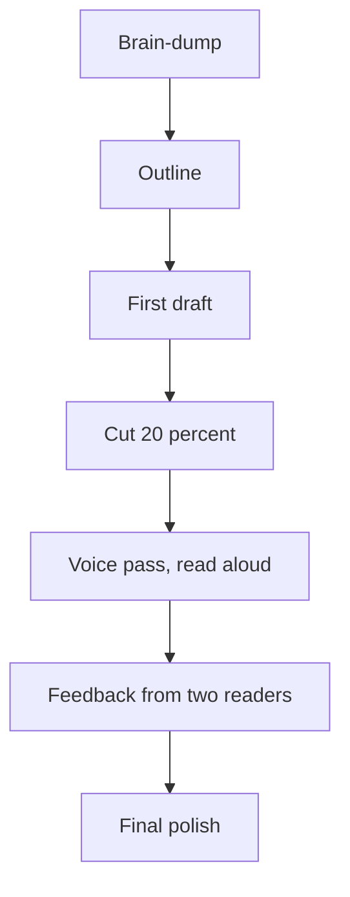

# Writing Essays That Sound Like You

Essays are where a committee meets a person rather than a score. A good essay doesn't try to impress. It makes the reader think, "I'd like to hear more from her." This lesson shows you how to build that, step by step.

> [!NOTE]
> Essay prompts change every cycle. What we know from the research: ISB has asked for three compulsory essays and one optional for first-time applicants (reapplicants have an extra compulsory one). INSEAD uses three essays plus job-description answers and a video interview. LBS MiM asks about your motivations, leadership and teamwork, why this degree, and your contribution. Always read the current prompts on the school's own site.

## The four essay families

Almost every prompt falls into one of four families.

| Family | The real question | Typical length |
|---|---|---|
| Goals | What do you want to do, and why does this degree get you there? | 300-600 words |
| Why this school | What's specific about this place that fits you? | 200-500 words |
| Leadership or challenge | Tell me about a time you led, failed or changed | 300-500 words |
| Personality / free | Who are you beyond your resume? | 200-500 words |

Know which family you're in before you write. Many applicants answer the question they wish was asked.

## Goals essays

### The structure

1. **Where I am:** one or two sentences, with proof of impact.
2. **Short-term goal:** the first role after the programme, in a named industry and function.
3. **Long-term goal:** the bigger vision, five to ten years out.
4. **The gap:** what you can't get from your current job.
5. **The bridge:** how this specific programme fills the gap.

### Short-term goals

Be concrete. "Brand strategy manager at a global consumer goods company in Europe" is better than "a leadership role in marketing." Name two or three target companies if the school asks.

### Long-term goals

This is your ambition, but keep it believable. A reader should think, "Yes, her short-term path could lead there."

> [!TRAP]
> Two common errors: goals that are too vague ("make an impact in business") and goals that are too different from your past with no bridge ("I'll move from marketing to quantitative finance"). If you're switching, show a logical step.

## Why this school (or why this programme)

Generic praise ("world-class faculty, great network") is the weakest thing you can write. Instead:

- Name two or three specific courses, clubs or projects.
- Mention a person you spoke to: a current student, an alumna, a faculty member from an info session.
- Say what you'd contribute, not only what you'd take.
- Show you understand the school's culture. For instance, ISB's one-year intensity, INSEAD's international mix, or SPJIMR's focus on values and social impact.

> [!TIP]
> Attend at least one info session per school, and write one line in your notes about something that surprised you. That line often becomes the strongest sentence in your essay.

## Leadership and challenge stories: the STAR method

STAR stands for Situation, Task, Action, Result. It keeps a story clear and prevents you from rambling.

| Part | What to write | Share of words |
|---|---|---|
| Situation | The context in two or three sentences | 15% |
| Task | What you were responsible for and why it was hard | 15% |
| Action | What you did, step by step, in your own voice | 45% |
| Result | What changed, with a number, plus what you learned | 25% |

### Choosing the story

Choose a story that shows a quality, not an event. Ask: "What does this say about me?" If the answer is "I'm hard-working", try a different story. Better qualities: you listen, you persuade, you recover from setbacks, you push for quality when it's inconvenient.

### Action is the heart

Most weak essays spend too long on situation and too little on action. Write "I" more than "we". It's fine to credit the team; the committee wants to know what you did.

> [!REMEMBER]
> A challenge essay isn't a confession. It shows how you respond to difficulty. A failure story works when you name your own part in it, show a real change in behaviour, and show a later situation where you used that learning.

## Worked example: a STAR paragraph

Prompt: Describe a time you led without authority.

Show an example

**Situation:** "Our team's monthly campaign reports were late, and nobody owned fixing it."

**Task:** "I wasn't the manager, but I was the one who spent each Friday chasing numbers."

**Action:** "I mapped who owned each data source, built a shared tracker, and set a five-minute Thursday check-in. When two colleagues pushed back, I showed them how the delay was costing us a day of analysis every month."

**Result:** "Reports now arrive two days earlier. My manager asked me to teach the process to the other teams. I learned that people follow a process they helped design."

Why it works: it's specific, the action is hers, there's a number (two days), and the lesson shows self-awareness.

Trap: making the result too grand. Smaller, true results are more persuasive.

## The drafting process

Don't start by writing the essay. Follow this order.

1. **Brain-dump (30 minutes).** Write everything you'd say to a friend about why you want this. Don't edit.
2. **Outline (20 minutes).** Put each point under a heading from the structure above.
3. **First draft (60 minutes).** Write fast, without rereading. It'll be messy.
4. **Cut (30 minutes).** Remove 20% of the words. Remove every sentence that could be in anyone's essay.
5. **Voice pass (20 minutes).** Read aloud. Replace formal words with the ones you'd say. Contractions are fine unless the school asks for a formal tone.
6. **Feedback.** Give it to two readers: one who knows you well, and one who doesn't. Ask the second what they remember about you.
7. **Final polish.** Spelling, names of the school, word count.

The drafting process, in order.

> [!TIP]
> Write all essays in a separate document first, not in the application portal, which may time out or lose your text. Paste in only at the end.

## Timeline for ISB-style applications

If you aim for a Round 1 or Round 2 deadline in autumn 2027:

| When | Action |
|---|---|
| June to July 2027 | Brain-dump stories; collect one story for each family |
| August 2027 (after GMAT) | Draft goals essay and why-school essay |
| 6 to 8 weeks before deadline | Draft the other essays; brief recommenders |
| 3 weeks before deadline | Second drafts, feedback round |
| 1 week before | Final polish; submit a few days early |

## Optional essays

ISB has offered an optional essay. Use it only to explain something that needs explaining: a gap, a low grade, an unusual career move. Don't use it to repeat your story. If nothing needs explaining, skip it.

## Common mistakes

- Starting with a quote or a life-changing moment as a cliché.
- Repeating your resume.
- Listing adjectives instead of showing evidence ("I'm passionate, driven and creative").
- Writing about everything, deeply about nothing.
- Using the same essay for every school without editing the name or details.
- Over-polishing until you sound like everyone else.
- Ignoring the word limit.

## Essay checklist

Before you submit, tick each one.

- [ ] I answered the question that was actually asked.
- [ ] The first two sentences make the reader want to continue.
- [ ] Every paragraph has one clear point.
- [ ] There's at least one specific, vivid detail per story.
- [ ] I used "I", and credited others where it's true.
- [ ] My goals are specific and believable.
- [ ] My "why this school" could not be copied to another school.
- [ ] Numbers are true and defensible.
- [ ] I read it aloud and it sounds like me.
- [ ] Someone else proofread it.
- [ ] It's within the word limit.
- [ ] The school's name is correct throughout.

## A note on AI tools and originality

Schools expect your essays to be your own work. Using a tool to brainstorm or check grammar is one thing. Having a tool write your story is another, and it tends to read as generic anyway. Check each school's policy and keep your voice at the centre.

## Quick check
1. What does STAR stand for?

Answer
Situation, Task, Action, Result.

2. Which part of a STAR story should get the most words?

Answer
Action, around 45% of the story.

3. What's the weakest kind of "why this school" sentence?

Answer
Generic praise that could apply to any school, such as "world-class faculty".

## Key takeaways
- Know the essay family first: goals, why this school, leadership or challenge, or personality.
- A strong goals essay has a clear short-term role, a believable long-term vision, a gap, and a bridge.
- "Why this school" needs specific courses, people and cultural points, not praise.
- Use STAR for stories, and spend the most words on what you did.
- Draft in stages: brain-dump, outline, fast draft, cut, voice pass, feedback.
- Use the optional essay only for something that needs explaining.
- Check the current prompts and word limits on the school's own site.

## Go deeper
- [ISB](https://www.isb.edu/): current essay prompts and the Admissions Director's blog.
- [London Business School](https://www.london.edu/): MiM application essay guidance.
- [INSEAD](https://www.insead.edu/): application structure and essay questions.
- [HEC Paris](https://www.hec.edu/): MiM application requirements.
