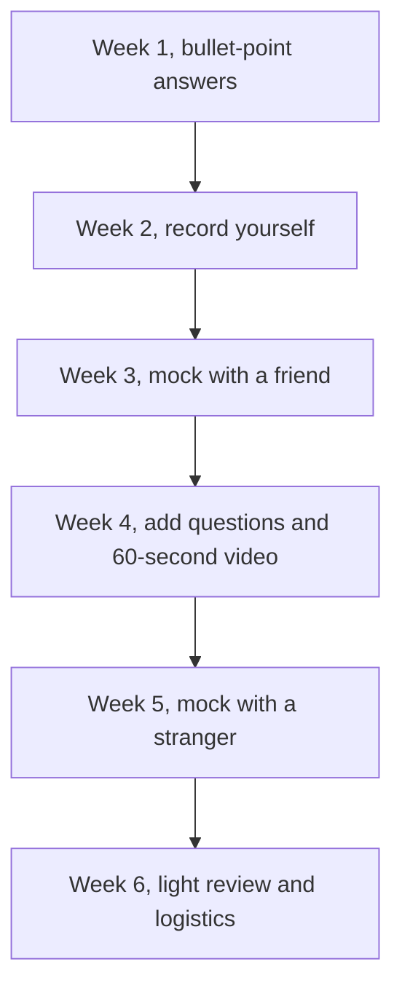

# Interviews and Video Essays

An invitation to interview means the committee already thinks you could belong. Now they want to meet the person behind the file. This lesson covers the formats you're likely to face, how to structure answers, and how to practise without sounding scripted.

> [!NOTE]
> Interview formats change. What we know from the research: ISB interviews every shortlisted candidate, with no group discussion, and doesn't publish the length or format. IIM Calcutta's PGPEX uses a written test plus a personal interview weighted at 30%. INSEAD uses a video interview (Kira) plus interviews with two alumni. LBS MiM uses a virtual interview with alumni or the admissions team, and a Kira video interview only for waitlisted candidates. Kellogg MiM uses video essays and an interview by invitation (third-party). Always check the current process.

## The formats

| Format | What it feels like | How to prepare |
|---|---|---|
| ISB-style personal interview | A conversation with an admissions member or alum, often remote for overseas candidates | Know your story; practise STAR answers; be ready for follow-ups on your essays |
| IIM-style panel interview | Two or three people, sometimes probing your work, current affairs and hobbies | Read news; revisit your resume; practise thinking aloud |
| MiM interviews | Often with alumni or admissions staff, focused on motivation and fit | Know the programme and the city; have clear reasons |
| Video essays (Kira-style) | You see a question on screen, get a short prep time, then record an answer | Practise short, structured answers on camera |

### Kira-style video interviews

From INSEAD's published process: a video interview within 48 hours of being invited, with four video questions (45 seconds to prepare, 60 seconds to answer) and one written question (five minutes). Other schools use similar tools.

> [!TIP]
> In a timed video, structure beats polish. Use a simple pattern: one-sentence answer, one example, one lesson. Practise saying it in 60 seconds with a phone timer.

## The universal answer shape

Most questions can be answered with a three-part structure.

1. **Answer:** say your main point in one sentence.
2. **Evidence:** give one specific example.
3. **Link:** close by tying it to the programme or your goals.

For behavioural questions ("Tell me about a time..."), use STAR: Situation, Task, Action, Result.

> [!REMEMBER]
> Pause before you answer. Two seconds of silence feels long to you and normal to the interviewer. It beats a rushed ramble.

## The 25 most common questions, and how to answer them

Group 1: Your story

1. **Walk me through your resume.** Give a two-minute story with a clear thread: education, what you've learned at work, and why you're here. Don't recite dates.
2. **Tell me about yourself.** Same shape as above, but add a line about who you are outside work.
3. **Why an MBA / MiM / PGP now?** Name a specific gap that work can't fill, and why the timing makes sense for you.
4. **Why this programme and this school?** Two specific features, one person you spoke to, one thing you'd contribute.
5. **What are your short-term and long-term goals?** Use your essay structure. Be concrete about the first role.
6. **Why not just continue at work or switch jobs?** Show you've considered alternatives and that this path is faster or deeper.
7. **What if you don't get in?** Say you'd reapply or choose another route, and show you have a plan. Don't sound desperate or indifferent.

Group 2: Your work

8. **What's your biggest professional achievement?** STAR with a number, and say what *you* did.
9. **Tell me about a failure.** Choose a real one. Say what you learned and how you've applied it.
10. **Describe a time you led without authority.** STAR, emphasise persuasion and influence.
11. **Tell me about a conflict at work.** Show that you listen and look for common ground.
12. **How do you handle pressure and deadlines?** Give an example of prioritising under real constraints.
13. **What feedback have you received, and what did you do with it?** Name something real and show a change.
14. **Explain your role to someone outside marketing.** Tests clarity. Use plain words and an analogy.
15. **How do you use data in your work?** Give a specific metric and a decision it changed.

Group 3: Character and fit

16. **What are your strengths?** Pick two, with an example each.
17. **What are your weaknesses?** Choose a real but non-fatal one, and show what you're doing about it.
18. **What do you do outside work?** Be genuine. Be ready to talk in depth.
19. **Describe a time you helped someone else succeed.** Shows teamwork and generosity.
20. **What would your friends or colleagues say about you?** Choose qualities with proof.
21. **What do you hope to contribute to the class?** Name a skill, a perspective or a project.

Group 4: Thinking and awareness

22. **What's a recent business story you followed?** Pick something in your field, give a view, and say what surprised you.
23. **Why marketing, and where is it heading?** Show you understand the shift towards data, AI-assisted content, and customer experience, without sounding like a buzzword list.
24. **Tell me about a decision you made with incomplete information.** Shows judgment.
25. **Do you have any questions for us?** Always have two. Ask about something you can't find online, such as how students work together, or what surprised the interviewer most about the programme.

> [!TRAP]
> Don't ask questions you could answer by reading the website. Don't ask about salary, and don't ask "what are my chances?".

## Handling tough moments

- **You blank on a question.** Say "Let me think for a moment." Then answer.
- **You don't know.** Say so, then explain how you'd find out or reason it through.
- **A follow-up challenges you.** Don't get defensive. Say, "That's a fair point. Here's how I'd think about it."
- **Technical problems on video.** Stay calm, tell the interviewer, and reconnect. They've seen it before.

## Practice plan

You'll practise in layers. Start four to six weeks before your first likely interview.

| Week | Activity |
|---|---|
| 1 | Write bullet-point answers to questions 1 to 10; no scripts |
| 2 | Record yourself answering them on your phone; watch for filler words and pace |
| 3 | Do a mock interview with a friend or colleague; ask for specific feedback |
| 4 | Add questions 11 to 25; practise the 60-second video format |
| 5 | Mock interview with someone who doesn't know you well; practise Q&A on your essays |
| 6 | Light review; sleep; prepare logistics |

Your six-week interview practice runs like this.

### What to do on the day

- Test your camera, microphone and internet an hour before.
- Choose a quiet, well-lit place with a neutral background.
- Have your resume and two questions for them nearby.
- Dress as you would for a good work meeting.
- Smile, speak a little slower than normal, and look at the camera, not your face on the screen.
- Send a short thank-you note within a day.

## Worked example: answering "Why now?"

Show a sample answer

"I've spent two years in marketing and I'm good at running campaigns and reading results. What I can't do yet is decide where a company should invest, because I haven't worked on pricing, operations or finance. (Answer.)

Last quarter I proposed a new segment to my director, and I couldn't explain the financial case beyond the campaign numbers. That made me realise that to move from execution to strategy I need a structured grounding in how decisions are made. (Evidence.)

This programme gives me that in one intense year, and the timing works because I have enough experience to contribute to class discussion, but I'm early enough to change direction. (Link.)"

Length: about 45 seconds spoken. Trap: sounding rehearsed. Practise the points, not the exact words.

## Quick check
1. What are the three parts of the universal answer shape?

Answer
Answer, evidence, link.

2. How long do you typically get to answer each video question in INSEAD's process?

Answer
45 seconds to prepare and 60 seconds to answer.

3. Should you ask the interviewer about your chances?

Answer
No. Ask about something real you can't find online.

## Key takeaways
- ISB interviews every shortlisted candidate with no group discussion; check each school's current format.
- Use answer, evidence, link for most questions, and STAR for behavioural ones.
- Prepare 25 core questions, grouped by your story, your work, your character and your awareness.
- Practise in layers: notes, recording, a friend, a stranger.
- For video essays, structure and timing matter more than polish.
- Always prepare two thoughtful questions for the interviewer.

## Go deeper
- [ISB](https://www.isb.edu/): FAQs on the interview process.
- [INSEAD](https://www.insead.edu/): the video and alumni interview process.
- [London Business School](https://www.london.edu/): MiM interview guidance.
- [Kellogg School of Management](https://www.kellogg.northwestern.edu/): MiM and video essay information.
