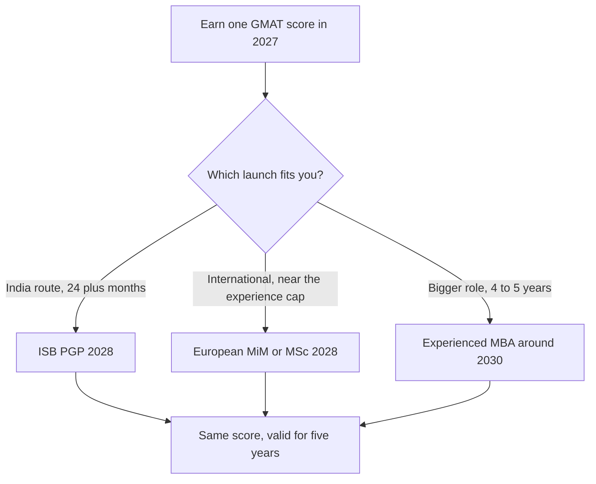

# From GMAT to Admit: Your Roadmap

The GMAT is one piece of a bigger puzzle. Before you spend a single weekend on quant, it helps to know what you're studying for: which degree, which schools, which year. This lesson gives you the map, so every hour of prep points at a real destination.

> [!NOTE]
> Everything about schools in this module is indicative. Deadlines, fees and eligibility rules change every cycle. Treat the numbers here as a way to plan, and always confirm on the school's official website before you act. Where we flag "confirm", we mean it.

## Four kinds of programme, and what each one is for

People say "MBA" for everything. They're not the same product. Here's the honest breakdown.

| Type | Typical experience | Length | What it's for |
|---|---|---|---|
| Full-time MBA (INSEAD, LBS, HBS, Wharton) | 4-6 years on average | 10 months to 2 years | Switching or accelerating into senior roles |
| One-year PGP in India (ISB) | 2+ years minimum, about 4 on average | 1 year | Strong India network, fast career step-up |
| Masters in Management, "MiM" (LBS, HEC, ESSEC, Kellogg) | 0-2 years | 1-2 years | Starting a management career early |
| Specialised Masters (e.g. Imperial MSc Strategic Marketing) | 0-3 years, sometimes more case by case | 1 year | Going deep in one function, like marketing |

The most important column is the middle one. Programmes are built around a typical classmate. A MiM is designed for someone with almost no experience. A full-time MBA is designed for someone who has run teams. You want to land where your profile looks normal, or slightly strong, not out of place.

## Where you stand today

You graduated from Jesus and Mary College (Delhi University) and have been working in marketing since late 2025. By the time you apply, you'll have roughly:

- About 22 months of experience in September 2027.
- About 2 years and 4 months by 31 March 2028.
- About 3 years by late 2028.

That puts you in an interesting spot. Too experienced for some pre-experience programmes. Not experienced enough for most classic MBAs. The good news is that two or three years is exactly the sweet spot for several excellent options, and you have time to build a profile that makes you look ahead of your years.

> [!REMEMBER]
> Your experience clock matters more than most people realise. Many schools count full-time work only, and many count it "as of" a fixed date, like 31 March. Always check how each school counts, and what date it uses.

## Three realistic paths for you

### Path 1: ISB PGP for the 2028 intake (the India route)

The ISB Post Graduate Programme in Management asks for 24+ months of full-time experience as of 31 March (the exact reference year is something to confirm on isb.edu). Based on your timeline, you'd very likely meet that for the 2028-29 programme. ISB says it has no minimum GMAT score. Its Class of 2026 had a GMAT mean of 683 with a middle-80% range of 635 to 730 (the page doesn't say whether that mixes Classic and Focus scores, so read it as a rough guide), 47% women, and about four years of average experience.

Notice that last number. Your 2.3 years would sit below the class average. That's fine and common, since classes include a range, but it means your story and your impact need to be sharp.

### Path 2: A European MiM or marketing Masters for 2028

LBS MiM, Imperial MSc Management, and Kellogg MiM all state that they're for people with no more than about two years of experience. Imperial MSc Strategic Marketing is explicitly more flexible: people with more than three years can be considered case by case. HEC, ESSEC and ESCP MiMs are pre-experience programmes too.

This path is time-sensitive. You'll be right at the edge of the experience cap. Applying in an early round in autumn 2027, and counting your months carefully, could be the difference. We'll go through this in the global programmes lesson.

### Path 3: An experienced MBA later (around 2030)

IIM Ahmedabad's PGPX and IIM Lucknow's IPMX look for about four years of experience. IIM Bangalore and Calcutta want five. INSEAD and LBS MBA typically see 4 to 6 years. If your long-term goal is one of these, you'd apply around 2030-2031, with a stronger track record and a bigger story to tell.

Here's the part that connects everything: **a GMAT score is valid for five years.** If you sit the exam in 2027 and score well, that score can still be used for applications in 2031. So the GMAT you're preparing for now keeps its value across all three paths.

One GMAT score can launch any of your three paths.

> [!TIP]
> Treat 2027 as the year you earn your score. Treat 2028 as the year you try Path 1 or 2. Treat 2030 as your "second shot" if you want a bigger MBA. One test, three possible launches.

## How these paths compare

| | ISB PGP 2028 | European MiM / MSc 2028 | Experienced MBA ~2030 |
|---|---|---|---|
| Your experience at entry | ~2.3 years (edge of eligibility) | ~2 years (edge of cap) | ~4-5 years (comfortable) |
| GMAT needed | Yes, no stated minimum | Often optional or recommended | Yes, usually competitive |
| Cost (indicative) | High, with scholarships possible | High, with fewer India-friendly scholarships | Highest |
| Main risk | Looking light on experience | Being too experienced | Waiting costs time |
| Main upside | Strong India network and placements | International start, early career | Senior-level jump |

You don't have to choose today. You do need to keep each door open. That means two things: build your profile deliberately, and don't miss the dates that quietly close doors.

## Where the GMAT fits

Think of the GMAT as a ticket, not the whole journey. It matters because:

1. Some schools weigh it heavily. IIM Calcutta's PGPEX gives it 25% of selection weight, IIM Lucknow's IPMX gives it 30%.
2. Others use it as one signal among many. ISB says it's holistic and has no cutoff.
3. For scholarships, a strong score helps in nearly every case.

Your plan is to take the GMAT Focus Edition first on Saturday 28 August 2027, with a backup attempt in mid-October 2027. That timing is tight but workable for an ISB Round 1 or Round 2 submission, and for European rounds that close around the turn of the year. Work backwards: you need a score in hand, or at least a booked date, before your essays are done.

> [!TRAP]
> Don't chase a magic number like "685 for ISB". No source we found says ISB wants that. ISB states there's no minimum. Aim for a competitive score for your target list, then put real effort into everything else. A 680 with a sharp story beats a 710 with a flat one.

## What a good roadmap looks like

Here's the sequence, in plain terms:

1. **Now to Mar 2027:** learn the exam, start the profile project at work, make a first school shortlist.
2. **Apr to Aug 2027:** serious GMAT prep, info sessions, recommender conversations.
3. **Aug to Oct 2027:** sit the exam, finish essays, submit early-round applications.
4. **Nov 2027 to Mar 2028:** later rounds, interviews, scholarship applications.
5. **Apr to Jun 2028:** decisions, funding, visas.

The full month-by-month plan lives in the timeline lesson, and your Admissions tracker in the app will remind you of each step.

### Worked example: matching profile to path

Imagine Maria in September 2027. She has 22 months of marketing experience, a GMAT of 685, a campaign she led that grew leads by 40%, and a volunteer role teaching English to school kids on weekends.

Show how she might think about it

First, she checks the hard rules. ISB: 24+ months as of 31 March (she should confirm which year). If the reference is 31 March 2028, she has about 28 months, so she's eligible. If it's 31 March 2027, she'd have about 16 months and would have to wait. That single confirmation changes her plan, so it's the first email or website check.

Second, she looks at the MiM caps. LBS MiM says max two years. Her 22 months fits if she applies in autumn, but by spring she'd be past 2 years. So the early round is better.

Third, she checks fit. Her marketing background points to Imperial MSc Strategic Marketing as a specialised option and ISB as a generalist option. She shortlists both and keeps one MiM as a stretch.

Trap: assuming "about two years" means eligible. Always read the exact counting rule.

## Quick check
1. Why does a five-year GMAT validity matter for Maria?

Answer
A score earned in 2027 can still be used for an experienced MBA application around 2030-2031. The prep isn't wasted if she takes a longer route.

2. Which type of programme is the poorest fit for someone with 2.3 years of experience?

Answer
The IIM one-year executive programmes (PGPX, IPMX, EPGP, PGPEX), which want 4 to 5 years. They're a future option, not a current one.

3. What single fact should you confirm first about ISB eligibility?

Answer
Which year's 31 March is used to count the 24 months of experience. Check isb.edu.

## Key takeaways
- A MiM, a one-year PGP, a full-time MBA and a specialised Masters each suit a different experience level. Pick the one where your profile looks normal.
- Maria has three realistic paths: ISB PGP 2028, a European MiM or marketing Masters 2028, and an experienced MBA around 2030.
- Experience is counted as of a fixed date and usually full-time only. Confirm both for every school.
- A GMAT score lasts five years, so one strong attempt can serve several application cycles.
- ISB has no stated minimum GMAT score. Don't build your plan around a rumoured number.
- Early rounds help in two ways: you're less likely to cross an experience cap, and scholarship money is often more available.

## Go deeper
- [ISB, Indian School of Business](https://www.isb.edu/): official programme, eligibility and deadline pages.
- [London Business School](https://www.london.edu/): MiM and MBA class profiles.
- [HEC Paris](https://www.hec.edu/): MiM admissions details.
- [INSEAD](https://www.insead.edu/): the experienced MBA benchmark.
- [GMAT exam on mba.com](https://www.mba.com/exams/gmat-exam): official exam information.
