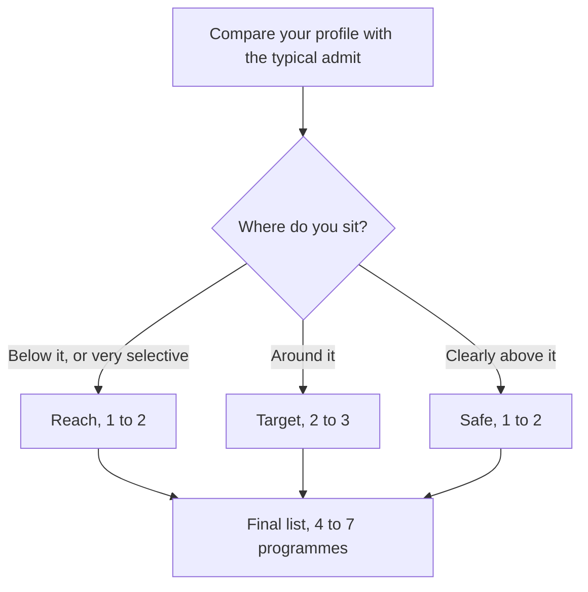

# Building Your School List

A good school list isn't a ranking. It's a set of programmes where you could realistically get in, would actually be happy, and can afford. This lesson gives you a method, then a worksheet to fill in your Admissions tracker.

> [!NOTE]
> Treat any numbers you pull from the web as a starting point. Third-party sites often disagree with each other and with the school. Write down where each number came from, and mark it "confirmed" only when you've seen it on the school's own page.

## Start with the question, not the brand names

Most people begin with "Which schools are famous?" Start instead with three questions:

1. **What do I want to be doing in five years?** Be specific. "Head of brand for a consumer company" is useful. "Something senior" isn't.
2. **Where do I want to live and work?** India, Europe, Singapore, the US. Visa rules and recruiting pipelines differ a lot.
3. **What can I afford, and what return do I need?**

Write one paragraph answering all three. It's the first draft of your goals essay too.

## Reach, target and safe, in plain terms

| Category | Meaning | How many |
|---|---|---|
| Reach | Your profile is below the typical admit, or the school is very selective | 1 to 2 |
| Target | Your profile is around the typical admit | 2 to 3 |
| Safe | Your profile is clearly above the typical admit | 1 to 2 |

Total list: 4 to 7 programmes. More than that and your essays turn generic.

Sort every programme by comparing your profile with its typical admit.

### How to judge "score vs average"

For each programme, compare your GMAT Focus score to the school's published average or range. But be careful:

- Check whether the school's number is Classic or Focus. A Classic 700 is roughly a Focus 645 to 655 according to GMAC's concordance, so don't compare raw numbers across the two scales.
- Ranges beat averages. ISB's Class of 2026 middle 80% was 635 to 730 (scale not stated), which tells you far more than the mean of 683.
- A score below the average isn't disqualifying when the school says it has no minimum, as ISB does. But then other parts of your profile have to carry more weight.

> [!TRAP]
> Don't treat "average GMAT" as a pass mark. An average is the middle of a wide range. Many admits are below it, usually with strong stories, scholarships for diversity, or unusual experience. Equally, a score above average doesn't guarantee anything.

## The five filters

Run each programme through these in order.

### Filter 1: Hard eligibility

Does it accept your experience level and test? Is the experience counted as of a date you can meet?

- ISB PGP: 24+ months as of 31 March (confirm the year).
- LBS MiM, Imperial MSc Management, Kellogg MiM: roughly two-year caps.
- IIM one-year programmes: 4 to 5 years, so they fail this filter today.

If it fails, move it to a "later" list and don't spend more time on it.

### Filter 2: Career fit

Look at the programme's employment report and the sectors graduates enter. Does it place people in the roles you want, in the city you want? Marketing isn't the biggest placement function at every school. For example, sales and marketing was about 9% of the functional mix in a recent IIM Ahmedabad PGPX class, according to a third-party summary. That's a sign to check each school's own numbers.

### Filter 3: Return on investment

A simple version:

**Total cost** (tuition + living + lost salary during the programme) compared to **expected post-programme salary** over the first five years.

You don't need to be exact. You need to know if the loan you take is three years of salary or ten. We'll cover funding in detail in its own lesson.

### Filter 4: Location and life

Where will you live for one to two years? What are the visa rules for working after graduation? Is the climate, language and culture something you'd enjoy or find isolating?

### Filter 5: Money available

Does the school offer scholarships you could realistically win? ISB says about 25% of its students receive support. INSEAD has women's scholarships. Imperial lists Forte Fellowships for women with leadership records. Treat these as chances, not guarantees.

## Your worksheet

Copy this table into the Admissions tracker in the app, one row per programme.

| Field | What to write |
|---|---|
| Programme | Full name |
| Type | MBA, PGP, MiM, MSc |
| Experience rule | Exact wording, with date |
| Your experience on that date | In months |
| Test accepted | GMAT Focus, GRE, others |
| Average / range | Note scale and source |
| Your target score vs average | Above / around / below |
| Tuition + living | Total, in rupees |
| Scholarship options | Names and deadlines |
| Round 1 / Round 2 / Round 3 dates | "Check official deadline" until confirmed |
| Essays required | Count and rough word limits |
| Recommenders required | Number, type |
| Interview type | Alumni, admissions, video |
| Category | Reach / Target / Safe |
| Why I want this one | One honest sentence |
| Status | Researching / Drafting / Submitted / Decision |

> [!TIP]
> Add a column called "Confidence in data". Mark each row "official" or "third-party". It stops you from planning around a rumour.

## Sample list for Maria (illustrative only)

| Programme | Category | Why |
|---|---|---|
| ISB PGP | Target | Eligible, strong India network, no GMAT minimum |
| Imperial MSc Strategic Marketing | Target | Marketing-specific, flexes up to 3 years case by case |
| LBS MiM | Reach | Brand, but she's at the edge of the experience cap |
| HEC Paris MiM | Target | Accepts Focus; strong France and Europe network |
| SPJIMR PGDM | Safe or target | No experience minimum, accepts GMAT |
| NUS MBA | Reach | 2-year minimum met around late 2027, but typical admits are older |

This list is a starting point. Your own research, budget and preferences will change it.

## Worked example: filling in one row

Take ISB PGP and fill the worksheet row.

Show the filled row

- **Programme:** ISB PGP, Hyderabad or Mohali
- **Experience rule:** "24+ months as of 31 March" (confirm year on isb.edu)
- **Your experience on that date:** about 28 months if 31 March 2028 applies
- **Test:** GMAT or GRE, test-centre only, valid five years
- **Average / range:** mean 683, middle 80% 635 to 730 (scale unspecified, official placement page)
- **Target vs average:** around, if she scores 680-700 Focus
- **Cost:** tuition around INR 31 lakh plus GST (third-party) and living costs; confirm
- **Scholarships:** about 25% of students get support; waivers 25-100%; auto-considered for merit
- **Rounds:** three; roughly Sep, Dec, Jan (inferred, check official)
- **Essays:** three compulsory, one optional
- **Recommenders:** one, a supervisor preferred
- **Interview:** all shortlisted are interviewed; no group discussion
- **Category:** Target
- **Confidence:** mixed. Rules are official, cost is third-party

Trap: leaving "confirm year" off the row. That's the line that matters.

## Quick check
1. How many programmes should a final list have?

Answer
About four to seven, spread across reach, target and safe.

2. Why can't you compare a Classic average to a Focus score directly?

Answer
They're on different scales. A Classic 700 is about a Focus 645 to 655.

3. Which filter comes first, and why?

Answer
Hard eligibility. If you don't meet the experience or test rule, nothing else matters.

## Key takeaways
- Start with your five-year goal, location and budget, then choose schools.
- Use reach, target and safe, and keep the list to four to seven programmes.
- Compare scores on the same scale, using ranges as well as averages.
- Run every programme through five filters: eligibility, career fit, return on investment, location, and money.
- Record the source of every number and mark whether it's official or third-party.
- Use the worksheet in your Admissions tracker and update it as dates are confirmed.

## Go deeper
- [ISB](https://www.isb.edu/): class profile and placements.
- [London Business School](https://www.london.edu/): programme and class profile pages.
- [INSEAD](https://www.insead.edu/): scholarships and admissions.
- [Forte Foundation](https://www.fortefoundation.org/): women's fellowships and member schools.
