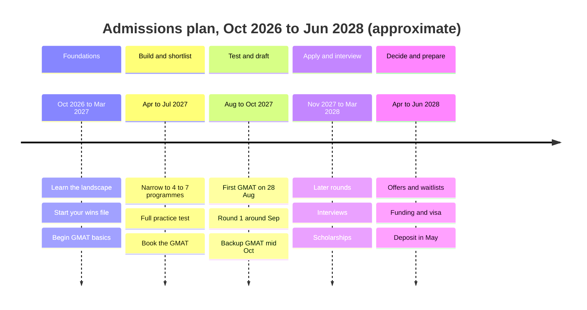

# Your Month-by-Month Timeline: Oct 2026 to Jun 2028

This is your calendar, from today to the day you hold an offer. It's built around your GMAT plan: first attempt on Saturday 28 August 2027, backup in mid-October 2027. The dates here are a plan, not facts about any school. Where a deadline matters, we say "check the official deadline".

> [!NOTE]
> School deadlines shift each year. Use the patterns below to plan, and replace each one with the official date once the school publishes it. The app's Admissions tracker and daily planner follow this same schedule.

## The big picture

| Phase | Months | Focus |
|---|---|---|
| 1. Foundations | Oct 2026 to Mar 2027 | Learn the landscape, start building your profile, begin GMAT basics |
| 2. Build and shortlist | Apr to Jul 2027 | Serious GMAT prep, school research, paperwork |
| 3. Test and draft | Aug to Oct 2027 | Take the GMAT, write essays, early-round applications |
| 4. Apply and interview | Nov 2027 to Mar 2028 | Later rounds, interviews, scholarships |
| 5. Decide and prepare | Apr to Jun 2028 | Offers, funding, visa, pre-programme prep |

Here is the same plan as a timeline. All dates are approximate, so confirm each school deadline on its official page.

## Phase 1: Foundations (Oct 2026 to Mar 2027)

### October 2026
- Read the first three admissions lessons: roadmap, India programmes, global programmes.
- Start your "wins file" at work: one line per achievement, with a number.
- Set up a folder for applications.

### November 2026
- Create an account at mba.com and register for the free Official Starter Kit.
- Check your passport. Renew it if needed.
- Take the free diagnostic practice (see your GMAT plan).

### December 2026
- Read ISB's latest class profile on its official pages.
- Note the experience rule of each school on your long list (and the date it's counted).
- Decide your "three paths" in rough form: ISB 2028, MiM or marketing Masters 2028, experienced MBA later.

### January to March 2027
- Choose one project at work to own end to end, and tell your manager you want the responsibility.
- Start the habit of one admissions task a week (the planner will schedule them).
- Begin the GMAT study plan in earnest.
- Ask your college and university how to get a Medium of Instruction certificate and transcripts.

> [!TIP]
> Winter and spring are the quiet months in your cycle. Use them for the slow things that take weeks: documents, a work project, a course.

## Phase 2: Build and shortlist (Apr to Jul 2027)

### April 2027
- Attend info sessions and webinars for your shortlisted schools.
- Keep going with a quant, statistics or analytics course, if you're doing one (aim to finish by July).
- Update your wins file with the project's results.

### May 2027
- Narrow your list to four to seven programmes using the school-list worksheet.
- Check every experience rule against your exact months.
- Start saving or researching loans, and note scholarship deadlines.

### June 2027
- Talk to current students and alumni. Ask what surprised them.
- Take a full-length practice GMAT to measure where you are.
- Plan your recommender conversations.

### July 2027
- Book the GMAT for 28 August 2027 now if you haven't already. The booking window opens about six months ahead (around 28 February 2027), so earlier is better; early July, about six to eight weeks ahead, is the latest sensible date.
- Collect scanned transcripts and the MOI certificate.
- Draft your story: why management, why now.

## Phase 3: Test and draft (Aug to Oct 2027)

### August 2027
- **Saturday 28 August: first GMAT attempt.**
- Rest the next day. Then, within a week, restart the application work.
- Brief your recommenders with the recommender pack.
- Draft your resume and goals essay.

### September 2027
- ISB's Round 1 deadline is likely around mid or late September, since the application opens about two months before the deadline. Check the official deadline.
- If your score is where you want it, submit in Round 1 or choose Round 2.
- Imperial's and LBS MiM's first rounds usually close around late September or early October. Check the official deadline.
- Practise the first interview answers.

> [!TRAP]
> Don't rush an application out the same week as the GMAT just to catch a round. A strong Round 2 beats a weak Round 1. The exception is a programme with a tight experience cap, where the early round may be the only realistic one. Read that rule carefully.

### October 2027
- **Mid-October: backup GMAT attempt**, only if you need it.
- HEC MiM's first round has closed in early October in the past. Check the official deadline.
- INSEAD's second round has been around early November in past cycles (for later MBA planning only).
- Keep working on essays for your second-round targets.

## Phase 4: Apply and interview (Nov 2027 to Mar 2028)

### November 2027
- Submit second-round applications where relevant.
- Start Kira-style video practice: 60-second answers.
- Send recommenders a gentle reminder.

### December 2027
- ISB's second round has been around early December. Check the official deadline.
- Prepare for interviews with a friend or colleague.
- Keep a tight record of every deadline.

### January 2028
- ISB's third round may be around mid-January. Check the official deadline.
- Imperial's second round has closed in early January in the past.
- Interviews start for early-round applicants.

### February to March 2028
- Interview season. Practise weekly.
- LBS MiM's scholarship cut-off was 8 March in the cycle we found. Check the official date.
- Apply for scholarships and Forte fellowships where schools list them.
- On 31 March 2028 you'll have about 28 months of experience; make sure your applications state your dates accurately.

## Phase 5: Decide and prepare (Apr to Jun 2028)

### April 2028
- Offers and waitlists arrive in waves.
- Compare offers using your budget worksheet.
- JN Tata Endowment screening has run around March to April in past cycles. Check the official timeline.

### May 2028
- Accept an offer and pay the deposit by the stated deadline.
- Start loan applications and visa steps.
- Ask for scholarship reconsideration if you have a competing offer (see the decisions lesson).

### June 2028
- Finish visa and loan paperwork.
- Start pre-programme prep: maths refresh, finance basics, reading list.
- Thank recommenders and update them with your result.

## If your plan changes

| Situation | What to adjust |
|---|---|
| GMAT score below target | Use the backup attempt; shift to Round 2 or 3; consider the 2029 cycle |
| Experience rule is stricter than expected | Switch to later-intake programmes; use the extra time to build your profile |
| Funding gap | Delay a year, apply to schools with scholarships, or choose a lower-cost programme |
| Recommender unavailable | Choose another, briefing them earlier |

## Worked example: reading a deadline pattern

Suppose a school's Round 2 closed on a Thursday in early December in the last cycle. How do you plan for the next one?

Show the working

1. Assume the next deadline is in the same week, but treat it as unconfirmed until published.
2. Work backwards. If the deadline is about 6 December, the application should be ready one week earlier, on 29 November.
3. The recommender pack needs to be out eight weeks before: early October.
4. Essays need a first draft by early November.
5. Your GMAT result needs to be in hand, so a backup test in mid-October still leaves time.

Trap: planning to the exact deadline day. Portals crash, recommenders are late, and the best submissions go in a few days early.

## Quick check
1. When is your first GMAT attempt, and when should you book it?

Answer
Saturday 28 August 2027. Book as soon as the window opens (around 28 February 2027), and no later than early July.

2. Why might early rounds matter more for MiMs with experience caps?

Answer
Your experience grows each month, so a later round could push you past the school's cap.

3. What should you do when a deadline is only "inferred" from last year's?

Answer
Plan to it, but check the official deadline as soon as the school publishes it.

## Key takeaways
- Five phases: foundations, build and shortlist, test and draft, apply and interview, decide and prepare.
- Book the GMAT for 28 August as soon as the window opens (about late February 2027), and by early July at the latest; keep mid-October as a backup.
- Brief recommenders in August, about eight weeks before the deadline.
- Plan to inferred deadlines, then replace them with official ones.
- Submit a few days early.
- Keep an eye on experience caps; they tighten as months pass.

## Go deeper
- [ISB](https://www.isb.edu/): official deadlines and rounds.
- [London Business School](https://www.london.edu/): MiM stages and scholarship dates.
- [HEC Paris](https://www.hec.edu/): MiM round dates.
- [INSEAD](https://www.insead.edu/): MBA round dates for future planning.
- [GMAT exam on mba.com](https://www.mba.com/exams/gmat-exam): booking and the official starter kit.
