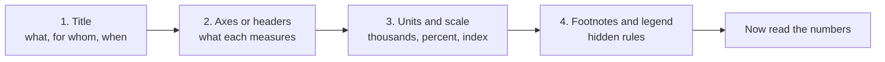

# Reading Data Like an Analyst

Every Table Analysis and Graphics Interpretation question on the GMAT Focus is really the same question in disguise: can you read a chart or table correctly, under time pressure, without being fooled by the labels? You already do this every week when you open a campaign dashboard. This lesson turns that instinct into an exam skill.

## The three-second scan

Before you touch a number, read four things, in this order:

1. **Title.** What is being measured, for whom, and over what period?
2. **Axes or column headers.** What does each one measure, and in what unit?
3. **Units and scale.** Thousands, millions, percent, percentage points, index (base year = 100)?
4. **Footnotes and legend.** These hide the rules: "excludes returns", "projected", "2025 figures are estimates".

Run this scan on every chart or table before touching a number.

Think of a campaign report. If the header says "Spend (₹ thousands)" and you read it as rupees, every conclusion you draw is 1,000 times off, even though your arithmetic is perfect. The GMAT loves this exact trap, because it punishes careless readers and rewards the ones who spend three seconds on the frame.

> [!TIP]
> Say the unit out loud (in your head) before computing: "These are thousands of units, so 450 means 450,000." It costs two seconds and saves whole questions.

## Reading each chart type

**Bar chart.** Compares categories. Read the bar's end against the axis, not against the neighbouring bar. If the axis does not start at zero, bars exaggerate differences. A bar that looks "twice as tall" may be only 10% bigger.

**Stacked bar.** Each bar is a total split into parts. The bottom segment is easy to read (it starts at zero). Every other segment must be read as a difference: top edge minus bottom edge. Comparing the middle segments across bars is the most common place to misread.

**Line chart.** Shows change over time. Steeper line means faster change in the unit of the axis. A line that is rising but flattening is still growing, just by smaller amounts each period.

**Scatterplot.** Each dot is one item with two measurements (x and y). You look for the overall pattern: positive (up and right), negative (down and right), or none. The GMAT may add a trend line and ask you to read values from it.

**Pie chart.** Shows share of a whole, usually in percent. Two pies with different totals cannot be compared by slice size alone: a 20% slice of a 500-unit pie is smaller than a 15% slice of a 900-unit pie.

**Bubble chart.** A scatterplot where the size of each dot carries a third variable (for example, x = ad spend, y = leads, bubble size = revenue). On the exam you will see this described in words or as a scatterplot, so just remember: position gives two values, size gives a third.

## Units and axis traps

> [!TRAP]
> **Thousands vs millions.** A chart labelled "Revenue (in millions)" with a value of 3.2 means 3,200,000. If another chart is in thousands, the same 3.2 means 3,200. Never mix the two without converting.

> [!TRAP]
> **Percent vs percentage points.** If a conversion rate goes from 4% to 6%, it rose by **2 percentage points** but by **50 percent** (2/4). A statement that says "rose by 2%" is wrong, and the exam knows it.

Other axis tricks to watch for:

- **Truncated axis.** The y-axis starts at 80 instead of 0, so small changes look huge.
- **Dual axes.** Two lines share a chart but use different scales on the left and right. Always check which axis each series belongs to.
- **Uneven intervals.** An x-axis with years 2015, 2018, 2019, 2023 is not evenly spaced. A slope between points means nothing unless you divide by the gap.
- **Index values.** "2020 = 100" means every other number is relative to 2020. An index of 130 means 30% above 2020, not 130 units.

## Percent change and growth rates

The formula you will use constantly:

**Percent change = (new − old) / old × 100**

The denominator is always the **old** (starting) value. This single fact decides most percent traps.

> [!REMEMBER]
> Percent change = (new − old) / old. Percent of = part / whole. The word "from" or "than" usually points at the base.

| Situation | Old | New | Percent change |
|---|---|---|---|
| Newsletter sign-ups rise | 400 | 500 | +25% |
| Same sign-ups fall back | 500 | 400 | −20% |
| Cost per lead drops | 80 | 60 | −25% |

Notice that +25% followed by −20% returns you to the start. Up and down percentages are not symmetrical because the base changes.

**Growth rate vs growth amount.** A line chart showing sales of 100, 110, 121 has a constant 10% growth rate, but the amounts added (10, then 11) keep growing. A chart showing 100, 110, 120 adds a constant 10 each year, but the growth rate is shrinking (10%, then 9.1%). Learn to ask which one the question wants.

### Approximate compound growth

If something grows by r% per period for n periods, it multiplies by (1 + r/100)n. You do not need exact values on the GMAT; you need good estimates.

- 10% per year for 2 years: about +21% (1.1 × 1.1 = 1.21).
- 5% per year for 3 years: about +16% (1.053 ≈ 1.158).
- 3% per year for 4 years: about +12.5%.

**Rule of 72.** Doubling time in years ≈ 72 ÷ growth rate in percent. At 8% a year, a number doubles in about 9 years.

> [!SHORTCUT]
> For small rates over a few periods, just add the percentages and add a little extra. Two years at 6% is about 12% plus a bit (actual 12.36%). Use this to eliminate answer choices fast, then calculate only if two choices are close.

## Ratios from charts

A ratio compares two quantities from the same chart: for example, leads per rupee spent, or revenue per employee. Three habits help:

- **Read both values first, divide second.** Write "180 leads / 6 (₹ thousand) = 30 leads per thousand rupees".
- **Round early, round sensibly.** If the answer choices are 10% apart, rounding each number to two significant figures is safe.
- **Compare ratios without dividing.** To decide whether 47/120 is bigger than 31/80, cross-multiply: 47 × 80 = 3,760 and 31 × 120 = 3,720, so 47/120 is slightly bigger.

In a scatterplot, a ratio like "revenue per store" is just the slope of the line from the origin to a dot. The dot that sits on the steepest line from (0, 0) has the highest ratio, even if it is not the highest dot.

## Weighted averages from tables

A simple average treats every row equally. A **weighted average** counts bigger groups more.

Weighted average = (sum of value × weight) / (sum of weights)

Say a table shows three campaigns:

| Campaign | Clicks | Conversion rate |
|---|---|---|
| A | 2,000 | 5% |
| B | 500 | 12% |
| C | 1,500 | 4% |

The simple average of the rates is (5 + 12 + 4)/3 = 7%. But the overall conversion rate is total conversions over total clicks: (100 + 60 + 60)/4,000 = 220/4,000 = 5.5%. Campaign B is small, so it barely moves the overall figure.

> [!TRAP]
> Never average percentages directly unless the groups are the same size. Convert each to a count, add the counts, then divide by the total.

**Shortcut check.** The weighted average always lies between the lowest and highest values, and it sits closer to the value with the larger weight. If an answer choice is outside the range, or closer to the small group, it is wrong.

## Median from a table

The median is the middle value when the numbers are sorted. With an odd number of values it is the middle one; with an even number it is the average of the two middle ones.

For 9 rows, the median is the 5th value after sorting. For 10 rows, it is the average of the 5th and 6th. In the on-screen Table Analysis tool you can sort by clicking a column header, which makes this very fast: sort, count to the middle, read.

> [!NOTE]
> The median ignores how extreme the highest and lowest values are. That is why a single huge outlier moves the mean but not the median.

For data given in frequency form ("3 stores sell 10 units, 5 stores sell 12 units, 2 stores sell 20 units"), count cumulatively: the 10 stores are ordered 10, 10, 10, 12, 12, 12, 12, 12, 20, 20. The median is the average of the 5th and 6th, which is 12.

## Correlation, trend lines and causation

**Correlation** means two variables move together. **Causation** means one makes the other happen. A scatterplot can show the first and never the second.

- **Positive correlation.** As x rises, y tends to rise.
- **Negative correlation.** As x rises, y tends to fall.
- **No correlation.** The cloud has no direction.
- **Strength.** The tighter the dots hug a line, the stronger the relationship.

A **trend line** (line of best fit) is a straight line drawn through the cloud. You can use it to estimate y for a given x, but only inside the range of the data. Predicting far outside the plotted range is extrapolation, and the exam treats it as unsupported.

On the exam, the right answer to "does the graph show that A causes B?" is almost always no. Think of your own work: ad spend and sales both spike during Diwali. The chart shows a correlation, but the festival may be driving both. You cannot conclude that the extra spend caused the extra sales without more information.

> [!TRAP]
> Words like "causes", "leads to", "is responsible for", "will" and "always" are red flags in statements. Graphs support words like "is associated with", "tends to", "is higher than".

When the question asks about points above or below the trend line, remember: a point **above** the line has a y-value higher than the trend predicts for its x. A point's distance from the line is not the same as its y-value.

## Estimation versus the calculator

Data Insights gives you an on-screen calculator, which is a gift and a trap. It is slow: you click each digit, and every extra calculation costs 10 to 20 seconds. A good rule is to **estimate first, calculate only when two answers are too close to call.**

- Round numbers to two significant figures: 4,873 becomes 4,900, and 12.4% becomes about 12%.
- Use friendly fractions: 33% is 1/3, 25% is 1/4, 12.5% is 1/8, 20% is 1/5.
- Compare before you compute: "Is A more than double B?" needs only a rough doubling check.
- Use the calculator for multi-step division (like weighted averages with ugly numbers) or when the answer must be exact and the options are close.

> [!TIP]
> Before you press a single calculator key, write down what you expect the answer to be roughly. If the calculator disagrees wildly, you mistyped.

## Worked examples

### Worked example 1 (Easy)
A dashboard shows monthly email sends of 40 (in thousands) in March and 52 (in thousands) in April. By what percent did sends increase?

Show solution

Change = 52 − 40 = 12 (thousand). Percent change = 12/40 = 0.30 = **30%**. The "thousands" label does not matter for a percent, since the unit cancels.

Faster way: 10% of 40 is 4, and 12 is three 4s, so 30%.

Trap: dividing by the new value (12/52 ≈ 23%). The base is always the starting value.

### Worked example 2 (Medium)
Conversion rate for a landing page rose from 5% in Q1 to 7% in Q2. Which statement is correct?

(A) It rose by 2%. (B) It rose by 2 percentage points, or 40%. (C) It rose by 40 percentage points. (D) It rose by 28%. (E) It rose by 140%.

Show solution

The difference is 7 − 5 = 2 percentage points. The relative increase is 2/5 = 40%. So **(B)** is the only choice that states both correctly.

Trap: (A) confuses percentage points with percent. (E) divides the new rate by the old one (7/5 = 140%), which is the ratio, not the increase.

### Worked example 3 (Medium-hard)
A table shows three regions: North with 600 orders and a 10% return rate, South with 300 orders and a 20% return rate, and East with 100 orders and a 40% return rate. What is the overall return rate?

Show solution

Returns: 60 + 60 + 40 = 160. Total orders = 1,000. Overall rate = 160/1,000 = **16%**.

The simple average of the rates would be (10 + 20 + 40)/3 ≈ 23.3%, which is wrong because East is only a tenth of the orders.

Faster way: the answer must sit near 10% and 20% because those regions dominate. Anything above 25% can be eliminated immediately.

### Worked example 4 (Hard)
A line chart shows revenue index values (2022 = 100) of 100, 120, and 138 for 2022, 2023, and 2024. The marketing head says, "Growth slowed down in 2024." Is she right about the growth rate, and about the amount added?

Show solution

2023: 20/100 = 20% growth, amount added 20. 2024: 18/120 = 15% growth, amount added 18.

The growth rate slowed (20% to 15%) and the amount added also fell (20 to 18). So she is right on both counts.

Suppose 2024 had been 146 instead. Then the amount added would be 26 (higher) while the growth rate would be 26/120 ≈ 21.7% (also higher). Always compute both before agreeing with a claim.

Trap: comparing the heights of the two line segments by eye. On a squeezed axis, they look equal when they are not.

## Quick check
1. A bar chart's y-axis is labelled "Units sold (millions)". A bar reads 2.4. How many units were sold?

Answer
2.4 million, or 2,400,000.

2. Click-through rate falls from 2.5% to 2.0%. What is the change in percentage points and in percent?

Answer
0.5 percentage points down; 0.5/2.5 = 20% decrease.

3. Revenue grows 10% per year. About how much higher is it after 3 years?

Answer
1.1 × 1.1 × 1.1 = 1.331, so about 33% higher (not 30%).

4. Median of a table with 12 sorted rows: which positions do you average?

Answer
The 6th and 7th values.

5. A scatterplot shows strong positive correlation between social spend and sales. Can you say spend caused the sales?

Answer
No. Correlation alone does not show causation; a third factor (season, promotions) could drive both.

## Key takeaways
- Read title, axes, units and footnotes before any number. Most traps live there.
- Percent change always divides by the old value. Percentage points are simple differences between two percentages.
- Never average percentages directly; convert to counts and divide the totals, or use weights.
- For medians, sort and count to the middle. The table tool sorts for you.
- A scatterplot shows correlation, never causation. Trend lines are only reliable inside the plotted range.
- Estimate first with friendly fractions and two-digit rounding. Use the slow calculator only when answer choices are close.
- Stacked bar segments (except the bottom one) must be read as differences between edges.

## Go deeper
- [Khan Academy: Statistics and probability](https://www.khanacademy.org/math/statistics-probability) — free practice on reading charts, averages and scatterplots.
- [Khan Academy: Algebra](https://www.khanacademy.org/math/algebra) — brush up percent and ratio fundamentals.
- [GMAT Club forum](https://gmatclub.com/forum/) — community discussions on Data Insights strategy.
- [Official GMAT exam site](https://www.mba.com/exams/gmat-exam) — format details for Data Insights.
