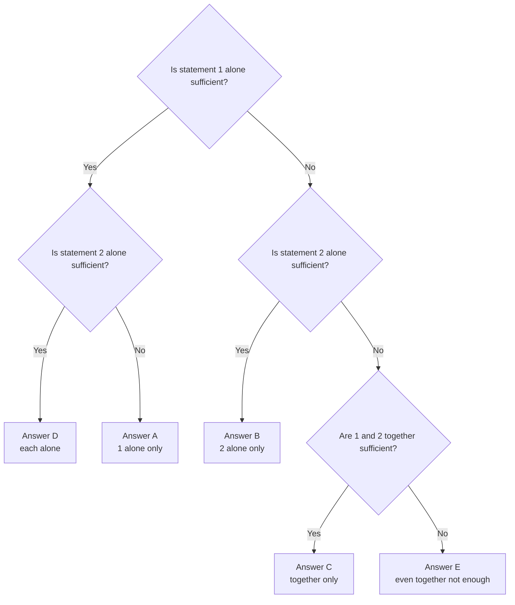

# Data Sufficiency: The Method

Data Sufficiency (DS) appears on every Data Insights section, usually 5 to 7 times, and it is the question format almost nobody has seen before. It also happens to be the most learnable one: the answer choices never change, and a fixed routine gets you through every question.

## What DS is really asking

A normal maths question asks, "What is the answer?" A DS question asks something more modest: "Do you have enough information to find the answer?" You are acting like a manager reading two reports. You don't redo the analysis. You decide whether each report is enough to make the call.

Every DS question has the same layout: a question (the stem), then two statements. Sometimes the stem adds a few facts that are true for the whole problem.

> If n is a positive integer, what is the value of n?
>
> (1) n² = 49
>
> (2) n is even

"n is a positive integer" is a fact in the stem. It always applies. The two statements are the new information you are testing.

## The five answer choices (memorise them word for word)

These never change, so learn them once and you'll never have to read them again. On the real test they are listed in this order:

- **(A)** Statement (1) ALONE is sufficient, but statement (2) alone is not sufficient.
- **(B)** Statement (2) ALONE is sufficient, but statement (1) alone is not sufficient.
- **(C)** BOTH statements TOGETHER are sufficient, but NEITHER statement ALONE is sufficient.
- **(D)** EACH statement ALONE is sufficient.
- **(E)** Statements (1) and (2) TOGETHER are NOT sufficient.

> [!REMEMBER]
> Memorise the order A, B, C, D, E as: 1 only, 2 only, both needed, either works, nothing works. In the exam interface the app shows the five choices for you, but you must know instantly which letter matches which situation.

## "Sufficient" means exactly one answer

This is the single most important idea in DS.

- For a **value question** ("What is x?"), a statement is sufficient if it fixes **exactly one value**. Two possible values, or a range of values, means not sufficient.
- For a **yes/no question** ("Is x > 5?"), a statement is sufficient if it gives the **same answer every time**: always yes, or always no. A statement that makes the answer "no" is just as sufficient as one that makes it "yes". The next lesson digs into this.

The question never asks whether the answer is yes. It asks whether you can be certain.

> [!TRAP]
> "I can't solve it, so it's not sufficient" is wrong. A statement can be sufficient even when you don't know the answer, because sufficient means "the answer is determined", not "I computed it". You also don't need the final number, so stop as soon as you're sure it is a single value.

## The AD/BCE grid

You always evaluate statement (1) alone first, then statement (2) alone, then the pair only if needed. Draw a quick grid on your scratch board:

| | (1) sufficient? | (2) sufficient? | Answer |
|---|---|---|---|
| Both yes | Yes | Yes | D |
| Only (1) | Yes | No | A |
| Only (2) | No | Yes | B |
| Neither | No | No | C or E (test together) |

This decision tree gives the answer for every DS question, step by step.

The routine:

1. Evaluate (1) alone. Write "S" (sufficient) or "N" (not sufficient).
2. **Forget statement (1) completely.** Evaluate (2) alone and write S or N.
3. Read your two marks. S/S is D. S/N is A. N/S is B. N/N means you combine them: if together they work it's C, otherwise E.

On paper, you can cross out letters as you go. After statement (1): if S, the answer can only be A or D; if N, it can only be B, C or E. This is the AD/BCE split. If you wrote N for (1), you have already eliminated A and D.

> [!TIP]
> Start with the easier-looking statement, but evaluate in a way that never leaks information. If you begin with (2), the surviving choices after a "sufficient" are B and D; after "not sufficient" they are A, C and E. Your grid should be the same.

## Do not solve to the end

DS rewards the lazy-smart habit of stopping early. For each statement, ask: "Can this lead to only one answer?" Often you can see it before the arithmetic finishes.

Example: if a statement gives you two linear equations in the same two unknowns, and they are clearly different, you know you can solve for both. You do not need to find the actual values. Only the answer to "could I?" matters.

Be careful, though. "Do not solve" does not mean "do not check". If a statement looks like one equation and one unknown, make sure the equation is not secretly nonlinear (it may have two solutions).

## Rephrase the question first

Before you look at the statements, spend ten seconds simplifying the question. A rephrased stem tells you exactly what you are hunting for.

- "What is the value of 4a + 2b?" is the same as "What is the value of 2a + b?" times 2. So what you need is just 2a + b.
- "Is x² > 9?" becomes "Is x > 3 or x < −3?" (that is, "Is |x| > 3?").
- "What is the total cost of 3 pens and 3 notebooks?" becomes "What is the price of one pen plus one notebook?" because the total is 3 × (pen + notebook).
- "Is the average of three numbers greater than 10?" becomes "Is their sum greater than 30?"

A good rephrase reduces each statement to a yes/no check: "Does this give me 2a + b?"

## Counting equations and unknowns (and when it fails)

A very useful shortcut: to find the values of n unknowns, you generally need n independent equations. So:

- One unknown, one equation: usually sufficient.
- Two unknowns, one equation: usually not sufficient alone.
- Two unknowns, two equations: usually sufficient together.

This is a great first guess, and it is correct most of the time. But it fails in four well-known ways.

1. **The equations are the same equation in disguise.** "x + y = 10" and "2x + 2y = 20" look like two equations but carry the same information.
2. **A nonlinear equation can have two solutions.** One equation in one unknown, like x² = 25, gives x = 5 or x = −5, so it is not sufficient.
3. **Symmetric pairs.** If a system treats x and y in the same way, swapping them keeps both equations true, so you can't tell which is which unless the question asks for something symmetric.
4. **The question needs a combination, not each unknown.** If the stem asks for x + y, a single equation like 3x + 3y = 21 is sufficient even with two unknowns.

> [!TRAP]
> Counting unknowns is a guide, not a proof. Whenever you are about to trust it, glance for a sneaky exception: same equation, powers, symmetry, or a question about a combination.

## Worked examples

### Worked example 1 (Easy)
What is the value of n?

(1) 3n + 4 = 19

(2) n is positive

Show solution

Statement (1): 3n = 15, so n = 5. One value, so sufficient.

Statement (2): n is positive, which fits 1, 2, 3, and so on. Many values, so not sufficient.

Answer: A.

Trap: choosing C because "I used both". You use the statements separately first; the second one adds nothing.

### Worked example 2 (Medium)
What is the value of 4a + 2b?

(1) 2a + b = 7

(2) a − b = 1

Show solution

Rephrase first: 4a + 2b = 2(2a + b). The question is really "what is 2a + b?", times 2.

Statement (1) hands us 2a + b = 7 directly, so 4a + 2b = 14. Sufficient.

Statement (2): a − b = 1 has many solutions. a = 2, b = 1 gives 4a + 2b = 10, while a = 3, b = 2 gives 16. Not sufficient.

Answer: A.

Faster way: spotting the common factor beats solving for a and b. If you had solved two equations, you'd have wasted a minute and likely chosen C.

Trap: counting "two unknowns, so I need both statements". The stem asks for a combination, not for a and b separately.

### Worked example 3 (Medium)
What is the value of x?

(1) x + y = 10

(2) 2x + 2y = 20

Show solution

Statement (1): one equation, two unknowns. x = 1, y = 9 and x = 2, y = 8 both work. Not sufficient.

Statement (2): divide by 2 to get x + y = 10, which is statement (1) again. Not sufficient.

Together: they say exactly the same thing, so x can still be 1 or 2 or anything. Not sufficient.

Answer: E.

Trap: "two equations, two unknowns, so C." The equations must be independent, meaning neither can be rebuilt from the other by multiplying or adding.

### Worked example 4 (Hard)
If x and y are positive integers, what is the value of x?

(1) x + y = 4

(2) xy = 3

Show solution

Statement (1): positive integer pairs adding to 4 are (1, 3), (2, 2) and (3, 1). x could be 1, 2 or 3. Not sufficient.

Statement (2): positive integers with product 3 are (1, 3) and (3, 1). x could be 1 or 3. Not sufficient.

Together: only (1, 3) and (3, 1) satisfy both (check (2, 2): product 4, not 3). x is still either 1 or 3. Not sufficient.

Answer: E.

Why the shortcut failed: the two equations are symmetric in x and y. Swapping x and y leaves both true, so the system cannot tell the two variables apart. If the question had asked for x + y or xy, the same statements would have been sufficient.

Trap: C, because the equations are independent and in the right number. Always do a quick test with real numbers when you suspect symmetry.

## Quick check

1. Choice (D) means what, in plain words?

Answer

Each statement, on its own, is enough. Either one alone gives a single answer.

2. If statement (1) alone is not sufficient, which answers are left?

Answer

B, C and E. Choices A and D require (1) alone to be sufficient.

3. A value question has statement (1) giving "x² = 16". Is it sufficient?

Answer

No. x could be 4 or −4, so there are two values.

4. Rephrase: "Is the average of four numbers greater than 12?"

Answer

"Is the sum of the four numbers greater than 48?"

## Key takeaways

- Memorise the five choices: 1 only (A), 2 only (B), both together (C), each alone (D), neither even together (E).
- Sufficient means exactly one answer: one value for value questions, always yes or always no for yes/no questions.
- Evaluate each statement alone first, and forget the other statement while you do.
- If both are insufficient alone, combine them: that decides between C and E.
- Don't solve to the end. Decide whether a unique answer exists.
- Rephrase the question first; it tells you precisely what you need.
- The equations-versus-unknowns count is a guide that fails with duplicate equations, powers, symmetry, or combination questions.

## Go deeper
- [Official GMAT exam page](https://www.mba.com/exams/gmat-exam) for official Data Insights sample questions and the exact DS format.
- [GMAT Club forums](https://gmatclub.com/forum/) for hundreds of DS discussions, if you want extra practice after our questions.
- [Khan Academy: Algebra](https://www.khanacademy.org/math/algebra) to practise systems of equations, which sit under many DS questions.
