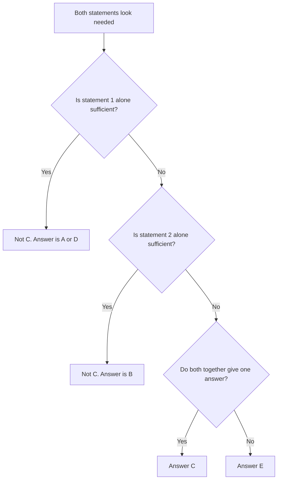

# Data Sufficiency Traps

The GMAT doesn't need many tricks to catch a well-prepared student. It needs six or seven, used repeatedly in new clothes. Once you can name each trap, you'll feel them coming. This lesson is your field guide.

## Trap 1: The C-trap

You read the question, you see that (1) gives one piece of information and (2) gives the other, and the two obviously combine. Your brain shouts "C!" and you move on.

That is exactly the moment to slow down. The GMAT loves questions where the two statements look made for each other, but one of them already does the job alone, or the useful part of one cancels out.

> What is the value of x?
>
> (1) 3x + 2y = 2y + 12
>
> (2) y = 7

Together they feel natural: (2) gives y, (1) has y. But in (1) the 2y cancels from both sides, leaving 3x = 12, so x = 4 without ever needing y. Statement (1) is sufficient alone, and (2) is useless. The answer is A.

> [!TIP]
> Before choosing C, check each statement alone one more time with a short question: "Does y (or any extra variable) actually matter here?" If you are about to combine, look for cancellation, a common factor, or a rephrase that makes one statement enough.

> [!TRAP]
> C is the most overchosen answer when students are unsure. When "obviously together" is your reason, run the individual tests again.

Before you pick C, run this check. It also shows you when A, B or E is the right answer instead.

## Trap 2: The statements never contradict each other

On the real test, both statements are always true at the same time and about the same situation. They will never contradict each other. That gives you two useful checks.

1. If you decide that (1) alone gives x = 5 and (2) alone gives x = −5, you have made a mistake somewhere. A real DS question can't have two sufficient statements that disagree.
2. When you combine statements, the answer must satisfy both. If (1) gives x = 2 or 3 and (2) gives x = 3 or 4, then x = 3 is the only value consistent with both. That is the logic behind most C answers.

Use the rule as a safety net after you solve: if you reach a "D" with two different values, one of your solutions is wrong.

## Trap 3: The forbidden move (borrowing from the other statement)

When you evaluate statement (2) alone, you must act as if statement (1) does not exist. It sounds obvious, but the brain leaks.

> What is x?
>
> (1) x + y = 10
>
> (2) y = 2x

Evaluating (2) alone, you might think: "y = 2x, and I know x + y = 10 from the other statement, so x = 10/3." That is the forbidden move. Statement (2) on its own is just y = 2x, which fits x = 1, y = 2, and x = 5, y = 10. Not sufficient. And (1) alone is not sufficient either. Only when you combine them can you substitute: x + 2x = 10, so x = 10/3. The answer is C, and you earned it legitimately.

> [!TRAP]
> The leak usually happens in the second statement. Keep a clean mental wall: after you finish (1), write S or N, then erase everything you learned. The only time you may use both is in the final "together" step.

## Trap 4: Hidden constraints (integers, positives, real-world counts)

Phrases in the stem like "n is an integer" or "x is positive" are not decoration. They shrink the possibilities, and that can turn an insufficient statement into a sufficient one.

- **Integers.** "3 < n < 5" fixes n = 4 only if n is an integer. For a real number, n could be 3.5 or 4.7.
- **Positives.** x² = 49 gives x = 7 only if x is positive; otherwise it is ±7.
- **Real-world counts.** The number of people, pens or cars is a whole number, and it can't be negative. You may not be told this, but you're expected to know it.
- **Non-zero.** If a denominator or divisor is involved, zero is out.

The same constraint can also be a trap in reverse: a statement mentions "a prime number" or "a multiple of 7", and that is the information you need.

> [!NOTE]
> Always test your numbers against the stem as well as the statement. A test case that breaks the stem's conditions doesn't count.

## Trap 5: The D trap with quadratics (two roots)

A single equation in one unknown looks sufficient, and for linear equations it is. For squares, it usually isn't.

- x² = 9 gives x = 3 or x = −3.
- (x − 2)(x − 5) = 0 gives x = 2 or x = 5.
- |x| = 4 gives x = 4 or x = −4.
- x³ = 8 gives x = 2 only (odd powers have one real root).
- √x = 3 gives x = 9 only (a square root is non-negative).

So when a statement is a quadratic (or has an absolute value), assume two answers until the other conditions rule one out. That is why D is rare on quadratic DS questions, and why C is common: the second statement ("x > 3", "x is positive") is often used to pick the right root.

## Trap 6: Solving too far, or not far enough

Two opposite mistakes. One is to compute the final answer when you only needed to see that a unique answer exists. The other is to say "sufficient" because the statement looks relevant, without checking that it fully settles the question. A good test is "Can I name a second scenario that satisfies this statement but gives a different answer?" If you can, it is not sufficient. If you can't, it is.

## The DS traps checklist

Run through this in the last ten seconds before you answer:

1. Did I judge each statement alone, with the other one wiped from memory?
2. If I want to choose C, did I check whether one statement alone already works?
3. For value questions, is the answer exactly one value (not two roots, not a range)?
4. For yes/no questions, did I look for a "no" case and a "yes" case, including zero, fractions and negatives?
5. Did I apply every condition in the stem (integer, positive, count)?
6. If I picked D, do both statements point to the same value?
7. Did I read the question as asked, for example x + y versus x, or "is x > 5" versus "is x ≥ 5"?

## Worked examples

### Worked example 1 (Easy)
What is the value of x?

(1) 3x + 2y = 2y + 12

(2) y = 7

Show solution

Statement (1): subtract 2y from both sides to get 3x = 12, so x = 4. Sufficient.

Statement (2): y = 7 says nothing about x. Not sufficient.

Answer: A.

Trap: choosing C because the two statements "go together". The y in (1) cancels, so (2) never gets used.

### Worked example 2 (Medium)
If n is an integer, what is the value of n?

(1) 3 < n < 5

(2) n² = 16

Show solution

Statement (1): the only integer strictly between 3 and 5 is 4. Sufficient (because n is an integer).

Statement (2): n² = 16 gives n = 4 or n = −4. Not sufficient.

Answer: A.

Trap: the stem's "integer" is easy to skim past. Without it, (1) would fail, since 3.5 and 4.2 would qualify. With it, (1) alone is enough.

### Worked example 3 (Medium)
What is the value of x?

(1) x² − 6x + 8 = 0

(2) x > 3

Show solution

Statement (1): factor to (x − 2)(x − 4) = 0, so x = 2 or x = 4. Two values. Not sufficient.

Statement (2): x could be 4, 5, 10, and so on. Not sufficient.

Together: the roots are 2 and 4, and only 4 satisfies x > 3. So x = 4. Sufficient.

Answer: C.

Trap: treating (1) as "one equation, one unknown, sufficient". Quadratics usually have two roots, and the second statement is there to choose between them.

### Worked example 4 (Hard)
Kavya bought only pens (₹5 each) and notebooks (₹12 each) and spent exactly ₹87. How many notebooks did she buy?

(1) She bought more pens than notebooks.

(2) She bought at least 2 pens.

Show solution

Let p pens and n notebooks. 5p + 12n = 87, and p and n are whole numbers (zero or more).

The remainder when 87 − 12n is divided by 5 must be 0. Testing n = 0 to 7: n = 0 gives 87 (no), n = 1 gives 75 (p = 15, yes), n = 2 gives 63 (no), n = 3 gives 51 (no), n = 4 gives 39 (no), n = 5 gives 27 (no), n = 6 gives 15 (p = 3, yes), n = 7 gives 3 (no). So the only possibilities are (p, n) = (15, 1) and (3, 6).

Statement (1): more pens than notebooks eliminates (3, 6) because 3 < 6. Left with (15, 1), so n = 1. Sufficient.

Statement (2): both options have at least 2 pens (15 and 3). Still n = 1 or 6. Not sufficient.

Answer: A.

Trap: forgetting the hidden constraint. The "whole numbers only" rule turns a one-equation, two-unknown problem into one with just two solutions.

## Quick check

1. If x² = 25, can you tell what x is?

Answer

No. x is 5 or −5, unless something else (like "x > 0") picks one.

2. You evaluate statement (2) and use the equation from statement (1). What did you do wrong?

Answer

You made the forbidden move: using one statement while judging the other alone. Evaluate (2) completely independently first.

3. Statement (1) gives x = 3 and statement (2) gives x = 4, each alone sufficient. What should you conclude?

Answer

You made a mistake. On the real GMAT the two statements never contradict each other, so recheck your work.

## Key takeaways

- Before you pick C, check whether one statement alone is already enough.
- The two statements never contradict; use this to catch your own errors.
- Never borrow from the other statement while judging one alone.
- Integers, positives and real-world counts are free information; use them.
- Quadratics, absolute values and even powers give two answers until another condition removes one.
- Odd roots and square roots (√x) give exactly one answer.
- Finish every question with the checklist.

## Go deeper
- [Official GMAT exam page](https://www.mba.com/exams/gmat-exam) for official Data Insights sample questions.
- [GMAT Club forums](https://gmatclub.com/forum/) for community DS discussions and difficult practice.
- [Khan Academy: Algebra](https://www.khanacademy.org/math/algebra) for revising quadratics and absolute values.
