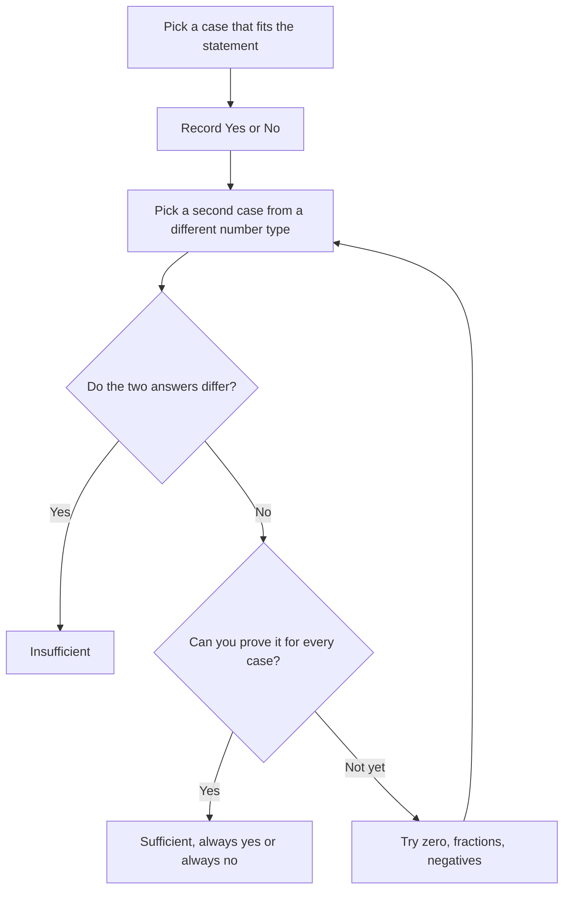

# Yes/No Data Sufficiency

Roughly a third to a half of DS questions are yes/no questions: "Is x > 5?" "Is n divisible by 6?" "Is the average above 40?" They feel different from value questions, and they are the ones where the most points are lost, because people confuse "the answer is no" with "I can't tell".

## The big idea: always yes or always no

In a value question you need one value. In a yes/no question you need **one answer: always yes, or always no.**

- **Always yes**: sufficient.
- **Always no**: also sufficient. A firm "no" is a perfectly good answer.
- **Sometimes yes and sometimes no**: not sufficient.

> [!REMEMBER]
> Sufficient does not mean "the answer is yes". It means "the answer never changes". "Definitely no" is as sufficient as "definitely yes". "Maybe" is the only insufficient result.

> [!TRAP]
> The most common DS mistake: a statement proves the answer is "no", and the student marks it "not sufficient" because "it doesn't answer yes". Remember the question is "Is x > 5?", and learning "definitely not" is learning something real.

## How to test a statement: two cases or a proof

You can settle a yes/no question in only two ways.

1. **Prove it.** Show that the statement forces the same answer in every case. This is usually algebra or logic: "x < 0, so x² > 0, so always yes".
2. **Find two cases.** Find two numbers that both satisfy the statement, one making the answer yes and the other making it no. Two such cases prove insufficiency. You never need more than two.

The second approach is faster for insufficient statements, and most statements in DS are insufficient. So default to hunting for a pair of cases that disagree. If you can't find one after a fair try, suspect the statement is sufficient and then look for the proof.

Testing a yes/no statement follows this loop.

## Testing numbers systematically

The trap is testing only the numbers you like: positive whole numbers. The GMAT knows this, and it hides the "no" case in a place you didn't look. So test across this checklist, and test the extremes quickly.

| Number type | Examples | Why it matters |
|---|---|---|
| Positive integer | 1, 2, 7 | The default, rarely the trap |
| Zero | 0 | Neither positive nor negative; even; kills products and quotients |
| Negative integer | −1, −4 | Flips inequalities, changes signs of products |
| Positive fraction | ½, ¼ | Squaring makes it smaller, not bigger |
| Negative fraction | −½ | Square is larger than the number itself |
| One | 1 | x² = x and x³ = x |
| Big and small | 100, −100 | Shows what happens at extremes |

For each statement, pick a first case that satisfies it, record the answer, then deliberately pick a second case from a different row of the table. If it disagrees with the first, you're finished.

> [!TIP]
> The words "positive", "integer", "nonzero" and "greater than 1" are filters. Every number you test must pass them. Test across the types that are still allowed.

### The fractions-and-zero habit

Whenever a statement involves squares, absolute values, or "x² > x", test four values: a number bigger than 1, 1 itself or 0, a fraction between 0 and 1, and a negative number. Those four cover almost every behaviour.

For example, "Is x² > x?" is yes for x = 2 (4 > 2), no for x = ½ (¼ < ½), no for x = 1 (1 = 1), no for x = 0, and yes for x = −2 (4 > −2). So the answer changes as you move around the number line, which is exactly what makes it a DS favourite.

## Proving insufficiency with two cases (a template)

When you write your scratch work, keep it short and consistent:

- Statement (1): x = __ gives yes; x = __ gives no. Not sufficient.
- Statement (2): x = __ gives yes; x = __ gives no. Not sufficient.
- Together: combine the conditions. Try again.

Writing the actual numbers keeps you honest. Many errors come from "feeling" that a statement works without having tested a disconfirming case.

## Same answer for a whole range

Sometimes a statement doesn't fix a single value, but it confines the variable to a range where the answer is the same. "Is x < 1?" with the statement x² < 1 is sufficient even though x can be many values: x² < 1 means −1 < x < 1, so x < 1 every time. Always yes.

Scan the range before you decide: if every allowed value gives the same answer, the statement is sufficient even though it doesn't pin down x.

## Worked examples

### Worked example 1 (Easy)
Is x > 3?

(1) x = 5

(2) x² > 9

Show solution

Statement (1): x = 5 is greater than 3, always yes. Sufficient.

Statement (2): x² > 9 means x > 3 or x < −3. x = 4 gives yes. x = −4 gives 16 > 9 and x = −4 is not greater than 3, so no. Two answers, not sufficient.

Answer: A.

Trap: reading x² > 9 as "x > 3". Squares hide negative numbers.

### Worked example 2 (Medium)
Is the integer n divisible by 6?

(1) n is divisible by 3.

(2) n is even.

Show solution

Statement (1): n = 3 is not divisible by 6 (no). n = 6 is (yes). Not sufficient.

Statement (2): n = 2 is not divisible by 6 (no). n = 6 is (yes). Not sufficient.

Together: n is a multiple of 3 and even. A number divisible by both 2 and 3 is divisible by 6 (2 and 3 share no factor), so the answer is always yes. Sufficient.

Answer: C.

Trap: stopping at "neither works alone" and choosing E without trying to combine. In yes/no problems, always run the combined test.

### Worked example 3 (Medium)
Is x² > x?

(1) x < 0

(2) |x| > 1

Show solution

Rephrase: x² > x holds when x < 0 or x > 1, and fails for 0 ≤ x ≤ 1.

Statement (1): every negative x has x² positive and x negative, so x² > x. Always yes. Sufficient.

Statement (2): |x| > 1 means x > 1 or x < −1. For x > 1, x² > x (x = 2: 4 > 2). For x < −1, x² > x (x = −3: 9 > −3). Always yes. Sufficient.

Answer: D.

Trap: thinking (2) is insufficient because "x could be positive or negative". It can, but the answer is the same either way. That is what sufficiency means.

### Worked example 4 (Hard)
Is xy < 0?

(1) x²y > 0

(2) x + y = 0

Show solution

Statement (1): x² is never negative, so x²y > 0 forces x ≠ 0 and y > 0. But x could be positive or negative. x = 1, y = 1 gives xy = 1 > 0 (no). x = −1, y = 1 gives xy = −1 (yes). Not sufficient.

Statement (2): x = −y. If x = 1 and y = −1, then xy = −1 (yes). If x = 0 and y = 0, then xy = 0, which is not less than 0 (no). Not sufficient.

Together: from (1), y > 0 and x ≠ 0. From (2), x = −y, so x is negative. A negative times a positive is negative, so xy < 0 every time. Sufficient.

Answer: C.

Trap: forgetting zero. x = y = 0 is what defeats statement (2) alone. Zero is the favourite hiding place for the "no" answer.

## Quick check

1. A statement guarantees that the answer to "Is n odd?" is no. Sufficient or not?

Answer

Sufficient. It always gives the same answer (always no).

2. For "Is x > x²?", which two test values show that a statement "0 ≤ x ≤ 1" is not sufficient?

Answer

x = ½ gives ½ > ¼ (yes). x = 0 gives 0 > 0 (no). The two cases disagree.

3. What range of test values should you try when a statement involves x²?

Answer

A number greater than 1, a fraction between 0 and 1, zero (or 1), and a negative number.

## Key takeaways

- In yes/no DS, sufficient means "always yes" or "always no".
- A definite "no" is a sufficient answer.
- To show insufficiency, find two cases that satisfy the statement but give different answers.
- To show sufficiency, prove the answer never changes, or check that the allowed range is covered.
- Test systematically: positive, negative, zero, fractions, and one.
- Respect the filters in the stem ("positive", "integer") when you pick test numbers.
- If neither statement works alone, always test them together before choosing E.

## Go deeper
- [Official GMAT exam page](https://www.mba.com/exams/gmat-exam) for official practice material.
- [GMAT Club forums](https://gmatclub.com/forum/) for large collections of yes/no DS discussions.
- [Khan Academy: Algebra](https://www.khanacademy.org/math/algebra) for review of inequalities and absolute value.
