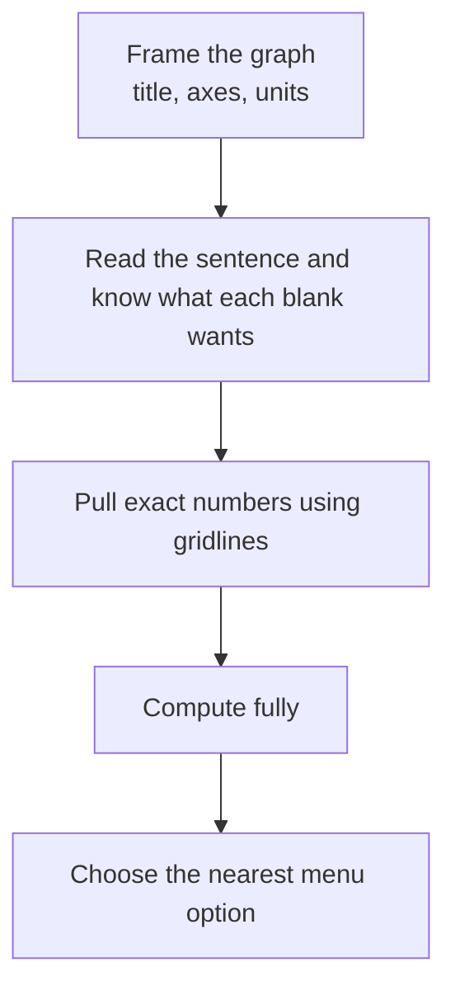

# Graphics Interpretation

Graphics Interpretation (GI) shows you one graph (bar, line, stacked bar, scatterplot, pie) and a sentence with two drop-down blanks. You pick the best option in each blank. It looks gentle, but each blank is its own scoring point, and both must be right. Expect one or two of these in the Data Insights section.

## How the question works

The prompt reads like a half-finished sentence: "Between 2021 and 2024, revenue grew by approximately [[1]] percent, while the number of stores [[2]]." Each blank is a menu of 3 to 5 options. Options are usually close together, so you cannot just eyeball: the exam wants **reading precision** plus **correct calculation**.

> [!REMEMBER]
> GI tests three things: (1) reading values accurately, (2) a short calculation (percent, ratio, difference, slope), and (3) choosing the **nearest** or **best-supported** option.

## The four-step routine

1. **Frame the graph.** Title, axes, units, legend. Say the unit aloud.
2. **Read the sentence, not the graph.** Know what each blank wants: a value, a difference, a percent, a comparison word like "increase" or "decrease", or a slope description.
3. **Pull the exact numbers.** Use the gridlines. For a point between lines, estimate to the nearest quarter of a gridline.
4. **Compute, then choose the nearest option.** Do the arithmetic fully before looking at the menu. Menus are designed to trap you into matching a half-done calculation.

Graphics Interpretation in four steps.

## Reading precisely

- **Follow the line to the axis.** Put your finger on the top of the bar and move horizontally. Parallax is real: use gridlines.
- **Count the grid steps.** If the axis shows 0, 20, 40 with gridlines every 10, you read to the nearest 5 or better.
- **Legend first, always.** Two series with similar colours are the classic mix-up. Confirm which one the sentence is about.
- **Stacked bars.** The value of a middle segment is top minus bottom. A segment's visual height is the value; its position is not.

> [!TRAP]
> In a stacked bar, the number at the top of a segment is the **running total**, not the segment's own value. Subtract the lower edge.

## Rate of change and slope

On a line graph, the **slope** between two points is (change in y) ÷ (change in x). If the x-axis is years and y is revenue in ₹ crore, the slope is crore per year.

- **Steeper line = faster change** in the units of the axis.
- **Compare slopes by comparing rise over the same run.** If two segments cover the same number of years, just compare their rises.
- **Growth rate is not slope.** A line from 10 to 20 and another from 100 to 110 have the same slope (10 per period) but very different growth rates (100% vs 10%).
- **A flat line means zero change**, not zero value.

For a concave-down curve (rising but flattening), the increase each period shrinks. For a concave-up one, it grows.

## Nearest-value answers

When the options are like 12%, 18%, 25%, 33%, compute your value (say 21.4%) and choose the **closest** one (here 18%, because 21.4 − 18 = 3.4 and 25 − 21.4 = 3.6). When the gap is small, you need the exact calculation. When it is large, rough rounding is enough.

> [!TIP]
> Estimate the answer to about 10% accuracy, then glance at the menu. If only one option is near, you are done. If two are near, compute exactly.

Also note the wording:

| Phrase | What it means |
|---|---|
| approximately / about | pick the closest |
| at least | the option must be ≥ your value |
| nearly double | between about 1.8 and 2.0 times |
| roughly half | between about 45% and 55% |

## Percentage interpretations

Questions often ask for "what percent of the total", "percent increase" or "percentage-point difference". The patterns:

- **Share of total (pie, stacked bar):** part ÷ whole. For a pie labelled in percents, you only read.
- **Percent increase:** (new − old) ÷ old.
- **Percentage points:** simple subtraction of two percent values.
- **One value as a percent of another:** a ÷ b, so "A is what percent of B" divides by B.

> [!TRAP]
> If a share goes from 20% to 30%, it did **not** rise 10%. It rose 10 percentage points, and 50% in relative terms.

For pies of different totals, convert each slice to a count before comparing: 15% of 800 is 120, which is larger than 20% of 500 (100).

## Scatterplots

Scatterplots appear in GI more often than you might expect. The typical blanks are:

- **Direction and strength of association.** "The data show a [[1]] correlation between ad spend and leads." (positive, negative, no)
- **Reading from a trend line.** "According to the line, a store with 40 staff would be expected to have sales of about [[2]]." Go up from x = 40 to the line, then across to y.
- **Above or below the line.** "Store C performed [[1]] expectation": if its dot is above the line, it performed above what the trend predicts.
- **Outliers.** A dot far from the pattern. Removing an outlier may change the slope substantially, but it rarely changes the direction of a strong trend.

> [!NOTE]
> The slope of the trend line tells you how much y changes **on average** when x rises by one unit. It does not predict any one dot exactly.

Do not extend a trend line far past the data. Statements about x-values well outside the plotted range are not supported.

## Worked examples

### Worked example 1 (Easy)
A bar chart shows quarterly website visits in thousands: Q1 = 120, Q2 = 150, Q3 = 180, Q4 = 210. "Visits rose by [[1]] thousand each quarter, so Q4 visits were [[2]] percent higher than Q1." Options for blank 1: 20, 30, 40; blank 2: 50, 60, 75, 90.

Show solution

Differences: 150 − 120 = 30, 180 − 150 = 30, 210 − 180 = 30. Blank 1 is **30**. Q4 vs Q1: 90/120 = 75%. Blank 2 is **75**.

Trap: 90 as the answer for blank 2, which is the absolute increase and not the percent.

### Worked example 2 (Medium)
A stacked bar for 2024 shows total orders of 400 (in hundreds), with the bottom segment "Online" ending at 150 and the top segment "In-store" ending at 400. "In-store orders were [[1]] percent of the total." Options: 37.5, 50, 62.5, 70.

Show solution

In-store = 400 − 150 = 250. 250/400 = 62.5%. Answer **62.5**.

Trap: 37.5% is the online share (150/400). The top-edge reading of 400 is a running total, not the in-store value.

### Worked example 3 (Medium-hard)
A line chart shows monthly leads for two channels. Channel A rises from 200 in January to 320 in May. Channel B rises from 80 to 164 over the same months. "Over this period, Channel [[1]] had the larger growth rate, at about [[2]] percent." Options for blank 1: A, B. Blank 2: 50, 60, 85, 105.

Show solution

A: 120/200 = 60%. B: 84/80 = 105%. The larger growth rate is **B**, at about **105** percent.

Trap: A has the larger absolute rise (120 vs 84), but the growth rate divides by each channel's own starting value. Blank 2 options 50 and 60 are A's figures, so a half-right answer is built in.

### Worked example 4 (Hard)
A scatterplot plots 30 cities, with x = marketing spend (₹ lakh) and y = new customers. A trend line passes through (10, 200) and (30, 520). "The trend line suggests each additional ₹1 lakh of spend is associated with about [[1]] new customers, and a city spending ₹20 lakh would be expected to gain about [[2]] customers." Options for blank 1: 8, 12, 16, 32; blank 2: 300, 360, 400, 460.

Show solution

Slope = (520 − 200)/(30 − 10) = 320/20 = **16** customers per lakh. At x = 20, which is the midpoint, y = (200 + 520)/2 = **360**.

Faster way: x = 20 sits exactly halfway between 10 and 30, so y is the average of the two y-values.

Trap: 32 comes from dividing 320 by 10 instead of 20. 520 would be the value at 30, and 400 is a rough guess that ignores the slope.

## Quick check
1. A y-axis has gridlines every 25 and a bar tops out halfway between the 100 and 125 lines. What is its value?

Answer
About 112.5 (so you read it as 112 or 113).

2. Sales go from 50 to 80 in a line chart. What is the percent increase?

Answer
30/50 = 60%.

3. A pie shows 24% for "Paid search" and the total is 500 units. How many units?

Answer
0.24 × 500 = 120.

4. A dot sits well above the trend line. How did it perform relative to expectation?

Answer
Higher than the trend predicts for its x-value.

## Key takeaways
- Read the sentence first, so you know whether the blank needs a value, a percent or a comparison.
- Always check units and the legend before pulling numbers.
- In stacked bars, subtract edges; never read a top-edge number as a segment value.
- Slope = rise ÷ run, in the axis units. Growth rate divides by the starting value.
- Compute fully, then pick the nearest option. Menus contain half-finished answers on purpose.
- Percent change and percentage-point difference are different. Check which the blank wants.
- Scatterplots show association only; stay inside the plotted range when using the trend line.

## Go deeper
- [Khan Academy: Statistics and probability](https://www.khanacademy.org/math/statistics-probability) — scatterplots, trend lines and reading graphs.
- [Official GMAT exam site](https://www.mba.com/exams/gmat-exam) — Data Insights overview.
- [GMAT Club forum](https://gmatclub.com/forum/) — worked threads on Graphics Interpretation.
