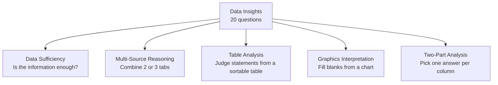

# Meet Data Insights

Data Insights (DI) is the newest section of the GMAT, and the one that feels least like anything you did at school. It is 20 questions in 45 minutes, it counts for one third of your total score, and it rewards exactly the skills a marketing job already trains: reading messy information, deciding what matters, and not getting fooled by a confident-looking number.

## What Data Insights actually tests

Quant asks you to solve a clean problem. Data Insights hands you a pile of information (a table, a chart, three emails, two statements) and asks what you can conclude from it. The math is the same arithmetic and algebra you meet in Quant, and it is usually lighter. The harder part is the reasoning: which numbers are relevant, what the question is really asking, and whether the information you were given is enough.

That is why DI is called a mixed section. Some questions are nearly pure math wearing a business costume. Others are nearly pure logic with a number or two thrown in. Many sit in the middle, and they need you to read like a Verbal student and calculate like a Quant student in the same two minutes.

> [!NOTE]
> You get an on-screen calculator in DI, and only in DI. It is basic (add, subtract, multiply, divide, square root, percent). Quant has no calculator at all.

## The five question types

You will see all five in every test, in a mixed order. The numbers below are typical, not guaranteed, because the test adapts to you.

| Type | Full name | What you get | Roughly how many |
|---|---|---|---|
| DS | Data Sufficiency | A question and two statements | 5-7 |
| MSR | Multi-Source Reasoning | 2-3 tabs of text, tables or charts, then 2-3 questions | 6-7 (in 2-3 sets) |
| TA | Table Analysis | A sortable table, then true/false statements | 2-4 |
| GI | Graphics Interpretation | A chart, then a sentence with drop-down blanks | 2-4 |
| TPA | Two-Part Analysis | A short problem, then one answer for each of two columns | 2-4 |

Here are the five Data Insights types and what each one asks you to do.

Let's meet each one with a tiny example, so none of them looks strange on test day.

### 1. Data Sufficiency (DS)

You are asked a question, then given two statements. You do not solve the question. You decide whether the statements give you enough to solve it.

> What is the value of x?
>
> (1) 2x = 10
>
> (2) x² = 25

Statement (1) gives x = 5, one value, so it is enough. Statement (2) gives x = 5 or x = −5, two values, so it is not enough. The answer is "(1) alone is sufficient, (2) alone is not". DS gets its own lessons, and it is the first thing you will study, because it appears nowhere else in life.

### 2. Multi-Source Reasoning (MSR)

A split screen with two or three tabs: perhaps an email from a manager, a table of sales figures and a short policy note. Each question needs information from more than one tab. A typical question is: "Based on the email and the table, can the company afford the new contract?" You must click between tabs, so the skill is knowing where to look.

### 3. Table Analysis (TA)

A table with many rows that you can sort by any column. Below it are three statements, and you mark each one as true or false (or yes or no) based on the table.

| Store | Revenue (₹ lakh) | Costs (₹ lakh) |
|---|---|---|
| A | 120 | 90 |
| B | 200 | 170 |
| C | 150 | 100 |
| D | 90 | 80 |

"Store C has the highest profit." Profit is revenue minus costs: A = 30, B = 30, C = 50, D = 10. True. You get three of these statements in one question, and **all three must be right** for credit.

### 4. Graphics Interpretation (GI)

A chart (bars, lines, a scatter plot) with a sentence that has two drop-down menus. For example: "From 2022 to 2024 the number of visitors rose by about ____ percent, while revenue per visitor ____ (rose / fell / stayed flat)." You read the chart carefully, then fill both blanks. Both must be right.

### 5. Two-Part Analysis (TPA)

A short scenario, then a small grid. You pick one row for the first column and one row for the second. The two choices are usually linked.

> Two positive numbers have a sum of 14 and a product of 48. Select a value for Number 1 and a value for Number 2. Options: 2, 4, 6, 8, 10.

Answer: 6 and 8 (6 + 8 = 14, 6 × 8 = 48). Again, both columns must be right.

> [!REMEMBER]
> Three of the five types (TA, GI, TPA) are multi-part: every part must be correct to get credit for the question. There is no partial credit. That is fine, because these questions are often easier than they look when you take them one part at a time. Just never rush the last part.

## Timing: the 2:15 rule

Forty-five minutes divided by 20 questions is 2 minutes 15 seconds per question. That is your average, not your target for every question. Some will take 70 seconds. A few hard ones will deserve three minutes. What matters is that the average holds.

Checkpoints help. After about 15 minutes you should be around question 7, after 30 minutes around question 13 or 14, and after 40 minutes you should be starting question 18 with a few minutes in hand for the last ones.

> [!TIP]
> If you have already spent about two minutes and still don't have a plan, make your best educated guess, bookmark the question, and move on. A wrong guess costs the same as a wrong answer after five minutes of work, but the five minutes cost you the next question as well.

Also remember: unanswered questions are penalised on the GMAT Focus Edition, so always answer something before time runs out. In the last 90 seconds, guess on whatever is left.

## How DI is scored

Data Insights gets its own section score between 60 and 90. The total score (205-805) combines your Quant, Verbal and Data Insights section scores with equal weight. In plain words: a 5-point drop in DI hurts your total about as much as a 5-point drop in Verbal. Many people from non-maths backgrounds put all their energy into Quant and treat DI as an afterthought, which is a waste, because DI is very learnable. Pattern recognition does most of the work, and you will build it here.

The test is also question-level adaptive. Get early questions right and the next ones get harder; get them wrong and they ease off. So the early questions matter a little more, which is one more reason not to burn two minutes on a hopeless question at the start.

## The calculator: when to use it and when not to

The calculator is a helper for arithmetic, not for thinking. Use it for long multiplication or division in Table Analysis, Graphics Interpretation and MSR, where numbers like 1,847 × 0.36 show up. Use it to double-check a percent change.

Do not use it in these situations:

- **Data Sufficiency.** You almost never have to compute the final value. Calculating wastes time and tempts you to solve what you only needed to judge.
- **When estimation is enough.** If the answer choices differ by a lot, "about 40%" beats typing six numbers.
- **When a simple rule gives it away.** Even or odd, positive or negative, bigger or smaller: your brain is faster than the buttons.

> [!TRAP]
> The calculator can make you slow. Typing 37 × 24 takes five seconds and invites a typo. Mental maths (37 × 24 = 37 × 25 − 37 = 925 − 37 = 888) takes about the same time and teaches your brain to see structure. Use the tool when the numbers are ugly, not to avoid thinking.

## Worked examples

### Worked example 1 (Easy)
What is the value of x + y?

(1) x = 2y

(2) 3y = 12

Show solution

Statement (1) alone: x = 2y links x and y but doesn't fix either. y = 1 gives x + y = 3, and y = 2 gives x + y = 6. Not sufficient.

Statement (2) alone: y = 4, but x is unknown, so x + y can't be found. Not sufficient.

Together: y = 4, so x = 8, and x + y = 12. One value, so sufficient. The answer is C.

Faster way: count the unknowns. Two unknowns (x and y) need two independent pieces of information, and neither statement alone provides both.

Trap: picking A or B after solving only one statement. Always test each statement on its own first.

### Worked example 2 (Medium)
A gym charges a one-time joining fee F plus a fixed monthly fee M. A 6-month membership costs ₹8,000 in total, and a 12-month membership costs ₹14,000 in total. Select a value for F and a value for M that are consistent with this information. Options: 500, 1,000, 1,500, 2,000, 2,500.

Show solution

The two memberships give F + 6M = 8,000 and F + 12M = 14,000. Subtract the first from the second: 6M = 6,000, so M = 1,000. Then F = 8,000 − 6,000 = 2,000.

Answer: F = 2,000 and M = 1,000.

Faster way: the extra 6 months cost ₹6,000, so each month is ₹1,000. The fee is what is left of the first total after 6 months.

Trap: treating the pair as separate. In TPA the two answers are linked, so check your pair against both facts before submitting.

### Worked example 3 (Medium)
Using the store table above, mark each statement true or false.

(a) Total profit across the four stores exceeds ₹100 lakh.
(b) Store C has the highest profit margin (profit divided by revenue).
(c) The store with the highest revenue also has the highest profit.

Show solution

Profits: A = 30, B = 30, C = 50, D = 10 (all in ₹ lakh).

(a) 30 + 30 + 50 + 10 = 120, which exceeds 100. True.

(b) Margins: A = 30/120 = 25%, B = 30/200 = 15%, C = 50/150 = 33.3%, D = 10/90 = 11.1%. Store C is highest. True.

(c) Highest revenue is Store B (200), but its profit (30) is below Store C's (50). False.

Trap: confusing revenue with profit, or profit with margin. Before you evaluate a TA statement, circle the exact measure it uses.

### Worked example 4 (Hard)
Is xy > 0?

(1) x + y > 0

(2) x − y > 0

Show solution

Statement (1) alone: x = 3, y = 1 gives xy = 3 > 0 (yes). x = 3, y = −1 also has x + y = 2 > 0, but xy = −3 (no). Two different answers, so not sufficient.

Statement (2) alone: x = 3, y = 1 gives x − y = 2 > 0 and xy = 3 (yes). x = 1, y = −3 gives x − y = 4 > 0 and xy = −3 (no). Not sufficient.

Together: x = 3, y = 1 satisfies both and gives yes. x = 3, y = −1 satisfies both (sum 2, difference 4) and gives no. Still two answers. The answer is E.

Trap: feeling that two inequalities "must" combine into something useful. If one pair of numbers gives yes and another gives no, you're done; the statements are not sufficient.

## What to study, and in what order

DI looks like five separate skills, but there are really three layers. Build them in this order, and Maria, don't skip ahead:

1. **Data Sufficiency method** (this unit). It is the strangest question format, and mastering it makes everything else feel familiar. Start with the five fixed answer choices, then Yes/No questions, then the traps, then the word-based (non-numerical) version.
2. **Data literacy.** Reading tables, charts and percent changes quickly and accurately. This supports Table Analysis, Graphics Interpretation and MSR.
3. **Multi-part question types.** Two-Part Analysis and Multi-Source Reasoning, then timed mixed sets and strategy.

Quant topics (percents, ratios, number properties, inequalities, basic statistics) feed DI constantly, so keep your Quant practice going alongside. A DS question about "the average of five numbers" is a stats question wearing a different hat.

## Quick check

1. How many seconds per question, on average, do you get in Data Insights?

Answer

45 minutes is 2,700 seconds, and 2,700 ÷ 20 = 135 seconds, or 2 minutes 15 seconds.

2. Name the three DI question types where every part must be right to get credit.

Answer

Table Analysis (all three statements), Graphics Interpretation (both blanks) and Two-Part Analysis (both columns). Some MSR questions also use the three-statement format.

3. In which question type should you almost never use the calculator to find the final value?

Answer

Data Sufficiency. You only decide whether the information is enough; computing the value wastes time.

4. Is the Data Insights section score weighted less than Quant or Verbal in your total?

Answer

No. All three section scores count equally toward the 205-805 total.

## Key takeaways

- Data Insights is 20 questions in 45 minutes: about 2:15 per question on average.
- The five types are DS, MSR, TA, GI and TPA, and the on-screen calculator is available for all of them.
- Multi-part questions (TA, GI, TPA) give credit only when every part is right, so take each part carefully.
- DI counts as one third of your total score, the same weight as Quant and Verbal.
- DI mixes reasoning with light maths: the logic is harder than the arithmetic.
- Use the calculator for ugly arithmetic, never to compute what DS only asks you to judge.
- Study order: DS method, then data literacy, then TPA and MSR, then timed mixed practice.
- Always answer every question before time ends, because blanks are penalised.

## Go deeper
- [Official GMAT Focus Edition exam page](https://www.mba.com/exams/gmat-exam) for the current format and sample questions from the test makers.
- [GMAT Club forums](https://gmatclub.com/forum/) for community discussion of Data Insights strategy and pacing.
- [Khan Academy: Algebra](https://www.khanacademy.org/math/algebra) to refresh the algebra behind many DI questions.
