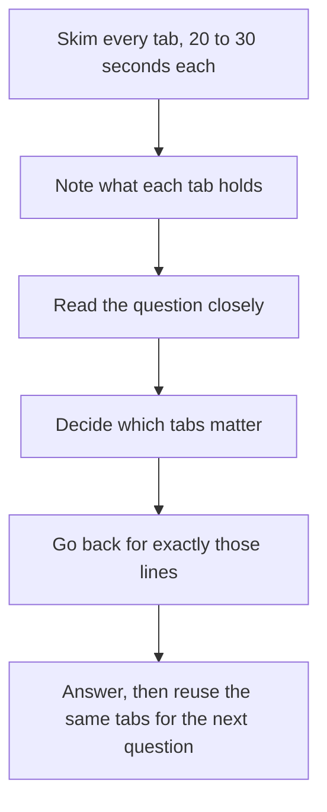
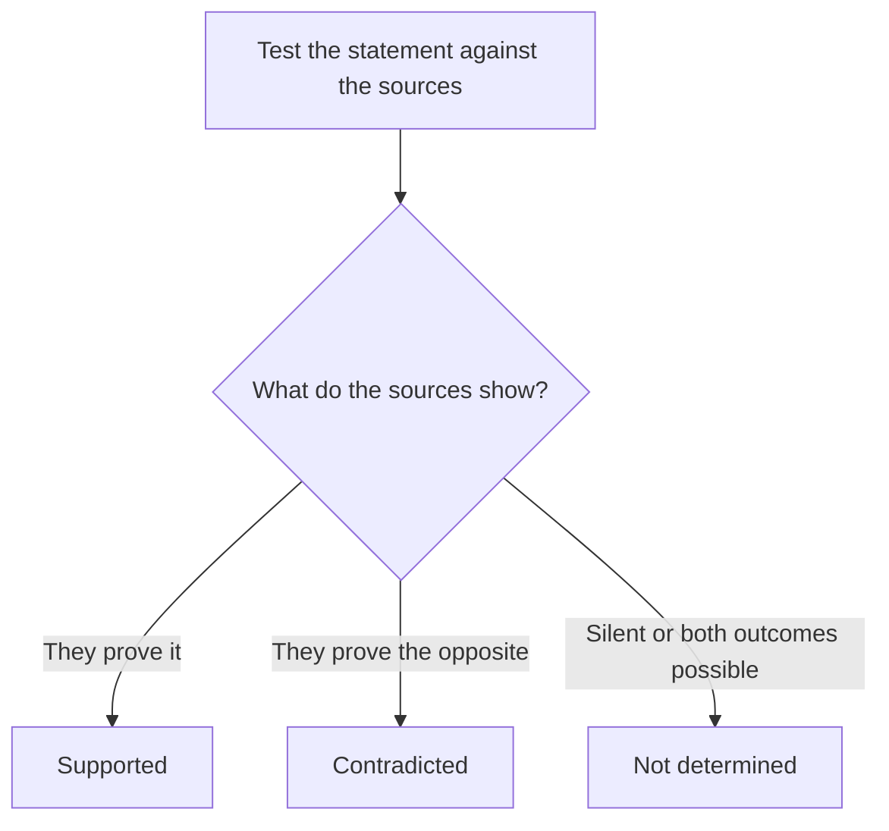

# Multi-Source Reasoning (MSR)

Multi-Source Reasoning is the Data Insights question type that feels most like real work: you open a few "tabs" (an email, a memo, a table, a chart), and you answer questions that need information from more than one of them. Expect roughly 2 to 3 MSR sets, so 6 to 9 of your 20 questions, which makes this the single biggest type in the section.

## How an MSR set is built

Every set has one shared stimulus and usually three questions. The stimulus has two or three tabs, and you click between them. You can't see two tabs at the same time, so you have to remember or jot down what each contains.

| Tab type | What it usually holds |
|---|---|
| Email or memo | A person's goals, rules, deadlines, or constraints. Often the "business logic" lives here. |
| Table | Numbers: costs, quantities, rates, dates, scores. |
| Chart | A trend or a comparison (bar, line, or scatter). |
| Policy or report excerpt | Definitions and exceptions you must apply exactly. |

The three questions in a set are usually independent. You can answer them in any order, and a mistake in one rarely ruins another.

### Question formats

- **Multiple choice** with five options, like a normal question. Most need you to combine two tabs: apply a rule from the memo to numbers in the table.
- **Yes/No or True/False triples.** You see three statements and mark each one Yes or No (or True or False, or Supported or Not supported). You only score if all three are correct.

> [!REMEMBER]
> Three layers of difficulty live in MSR: (1) finding the right number, (2) applying the right rule, (3) deciding whether a claim is proved, possible, or unsupported. The third layer is where good scores are made.

## The skim-first routine

The mistake that costs people the most time is reading each tab in full, then reading the question, then going back to hunt. Do this instead.

1. **Skim every tab for 20 to 30 seconds each.** Note what each tab contains in a few words ("Tab 1: manager's rules; Tab 2: costs by site; Tab 3: monthly trend"). Don't try to memorise details.
2. **Read the question closely.** Decide which tab or tabs hold the answer.
3. **Go back for exactly what you need.** Read the relevant lines slowly, highlight the numbers in your head, write them on your noteboard.
4. **Answer the next question, using the same tabs.** This is where reading once pays off: question 2 and 3 are much faster because you already know the layout.

> [!TIP]
> The first question of a set is the slowest (about 3 to 4 minutes including the skim). Questions 2 and 3 should take 1.5 to 2 minutes each. Over the whole set you average about 2.5 minutes per question.

The skim-first routine for Multi-Source Reasoning.

## Cross-referencing tabs

Most hard MSR questions have a "hand-off": a rule in one tab applied to data in another. The classic hand-offs:

- **Memo rule, table data.** "Order only from suppliers with a defect rate under 2%" (memo) and a supplier table. You filter the table using the memo.
- **Definition in one tab, numbers in another.** "Net revenue means sales minus returns" and a table of sales and returns.
- **Email request, chart trend.** "We want to invest where growth is steadiest" and a line chart.
- **Two sources disagree.** A memo says 12 staff, a table shows 14. Look for the date, the scope (full-time vs all), or the units. Differences like these are deliberate.

Always check units (₹ thousands vs ₹ lakh, per month vs per year, percent vs percentage points), dates, and scope words like "only", "at least", "per person".

> [!TRAP]
> A tempting wrong answer in MSR is usually correct arithmetic on the wrong row, or the right row with the rule from the wrong tab. If your answer seems to appear straight off the table without applying the memo's rule, stop and ask what the memo changed.

## Inference vs "can be determined"

Yes/No triples often test how far you can go. Sort every statement into one of three boxes:

- **Supported.** The sources prove it, with arithmetic if needed.
- **Contradicted.** The sources prove the opposite.
- **Not determined.** The sources are silent or leave both outcomes possible.

On a "Yes/No" label set, "Not determined" usually counts as No (the statement isn't proved). On a "True/False" set, read the label wording carefully: the question stem usually says what to do ("Is the statement supported by the information?"). Your job is to ask: "Can I show this from the tabs alone?" Not: "Is this probably true in real life?"

Every statement in a Yes/No set lands in one of three boxes.

> [!NOTE]
> Don't import outside knowledge. If a memo says "the new rule starts in March", you can't assume "starts" means March 1 unless it says so. Use only what's on the screen.

## A full worked set

Here's one complete MSR set, with four questions at rising difficulty. (Real sets have three questions; we'll use four so you can see more patterns.) Read the three tabs, then try each question before opening the solution.

**Tab 1: Email**

> From: Priya Nair, Regional Manager
> To: Expansion team
> Subject: New kiosk decision
>
> We're opening one new coffee kiosk next quarter, either at the Metro Station or at the Mall. A site goes ahead only if its expected monthly profit is at least ₹1,00,000. Monthly profit means monthly revenue minus variable costs minus rent. Assume 30 trading days a month. Variable costs are 55% of revenue at both sites.

**Tab 2: Site data**

| Site | Visitors per day | Share of visitors who buy | Average bill (₹) | Monthly rent (₹) |
|---|---|---|---|---|
| Metro Station | 1,500 | 8% | 100 | 90,000 |
| Mall | 1,000 | 12% | 160 | 1,40,000 |

**Tab 3: Note from Finance**

> Rent at the Metro Station is negotiable. Rent at the Mall is fixed by the landlord's contract.

### Worked example 1 (Easy)

What is the expected monthly revenue at the Mall?

(A) ₹1,92,000  (B) ₹2,59,200  (C) ₹3,60,000  (D) ₹5,76,000  (E) ₹6,40,000

Show solution

Buyers per day = 1,000 × 12% = 120. Revenue per day = 120 × 160 = ₹19,200. Over 30 days: ₹5,76,000. Answer (D).

Trap: (B) ₹2,59,200 is the Mall's profit before rent (45% of revenue), not revenue. (C) is the Metro's revenue, from the wrong row.

### Worked example 2 (Medium)

Does the Mall meet Priya's profit rule, and by how much does it exceed or miss the target?

(A) Misses by ₹7,200  (B) Meets, exceeds by ₹19,200  (C) Meets, exceeds by ₹1,19,200  (D) Misses by ₹40,000  (E) Meets, exceeds by ₹1,00,000

Show solution

Revenue = ₹5,76,000. Variable costs are 55%, so contribution = 45% × 5,76,000 = ₹2,59,200. Subtract rent: 2,59,200 − 1,40,000 = ₹1,19,200. The target is ₹1,00,000, so the Mall exceeds it by ₹19,200. Answer (B).

Trap: (C) forgets to compare with the target; ₹1,19,200 is the profit itself.

### Worked example 3 (Medium to hard, True/False triple)

For each statement, say whether it is True or False based on the three tabs.

1. At its current rent, the Metro Station meets the profit rule.
2. Each visitor to the Mall generates more expected revenue than each visitor to the Metro Station.
3. If variable costs at the Metro Station fell to 50% of revenue (rent unchanged), the Metro Station would meet the profit rule.

Show solution

Metro revenue = 1,500 × 8% × 100 × 30 = ₹3,60,000. Contribution at 45% = ₹1,62,000. Minus rent 90,000 = ₹72,000, below the ₹1,00,000 target. Statement 1: False.

Revenue per visitor: Mall 12% × 160 = ₹19.20. Metro 8% × 100 = ₹8. Statement 2: True.

At 50% costs: 3,60,000 × 50% = 1,80,000, minus 90,000 = ₹90,000. Still below 1,00,000. Statement 3: False.

Answer: F, T, F. Note that statement 2 didn't need the memo at all, which shows how some statements use only one tab.

### Worked example 4 (Hard)

Using only the information given, what is the largest Metro Station monthly rent at which the Metro Station would still meet the profit rule?

(A) ₹62,000  (B) ₹72,000  (C) ₹90,000  (D) ₹1,00,000  (E) ₹1,62,000

Show solution

This question needs the memo's rule (profit at least ₹1,00,000), the table's data (to get contribution), and the Finance note (rent is the variable you can change).

Contribution at Metro = ₹1,62,000. We need 1,62,000 − rent ≥ 1,00,000, so rent ≤ ₹62,000. Answer (A).

Trap: (B) is the current profit, which is a different quantity. (E) is contribution before rent. The tab-3 note is what tells you rent is the thing to solve for; without it, you'd look for another unknown.

## Calculator discipline

You get the on-screen calculator in Data Insights, and in MSR it's worth using. But a calculator doesn't think for you. Use it for multi-step products and percentages, and do easy arithmetic in your head. Always write the intermediate numbers on your noteboard (the number of buyers, the revenue, the contribution), so you can reuse them in the next question of the set.

## Time management

- Budget about 7 to 8 minutes per 3-question set.
- If you're at four minutes and haven't finished question 1, you've either misread a rule or you're hunting for a number that isn't there. Re-read the question stem, not the tabs.
- Don't abandon in the middle of a set after investing the skim time. It's better to guess on one hard question in the set and finish the other two.
- Keep notes tight: jot "Tab1 = rules, Tab2 = costs, Tab3 = trend". Details can be re-read; structure can't be easily recalled.

## Quick check

1. Why skim all tabs before reading question 1?

Answer

So you know where each type of information lives. You pay the reading cost once, and the next two questions become much faster.

2. A memo says "contracts above ₹5 lakh need approval." A table shows a contract of exactly ₹5 lakh. Does it need approval?

Answer

No. "Above" means strictly greater than. Watch every boundary word (above, at least, under, up to).

3. A statement says "Site B will earn more next year." The tabs only give this year's data. True or false?

Answer

Not supported (so not "Yes/True"). The tabs don't contain forecasts, and you can't import outside assumptions.

4. In the worked set, why was the Finance note important?

Answer

It tells you the Metro rent can change (and the Mall rent can't), which tells you what variable question 4 is solving for.

## Key takeaways

- Skim all tabs first and note what each contains. Details come later, when a question needs them.
- Most hard questions are a "hand-off": a rule in one tab applied to data in another.
- Check units, dates, and scope words ("only", "at least", "per person") every time.
- In Yes/No triples, ask "can I prove this from the tabs alone?" Not "is this probably true?"
- Write intermediate results on your noteboard so questions 2 and 3 are faster.
- Budget about 7 to 8 minutes per set. Guess on one hard item rather than burn five minutes on it.

## Go deeper
- [GMAT exam overview (mba.com)](https://www.mba.com/exams/gmat-exam) — official description of Multi-Source Reasoning.
- [GMAT Club forum](https://gmatclub.com/forum/) — discussion threads on Data Insights pacing.
- [Khan Academy: Statistics and probability](https://www.khanacademy.org/math/statistics-probability) — helps with reading tables and charts quickly.
