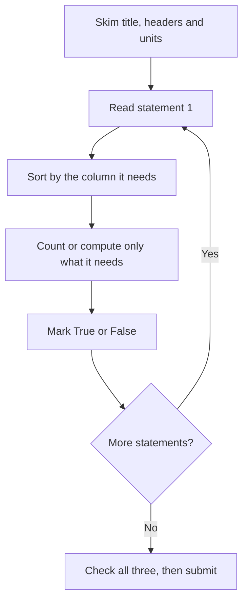

# Table Analysis

Table Analysis (TA) shows you a sortable data table and three statements. For each one you decide Yes or No (or True or False). You get one Data Insights question per table, usually one or two per exam, and each takes about two to three minutes. The table is not hard to read; the skill is deciding what to compute and what to skip.

## What the question looks like

You see a table with 6 to 15 rows and 4 to 7 columns, a short intro sentence, and a prompt such as "For each of the following statements, select Yes if the statement is true based on the table, and No otherwise." Three statements follow. You must get **all three** right to score the question.

The table is sortable: click a column header and the rows reorder. That one feature is the whole game. Sorting turns "find the median", "count how many exceed X" and "which is the highest" into a glance.

> [!REMEMBER]
> The question is only correct if all three statements are right. Treat each statement as its own mini problem, and never skip one because you are "pretty sure".

## The five-step method

1. **Skim the table frame (5 seconds).** Title, column headers, units, any footnote.
2. **Read statement 1 before doing anything.** Decide which column (or two) it cares about.
3. **Sort by that column.** Highest to lowest usually works. Click once or twice to flip.
4. **Count or compute only what the statement needs.** Do not calculate the whole table.
5. **Answer, then re-sort for the next statement.** Reset your eyes, because the row order changed.

Strategy tip: do not memorise the table before reading the statements. A table has hundreds of facts; the statements ask about three.

The Table Analysis method as a loop you repeat for each statement.

## Statement types you will meet

### 1. Counting statements

"More than half of the countries have a growth rate above 3%." Sort by growth rate, find where it crosses 3%, count rows above it, and compare with half of the total.

**At least / at most / more than / fewer than.** Watch the boundary:

| Phrase | Includes the boundary value? |
|---|---|
| at least 40 | Yes (40 or more) |
| more than 40 | No (41 or more) |
| at most 40 | Yes (40 or fewer) |
| fewer than 40 | No (39 or fewer) |

> [!TRAP]
> A row that equals the boundary exactly is where most students slip. Mark it when you sort: it is in for "at least" and out for "more than".

### 2. Extreme value statements

"The highest-revenue company also has the lowest margin." Sort by revenue, look at the top row, then check whether its margin is the lowest. Sort by margin only if you need to verify it.

### 3. Median and mean statements

For the median, sort by the column, then count to the middle. With 11 rows, it is the 6th value. With 12 rows, the average of the 6th and 7th. For "the median is greater than the mean", remember that if a few huge values exist, the mean is pulled up and sits above the median; if a few tiny values exist, the mean sits below.

For the mean, you often do not need the exact value. Estimate the total from the rounded numbers, or test whether the mean must be above or below a threshold by seeing which values are far from it.

### 4. Percent-of-total statements

"Region X accounts for more than 25% of total sales." Total is the sum of the column, so add the column once (use the calculator or estimate), then compare the row against a quarter of the total. A cleaner check: is the row bigger than the sum of the other three-quarters divided by three? In practice, just test "row × 4 > total".

> [!TIP]
> To test "A is more than 30% of B", compute 0.3 × B (or 3 × B / 10) and compare with A. You never need the exact percent.

### 5. Comparison and ratio statements

"The profit per employee at Firm C is more than twice that at Firm F." Compute each ratio roughly and compare. If the numbers are close to the threshold, do the exact division.

### 6. Statements with two conditions

"Every company with revenue over 500 has a margin below 10%." Sort by revenue, scan only the rows above 500, and check the margin column. One counterexample is enough to say No. For "At least one", one example is enough to say Yes.

> [!NOTE]
> "Every" statements fail on a single exception; "at least one" statements succeed on a single example. Knowing when you can stop searching saves a lot of time.

## Using the calculator wisely

The on-screen calculator is slow. Use it for:

- Summing a column of messy decimals when the threshold is close.
- Dividing two awkward numbers whose rough ratio is within about 5% of the threshold.

Skip it when the gap is obvious. For instance, if a row is 62 out of a total that you can roughly see is about 200, you already know it is above 25%.

## Worked examples

### Worked example 1 (Easy)
A table lists eight stores with columns Store, Region, Weekly Sales (₹ lakh), Staff, Footfall (thousands). Statement: "Exactly three stores have weekly sales above ₹40 lakh."

Show solution

Sort the Weekly Sales column from highest to lowest. Count the rows with a value greater than 40, stopping at the first row at or below 40. If three rows appear above that line and the fourth is 40 or less, the statement is Yes.

Faster way: sorting means you never read the bottom half of the table at all.

Trap: a store with exactly 40 lakh is not "above 40". Check the fourth row's value precisely.

### Worked example 2 (Medium)
Ten cities list average monthly rent (in thousands of ₹). Sorted values: 18, 20, 22, 24, 25, 27, 30, 35, 41, 70. Statement: "The median rent is lower than the mean rent."

Show solution

Median = average of the 5th and 6th values = (25 + 27)/2 = 26. Mean = sum/10 = (18 + 20 + 22 + 24 + 25 + 27 + 30 + 35 + 41 + 70)/10 = 312/10 = 31.2. So the median (26) is lower than the mean (31.2): **Yes**.

Faster way: one very high value (70) with no matching very low value drags the mean up, so the mean exceeds the median. You can say Yes without adding anything.

Trap: using the 5th value (25) as the median. With 10 values you must average the two middle ones.

### Worked example 3 (Medium-hard)
A table gives six products with Units Sold (thousands): 120, 80, 200, 50, 150, 100. Statement: "The best-selling product accounts for more than one-quarter of total units sold."

Show solution

Total = 120 + 80 + 200 + 50 + 150 + 100 = 700. A quarter of 700 is 175. The best seller is 200, which is above 175. So **Yes** (200/700 ≈ 28.6%).

Faster way: round to 700 quickly. 200 × 4 = 800 > 700, so it must exceed 25%.

Trap: comparing 200 to the second-highest value rather than to the total.

### Worked example 4 (Hard)
A table lists seven firms with Revenue ($m) and Employees. Statement: "The firm with the highest revenue per employee is not the firm with the highest revenue."

Show solution

Compute revenue ÷ employees for every row (the calculator is worth using here, because you cannot sort a derived column). Rough values are enough if the leader is clear. Compare the firm with the highest ratio against the firm at the top of the revenue sort. If they differ, the answer is Yes; if they are the same firm, No.

Method tip: for the ratio, a firm with high revenue and a large workforce often loses to a smaller, leaner firm. Test the top two or three revenue firms first, and the smallest-employee firms.

Trap: assuming the biggest firm is the most productive. The statement asks about a ratio, and ratios are not sortable in the table.

## Quick check
1. A table has 13 rows and you sort by price. Which row is the median?

Answer
The 7th.

2. "More than 4 of 12 stores exceed 30 units." Exactly 4 stores are above 30, and one store equals 30. Is the statement true?

Answer
No. The store at 30 does not exceed 30, so only 4 stores qualify, and "more than 4" needs at least 5.

3. Column total is 480. A row shows 130. Is it more than 25% of total?

Answer
25% of 480 is 120, so yes.

4. One row breaks the rule "every firm with Y above 50 has Z below 10". What is the answer?

Answer
No, a single counterexample is enough.

## Key takeaways
- Read the statements first; the table has far more facts than you need.
- Sort by the right column before counting. It is the fastest single action in the section.
- Check boundary rows ("at least" includes the number, "more than" does not).
- For median, sort and count to the middle; with an even count, average the middle two.
- Test percent-of-total claims with multiplication (row × 4 > total) rather than exact division.
- For "every" statements look for one counterexample; for "at least one" find one example.
- Sorting works only on existing columns; ratios between columns need a quick calculation.
- All three statements must be right, so give each one full attention.

## Go deeper
- [Official GMAT exam site](https://www.mba.com/exams/gmat-exam) — Data Insights format and practice resources.
- [GMAT Club forum](https://gmatclub.com/forum/) — discussion threads on Table Analysis strategy.
- [Khan Academy: Statistics and probability](https://www.khanacademy.org/math/statistics-probability) — mean, median and percent practice.
