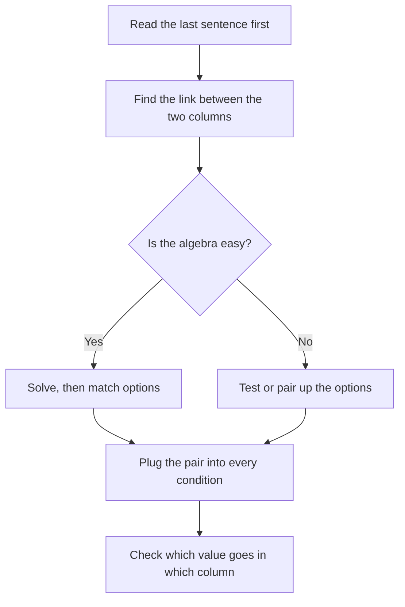

# Two-Part Analysis (TPA)

Two-Part Analysis questions show up in roughly 3 to 5 of your 20 Data Insights questions. They look strange at first, because you pick two answers instead of one, but underneath they're ordinary algebra, logic, or word-problem questions wearing a different outfit. Once you see that, they become some of the most predictable points in the section.

## What the question looks like

You get a short scenario (a paragraph, sometimes with a small table). Then you see a grid. There are two columns, each with a heading, and a list of five or six shared options running down the side. Your job is to choose one option in the first column and one option in the second column. You answer correctly only if both selections are right.

Here's the layout in words:

| Option | Column 1 (for example, "Price of A") | Column 2 (for example, "Price of B") |
|---|---|---|
| 12 | ○ | ○ |
| 15 | ○ | ○ |
| 18 | ○ | ○ |
| 20 | ○ | ○ |
| 24 | ○ | ○ |

Three facts about the format matter a lot.

- Both columns draw from the same list of options.
- The same option can be correct for both columns, but only if the scenario allows it. Don't assume it, and don't rule it out.
- There is no partial credit. One wrong click and the whole question is wrong.

> [!REMEMBER]
> A TPA is one puzzle with two unknowns. The two columns are almost always tied together by one relationship (a sum, a product, a ratio, a logical link). Finding that link is the whole game.

## The two flavours

About 60% of TPAs are quantitative and about 40% are verbal or logic-based. You can't predict which you'll get, so train both.

### Quant TPAs

You'll see things like "choose a value for x and a value for y that satisfy these conditions", or "choose the two prices that produce this revenue". The question usually gives you one or two constraints and each constraint ties the two unknowns together. Common shapes:

- Sum or difference given, plus a second condition (for example, x + y = 40 and x is 3 times y).
- A product or ratio condition (for example, total cost, rate times time).
- A range condition: "x must be greater than y" or "the average must lie between 8 and 10".
- Minimum and maximum: "choose the smallest and largest possible values".

### Verbal and logic TPAs

These don't need calculation. Typical shapes:

- **Strengthen and weaken pair.** "Choose the statement that would most strengthen the argument and the statement that would most weaken it." You need both columns, and the same sentence can't do both jobs.
- **Assumption and conclusion.** Choose which sentence is the conclusion and which is an unstated assumption the author relies on.
- **Scheduling or ordering.** Five meetings, rules about who goes before whom. Choose the earliest possible and latest possible slot for one item.
- **Best and worst.** Pick the policy most likely to help and the one most likely to hurt a stated goal.

## The core strategy

### Step 1: Read the question stem before the scenario details

The last sentence tells you what each column asks for. Underline in your mind the two things you must find. Then read the scenario knowing what to hunt for.

### Step 2: Find the constraint that links the two parts

Ask yourself: "If I knew column 1, could I work out column 2?" If yes, you have a link. Write it as an equation, an inequality, or a plain sentence. Everything else in the problem is decoration around that link.

### Step 3: Use the options, don't fight them

You've got five or six real numbers on screen. That is a gift. Often it's quicker to test options than to solve a clean algebra problem.

- **Solve first, then match.** Best when the algebra is easy (two simple equations).
- **Test the options.** Best when the algebra is messy or the link is a condition ("the product must equal 72").
- **Pair up.** Look for two options that satisfy the link together, and check the other condition on that pair.

### Step 4: Allow the same option twice only when the scenario does

Before you commit, ask: could both columns have the same value in this story? If a price must be higher than a cost, the same number can't fill both. If the two items are independent quantities, same value is fine.

### Step 5: Check both columns against every condition

Plug your final pair back into every sentence of the scenario. This takes 15 seconds and catches most errors.

> [!TIP]
> Cross out the options that fail a quick sanity check (too big, wrong parity, not a multiple of something). With six options, eliminating two or three turns a hard search into a short one.

> [!TRAP]
> The most common trap is answering a different pair from the one asked. The scenario may ask for the "greater" value in column 1 and the "smaller" in column 2. Underline which is which before you click.

Two-Part Analysis boils down to this decision flow.

## Quant TPAs in action

### Worked example 1 (Easy)

A stationery stall sold 20 items in one morning: some notebooks at ₹40 each and some pens at ₹10 each. Total takings were ₹500.

Select a value for **Notebooks sold** and a value for **Pens sold** that are consistent with this information. Make only one selection in each column.

| Option | Notebooks sold | Pens sold |
|---|---|---|
| 6 | ○ | ○ |
| 8 | ○ | ○ |
| 10 | ○ | ○ |
| 12 | ○ | ○ |
| 14 | ○ | ○ |

Show solution

The link between the columns is the total count: n + p = 20. The second condition is money: 40n + 10p = 500.

Substitute p = 20 − n: 40n + 10(20 − n) = 500, so 30n + 200 = 500, so n = 10. Then p = 10.

Answer: 10 in both columns. This is the "same option twice" case. It's allowed here because nothing in the story says the two counts must differ.

Faster way: use the options. If all 20 items were pens you'd have ₹200. Each notebook swapped in for a pen adds ₹30. You need ₹300 more, so 10 notebooks.

Trap: seeing that the same value goes in both columns and doubting yourself. If both equations say it, trust them.

### Worked example 2 (Medium)

Two positive integers x and y satisfy xy = 48 and x + y = 14, with x greater than y.

Select a value for **x** and a value for **y**.

| Option | x | y |
|---|---|---|
| 3 | ○ | ○ |
| 4 | ○ | ○ |
| 6 | ○ | ○ |
| 8 | ○ | ○ |
| 12 | ○ | ○ |
| 16 | ○ | ○ |

Show solution

Look for factor pairs of 48 in the list: 3 × 16, 4 × 12, 6 × 8. Now check sums: 19, 16, 14. Only 6 and 8 add to 14. Since x > y, x = 8 and y = 6.

Faster way: the sum is 14, so the two numbers sit symmetrically around 7. Try 7 ± 1, which gives 6 and 8, and 6 × 8 = 48. Done in seconds.

Trap: choosing x = 6 and y = 8 because you read the pair in the order you found it. Read which column is which before you click.

### Worked example 3 (Hard)

Machine A can complete a production order alone in a hours. Machine B, a slower machine, can complete the same order alone in b hours, where b is 5 more than a. Working together at their constant rates, the two machines complete the order in 6 hours.

Select a value for **a** and a value for **b**.

| Option | a | b |
|---|---|---|
| 6 | ○ | ○ |
| 8 | ○ | ○ |
| 10 | ○ | ○ |
| 12 | ○ | ○ |
| 15 | ○ | ○ |
| 20 | ○ | ○ |

Show solution

Rates add: 1/a + 1/b = 1/6, with b = a + 5.

Option testing is the cleanest route. The columns must differ by 5, so the candidate pairs from the list are (10, 15) and (15, 20). Check (10, 15): 1/10 + 1/15 = 3/30 + 2/30 = 5/30 = 1/6. That works. Check (15, 20): 1/15 + 1/20 = 7/60, which is not 1/6.

Algebra check: 6(a + 5) + 6a = a(a + 5), so a² − 7a − 30 = 0, so (a − 10)(a + 3) = 0, so a = 10.

Answer: a = 10, b = 15.

Trap: adding the times (10 + 15) or averaging them. Work problems add rates, not times.

## Verbal and logic TPAs in action

For verbal TPAs, the same two-step plan applies. First decide what each column's job is. Then classify every option by what it does (supports, undermines, irrelevant, restates the claim). Finally pick the best fit for each job.

> [!TIP]
> In a strengthen/weaken pair, the options usually contain exactly one clear strengthener and one clear weakener, plus decoys that are irrelevant, too extreme, or true but beside the point. Label every option with S, W, or 0 before you pick.

> [!NOTE]
> In a "conclusion and assumption" pair, the conclusion is the claim the author wants you to accept. The assumption is the unstated bridge. A good test: if you negate the assumption, the argument falls apart. If you negate a sentence that merely repeats evidence, nothing happens.

### Worked example 4 (Medium)

A city introduced free bus travel on weekends. Over the next six months, weekend car traffic into the city centre fell by 15%. The city council concluded that the free bus service caused the fall in car traffic.

Select the statement that, if true, most **strengthens** the council's conclusion and the statement that, if true, most **weakens** it.

| Statement | Strengthens | Weakens |
|---|---|---|
| A. During the same six months, a new weekend-only toll was introduced on the main highway into the city. | ○ | ○ |
| B. Weekday car traffic, which the free service does not touch, was unchanged over the six months. | ○ | ○ |
| C. Posters advertising the free service were put up at every bus stop. | ○ | ○ |
| D. Most weekend car traffic into the city centre consists of visitors from outside the city. | ○ | ○ |
| E. Weekday bus fares were not changed during the six months. | ○ | ○ |

Show solution

Label each option. A offers a rival cause (a toll that applies only on weekends), so it weakens. B is a comparison group: if traffic fell only when the free service operated, the service looks more likely to be the cause, so it strengthens. C, D and E are background details that don't touch the link between free buses and fewer cars.

Answer: Strengthens = B, Weakens = A.

Trap: D feels relevant because it talks about weekend traffic. But it doesn't say whether the fall came from the buses or from something else, so it neither helps nor hurts.

## Time and guessing

Aim for about 2 to 3 minutes per TPA. A quant TPA that needs algebra can take the full three; a clean verbal one should take two. If you've been at it for three minutes and have a pair that satisfies the main link but you haven't checked the second condition, check it, then move on.

If you must guess, there are two safe rules. First, always make a selection in both columns (blank answers earn nothing). Second, guess smartly: eliminate any option that breaks a condition, then choose a plausible pair rather than random clicks.

## Quick check

1. In a TPA, can the same row be right for both columns?

Answer

Yes, but only if the scenario permits it. Test it against the conditions; don't assume or rule it out.

2. The sum of two numbers is 30 and their product is 200. The options are 5, 8, 10, 15, 20, 25. Which pair?

Answer

10 and 20. They add to 30 and multiply to 200. No other pair of options does both.

3. In a strengthen/weaken TPA, why is "the most extreme-sounding option" often a decoy?

Answer

Because extreme options often go beyond what the argument needs, or are irrelevant to the link between evidence and conclusion. Check relevance first, then strength.

4. You've found a value for column 1. What should you do before looking at column 2?

Answer

Use the linking condition to work out the matching value for column 2, then test it against every sentence in the scenario.

## Key takeaways

- A TPA is one puzzle with two unknowns tied together by one relationship. Find that link first.
- Read the final sentence first so you know exactly what each column asks for (larger or smaller, strengthen or weaken).
- Test the options when the algebra is messy. With 5 or 6 options, testing is often faster than solving.
- The same option can fill both columns only when the story allows it.
- For verbal pairs, label every option (support, undermine, irrelevant) before choosing.
- Always check your final pair against every condition. It takes 15 seconds.
- Never leave a column blank. Aim for 2 to 3 minutes per question.

## Go deeper
- [GMAT exam overview (mba.com)](https://www.mba.com/exams/gmat-exam) — official description of the Data Insights section and question types.
- [Khan Academy: Algebra](https://www.khanacademy.org/math/algebra) — brush up on simultaneous equations, which power most quant TPAs.
- [GMAT Club forum](https://gmatclub.com/forum/) — community discussion of Two-Part Analysis strategy.
