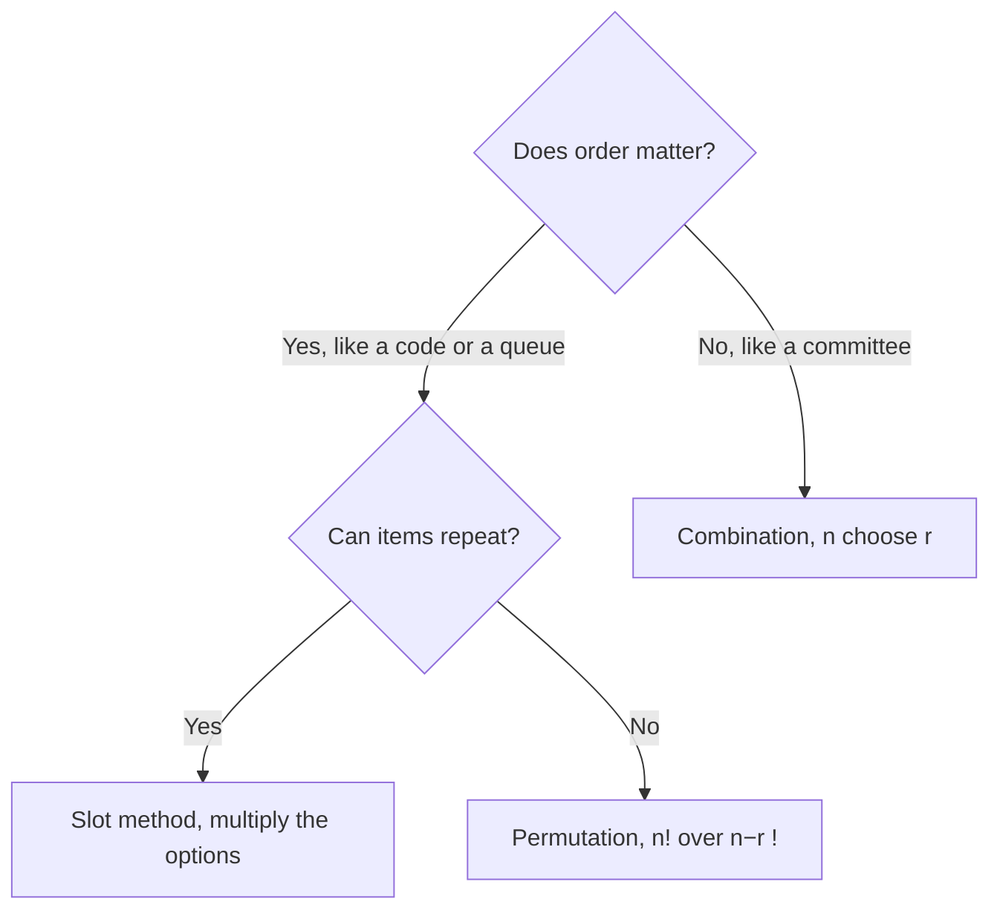

# Counting: Slots, Permutations and Combinations

Counting questions look scary because the numbers feel invented, but the GMAT Focus tests only a handful of ideas, over and over. If you master the slot method, the order-or-not question, and the two shortcuts (glue and complement), you can handle almost every counting problem the exam throws at you, up to the 705+ level.

## The fundamental counting principle (the slot method)

Imagine the thing you're building as a row of empty slots, such as a 3-letter code or a lunch order. Fill the slots one at a time. For each slot, ask: "How many options do I have here, given what I've already done?" Then **multiply**.

Say a Delhi Metro commuter has 3 routes to work and 2 routes home. The number of round-trip combinations is 3 × 2 = 6. Each choice is independent of the others, so the options multiply.

The two words that decide everything:

- **AND** (one step, then another step): multiply.
- **OR** (either this case or that case, never both): add.

> [!REMEMBER]
> Stages joined by AND multiply. Cases joined by OR add. Most counting errors come from mixing these up.

### Restrictions: fill the fussy slots first

If a slot has a rule (for example, "first digit can't be 0"), fill that slot first. Then the free slots become easy. A 4-digit PIN with no repeated digits and first digit non-zero: first slot 9 choices (1 to 9), second slot 9 (0 to 9 minus the one used), third 8, fourth 7. Product: 9 × 9 × 8 × 7 = 4536.

> [!TRAP]
> If you fill the free slots first, the restricted slot's number of options changes depending on what you already did, and the problem turns into a mess. Restricted slots first, always.

## Factorials, permutations and combinations

A **factorial** is a shortcut for "all the ways to line up n different things": n! = n × (n − 1) × ... × 2 × 1.

| n | 0 | 1 | 2 | 3 | 4 | 5 | 6 | 7 | 8 |
|---|---|---|---|---|---|---|---|---|---|
| n! | 1 | 1 | 2 | 6 | 24 | 120 | 720 | 5040 | 40320 |

Remember 0! = 1. Learn the table up to 7! and you'll rarely need a calculator.

### Permutations: order matters

If you pick r items from n and the order of selection creates different results (a ranking, a code, seats in a row, president then vice-president), use

nPr = n!/(n − r)! = n × (n − 1) × ... (r factors)

Don't memorise the fraction; just multiply r descending numbers starting at n. 8P3 = 8 × 7 × 6 = 336.

### Combinations: order doesn't matter

If you only care about **who or what** gets picked (a committee, a hand of cards, a team), divide out the orderings:

nCr = n!/(r! × (n − r)!) = nPr / r!

Compute with r factors on top and r! below: 8C3 = (8 × 7 × 6)/(3 × 2 × 1) = 56. Two helpful facts: nCr = nC(n − r), so 10C8 = 10C2 = 45, and nC0 = nC(n) = 1.

> [!TIP]
> The one-question test: "If I swap two of the chosen things, do I get a different outcome?" If yes (different jobs, different positions), it's a permutation. If no (just a group), it's a combination.

| Situation | Order matters? | Tool |
|---|---|---|
| Gold, silver, bronze medals among 8 runners | Yes | 8P3 = 336 |
| Choose 3 of 8 runners for a relay team | No | 8C3 = 56 |
| Arrange 5 different books on a shelf | Yes | 5! = 120 |
| Choose 2 toppings from 6 | No | 6C2 = 15 |

### Worked example 1 (Easy)
A school has 6 teachers. A principal needs one teacher to run the morning assembly and a different teacher to run the evening assembly. In how many ways can she choose?

Show solution

The two jobs are different, so order matters. Slot 1 (morning): 6 choices. Slot 2 (evening): 5 choices left.

6 × 5 = 30.

Faster way: that's just 6P2 = 30.

Trap: 15 (6C2) is the number of unordered pairs. Morning-Ravi, evening-Sunita is a different outcome from morning-Sunita, evening-Ravi.

### Worked example 2 (Medium)
A committee of 4 is chosen from 6 men and 5 women. How many committees have exactly 2 women?

Show solution

Choose the women and the men separately, then multiply (AND).

Women: 5C2 = 10. Men: 6C2 = 15.

10 × 15 = 150.

Faster way: none needed, but always check the sizes add up: 2 women + 2 men = 4 people. ✓

Trap: 11C4 = 330 ignores the condition; and 5C2 × 9C2 = 360 picks the two women first and then fills the other seats with "anyone", which counts committees with 3 or 4 women more than once.

## Arrangements with identical items

If some of the things you're arranging are identical, swapping them changes nothing, so you divide by the factorial of each repeated group:

Arrangements = n! / (a! × b! × ...)

For MISSISSIPPI there are 11 letters: M once, I four times, S four times, P twice. So 11!/(4! × 4! × 2!) = 34,650.

A friendlier way to see it: you have 6 slots and the word is BANANA (B once, A three times, N twice). Put the B somewhere (6 ways), then the two N's in 2 of the remaining 5 slots (5C2 = 10 ways); the A's fill the rest. 6 × 10 = 60, which equals 6!/(3! × 2!) = 60. Both views agree, so use whichever feels safer.

> [!TRAP]
> Students divide by the number of repeated letters (say 3) instead of the factorial of that number (3! = 6). Swapping three identical items can be done in 3! ways.

### Worked example 3 (Medium)
How many different arrangements of the letters of the word TOMATO are there?

Show solution

TOMATO has 6 letters: T twice, O twice, M once, A once.

6!/(2! × 2!) = 720/4 = 180.

Faster way: cancel before multiplying: 6 × 5 × 4 × 3 = 360, then divide by 2 = 180 (because 6!/2! = 360, then divide by the second 2!).

Trap: 720 treats the repeated letters as different, and 360 divides by only one of the two repeats.

## "Must be together" and "never together"

These two phrases appear all the time, and each has a standard move.

**Must be together: glue them.** Treat the group as one block, arrange all the blocks, then multiply by the ways to arrange inside the block. Six friends in a row where Asha and Ben sit together: 5! × 2! = 240.

**Never together (or "not adjacent"): two options.**

1. **Complement.** Total arrangements minus arrangements where they are together. For Asha and Ben not adjacent among 6 friends: 720 − 240 = 480.
2. **Gap method.** Arrange the "other" people first, then drop the fussy ones into the gaps between them. With n people lined up there are n + 1 gaps (including both ends).

> [!TIP]
> Use the complement when only one or two people are fussy. Use the gap method when a whole group must stay apart (such as "no two women adjacent").

### Worked example 4 (Hard)
Five men and three women stand in a row for a photograph. In how many arrangements are no two women adjacent?

Show solution

Seat the men first: 5! = 120 ways. They create 6 gaps (one at each end and four between). The three women must go into three different gaps: choose the gaps, 6C3 = 20, then order the women, 3! = 6.

120 × 20 × 6 = 14,400.

Faster way: you can write it as 5! × 6P3 = 120 × 120 = 14,400, because choosing and ordering 3 gaps for 3 distinct women is 6P3.

Trap: forgetting that the women are different people (using only 6C3 gives 2,400). Another trap is trying "total minus adjacent": it works but needs inclusion-exclusion and is much slower here.

## "At least one" and the complement

"At least one" hides many cases (1, 2, 3, ...). The opposite is a single case: "none". So

At least one = Total − None.

Choose 3 people from 5 men and 4 women with at least one woman: 9C3 − 5C3 = 84 − 10 = 74. Use direct counting only when the "at least" cases are few, such as "at least 3 of 4".

> [!SHORTCUT]
> Any time you read "at least one", write "Total − None" before you do anything else.

## Committees with conditions

Pick groups with a fixed composition: choose each sub-group separately and multiply. Then handle special people:

- **Two people must both be in:** put them in, choose the rest from everyone else. A committee of 4 from 9 people with Mia and Noor both on it: 7C2 = 21.
- **Two people refuse to serve together:** total minus the committees containing both. A committee of 3 from 7 where A and B can't both serve: 7C3 − 5C1 = 35 − 5 = 30.
- **Exactly k of one kind:** choose k from that kind, the rest from the other kind.

### Worked example 5 (Hard)
A committee of 3 is chosen from 7 people. Two of them, Kiran and Lata, will not serve together. How many committees are possible?

Show solution

Total committees: 7C3 = 35.

Bad committees contain both Kiran and Lata, plus one more chosen from the other 5: 5C1 = 5.

35 − 5 = 30.

Faster way: casework gives the same result. Neither on the committee: 5C3 = 10. Exactly one of them: 2 × 5C2 = 20. Total 30.

Trap: 35 − 2 = 33 (subtracting the two people instead of the committees that contain both of them).

## Circular arrangements

Around a round table, rotating everyone one seat gives the same arrangement. To remove the rotations, fix one person and arrange the others: n people in a circle can be arranged in (n − 1)! ways.

If two people must sit together, glue them: (n − 2)! × 2. Five people around a table with A and B together: 3! × 2 = 12 out of 4! = 24 total.

> [!NOTE]
> If the seats are numbered or labelled (a table with name cards), rotations are different, and it's just n!. Read for the words "identical" or "rotations are considered the same".

## Distributing items

Three flavours appear on the GMAT.

**1. Distinct items to distinct people** (each item picks a person): multiply slots. 4 different prizes to 3 students, any student can win several: 3 × 3 × 3 × 3 = 3⁴ = 81. Note that it's the number of recipients raised to the number of items.

**2. Identical items to distinct people** (stars and bars). Put k identical items into n people:

- Each person may get zero: (k + n − 1)C(n − 1).
- Each person gets at least one: (k − 1)C(n − 1).

For 8 identical sweets and 3 children: at least one each, 7C2 = 21; zero allowed, 10C2 = 45.

**3. Splitting a group into teams.** If the teams have names or labels, you choose in order and multiply. If they are unlabelled and the same size, divide by the number of ways to swap the teams. 8 people into two unlabelled teams of 4: 8C4/2 = 35.

> [!TRAP]
> With unlabelled groups of equal size, forgetting to divide doubles (or more) your answer. Always ask: "If I swapped the two groups, would I get a different arrangement?"

### Worked example 6 (Hard)
How many ways can 12 identical notebooks be given to 4 students, with every student receiving at least 2 notebooks?

Show solution

Give each student 2 notebooks first: that uses 8, leaving 4 notebooks to be shared freely among 4 students (zero allowed).

Free sharing: (4 + 4 − 1)C(3) = 7C3 = 35.

Faster way: after pre-giving the minimum, treat it as "4 stars and 3 bars": 7 positions, choose 3 for the bars.

Trap: using 11C3 = 165 (the "at least one" version) ignores the requirement of 2 each.

## Putting it together: a decision path

When you see a counting problem, run through these four questions in order. It takes ten seconds and saves you from most mistakes.

1. **Am I building something in stages?** If so, think slots and multiply.
2. **Does order matter?** Different roles or positions mean permutation; a plain group means combination.
3. **Are any items identical?** Divide by the factorials of the repeats.
4. **Is there a "together", "apart" or "at least one"?** Glue, gap method, or complement.

Use this tree to choose the counting tool.

A very common GMAT-hard pattern combines two of these, such as "choose a committee (combination), then assign roles within it (permutation)". Do the pieces one at a time, and write each piece's count on your scratch pad before multiplying.

> [!TIP]
> If a problem has small numbers and you can't see the method, write out the first few cases. Seeing 6 or 8 outcomes often reveals the pattern, and you can confirm your formula against the small case.

## Quick check

1. How many 3-letter codes can be made from the letters A, B, C, D, E if no letter repeats?

Answer

5 × 4 × 3 = 60 (order matters in a code).

2. How many ways can a team of 3 be chosen from 9 people?

Answer

9C3 = (9 × 8 × 7)/6 = 84.

3. In how many ways can the letters of LEVEL be arranged?

Answer

5 letters with L twice and E twice: 5!/(2! × 2!) = 120/4 = 30.

4. Five people sit in a row. Two of them must not sit together. How many arrangements?

Answer

Total 5! = 120. Together: 4! × 2 = 48. So 120 − 48 = 72.

5. How many ways can 6 identical balloons be given to 3 children if each child gets at least one?

Answer

(6 − 1)C(3 − 1) = 5C2 = 10.

## Key takeaways
- Stages joined by AND multiply; separate cases joined by OR add.
- Fill restricted slots first, then the free slots.
- Order matters (roles, positions, codes): permutation. Order doesn't matter (groups): combination.
- Identical items: divide the total factorial by the factorial of each repeat count.
- "Together": glue them into a block and multiply by the internal arrangements. "Never together": total minus together, or the gap method.
- "At least one" almost always means Total − None.
- Circular arrangements of n people: (n − 1)! because rotations are the same.
- Identical items to people: stars and bars, (k + n − 1)C(n − 1) with zeros allowed, (k − 1)C(n − 1) with at least one each.

## Go deeper
- [Khan Academy: Counting, permutations and combinations](https://www.khanacademy.org/math/statistics-probability) — free video lessons and practice on the fundamentals.
- [GMAT Club forum](https://gmatclub.com/forum/) — search "combinatorics" for a huge archive of discussions and strategy posts.
- [Official GMAT exam site](https://www.mba.com/exams/gmat-exam) — details on the Quantitative Reasoning section.
