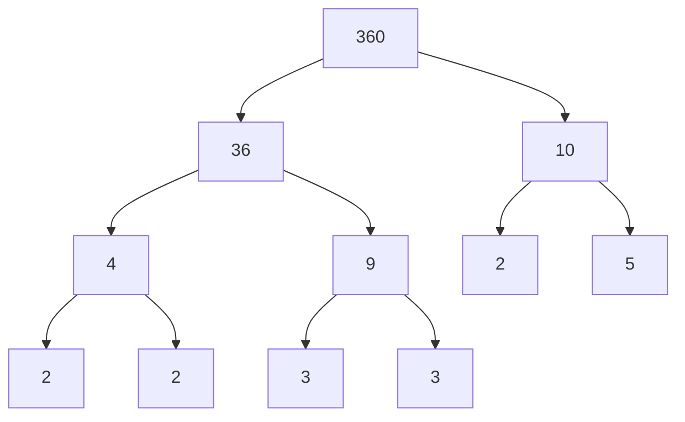

# Factors, Multiples & Primes

Almost every GMAT Quant section has at least one question that is really about factors, multiples or primes, even when it's dressed up as a word problem about bells, tiles or buses. The good news: the whole topic runs on one idea (prime factorisation), and once you own it, the "hard" questions become bookkeeping.

## The vocabulary, in plain words

A **factor** of a number divides it exactly, with nothing left over. 6 is a factor of 30 because 30 ÷ 6 = 5. A **multiple** is the other direction: 30 is a multiple of 6. Factors are small and finite; multiples go on forever.

A **prime** is a number with exactly two factors, 1 and itself. 2, 3, 5, 7 are primes. **1 is not prime** (it has only one factor) and **2 is the only even prime**. Every other even number is divisible by 2, so it can't be prime.

> [!REMEMBER]
> Primes under 100: 2, 3, 5, 7, 11, 13, 17, 19, 23, 29, 31, 37, 41, 43, 47, 53, 59, 61, 67, 71, 73, 79, 83, 89, 97. That's 25 of them. Learn them like you know your phone number.

To test whether a number up to about 150 is prime, you only need to try dividing by 2, 3, 5, 7 and 11. If none works, it's prime. (You only need primes up to the square root, and √150 is just over 12.)

## Divisibility rules

These save you from long division. Learn them in this order, easiest first.

| Divisor | Test |
|---|---|
| 2 | Last digit is even |
| 3 | Digit sum is divisible by 3 |
| 4 | Last two digits form a number divisible by 4 |
| 5 | Last digit is 0 or 5 |
| 6 | Divisible by both 2 and 3 |
| 8 | Last three digits form a number divisible by 8 |
| 9 | Digit sum is divisible by 9 |
| 10 | Last digit is 0 |
| 11 | (Sum of digits in odd positions) − (sum of digits in even positions) is 0 or a multiple of 11 |
| 12 | Divisible by both 3 and 4 |

Example for 11: take 91,872. Digits from the left: 9, 1, 8, 7, 2. Odd positions: 9 + 8 + 2 = 19. Even positions: 1 + 7 = 8. The difference is 11, so 91,872 is divisible by 11. (Check: 91,872 ÷ 11 = 8,352.)

> [!TRAP]
> For "divisible by 6" or "divisible by 12", you need coprime pieces. 6 = 2 × 3 works because 2 and 3 share no factors. But "divisible by 4 and 6" does NOT mean divisible by 24. 12 is divisible by both 4 and 6, and it isn't divisible by 24. Always split into coprime pieces (like 8 and 3 for 24).

## Prime factorisation

Every integer above 1 breaks into primes in exactly one way (ignoring order). That is the superpower. To find it, use a factor tree: split the number into any two factors, then keep splitting until everything left is prime.

Take 360. Split as 36 × 10. Then 36 = 4 × 9 = 2 × 2 × 3 × 3, and 10 = 2 × 5. So 360 = 2³ × 3² × 5.

Here is a factor tree for 360. Keep splitting until every end is prime, and the ends 2, 2, 2, 3, 3, 5 give 360 = 2³ × 3² × 5.

Write it in that compact exponent form every time. It's the form that lets you read off almost anything about the number.

### Counting factors

If n = pa × qb × rc (primes p, q, r), then the number of positive factors is

(a + 1)(b + 1)(c + 1).

Why? Each factor picks a power of 2 from 2⁰ up to 2³ (4 choices), a power of 3 from 3⁰ to 3² (3 choices), and a power of 5 from 5⁰ to 5¹ (2 choices). Choices multiply: 4 × 3 × 2 = 24 factors of 360.

> [!REMEMBER]
> Number of factors = (each exponent + 1), multiplied together. For 360 = 2³ × 3² × 5¹, that's 4 × 3 × 2 = 24.

A cousin question: how many factors of 360 are **odd**? Throw away the 2s completely, leaving 3² × 5, which has 3 × 2 = 6 factors. So 6 odd factors. And how many are multiples of 5? Every one of those must contain the 5, so fix the 5 and count the rest: 4 × 3 = 12.

### Perfect squares and odd factor counts

Factors usually come in pairs (1 with 360, 2 with 180, and so on). The only time a pair collapses into a single factor is when a number pairs with itself, meaning the number is a perfect square. That's why:

> [!REMEMBER]
> A positive integer has an **odd** number of factors if and only if it is a perfect square. In prime-factor terms, every exponent is even.

You can also test a perfect square from its factorisation: 2⁴ × 3² × 7⁶ is a perfect square (all exponents even). 2⁴ × 3³ is not.

### Worked example 1 (Easy)
How many positive factors does 252 have?

Show solution

Factorise: 252 = 4 × 63 = 2² × 63 = 2² × 3² × 7.

Number of factors = (2 + 1)(2 + 1)(1 + 1) = 3 × 3 × 2 = **18**.

Faster way: none needed, but notice you never had to list the factors. Listing is slow and you'll miss one under pressure.

Trap: forgetting the "+ 1" and multiplying exponents (2 × 2 × 1 = 4). The +1 is there because the exponent 0 is also a choice.

### Worked example 2 (Medium)
If 2a × 3b has exactly 15 positive factors, where a and b are positive integers, what is the value of a + b?

Show solution

The factor count is (a + 1)(b + 1) = 15. Since a and b are positive, both a + 1 and b + 1 are at least 2. The only way to write 15 as a product of two integers that are each at least 2 is 3 × 5 (or 5 × 3).

So {a, b} = {2, 4}, and a + b = **6**.

Trap: using 15 = 1 × 15, which would make a = 0. The problem says positive integers, which rules it out.

## GCD and LCM

The **greatest common divisor** (GCD, sometimes called HCF in Indian textbooks) is the biggest number that divides both. The **least common multiple** (LCM) is the smallest number that both divide into.

Use the prime factorisations:

- **GCD** takes each prime that appears in **both** numbers, at the **lower** power.
- **LCM** takes each prime that appears in **either** number, at the **higher** power.

Take 72 = 2³ × 3² and 120 = 2³ × 3 × 5.

- GCD = 2³ × 3 = 24 (shared primes 2 and 3, lower powers).
- LCM = 2³ × 3² × 5 = 360 (every prime, higher powers).

> [!REMEMBER]
> For two positive integers: GCD × LCM = the product of the two numbers. Check: 24 × 360 = 8,640 and 72 × 120 = 8,640. This only works for **two** numbers, not three.

> [!TIP]
> Mnemonic for the word problems. "Together again" (bells, buses, blinking lights, planets lining up) means **LCM**. "Cut into the largest equal pieces" (tiles, chocolates split into identical bags, ribbons) means **GCD**.

### Worked example 3 (Medium)
Three temple bells ring at intervals of 12, 15 and 20 minutes. They all ring together at 9:00 a.m. At what time will they next ring together?

Show solution

"Together again" means LCM. 12 = 2² × 3, 15 = 3 × 5, 20 = 2² × 5. Take every prime at its highest power: 2² × 3 × 5 = 60.

They ring together every 60 minutes, so the next time is **10:00 a.m.**

Faster way: test multiples of the biggest number (20, 40, 60) until 12 and 15 also fit. 60 works.

Trap: multiplying everything (12 × 15 × 20 = 3,600). That is a common multiple, but not the least one.

### Worked example 4 (Medium)
A rectangular floor measures 180 cm by 300 cm. It must be covered entirely with identical square tiles, with no cutting. What is the least number of tiles needed?

Show solution

Fewest tiles means the biggest square tile, and the side has to divide both 180 and 300. So the side is the GCD.

180 = 2² × 3² × 5 and 300 = 2² × 3 × 5². GCD = 2² × 3 × 5 = 60.

Tiles along the 180 side: 180 ÷ 60 = 3. Along the 300 side: 300 ÷ 60 = 5. Total = 3 × 5 = **15 tiles**.

Trap: stopping at the tile size (60) and answering with it. Re-read what the question actually asks for.

## Reasoning with "if n is divisible by..."

GMAT loves statements like "n is divisible by 12 and by 15. What must be true?" The move is to convert the statement into prime powers.

n divisible by 12 = 2² × 3 means n has at least 2² and 3 in it. n divisible by 15 = 3 × 5 means n has at least 3 and 5. Combine at the higher power: n has at least 2² × 3 × 5 = 60. So **n is a multiple of the LCM, 60.**

Now every claim becomes a quick check. Must n be divisible by 30? 30 = 2 × 3 × 5, all contained in 60, so yes. By 8? n only has to have 2², so no. By 45 = 3² × 5? n only has to have one 3, so no. By 20? 20 = 2² × 5, yes.

> [!TRAP]
> "Divisible by 12 and 15" does not mean "divisible by 12 × 15 = 180". It means divisible by the LCM, 60. Multiplying overcounts the shared factor 3.

Another useful fact: if n is divisible by a and by b, and a and b share no common factor, then n is divisible by a × b. That's the "coprime" rule behind the tests for 6 and 12.

### Worked example 5 (Hard)
If n is a positive integer divisible by both 12 and 15, and n is less than 200, how many values can n take?

Show solution

n must be a multiple of LCM(12, 15) = 60. Multiples of 60 below 200: 60, 120, 180. That's **3 values**.

Trap: using 12 × 15 = 180 as the base, which gives only one value (180) and misses 60 and 120.

## Factorials and trailing zeros

n! (n factorial) means n × (n − 1) × ... × 2 × 1. So 5! = 120. Two powerful facts come from this definition:

1. n! is divisible by every integer from 1 up to n.
2. n! contains a lot of prime factors, and you can count them.

**Trailing zeros.** Every zero at the end of a number comes from a factor of 10 = 2 × 5. In n!, 2s are plentiful, so the 5s are the bottleneck. The number of trailing zeros in n! equals the number of 5s in its prime factorisation.

Count 5s by adding: ⌊n/5⌋ + ⌊n/25⌋ + ⌊n/125⌋ + ... (drop remainders each time).

For 50!: 50 ÷ 5 = 10, 50 ÷ 25 = 2, and the next term is 0. Total 12 trailing zeros.

Why the second term? Multiples of 25 (like 25 and 50) contain two 5s, so they've been counted once in the first step and need one more count.

**Highest power of a prime p in n!** uses the same trick: ⌊n/p⌋ + ⌊n/p²⌋ + ... For 20!, the number of 3s is 6 + 2 = 8, so 38 divides 20! but 39 does not.

> [!SHORTCUT]
> For a composite like 6k dividing 20!, count the scarcer prime. 6 = 2 × 3, 20! has plenty of 2s (10 + 5 + 2 + 1 = 18) but only eight 3s, so the greatest k is 8.

### Worked example 6 (Hard)
What is the greatest integer k such that 12k divides 30!?

Show solution

12 = 2² × 3. So 12k = 22k × 3k.

Count the 2s in 30!: 15 + 7 + 3 + 1 = 26. Count the 3s: 10 + 3 + 1 = 14.

From the 2s: 2k ≤ 26, so k ≤ 13. From the 3s: k ≤ 14. The tighter limit wins: k = **13**.

Trap: counting only the 3s (14) because 2s "obviously" are plentiful. Here the 2s are needed in pairs, so they actually become the bottleneck.

### Worked example 7 (Hard)
Two positive integers have a GCD of 12 and an LCM of 360. If one of them is 60, what is the other?

Show solution

GCD × LCM = product of the numbers, so 12 × 360 = 60 × b. That gives b = 4,320 ÷ 60 = **72**.

Check: 60 = 2² × 3 × 5 and 72 = 2³ × 3². GCD = 2² × 3 = 12 ✓. LCM = 2³ × 3² × 5 = 360 ✓.

Trap: the problem has a unique answer here, but be careful in similar questions; always verify the GCD and LCM of your candidate, not just the product.

## Quick check

1. How many positive factors does 100 have?

Answer

100 = 2² × 5², so (2 + 1)(2 + 1) = 9. It's odd because 100 is a perfect square.

2. Is 2,457 divisible by 9? By 11?

Answer

Digit sum 2 + 4 + 5 + 7 = 18, so yes for 9. For 11: odd positions 2 + 5 = 7, even positions 4 + 7 = 11, difference −4, so not divisible by 11.

3. How many trailing zeros does 100! have?

Answer

100 ÷ 5 = 20, plus 100 ÷ 25 = 4, so 24 zeros.

4. Two lights blink every 18 s and 24 s. If they blink together now, after how many seconds do they next blink together?

Answer

LCM(18, 24) = 2³ × 3² = 72 seconds.

5. n is divisible by 14 and by 21. Must n be divisible by 42?

Answer

Yes. LCM(14, 21) = 42, so n is a multiple of 42.

## Key takeaways
- Prime factorisation is the master tool. Write every number as primes with exponents.
- Number of factors = (exponent + 1) multiplied across all primes. Odd count means perfect square.
- GCD uses shared primes at the lower power; LCM uses all primes at the higher power; GCD × LCM = product (two numbers only).
- "Together again" is LCM. "Largest equal pieces" is GCD.
- "Divisible by a and b" means divisible by LCM(a, b), not by a × b.
- Trailing zeros of n! count the 5s: ⌊n/5⌋ + ⌊n/25⌋ + ...
- To find the highest power of a composite in n!, count each prime separately and take the scarcer one, remembering to divide by the exponent.
- 1 is not prime and 2 is the only even prime.

## Go deeper
- [Khan Academy: Arithmetic and pre-algebra](https://www.khanacademy.org/math/arithmetic) — free refreshers on factors, primes and divisibility from first principles.
- [GMAT Club forum](https://gmatclub.com/forum/) — search "number properties" for community discussion of worked problems.
- [Official GMAT exam page](https://www.mba.com/exams/gmat-exam) — the official source for exam format and practice tools.
