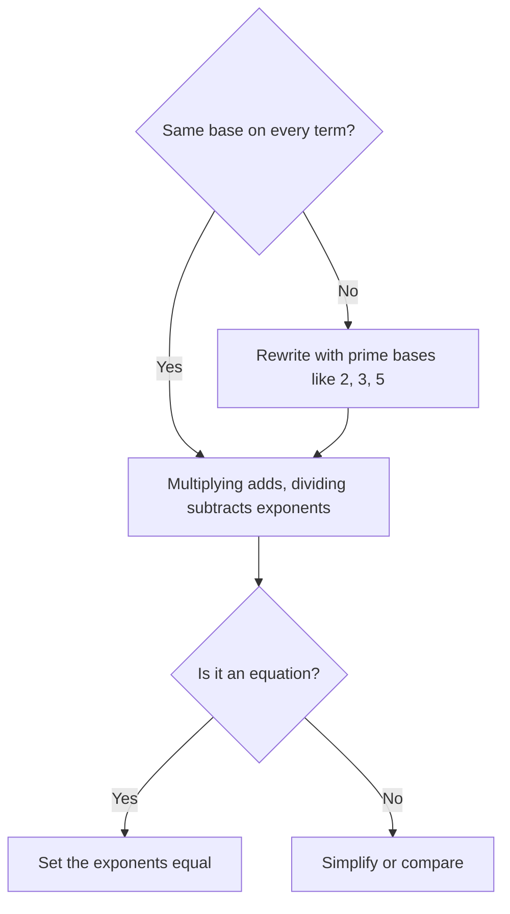

# Exponents & Roots

Exponents turn up everywhere on the GMAT Focus: in their own right, inside percent growth, in number properties, and as a favourite way to build "looks scary, is actually simple" questions. The test rewards one skill above all: **rewriting numbers so the bases match.**

## What an exponent means

xⁿ means "multiply x by itself n times." So 2⁵ = 2 × 2 × 2 × 2 × 2 = 32. Here 2 is the **base** and 5 is the **exponent** (or power).

Almost every exponent rule is that definition in disguise. If you forget a rule on test day, rebuild it from small examples.

## The rules you must own

| Rule | Example |
|---|---|
| xa × xb = xa+b | 2³ × 2⁴ = 2⁷ |
| xa ÷ xb = xa−b | 3⁸ ÷ 3⁵ = 3³ |
| (xa)b = xab | (5²)³ = 5⁶ |
| (xy)a = xaya | (2 × 3)² = 4 × 9 |
| (x/y)a = xa/ya | (2/3)³ = 8/27 |
| x⁰ = 1 (x ≠ 0) | 17⁰ = 1 |
| x−a = 1/xa | 2⁻³ = 1/8 |
| x1/n = ⁿ√x | 81/3 = ∛8 = 2 |
| xm/n = (ⁿ√x)m | 82/3 = 2² = 4 |

> [!REMEMBER]
> Multiply same base: ADD exponents. Divide same base: SUBTRACT. Power of a power: MULTIPLY. These rules only work when the BASES are the same.

> [!TRAP]
> 2³ × 3³ is NOT 6⁶ and 2³ + 2³ is NOT 2⁶. The addition rule applies to multiplication of the same base. For sums, you factor: 2³ + 2³ = 2 × 2³ = 2⁴.

### Negative and zero exponents

A negative exponent doesn't make the number negative; it flips it. 2⁻³ = 1/2³ = 1/8. And a fraction raised to a negative power flips: (2/3)⁻² = (3/2)² = 9/4.

Any non-zero number to the power 0 is 1. (0⁰ is not tested.)

### Fractional exponents and roots

A fractional exponent is a root in disguise. x1/2 = √x, x1/3 = ∛x. The denominator of the fraction tells you the root, the numerator tells you the power.

Example: 163/4. Take the fourth root of 16 first (that's 2), then cube it: 2³ = 8. Root first keeps numbers small.

> [!TIP]
> For xm/n, always take the root FIRST, then the power. 272/3 = (∛27)² = 3² = 9, not ∛(27²) = ∛729.

## Making the bases match

This is the single most useful GMAT exponent move. Powers of 2, 3, 5 and 10 are the usual suspects.

| Number | As a power |
|---|---|
| 4, 8, 16, 32, 64 | 2², 2³, 2⁴, 2⁵, 2⁶ |
| 9, 27, 81 | 3², 3³, 3⁴ |
| 25, 125 | 5², 5³ |
| 100, 1000 | 10², 10³ |

Most exponent questions follow this path.

### Worked example 1 (Easy)
If 4x = 32, what is x?

Show solution

Rewrite both sides with base 2: 4 = 2², so 4x = 22x. And 32 = 2⁵. So 2x = 5 and x = 2.5.

Check: 42.5 = 4² × 41/2 = 16 × 2 = 32 ✓.

Trap: Answering x = 8 (32 ÷ 4) or x = 5 (just copying the exponent of 32). Exponents are not division, and the bases must match first.

### Worked example 2 (Medium)
What is 210 + 211 + 212, written as a multiple of 210?

Show solution

Factor out the smallest power: 210(1 + 2 + 4) = 7 × 210.

Check: 1024 + 2048 + 4096 = 7168 and 7 × 1024 = 7168 ✓.

Trap: Adding the exponents (233) or saying 210 + 211 = 221. Sums need factoring; products add exponents.

> [!SHORTCUT]
> Sum or difference of powers of the same base: factor out the SMALLEST power. 5n+1 − 5n = 5n(5 − 1) = 4 × 5n. This one trick settles a lot of "hard-looking" questions.

## Exponential equations with the same base

If bx = by and b is not 0, 1, or −1, then x = y. So the plan is always: rewrite so both sides have the same base, then set the exponents equal.

### Worked example 3 (Medium)
If 9x × 27x−1 = 81, what is x?

Show solution

Everything is a power of 3: 9x = 32x, 27x−1 = 33(x−1) = 33x−3, 81 = 3⁴.

So 32x + 3x − 3 = 3⁴, which gives 5x − 3 = 4 and x = 7/5.

Check: 91.4 = 32.8; 270.4 = 31.2; product = 3⁴ = 81 ✓.

Trap: Multiplying exponents instead of adding when the bases are multiplied together (32x × 33x−3, so ADD).

### Exponents with negative bases

A negative base to an even power is positive; to an odd power it's negative. (−2)⁴ = 16 but (−2)³ = −8. Note −2⁴ means −(2⁴) = −16, because the exponent only grabs what's directly beside it.

> [!TRAP]
> −3² = −9 but (−3)² = +9. The GMAT uses brackets deliberately. Read them carefully.

Also remember that x² = 9 has TWO solutions (3 and −3), but √9 means the positive root only, so it equals 3. The symbol √ always gives the non-negative root.

## Simplifying roots

Pull out perfect squares: √72 = √(36 × 2) = 6√2. √50 + √18 = 5√2 + 3√2 = 8√2. You can only combine roots that have the same radicand ("like terms"), the same way you only combine 5x + 3x.

The product and quotient rules work for roots: √a × √b = √(ab) and √a / √b = √(a/b), for positive a, b. But **√(a + b) is NOT √a + √b**. √(9 + 16) = 5, not 3 + 4 = 7.

Useful values to memorise:

| n | 1 | 2 | 3 | 4 | 5 | 6 | 7 | 8 | 9 | 10 | 11 | 12 | 13 | 14 | 15 |
|---|---|---|---|---|---|---|---|---|---|---|---|---|---|---|---|
| n² | 1 | 4 | 9 | 16 | 25 | 36 | 49 | 64 | 81 | 100 | 121 | 144 | 169 | 196 | 225 |

And cubes: 2³ = 8, 3³ = 27, 4³ = 64, 5³ = 125, 10³ = 1000. Approximate roots: √2 ≈ 1.41, √3 ≈ 1.73, √5 ≈ 2.24.

### Rationalising denominators

Mathematicians don't like roots on the bottom of a fraction. To remove one, multiply top and bottom by the root: 6/√3 = 6√3/3 = 2√3. For a denominator like (a + √b), multiply by its **conjugate** (a − √b); the product is a² − b, which has no root.

Example: 1/(√5 − 2) × (√5 + 2)/(√5 + 2) = (√5 + 2)/(5 − 4) = √5 + 2.

> [!NOTE]
> On the GMAT, answer choices are usually already simplified. You rationalise to match your answer to a choice, not because the exam asks you to.

### Worked example 4 (Medium)
What is the value of (√18 + √8)/√2?

Show solution

√18 = 3√2 and √8 = 2√2. Numerator = 5√2. Dividing by √2 gives 5.

Method two: split the fraction: √18/√2 = √9 = 3 and √8/√2 = √4 = 2. Total 5 ✓.

Trap: Answering √26 (adding under one root) or 5√2 (forgetting to divide).

## Comparing powers

To compare numbers like 3⁴⁰ and 9²⁰ or 2¹⁰⁰ and 5⁴⁵, rewrite them so the bases or the exponents match.

- 9²⁰ = (3²)²⁰ = 3⁴⁰. They're equal.
- 4³⁰ vs 8²⁰: 4³⁰ = 2⁶⁰ and 8²⁰ = 2⁶⁰. Equal again.
- 2⁶⁰ vs 3⁴⁰: take the 20th root of both: 2³ = 8 vs 3² = 9. So 3⁴⁰ is bigger.

> [!TIP]
> Same base: bigger exponent wins (if the base is above 1). Same exponent: bigger base wins (for positive numbers). If neither matches, take a common root to make the exponents equal.

Between 0 and 1 the order reverses: (½)³ = 1/8 is smaller than (½)² = ¼. Powers of fractions shrink as the exponent grows.

## Growth and doubling

If something doubles every day, after n days it's 2ⁿ times as large. The useful flip side: if it fills a pond on day 30, it was half full on day 29. A quantity that triples every 4 years grows by 3t/4 after t years. Same idea: the exponent counts "how many periods have passed".

### Worked example 5 (Medium)
A culture of bacteria triples every 2 hours. It starts with 400 cells. How many hours until it first exceeds 30,000 cells?

Show solution

After 2 hours: 1,200; 4: 3,600; 6: 10,800; 8: 32,400. 32,400 is the first value above 30,000, so 8 hours.

Check: 400 × 3⁴ = 400 × 81 = 32,400 ✓, and 400 × 27 = 10,800 < 30,000 ✓.

Trap: Answering 4 (the number of tripling periods) when the question asks for hours. Convert units at the end.

## Powers of 10, decimals and estimation

Powers of 10 make decimals easy: 10⁻² = 0.01. The square root of a decimal like 0.0049 is 0.07, since 7² = 49 and moving two decimal places in becomes one place out. Rule of thumb: halve the number of decimal places in a square root, so 0.0049 (4 places) → 0.07 (2 places).

Estimating: since 12² = 144 and 13² = 169, √150 is a bit more than 12 (about 12.25). And 5³ = 125 means ∛130 ≈ 5.07.

### Worked example 6 (Hard)
If n is a positive integer and 3n+2 − 3n = 72 × 35, what is n?

Show solution

Factor: 3n(9 − 1) = 8 × 3n. So 8 × 3n = 72 × 3⁵. Divide by 8: 3n = 9 × 3⁵ = 3² × 3⁵ = 3⁷. n = 7.

Check: 3⁹ − 3⁷ = 19683 − 2187 = 17496. And 72 × 243 = 17496 ✓.

Trap: Cancelling to "3² − 1 = 8" and then forgetting the 3n that is left behind. Factor, don't cancel.

### Worked example 7 (Hard)
If x and y are integers, 2x × 4y = 64, and x > y > 0, what is the value of x − y?

Show solution

2x × 22y = 2⁶, so x + 2y = 6. With x > y > 0 and integers: y = 1 gives x = 4 (4 > 1 ✓). y = 2 gives x = 2 (not x > y). So x = 4, y = 1 and x − y = 3.

Trap: Answering with y = 2, x = 2 (violates x > y), or solving a single equation with two unknowns without using the integer and inequality conditions.

### Worked example 8 (Hard)
What is the units digit of 7⁴³ + 3²⁷?

Show solution

Units digits of powers of 7 cycle with period 4: 7, 9, 3, 1. 43 ÷ 4 leaves remainder 3, so 7⁴³ ends in 3. Powers of 3 also cycle every 4: 3, 9, 7, 1. 27 ÷ 4 leaves 3, so 3²⁷ ends in 7. 3 + 7 = 10, so the units digit is 0.

Trap: Using the exponent remainder 0 (when it divides evenly) as "units digit 0". When the remainder is 0, use the LAST item in the cycle (1 in both cases here).

## Quick check

1. Simplify (2³ × 2⁵) ÷ 2⁴.

Answer

23+5−4 = 2⁴ = 16.

2. What is 5⁻² + 5⁻¹?

Answer

1/25 + 1/5 = 1/25 + 5/25 = 6/25.

3. Simplify √75 − √12.

Answer

5√3 − 2√3 = 3√3.

4. Which is larger: 2⁶⁰ or 3⁴⁰?

Answer

Take the 20th root: 2³ = 8 vs 3² = 9. So 3⁴⁰ is larger.

5. Factor 4n+1 − 4n.

Answer

4n(4 − 1) = 3 × 4n.

## Key takeaways
- Same base multiplied: add exponents. Divided: subtract. Power of a power: multiply.
- Sums and differences don't follow the product rule. Factor out the smallest power.
- Negative exponent means flip; zero exponent means 1; fractional exponent means root.
- Rewrite everything to the same base (2, 3, 5 or 10) before solving an exponential equation.
- √ always gives the non-negative root; x² = 9 has two solutions.
- −3² and (−3)² differ. Read brackets carefully.
- To compare messy powers, make the bases or exponents equal by taking a common root.
- Units digits of powers repeat in a cycle of 4 or fewer.

## Go deeper
- [Khan Academy: Algebra](https://www.khanacademy.org/math/algebra) — a full course including exponent rules and radicals.
- [GMAT Club forum](https://gmatclub.com/forum/) — search "exponents" for worked discussions.
- [Official GMAT exam page](https://www.mba.com/exams/gmat-exam) — the exam format and what's tested.
