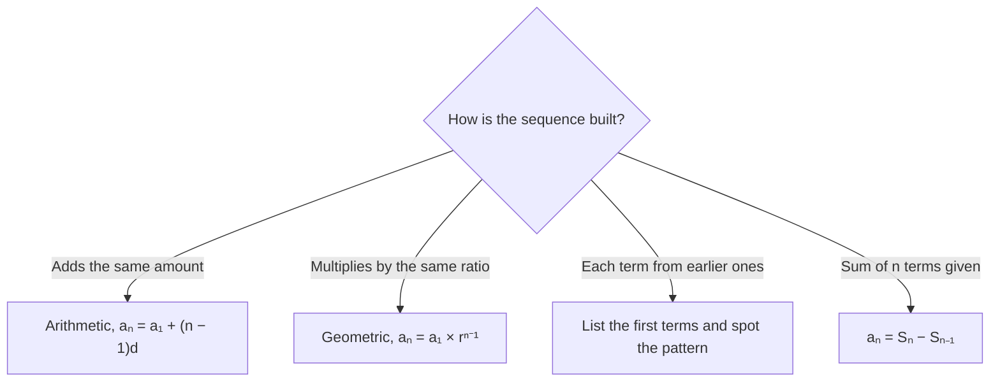

# Functions, Symbols & Sequences

Functions look scary because of the notation, but on the GMAT Focus they are almost always "follow the instructions" problems. Expect one or two questions on this topic: a made-up symbol, a composite function, or a sequence where you need to spot a pattern.

## What f(x) really means

A function is a machine. You feed in a number, the machine applies a fixed rule, and a number comes out. The notation f(x) = 3x − 5 just says: "whatever goes in the brackets, multiply it by 3, then subtract 5."

So f(4) = 3(4) − 5 = 7, and f(−1) = 3(−1) − 5 = −8. The letter x is only a placeholder. You can feed in a number, a letter, or even a whole expression:

- f(a) = 3a − 5
- f(x + 2) = 3(x + 2) − 5 = 3x + 1
- f(2x) = 6x − 5

> [!TIP]
> Put brackets around whatever you substitute. Most sign errors disappear when you write f(−3) = (−3)² − 2(−3) instead of doing it in your head.

> [!TRAP]
> −3² and (−3)² are different. The first is −9 and the second is +9. If a negative number goes into a squared term, bracket it first.

### Functions given by tables or words

Sometimes you don't get a formula. You get a table (x = 1 gives 4, x = 2 gives 7, ...) or a rule in words: "g(n) is the sum of the digits of n" or "f(n) is the number of positive divisors of n." Treat these exactly like formulas. Do what the sentence says, one input at a time.

Read the key word carefully. "Distinct prime factors" counts the prime 2 only once in 12 = 2 × 2 × 3, so the sum of distinct prime factors of 12 is 2 + 3 = 5, not 7.

### Piecewise rules

A rule may change depending on the input, for example f(x) = x/2 if x is even and f(x) = 3x + 1 if x is odd. Before you apply the rule, decide which case you are in. For f(f(7)): f(7) = 22 (odd), then f(22) = 11 (even).

## Composite functions

f(g(x)) means "do g first, then feed the answer into f." Work from the inside out.

Let f(x) = 2x + 1 and g(x) = x − 3.

- f(g(5)): g(5) = 2, then f(2) = 5.
- g(f(5)): f(5) = 11, then g(11) = 8.

The results differ, which shows that order matters. In general f(g(x)) ≠ g(f(x)). To get a formula, replace the inside: f(g(x)) = 2(x − 3) + 1 = 2x − 5.

> [!REMEMBER]
> f(g(x)): the function nearest to x acts first. Always inside out.

### Worked example 1 (Easy)
If f(x) = 3x − 5, what is f(4) + f(−1)?

Show solution

f(4) = 12 − 5 = 7 and f(−1) = −3 − 5 = −8. The sum is 7 + (−8) = −1.

Faster way: f(4) + f(−1) = 3(4 + (−1)) − 5 − 5 = 9 − 10 = −1. The −5 appears once for each function value.

Trap: dropping the negative sign in f(−1) and getting 3 − 5 = −2, which leads to 5.

## Made-up symbol operations

The GMAT likes to invent an operation, for example a ◆ b = ab − a − b, and ask you to evaluate it. There is nothing to memorise. The symbol is a recipe: copy the recipe, substitute the numbers in the order given, and watch your brackets.

Three rules keep you safe:

1. The first symbol goes in the first slot, the second in the second slot. Don't swap them unless the operation is symmetric (check!).
2. For nested symbols such as 2 ♣ (3 ♣ 5), work the inner brackets first.
3. If the operation looks messy, try to simplify the rule once. For example ab − a − b = (a − 1)(b − 1) − 1, which makes 5 ◆ 5 = 4 × 4 − 1 = 15 almost instant.

> [!TIP]
> If a question gives you a result and asks for an unknown ("4 ◆ x = 11, find x ◆ x"), solve the first equation for x with the rule, then use the rule again.

### Worked example 2 (Medium)
For all numbers a and b, a ★ b = a² − 2b. What is (3 ★ 2) ★ 1?

Show solution

Inner bracket first: 3 ★ 2 = 9 − 4 = 5. Then 5 ★ 1 = 25 − 2 = 23.

Trap: computing 3 ★ (2 ★ 1) instead. That gives 2 ★ 1 = 2, then 3 ★ 2 = 5. Because the operation isn't commutative or associative, grouping and order change the answer.

## Arithmetic sequences

An arithmetic sequence adds the same amount, the common difference d, each time: 7, 11, 15, 19, ... has d = 4.

> [!REMEMBER]
> **nth term:** aₙ = a₁ + (n − 1)d. You take n − 1 steps from the first term, not n.
>
> **Sum of n terms:** Sₙ = n × (a₁ + aₙ)/2 = (number of terms) × (average of first and last).
>
> **Number of terms** from m to k (steps of 1): k − m + 1. For steps of d: (last − first)/d + 1.

This tree helps you pick the right sequence tool.

So the 20th term of 7, 11, 15, ... is 7 + 19(4) = 83. And the sum of the integers from 11 to 40 is 30 terms × 25.5 average = 765.

Two powerful ideas make hard questions easy:

- **Symmetry.** In an arithmetic sequence the average of any two terms equal distances either side of a third term is that third term. So a₇ is the average of a₄ and a₁₀. With 13 terms, the middle term is a₇, so the sum of 13 terms is 13 × a₇.
- **Pairing blocks.** Terms 11-20 each sit 10 steps after terms 1-10, so the block sum is larger by 10 × 10d = 100d.

> [!TIP]
> Sum of an odd number of evenly spaced terms = (number of terms) × (middle term). Sum of an even number: (number of terms) × (average of the two middle terms).

### Worked example 3 (Medium)
The first term of an arithmetic sequence is 3 and the common difference is 5. What is the sum of the first 20 terms?

Show solution

The 20th term is 3 + 19(5) = 98. The sum is 20 × (3 + 98)/2 = 20 × 50.5 = 1,010.

Check with the second formula: S₂₀ = 20/2 × [2(3) + 19(5)] = 10 × 101 = 1,010.

Trap: using 20 × 5 + 3 = 103 as the last term, i.e. taking 20 steps instead of 19.

## Geometric sequences

A geometric sequence multiplies by the same ratio r each time: 3, 6, 12, 24, ... has r = 2.

> [!REMEMBER]
> **nth term:** aₙ = a₁ × rⁿ⁻¹. To move k places forward from any known term, multiply by rᵏ.

If the 3rd term is 12 and the 6th is 96, then three steps multiply by 96/12 = 8, so r³ = 8 and r = 2. You can reach the 10th term from the 6th by multiplying by 2⁴: 96 × 16 = 1,536. You never needed the first term.

> [!TRAP]
> Don't mix up the two types. Add the same number: arithmetic. Multiply by the same number: geometric. A sequence like 2, 5, 10, 17 is neither (the differences 3, 5, 7 keep changing).

## Recursive sequences and patterns

A recursive definition tells you how to get each term from earlier ones, such as a₁ = 3 and aₙ = 2aₙ₋₁ + 1. The safe method is to list the first five or six terms:

3, 7, 15, 31, 63, ...

Look for a pattern. Each term is one less than a power of 2 (4 − 1, 8 − 1, 16 − 1, 32 − 1, 64 − 1), so aₙ = 2n+1 − 1. Then a₃₀ = 2³¹ − 1, and a units-digit question becomes a simple cycle problem (powers of 2 end in 2, 4, 8, 6 repeating).

Some recursions repeat. If a₁ = 2, a₂ = 3 and aₙ = aₙ₋₁ − aₙ₋₂, the terms are 2, 3, 1, −2, −3, −1, 2, 3, ... which cycle every 6 terms. A full cycle sums to 0, so a sum of 100 terms is just the sum of the 4 leftover terms.

> [!TIP]
> For long recursive questions the answer is nearly always one of: a closed formula, a repeating cycle, or differences that follow a pattern. List terms until you see which one it is, then jump.

### Worked example 4 (Hard)
A sequence is defined by a₁ = 2, a₂ = 5 and aₙ = 3aₙ₋₁ − 2aₙ₋₂ for n ≥ 3. What is a₈?

Show solution

Rewrite the rule as aₙ − aₙ₋₁ = 2(aₙ₋₁ − aₙ₋₂). So the gaps between terms double each time. The first gap is 3, giving gaps 3, 6, 12, 24, 48, 96, 192.

a₈ = 2 + (3 + 6 + 12 + 24 + 48 + 96 + 192) = 2 + 381 = 383.

Faster way: just list the terms, which is only six more calculations: 2, 5, 11, 23, 47, 95, 191, 383.

Trap: leaving out the starting 2 and answering 381.

## Sequences defined by sums, and functional equations

If you're given the sum of the first n terms, Sₙ, the nth term is the difference of two sums: aₙ = Sₙ − Sₙ₋₁. For Sₙ = n² + 3n, a₁₀ = S₁₀ − S₉ = 130 − 108 = 22.

If a function is defined by a relationship like f(f(x)) = 9x + 8 with f linear, write f(x) = ax + b, expand f(f(x)) = a²x + ab + b, and match coefficients of x and the constants. Here a² = 9 and 4b = 8 (for a = 3), so f(x) = 3x + 2.

Equations such as f(x) + 2f(1/x) = 3x are solved by writing them twice, once with x and once with 1/x. You then have two equations in the two unknowns f(x) and f(1/x).

> [!NOTE]
> The GMAT Focus doesn't ask you to graph functions or find domains in a formal way. But "for how many x does f(f(x)) = 0" style questions are fair game: solve the outer equation first, then the inner one.

### Worked example 5 (Hard)
The 4th term of an arithmetic sequence is p and the 10th term is q. In terms of p and q, what is the sum of the first 13 terms?

Show solution

The 7th term is exactly midway between the 4th and 10th, so a₇ = (p + q)/2. The 13 terms are symmetric around a₇, so their average is a₇ and their sum is 13(p + q)/2.

Check with 1, 2, 3, ...: p = 4, q = 10, the sum of 13 terms is 91 and 13 × 14/2 = 91.

Trap: 13(p + q), forgetting to halve.

## Quick check

1. If f(x) = x² − 2x, what is f(−3)?

Answer

(−3)² − 2(−3) = 9 + 6 = 15.

2. For all a and b, a ◆ b = 2a + b². What is 3 ◆ 4?

Answer

2(3) + 16 = 22.

3. An arithmetic sequence starts 6, 10, 14. What is the 50th term?

Answer

6 + 49(4) = 202.

4. What is the sum of all the integers from 1 to 100 that are divisible by 4?

Answer

The terms are 4, 8, ..., 100, which is 25 terms with average 52. The sum is 1,300.

5. A geometric sequence has first term 5 and ratio 3. What is the 4th term?

Answer

5 × 3³ = 135.

## Key takeaways
- A function is a rule machine: substitute carefully, bracket negatives, and read the symbols as instructions.
- Composite functions go inside out: f(g(x)) means g acts first, and order matters.
- Made-up operations are recipes. Respect the order of the inputs and work inner brackets first.
- Arithmetic nth term = a₁ + (n − 1)d; sum = count × average of first and last; count = (last − first)/d + 1.
- Geometric sequences multiply by r; moving k places multiplies by rᵏ.
- For recursions, list five or six terms and look for a closed form, a cycle or doubling differences.
- Single term from running totals: aₙ = Sₙ − Sₙ₋₁.
- With variable answer choices, test with easy numbers and eliminate.

## Go deeper
- [Khan Academy: Algebra, functions](https://www.khanacademy.org/math/algebra) — free practice with function notation and sequences.
- [Khan Academy: Algebra 2, sequences](https://www.khanacademy.org/math/algebra2) — arithmetic and geometric sequences from scratch.
- [GMAT Club forum](https://gmatclub.com/forum/) — search for "functions and custom characters" threads for more practice.
