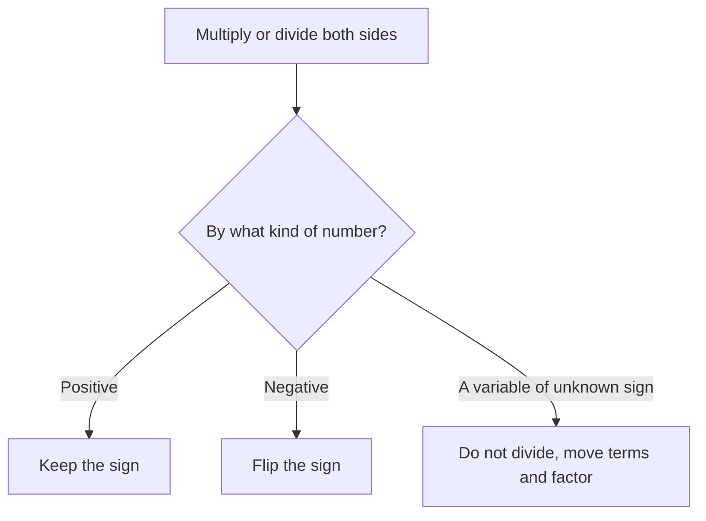

# Inequalities and Absolute Value

Inequalities are where the GMAT hides its traps. The solving is easy; the mistakes are in the details: a sign that should have flipped, a variable that could be negative, a fraction that behaves differently below 1. Absolute value questions appear in the same family because |x| is really an inequality in disguise. Expect a few of these in every Quant section, and the hard ones are often "must be true" questions.

## Solving linear inequalities

Treat an inequality like an equation with one important exception.

> [!REMEMBER]
> **When you multiply or divide both sides by a negative number, flip the inequality sign.** Adding or subtracting any number never flips it.

Before each step, check what you are multiplying or dividing by.

Why? Because 2 < 5, but multiply by −1 and you get −2 and −5, and −2 > −5. Negatives reverse the order of numbers on the number line.

Solve −3x + 7 > 22. Subtract 7: −3x > 15. Divide by −3 and flip: x < −5.

> [!TRAP]
> The flip is easy to forget when the negative is hidden, like −x > 4 (multiply by −1, so x < −4), or when dividing by a negative coefficient like −3. Sanity check: pick a value in your answer (x = −10) and plug it into the original: −3(−10) + 7 = 37 > 22. Good.

### Worked example 1 (Easy)
Which of the following describes all x such that 5 − 2x ≤ 13?

(A) x ≤ −4  (B) x ≥ −4  (C) x ≤ 4  (D) x ≥ 4  (E) x ≥ 9

Show solution

Subtract 5: −2x ≤ 8. Divide by −2 and flip the sign: x ≥ −4. The answer is **(B)**.

Check: x = 0 is in the set, and 5 − 0 = 5 ≤ 13. True. x = −5 is not in the set: 5 + 10 = 15, which is not ≤ 13. Good.

Trap: (A) forgets to flip the sign. (C) and (D) divide 8 by 2 and drop the negative.

## Compound inequalities and number lines

A compound inequality like −2 < 3x + 1 ≤ 10 has three parts. Do the same operation to **all three**: subtract 1 to get −3 < 3x ≤ 9, then divide by 3 to get −1 < x ≤ 3.

Picture the number line. "And" means the overlap of two regions; "or" means both regions together. For instance, x > 2 and x < 7 is the stretch between 2 and 7, while x < 2 or x > 7 is the two outside pieces.

## Combining inequalities

You can **add** inequalities that point the same way: if a < b and c < d, then a + c < b + d. You cannot subtract them. To handle a difference like x − y, rewrite it as x + (−y) and flip the bounds on y.

Example: 3 < x < 7 and −2 < y < 5. For x + y: the lowest is 3 + (−2) = 1 and the highest is 7 + 5 = 12, so 1 < x + y < 12. For x − y: −5 < −y < 2, so 3 + (−5) < x − y < 7 + 2, which gives −2 < x − y < 9.

### Worked example 2 (Medium)
If 3 < x < 7 and −2 < y < 5, which of the following gives all possible values of x − y?

(A) −2 < x − y < 9  (B) 1 < x − y < 12  (C) 5 < x − y < 2  (D) −2 < x − y < 5  (E) 1 < x − y < 9

Show solution

Flip y: from −2 < y < 5, multiply by −1 to get −5 < −y < 2 (the signs reverse). Add to 3 < x < 7: 3 + (−5) < x − y < 7 + 2, so −2 < x − y < 9. The answer is **(A)**.

Check with extremes: the biggest x − y uses the biggest x and smallest y (about 7 − (−2) = 9). The smallest uses the smallest x and biggest y (about 3 − 5 = −2). 

Trap: (C) subtracts bounds directly and gets an impossible range. (B) is the range for x + y.

> [!SHORTCUT]
> For "largest/smallest possible value" questions, test the corners. The extreme of a sum, difference or product of bounded quantities always occurs when each variable is at one of its endpoints.

## Squaring and multiplying inequalities: the sign trap

You can't safely multiply two inequalities unless every number involved is positive. And you can't square both sides of x > y unless both sides are non-negative. Examples:

- 3 > −5, but 3² = 9 < 25 = (−5)². Squaring reversed it.
- If x > y, you can't conclude 1/x < 1/y without knowing the signs. (3 > −2 but 1/3 > −1/2.)
- Multiplying by a variable? You must know whether it's positive or negative, or split into cases.

> [!TRAP]
> Never cross-multiply an inequality that contains a variable denominator unless you know the sign of the denominator. For x/y > 1, you cannot conclude x > y. If y is negative, the result is x < y.

The safe method on the GMAT is **testing cases**: pick a positive number, a negative number, a fraction between 0 and 1, and zero, and see what survives.

## Quadratic inequalities and number-line regions

For x² < x, don't divide by x. Move everything: x² − x < 0, so x(x − 1) < 0. The product of two numbers is negative when they have opposite signs, which happens only when 0 < x < 1.

General method: factor, find the roots (the "boundary points"), and test one value in each region.

For (x − 2)(x + 3) > 0 the boundary points are −3 and 2. Regions: x < −3 (test −4: (−6)(−1) = 6 > 0 yes), −3 < x < 2 (test 0: (−2)(3) = −6, no), x > 2 (test 3: (1)(6) = 6 yes). So x < −3 or x > 2.

> [!NOTE]
> A quick rule: for (x − a)(x − b) > 0 with a < b, the solution is the two outside pieces. For (x − a)(x − b) < 0, it's the stretch between.

### Worked example 3 (Medium)
If x² < x, which of the following must be true?

(A) x > 1  (B) x < 0  (C) x² > 1  (D) 0 < x < 1  (E) x > 2

Show solution

Rewrite as x² − x < 0, so x(x − 1) < 0. This product is negative only if x is between 0 and 1. The answer is **(D)**.

Check: x = ½ gives ¼ < ½. True. x = 2 gives 4 < 2. False. x = −1 gives 1 < −1. False.

Faster way: test numbers. x = 2 kills (A), (C) and (E). x = ½ kills (B). 

Trap: (A), (C) and (E) come from thinking squares are always bigger than the original number. That's true above 1, but between 0 and 1 squaring makes a number smaller, and that's exactly where this inequality lives.

## Absolute value as distance

|x| is the distance of x from zero on the number line, so it's never negative. More generally, **|x − a| is the distance between x and a**.

That one idea decodes everything:

- |x − 3| = 5 means "x is 5 units from 3": x = 8 or x = −2.
- |x − 3| < 5 means "x is within 5 units of 3": −2 < x < 8.
- |x − 3| > 5 means "x is more than 5 units from 3": x < −2 or x > 8.

> [!REMEMBER]
> |x| < b means −b < x < b (one connected stretch, an "and"). |x| > b means x < −b or x > b (two outside pieces, an "or"). If b is negative, |x| < b has no solution and |x| > b is true for every x.

### Worked example 4 (Medium)
How many integers x satisfy |x − 3| < 5?

(A) 7  (B) 8  (C) 9  (D) 10  (E) 11

Show solution

|x − 3| < 5 means −5 < x − 3 < 5. Add 3: −2 < x < 8. The integers are −1, 0, 1, 2, 3, 4, 5, 6, 7, which is 9 integers. The answer is **(C)**.

Check: x = −2 gives |−5| = 5, not less than 5, so −2 is excluded. x = 8 is excluded too.

Trap: (E) 11 counts the endpoints −2 and 8 as if the inequality were ≤. Also (B) 8 comes from 8 − (−2) − 2, the classic "subtract and forget to add 1" slip. For integers strictly between a and b, the count is b − a − 1 (here 10 − 1 = 9).

## Solving absolute value equations with cases

For an equation like |expression| = something, split into two cases: the inside is positive (or zero), or the inside is negative.

Solve |x| = 2x − 3.

- Case 1 (x ≥ 0): x = 2x − 3, so x = 3. Valid since 3 ≥ 0.
- Case 2 (x < 0): −x = 2x − 3, so x = 1. But 1 is not < 0, so reject.

Only x = 3. Check: |3| = 3 and 2(3) − 3 = 3. Yes.

> [!TRAP]
> Always check each case's answer against the condition that defines the case, and then check it in the original equation. Absolute value equations with x on both sides regularly produce extraneous solutions.

When there are two absolute values, like |A| = |B|, the two quantities are equal or opposites: A = B or A = −B. No need for four cases.

### Worked example 5 (Hard)
What is the sum of all values of x that satisfy |2x − 1| = |x + 4|?

(A) −5  (B) −1  (C) 4  (D) 5  (E) 9

Show solution

Either 2x − 1 = x + 4, giving x = 5, or 2x − 1 = −(x + 4), giving 2x − 1 = −x − 4, so 3x = −3 and x = −1. The sum is 5 + (−1) = 4. The answer is **(C)**.

Check: x = 5: |9| = 9 and |9| = 9. x = −1: |−3| = 3 and |3| = 3. Both work.

Trap: (D) 5 and (A) −5 come from picking one of the two solutions or the product (−5). The question asks for the sum of all values.

## Useful absolute value facts

- |a| × |b| = |ab| and |a|/|b| = |a/b|.
- |a + b| ≤ |a| + |b| (the triangle inequality). Equality holds when a and b have the same sign.
- √(x²) = |x|, not x. For example, √((−4)²) = √16 = 4 = |−4|.
- If |x| > x, then x must be negative. (For x ≥ 0, |x| = x.)

## Max and min problems

These ask for the biggest or smallest value of an expression, given bounds. The secret is that you rarely need calculus-style thinking, just test the endpoints and watch for squares (which can be maximised at a negative endpoint).

### Worked example 6 (Hard)
If −4 ≤ x ≤ 3 and −2 ≤ y ≤ 5, what is the greatest possible value of x² − y?

(A) 7  (B) 11  (C) 14  (D) 18  (E) 21

Show solution

To make x² − y large, make x² as large as possible and y as small as possible. On −4 ≤ x ≤ 3, the largest x² is at x = −4, giving 16 (compared with 9 at x = 3). The smallest y is −2. So the maximum is 16 − (−2) = 18. The answer is **(D)**.

Check: x = −4, y = −2 are both allowed. x² − y = 16 + 2 = 18. No other pair beats it, because 16 is the biggest possible square and −2 the smallest possible y.

Trap: (B) 11 comes from assuming the largest x is the one that gives the largest x², so x = 3 and 9 + 2 = 11. For squares, the endpoint with the larger absolute value wins. (E) 21 would be 16 + 5, using the wrong end of y.

> [!TIP]
> When a "must be true" question appears, try to break each choice. Use a negative number, zero, a fraction between 0 and 1, and a large number. The statement that survives every test is your answer.

## Quick check

1. Solve 4 − 3x < 13.

Answer

−3x < 9, so x > −3 (flip the sign).

2. If −1 < a < 2 and 3 < b < 6, what is the range of a − b?

Answer

−6 < −b < −3, so −1 + (−6) < a − b < 2 + (−3), giving −7 < a − b < −1.

3. For which values of x is (x − 1)(x + 4) < 0?

Answer

Between the roots: −4 < x < 1.

4. Solve |2x + 3| ≥ 7.

Answer

2x + 3 ≥ 7 or 2x + 3 ≤ −7, so x ≥ 2 or x ≤ −5.

5. If |x| > x, what can you say about x?

Answer

x < 0. For any x ≥ 0, |x| = x, so the inequality fails.

## Key takeaways
- Flip the inequality sign whenever you multiply or divide by a negative.
- Add inequalities that point the same way; never subtract them. To get x − y, flip the bounds on y first.
- Don't multiply, divide or square an inequality unless you know the signs. Test cases instead.
- For quadratic inequalities, move everything to one side, factor, mark boundary points and test each region.
- |x − a| is a distance. "Less than" gives one stretch (and), "greater than" gives two pieces (or).
- Split absolute value equations into cases, then check each answer against its own case and the original equation.
- For max/min problems, check the endpoints, and remember squares can peak at a negative endpoint.
- In "must be true" questions, try to disprove each choice with zero, negatives and fractions.

## Go deeper
- [Khan Academy: Algebra 1](https://www.khanacademy.org/math/algebra) — linear inequalities and absolute value practice.
- [Khan Academy: Algebra 2](https://www.khanacademy.org/math/algebra2) — quadratic inequalities and more absolute value work.
- [GMAT Club forum](https://gmatclub.com/forum/) — search "absolute value" and "inequalities" for worked discussions.
