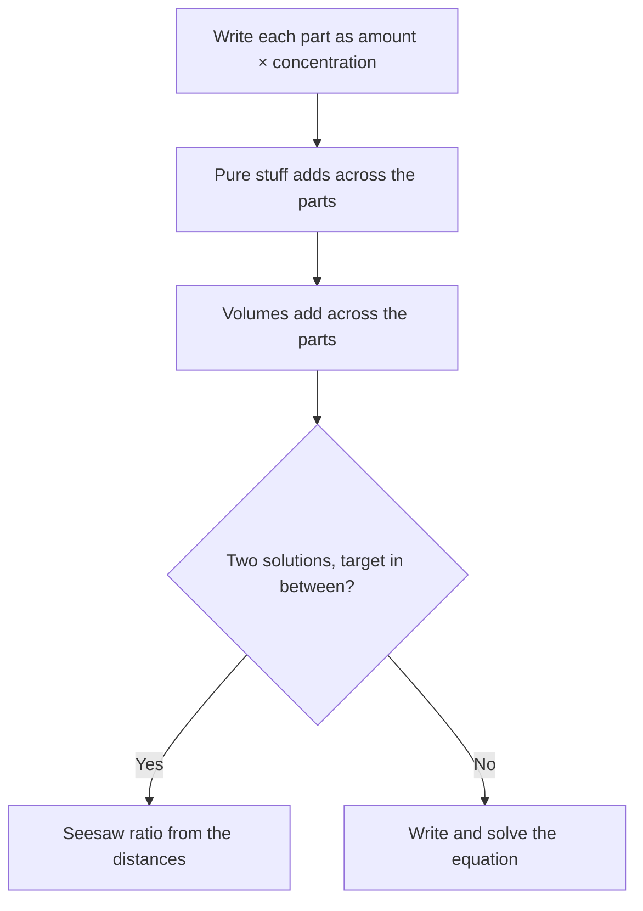

# Mixtures, Interest, Profit & Loss

Money and mixtures look like two different topics, but they run on the same engine: a weighted average with a percentage attached. On the GMAT Focus you'll typically see one or two of these in the Quant section. They're word problems, so the real skill is turning the English into a tidy equation without panicking.

This lesson takes you from "what even is a 30% solution?" to the multi-step problems that separate a 655 from a 705.

## Part 1: Concentration mixtures

### The one idea behind every mixture problem

A percentage only means something relative to the whole it's a percentage of. So in mixture problems, stop thinking in percentages and think in **amounts of the pure stuff**.

> Amount of pure stuff = (concentration) × (total volume)

Every mixture problem runs on this idea.

A 20% salt solution of 50 litres contains 0.20 × 50 = 10 litres of salt (and 40 litres of water). When you mix two solutions, the pure stuff simply adds up, and the total volume simply adds up. Concentrations never add. That's the whole game.

> [!REMEMBER]
> When mixing: (pure stuff in A) + (pure stuff in B) = (pure stuff in the final mix), and (volume A) + (volume B) = (final volume). Never add percentages directly.

Assume liquids mix without shrinking, so volumes add. The GMAT assumes this unless it tells you otherwise.

### Build a small table

For anything with more than one ingredient, draw three columns. It keeps you honest.

| | Volume | Concentration | Pure stuff |
|---|---|---|---|
| Solution A | a | p% | a × p% |
| Solution B | b | q% | b × q% |
| Mix | a + b | ? | sum of the two above |

Fill in what you know, write the equation on the last column, and solve.

### Worked example 1 (Easy)
A chemist mixes 6 litres of a 10% acid solution with 4 litres of a 40% acid solution. What is the percentage of acid in the mixture?

Show solution

Acid in the first: 0.10 × 6 = 0.6 L. Acid in the second: 0.40 × 4 = 1.6 L. Total acid = 2.2 L in 10 L of mix. That's 2.2/10 = 22%.

Faster way: the answer must lie between 10% and 40%, and since there's more of the weaker solution (6 vs 4), it should sit closer to 10%. 22% fits (12 above 10, 18 below 40, which is the 6:4 ratio flipped).

Trap: averaging 10% and 40% to get 25%. A simple average only works when the two volumes are equal.

### Adding water, evaporating water, adding pure stuff

These are the same table with a special row. Water is a 0% solution. Pure acid is a 100% solution. Evaporation removes water only, so the amount of the *other* stuff stays fixed while the total shrinks.

> [!TIP]
> In "add water" or "evaporate water" problems, find the quantity that does not change (the salt, the sugar, the acid) and anchor your equation on it.

### Worked example 2 (Medium)
A 40-litre solution is 25% salt. How many litres of water must evaporate so that the solution becomes 40% salt?

Show solution

Salt = 0.25 × 40 = 10 L, and this doesn't change. In the final solution, 10 L is 40% of the total, so the total is 10 ÷ 0.40 = 25 L. Water that evaporated = 40 − 25 = 15 L.

Trap: answering 40% − 25% = 15% of 40 = 6 L. Percent points of different wholes can't be subtracted like that.

## Part 2: The weighted-average (teeter-totter) method

The table method always works, but it can be slow. The faster tool is **alligation**, which I like to picture as a seesaw.

Put the two starting concentrations at the two ends of the seesaw, and the target concentration at the pivot. The *distances* from each end to the pivot tell you the ratio of the volumes, but flipped: the bigger amount sits closer to the pivot.

For example, mixing 30% and 60% to get 50%:

- 30% is 20 points below the target.
- 60% is 10 points above the target.
- So volumes are in the ratio (volume of 30%) : (volume of 60%) = 10 : 20 = 1 : 2.

Sanity check: 50% is much closer to 60% than to 30%, so we need more of the 60%. Yes, two parts of it to one part of the 30%.

> [!SHORTCUT]
> Ratio of volumes = (distance of the OTHER solution from the target) : (distance of THIS solution from the target). The nearer solution gets the bigger share.

### Worked example 3 (Medium)
How many litres of a 30% sugar solution and a 60% sugar solution must be combined to make 30 litres of a 50% solution?

Show solution

Distances from 50%: 30% is 20 away, 60% is 10 away. So volumes are 10 : 20, a ratio of 1 : 2. Total parts = 3, so each part is 10 litres. We need 10 L of the 30% solution and 20 L of the 60% solution.

Check: sugar = 0.30 × 10 + 0.60 × 20 = 3 + 12 = 15 L, and 15/30 = 50%. ✓

Algebra version: 0.30x + 0.60(30 − x) = 0.50 × 30, so 0.30x + 18 − 0.60x = 15, so −0.30x = −3, so x = 10.

> [!NOTE]
> Alligation works for anything that is a weighted average, not just liquids: average prices of two grades of rice, average speeds over equal time, average marks of two sections of a class. Same seesaw each time.

### Replacing part of a mixture

"Drain some and replace it with something else" is a GMAT favourite because it feels harder than it is. Two clean ways to think about it:

1. **Remove, then add.** Draining x litres removes x × (current concentration) of pure stuff. Adding x litres of the new liquid adds x × (new concentration). The total volume is unchanged.
2. **Fraction that survives.** If you drain a fraction f of a full container and replace it with water, the original liquid left is (1 − f) of what it was. Do it n times and the original survivors are (1 − f)n.

> [!TRAP]
> If you replace 10 L of a 50 L container with water and do it again, you have NOT removed 20 L of the original liquid. The second removal takes out some water along with the milk. Use the survivor fraction (4/5 each time), not subtraction.

### Worked example 4 (Medium)
A 50-litre container is full of pure milk. 10 litres are removed and replaced with water. Then 10 litres of the new mixture are removed and replaced with water again. How many litres of milk are in the container now?

Show solution

Each step removes 10/50 = 1/5 of whatever is in there, so 4/5 of the milk survives each time. Milk left = 50 × (4/5) × (4/5) = 50 × 16/25 = 32 litres.

Long way: after step 1, there are 40 L milk and 10 L water. Removing 10 L of this mix takes out 8 L milk and 2 L water, leaving 32 L milk and 18 L water. ✓

Trap: 50 − 10 − 10 = 30. It forgets that the second scoop contains some water.

### Worked example 5 (Hard)
A 60-litre vessel contains a solution that is 25% alcohol. A certain amount is drained, and exactly that amount of a 70% alcohol solution is added, making the final solution 40% alcohol. How many litres were drained?

Show solution

Seesaw method: the final 40% sits between the 25% solution that stays and the 70% solution that is added. Distances: 40 − 25 = 15 and 70 − 40 = 30. So (kept 25% solution) : (added 70% solution) = 30 : 15 = 2 : 1. The final 60 L is 2/3 original and 1/3 added, so the added amount, which equals the drained amount, is 20 litres.

Algebra: 0.25 × 60 − 0.25x + 0.70x = 0.40 × 60, so 15 + 0.45x = 24, so x = 20. ✓

Trap: treating the drained solution as pure alcohol or thinking the 70% solution is added to the full 60 L (it isn't; the vessel stays at 60 L).

## Part 3: Interest

### Simple interest

Simple interest is charged only on the original amount (the principal, P).

> [!REMEMBER]
> Simple interest = P × r × t, where r is the yearly rate as a decimal and t is the time in years. Total amount = P + P r t = P(1 + r t).

$4,000 at 6% simple interest for 3 years earns 4,000 × 0.06 × 3 = $720. The interest is the same every year, so it grows in a straight line.

### Compound interest

Compound interest is charged on the principal *plus* the interest already earned. Growth is exponential, not linear.

> [!REMEMBER]
> Annual compounding: A = P(1 + r)t. If compounded n times per year: A = P(1 + r/n)nt.

"6% compounded semi-annually" means 3% twice a year. "8% compounded quarterly" means 2% four times a year. The headline rate is split up, but the number of periods goes up. So compounding more often always gives slightly more.

| Quoted rate | Compounding | Per-period rate | Periods in 1 year | Growth in 1 year |
|---|---|---|---|---|
| 8% | Annual | 8% | 1 | 1.08 (8.00%) |
| 8% | Semi-annual | 4% | 2 | 1.0816 (8.16%) |
| 8% | Quarterly | 2% | 4 | about 1.0824 (8.24%) |

### Fast approximations (no calculator!)

The GMAT will give nice numbers, but a quick expansion helps. For small r:

(1 + r)2 = 1 + 2r + r², and the r² part is the "interest on interest".

So over two years at 10%: 1 + 0.20 + 0.01 = 1.21. And the difference between compound and simple interest after exactly two years is always P × r², a very handy shortcut.

> [!SHORTCUT]
> After 2 years: (Compound interest) − (Simple interest) = P × r². On $5,000 at 10%, that's 5,000 × 0.01 = $50.

### Worked example 6 (Medium)
$5,000 is invested at 10% interest compounded annually. How much more interest does it earn over 2 years than it would at 10% simple interest?

Show solution

Compound: 5,000 × 1.1 × 1.1 = 6,050, so interest = $1,050. Simple: 5,000 × 0.10 × 2 = $1,000. Difference = $50.

Faster way: P r² = 5,000 × 0.01 = $50.

Trap: computing 10% twice on 5,000 and forgetting that the second year's interest is on 5,500, not 5,000. Or comparing total amounts rather than interest (the difference is the same, but make sure you read what's asked).

> [!TIP]
> When the problem says an amount "doubles" or "triples" and asks about the time, use nice doubling checkpoints: at 10% compounded, money roughly doubles in about 7 years. The GMAT usually avoids this and gives you a clean exponent instead, so just trust the structure.

## Part 4: Profit and loss

### The vocabulary

- **Cost price (CP):** what the seller paid.
- **Marked price (MP) or list price:** the sticker price.
- **Selling price (SP):** what the customer actually pays.
- **Profit = SP − CP.** Profit % is usually measured on **cost** unless the problem says otherwise.
- **Markup:** how far above cost the sticker is. Markup % = (MP − CP)/CP.
- **Margin:** profit as a share of the **selling price**: (SP − CP)/SP.
- **Discount:** reduction from the marked price. Discount % = (MP − SP)/MP.

> [!TRAP]
> Markup is on cost, margin is on selling price. A 25% markup on a $80 item gives SP = $100, a profit of $20. That is a 25% markup but only a **20% margin** ($20 out of $100). The GMAT loves to blur these.

### Multipliers make it painless

Write every step as a multiplier. A 40% markup is × 1.40. A 15% discount is × 0.85. They chain by multiplication.

### Worked example 7 (Medium)
A shop marks up a jacket by 40% over cost, then sells it at a 15% discount on the marked price. What is the shop's profit, as a percent of cost?

Show solution

Take cost = 100. Marked price = 140. Selling price = 0.85 × 140 = 119. Profit = 19, so 19% of cost.

Multiplier version: 1.40 × 0.85 = 1.19.

Trap: 40% − 15% = 25%. The discount is on the marked price, which is bigger than the cost.

### Worked example 8 (Hard)
A retailer marks up the cost of an item by 60%. During a sale, the retailer sells it at a discount that still leaves a 20% profit over cost. What percent discount was offered on the marked price?

Show solution

Let cost = 100. Marked price = 160. Selling price for a 20% profit = 120. Discount = 160 − 120 = 40, which is 40/160 = 25% of the marked price.

Multiplier version: 1.60 × (1 − d) = 1.20, so 1 − d = 0.75, so d = 25%.

Trap: answering 60% − 20% = 40%, the "difference of two percentages on different bases" mistake.

### Break-even

Break-even means profit = 0, i.e. total revenue = total cost. If a business has fixed costs F (rent, equipment) and each unit costs v to make and sells for p, then:

Break-even quantity = F ÷ (p − v)

The quantity (p − v) is the profit on each unit available to pay off the fixed cost.

### Worked example 9 (Medium)
A bakery has fixed monthly costs of $12,000. Each cake costs $15 to make and sells for $40. How many cakes must it sell in a month to break even?

Show solution

Each cake contributes 40 − 15 = $25 towards the fixed cost. 12,000 ÷ 25 = 480 cakes.

Trap: dividing 12,000 by 40 (revenue per cake) and getting 300. That ignores the variable cost of making the cake.

## Quick check

1. How many litres of pure water must be added to 20 litres of a 30% acid solution to make it 20% acid?

Answer

Acid = 6 L stays fixed. 6 is 20% of the final total, so the total is 30 L. Water added = 30 − 20 = 10 litres.

2. $2,000 grows at 20% interest compounded annually. What is the total amount after 2 years?

Answer

2,000 × 1.2 × 1.2 = 2,000 × 1.44 = $2,880.

3. An item sells for $120 at a 20% profit on cost. What was the cost?

Answer

SP = 1.2 × CP, so CP = 120 ÷ 1.2 = $100.

4. A trader sells an article for $90 and makes a 25% margin on the selling price. What did the article cost?

Answer

Margin of 25% of SP means profit = $22.50, so cost = 90 − 22.50 = $67.50.

## Key takeaways

- Think in amounts of pure stuff, never in percentages added together. Pure stuff adds and volumes add.
- Use a quick table (volume, concentration, pure stuff) for any mixing problem, or use the seesaw for two-solution blends.
- For repeated replacement, use the survivor fraction (1 − f)n, never subtraction.
- Simple interest is P r t, a straight line. Compound interest is P(1 + r/n)nt, a curve. After 2 years the gap is P r².
- Markup is measured on cost, margin on selling price, and discount on marked price. Always check the base of each percentage.
- Chain percentage changes with multipliers (× 1.40, × 0.85); never add or subtract them.
- Break-even quantity = fixed costs ÷ (price − variable cost per unit).

## Go deeper
- [Khan Academy: Algebra and word problems](https://www.khanacademy.org/math/algebra) — extra practice on mixture and interest word problems.
- [GMAT Club forum](https://gmatclub.com/forum/) — search by topic to find discussions of mixture and interest problem types.
- [Official GMAT exam page](https://www.mba.com/exams/gmat-exam) — format and section details for the GMAT Focus Edition.
