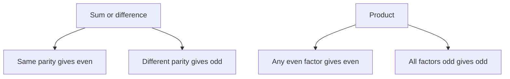
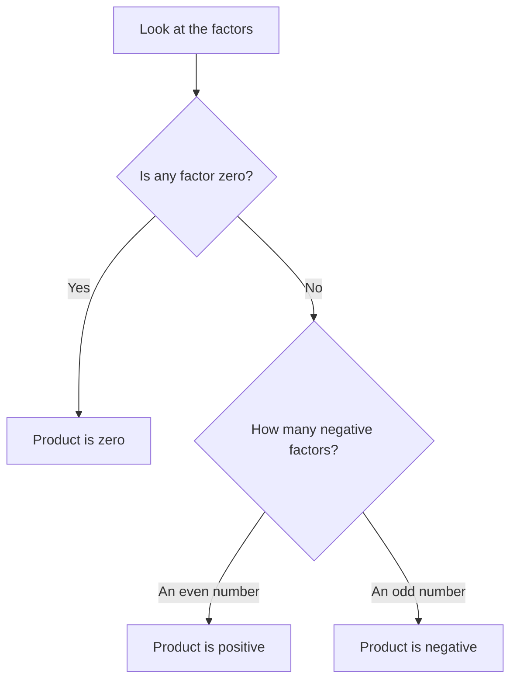

# Number Properties

"Number properties" questions test whether you really understand what numbers do: odd and even, positive and negative, zero, consecutive integers, fractions between 0 and 1. They look abstract, and they're where many people lose easy points to a single overlooked case. The good news is that a short checklist beats almost all of them.

## The cast of characters

- **Integers**: ... −3, −2, −1, 0, 1, 2, 3 ... No fractions or decimals.
- **Positive / negative**: 0 is neither. It is an even integer.
- **Even**: divisible by 2 (…, −4, −2, 0, 2, 4, …). **Odd**: not divisible by 2.
- **Prime**: exactly two positive divisors (2, 3, 5, 7, 11 ...). 1 is not prime, and 2 is the only even prime.
- **Consecutive integers**: n, n + 1, n + 2, and so on.
- **Digits**: 0 to 9. A number such as 473 has hundreds digit 4, tens digit 7, units digit 3.

> [!REMEMBER]
> 0 is an integer, it is even, and it is neither positive nor negative. 1 is odd, not prime, and is its own square and cube. These four facts sink more candidates than any formula.

## Odd and even rules

You don't need to memorise a table. Use the idea of "odd = one left over":

| Operation | Result |
|---|---|
| even + even, even − even | even |
| odd + odd, odd − odd | even |
| even + odd | odd |
| even × anything | even |
| odd × odd | odd |
| oddn | odd |
| evenn (n ≥ 1) | even |

For a sum or difference, **the parity only depends on how many odd terms there are**: an even count of odd numbers gives an even total. For a product, one even factor makes the whole product even.

Parity rules in one picture.

### Worked example 1 (Easy)
If a is even and b is odd, which of the following must be odd? (a) a + 2b (b) ab (c) a² + b² (d) a − b + 1

Show solution

Plug a = 2, b = 1.
(a) 2 + 2 = 4 even. (b) 2 even. (c) 4 + 1 = 5 odd. (d) 2 − 1 + 1 = 2 even.

Only (c) is odd. Algebra check: a² is even, b² is odd, even + odd = odd ✓.

Trap: Testing just one set of numbers. Here the parity rules guarantee it, but on harder "must be" questions you need several tests.

## Sign rules

A product (or quotient) of non-zero numbers is positive when there's an **even** number of negatives, and negative when there's an odd number. For powers: (negative)even is positive and (negative)odd is negative.

To find the sign of a product, count the negatives.

For sums, the bigger absolute value wins the sign: −8 + 3 = −5.

> [!TRAP]
> Squares are never negative, but x² can equal 0. So "x² > 0" tells you x ≠ 0, while "x² ≥ 0" tells you nothing. Also, x² ≥ x is not always true: for 0 < x < 1, x² < x.

### Zero and one

- 0 times anything is 0. Division by 0 is undefined.
- If xy = 0, at least one of x, y is 0. (This is the foundation of factoring equations.)
- 1 × anything = itself; 1 raised to any power is 1.
- The only numbers equal to their own square are 0 and 1.

## The "test numbers" checklist

Questions asking "which of the following MUST be true" or "COULD be true" are asking about **every** allowed value, or about **at least one**. The best method is to test a small set of special values, chosen to break your assumptions:

1. **Zero** (if allowed)
2. **1 and −1**
3. A **small positive integer** (2 or 3)
4. A **negative integer** (−2)
5. A **fraction between 0 and 1** (½)

> [!TIP]
> Number-line thinking: draw a line marked −1, 0, 1. Every number lives in one of these zones: below −1, between −1 and 0, between 0 and 1, above 1. Behaviour changes at each boundary. Powers, reciprocals and square roots all act differently in each zone.

For example, if x is between 0 and 1: x² < x < √x < 1/x. If x > 1 the order reverses for squares and roots: √x < x < x². If −1 < x < 0, then x³ > x? Try x = −½: x³ = −⅛ and −⅛ > −½, so yes x³ > x.

### Worked example 2 (Medium)
If 0 < x < 1, which is the greatest? I. x II. x² III. √x IV. 1/x

Show solution

Try x = ¼. Then x = 0.25, x² = 0.0625, √x = 0.5, 1/x = 4. Greatest: 1/x.

Why: dividing 1 by a number smaller than 1 gives something bigger than 1, and the other three are all below 1.

Trap: Choosing x² because "squaring makes bigger". That is true only above 1.

## Consecutive integers

Three consecutive integers can be written n − 1, n, n + 1. The middle one is the average, so the sum is 3n. This is the quickest way to handle "sum" problems.

Facts that save time:

- The sum of k consecutive integers = k × (average), where the average is the middle term (or the mean of the two middle terms).
- The product of **k consecutive integers is divisible by k!** (so any 3 in a row are divisible by 6; any 2 in a row are divisible by 2).
- Among any 2 consecutive integers, exactly one is even. Among any 3, at least one is a multiple of 3. Among any 4, one is a multiple of 4.
- Consecutive integers have opposite parity (odd, even, odd, even ...).

> [!NOTE]
> Consecutive EVEN (or ODD) integers go up by 2: n, n + 2, n + 4. Consecutive multiples of 5 go up by 5, and so on. Always check the gap before you set up the equation.

### Worked example 3 (Medium)
The sum of five consecutive odd integers is 135. What is the largest?

Show solution

Average = 135 ÷ 5 = 27 is the middle value. The five numbers are 23, 25, 27, 29, 31. The largest is 31.

Check: 23 + 25 + 27 + 29 + 31 = 135 ✓.

Trap: Taking the average 27 as the largest, or using a gap of 1 (which gives 25 to 29).

### Worked example 4 (Medium)
For integer n, is n(n + 1)(n + 2) always divisible by 6?

Show solution

Yes. Three consecutive integers contain at least one even number and exactly one multiple of 3, so the product is divisible by 2 × 3 = 6.

Test: n = 1: 6 ✓; n = 2: 24 ✓; n = −1: (−1)(0)(1) = 0, divisible by 6 ✓.

Trap: Forgetting that 0 counts as divisible by anything. A test with n = −1 or n = 0 is a good check.

## Digits and place value

A two-digit number with tens digit t and units digit u equals 10t + u. A three-digit number is 100h + 10t + u. Reversing digits of a two-digit number gives 10u + t.

Handy facts:

- The difference between a two-digit number and its reverse is 9(t − u). So it's always a multiple of 9.
- The sum of a two-digit number and its reverse is 11(t + u), a multiple of 11.
- A number is divisible by 9 exactly when its digit sum is divisible by 9.

### Worked example 5 (Medium)
A two-digit positive integer N is 27 more than the number formed by reversing its digits, and its digits add up to 9. What is N?

Show solution

Let the tens digit be t and the units digit u. N − reverse = (10t + u) − (10u + t) = 9(t − u) = 27, so t − u = 3. With t + u = 9, adding the two equations gives 2t = 12, so t = 6 and u = 3. N = 63.

Check: 63 − 36 = 27 ✓ and 6 + 3 = 9 ✓.

Trap: Treating the difference of 27 as the difference of the digits. The difference between a number and its reverse is 9 times the digit gap, so divide by 9 first.

## Putting it together: "must be true" with Roman numerals

Questions often give you several statements (I, II, III) and ask which MUST be true. Treat each statement separately: one counterexample kills it. If you can't find a counterexample after testing your checklist, prove it with an algebra or parity argument.

### Worked example 6 (Hard)
If x and y are integers and xy is odd, which of the following must be true? I. x + y is even II. x² − y² is even III. x is greater than y

Show solution

xy odd means both x and y are odd.

I: odd + odd = even ✓. II: odd² − odd² = odd − odd = even ✓. III: x = 1, y = 3 gives x < y, so it need not be true ✗.

Answer: I and II only.

Trap: Treating "xy odd" as saying only one of them is odd. A product is odd only if every factor is odd.

### Worked example 7 (Hard)
If p is a positive integer and p² is divisible by 12, which of the following must be a factor of p? I. 4 II. 6 III. 9

Show solution

12 = 2² × 3. For p² to have 2² and 3, p must have at least one 2 and one 3 (since squaring doubles the exponents, p needs at least 21 and 31). So 6 divides p.

I: p = 6, p² = 36 = 12 × 3 ✓ and 4 does not divide 6. ✗. III: 9 does not divide 6 ✗. II must be true.

Answer: II only.

Trap: Assuming p² divisible by 12 means p divisible by 12, or by 4. Squares double exponents, so the minimum for p is half.

## Quick check

1. Is the product of any three consecutive integers odd or even?

Answer

Always even, because at least one of the three is even.

2. If x is an integer and x² is even, must x be even?

Answer

Yes. If x were odd, x² would be odd.

3. If −1 < x < 0, which is larger, x or x²?

Answer

x² is larger (try x = −½: x² = ¼, which is positive, and x is negative).

4. The sum of four consecutive integers is 50. What are they?

Answer

Four consecutive integers sum to 4n + 6. Setting 4n + 6 = 50 gives n = 11, so the integers are 11, 12, 13, 14. Check: 11 + 12 + 13 + 14 = 50 ✓.

## Key takeaways
- 0 is even, neither positive nor negative; 1 is not prime; 2 is the only even prime.
- Parity of a sum depends on the count of odd terms; a product is even if any factor is even.
- A product of non-zero numbers is negative if it has an odd number of negative factors.
- Test a small set of special values: 0, 1, −1, a small positive integer, a negative integer, and a fraction between 0 and 1.
- "Must be true" needs all cases. One counterexample kills it. "Could be true" needs just one example.
- Consecutive integers: the middle term is the average; k in a row are divisible by k!.
- Squaring or square-rooting behaves differently below and above 1.
- Digit problems: write the number as 10t + u and let algebra do the work.

## Go deeper
- [Khan Academy: Arithmetic](https://www.khanacademy.org/math/arithmetic) — refresh the fundamentals.
- [GMAT Club forum](https://gmatclub.com/forum/) — number-properties discussion threads.
- [Official GMAT exam page](https://www.mba.com/exams/gmat-exam) — the format and scoring.
