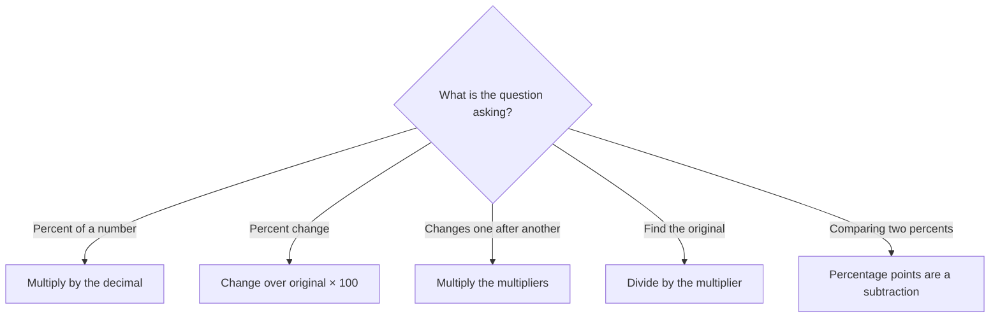

# Percents

Percents are the most reliable topic on GMAT Quant. They appear on their own, and also hide inside profit, interest, mixture, growth, and data-style word problems. The good news: once you see a percent as just a fraction over 100, and a "percent change" as a multiplier, the hard-looking questions become two-line problems.

## What "percent" means

"Percent" literally means "per hundred". 35% is 35/100 = 0.35. To convert: percent → decimal, move the point two places left; decimal → percent, move it two places right.

| Percent | Fraction | Decimal |
|---|---|---|
| 1% | 1/100 | 0.01 |
| 5% | 1/20 | 0.05 |
| 10% | 1/10 | 0.1 |
| 12.5% | 1/8 | 0.125 |
| 20% | 1/5 | 0.2 |
| 25% | 1/4 | 0.25 |
| 33⅓% | 1/3 | 0.333… |
| 50% | 1/2 | 0.5 |
| 75% | 3/4 | 0.75 |
| 100% | 1 | 1 |
| 150% | 3/2 | 1.5 |

Percents can be more than 100 (150% of 40 is 60) and less than 1 (0.5% = 0.005).

> [!REMEMBER]
> Learn the fraction-percent pairs by heart: ½ = 50%, ⅓ = 33⅓%, ¼ = 25%, ⅕ = 20%, ⅙ = 16⅔%, ⅛ = 12.5%, ⅒ = 10%. Working in fractions is often far quicker than working with decimals.

## Translating English into maths

Most percent mistakes are translation mistakes. Use this dictionary:

| English | Maths |
|---|---|
| "what percent" | x/100 |
| "of" | × |
| "is" | = |
| "A is what percent of B" | A = (x/100) × B, so x = (A/B) × 100 |
| "A is p% more than B" | A = B × (1 + p/100) |
| "A is p% less than B" | A = B × (1 − p/100) |

The base is whatever comes right after "of", "than", or "compared to". "25 is what percent of 200?" has base 200: 25/200 = 12.5%. "200 is what percent of 25?" has base 25: 800%.

> [!TRAP]
> "A is 20% more than B" and "B is 20% less than A" are NOT the same statement. If B = 100 then A = 120, but B is 100 which is only 16⅔% less than 120. The base changes, so the percent changes.

## Percent of a number: the 10% and 1% trick

You can find most percents of a number by building from 10% and 1%, which are just decimal shifts:

- 10% of 340 = 34. So 5% = 17, 20% = 68, 30% = 102.
- 1% of 340 = 3.4. So 15% = 10% + 5% = 34 + 17 = 51. And 35% = 30% + 5% = 102 + 17 = 119.
- 12% of 250: 10% = 25, 1% = 2.5, so 2% = 5, giving 30.

> [!SHORTCUT]
> **Percent swap:** x% of y equals y% of x. So 8% of 50 is the same as 50% of 8 = 4. Choose whichever direction is easier. 36% of 25 = 25% of 36 = 9.

For awkward percents, use the fraction version: 37.5% of 80 = ⅜ × 80 = 30.

### Worked example 1 (Easy)
What is 15% of 60% of 400?

Show solution

60% of 400 = 240. Then 15% of 240: 10% = 24, 5% = 12, total 36.

Faster way: use the swap on the first step: 60% of 400 = 4 × 60 = 240. Or combine: 0.15 × 0.6 = 0.09, and 9% of 400 = 36. 

Trap: adding the percents (75%) or multiplying incorrectly (15 × 60 = 900). Successive "of"s multiply as decimals, not add.

## Percent change

Percent change measures how much something moved compared to where it **started**:

**Percent change = (new − old)/old × 100%**

Going from 80 to 100: (100 − 80)/80 = 20/80 = 25% increase. Going from 100 to 80: (80 − 100)/100 = −20%, a 20% decrease. Same two numbers, different base, different percent.

A useful memory: the denominator is always the **original** (the "from" value). Underline the word "from" or "than" in the question.

**Multipliers: the single most powerful idea in this lesson.** An increase of p% is the same as multiplying by (1 + p/100). A decrease is multiplying by (1 − p/100).

| Change | Multiplier |
|---|---|
| +10% | × 1.10 |
| +25% | × 1.25 |
| +100% | × 2 |
| +200% | × 3 |
| −10% | × 0.90 |
| −25% | × 0.75 |
| −40% | × 0.60 |

New value = old × multiplier. So a 20% rise on ₹500 = 500 × 1.2 = ₹600.

Don't mix up "increase of 200%" (triples) with "increases to 200%" (doubles). The GMAT is precise about this wording.

## Successive percent changes

When percent changes happen one after another, **multiply the multipliers**. Never add the percents.

A price goes up 20% and then down 20%. Multiplier = 1.2 × 0.8 = 0.96, a 4% net decrease. Starting at 100: 120, then 20% of 120 is 24 off, giving 96.

Up 10% then up 10%: 1.1 × 1.1 = 1.21, a 21% rise, not 20%. The second 10% is on a bigger base.

> [!SHORTCUT]
> For two changes of a% and b%, the net is a + b + ab/100. For +20% and −20%: 20 − 20 − 4 = −4%. For +10% and +10%: 10 + 10 + 1 = 21%.

> [!TRAP]
> Up 20% then down 20% is not "back to start". Percent changes in sequence don't cancel, because each one is measured on a different base.

### Worked example 2 (Medium)
A phone's price is cut by 25% during the Diwali sale. After the sale, the new price is raised by 20%. What is the final price as a percent of the original price?

Show solution

Multipliers: 0.75 × 1.20 = 0.90.

So the final price is 90% of the original (a net 10% below the original).

Check with 100: after the cut it's 75, after the rise 75 + 15 = 90. ✓.

Trap: answering 95% by computing −25% + 20% = −5%. Successive changes are multiplied, and the second percent applies to the reduced price.

## Reverse percents: finding the original

You're told the final amount and the change, and asked for the original. **Divide by the multiplier.**

A shirt costs ₹720 after a 20% discount. Original price? The multiplier is 0.8, so original = 720 ÷ 0.8 = 900.

Never compute "20% of 720 and add it back": 720 + 144 = 864 is wrong, because the 20% was taken off the *original*, not off 720.

Similarly, after a 25% increase the value is 150. Original = 150 ÷ 1.25 = 120. (Fraction version: +25% means ×5/4, so original = 150 × 4/5 = 120.)

> [!TIP]
> Say it out loud: "720 is 80% of the original." Then, 80% of ? = 720 gives ? = 720/0.8. Writing "final = multiplier × original" always leads you to the right algebra.

## Percentage points vs percent

If an interest rate rises from 4% to 6%, it rose by **2 percentage points**, but it rose by **50 percent** (2/4). Percentage points are a plain subtraction of two percents; "percent change" compares them to the starting percent.

> [!NOTE]
> If a question says "increased by 5%" about a rate that was 20%, it means the rate became 20% × 1.05 = 21%, not 25%. If it says "increased by 5 percentage points", it's 25%.

## Markup, discount, and profit

Here the vocabulary matters, and the base is the thing to watch.

- **Cost** is what the shop pays. **Selling price** is what the customer pays. **Profit = selling price − cost.**
- **Markup** is usually a percent of **cost**: selling price = cost × (1 + markup%).
- **Discount** is a percent of the **marked (list) price**: sale price = marked × (1 − discount%).
- **Profit percent** is on cost unless the problem says "profit as a percent of selling price".

A shop buys a bag for ₹800 and marks it up 50%: marked price = 1,200. It then offers a 25% discount: sale price = 1,200 × 0.75 = 900. Profit = 900 − 800 = 100, which is 100/800 = 12.5% on cost.

Notice that a 50% markup followed by a 25% discount is not a 25% net profit. You multiply: 1.5 × 0.75 = 1.125, so the sale price is 112.5% of cost.

> [!TRAP]
> "Sold at a 20% discount and still made a 10% profit" combines two different bases: the discount is on the marked price, and the profit is on the cost. Write both multipliers against their own bases, then connect through the selling price.

### Worked example 3 (Medium)
A retailer marks a jacket up 40% above cost, then sells it at a 10% discount off the marked price. If the profit was ₹260, what was the cost?

Show solution

Let cost = C. Marked price = 1.4C. Sale price = 0.9 × 1.4C = 1.26C.

Profit = 1.26C − C = 0.26C = 260, so C = 260/0.26 = 1,000.

Check: marked 1,400, discount 140, sale 1,260. Profit = 260 ✓.

Faster way: the profit is 26% of cost, and 260 is 26% of 1,000.

Trap: computing profit as 40% − 10% = 30% and getting C = 866.67. The discount is a percent of the marked price, which is already larger than the cost.

## "Percent of" in groups and populations

A very common GMAT setup is a group split into parts, with percents given for each part.

A class has 60% girls. 50% of the girls and 30% of the boys wear glasses. What percent of the class wears glasses? Pick a total of 100 students: 60 girls, 40 boys. Glasses: 30 girls + 12 boys = 42. Answer: 42%.

> [!TIP]
> When no actual amount is given, **pick 100** for the base. Percents become plain numbers, and you can't go wrong because the answer is a percent, which doesn't depend on the total. Pick 200 or 1,000 when you'd otherwise get fractions.

That's a **weighted average**: 0.6 × 50% + 0.4 × 30% = 42%. Weighted averages are covered in depth in the mixtures lessons.

## Percent change in two or more variables

If a rectangle's length rises 20% and its width falls 10%, its area changes by 1.2 × 0.9 = 1.08, an 8% rise. This works for any quantity that is a product (revenue = price × quantity; distance = speed × time).

**Revenue pairs:** if price rises 25% and demand falls 20%, revenue changes by 1.25 × 0.8 = 1.0, so there's no change at all.

**Two-step "less than" statements:** "X is 20% less than Y, and Y is 25% more than Z". Then X = 0.8Y and Y = 1.25Z, so X = 0.8 × 1.25 Z = Z. X and Z are equal.

### Worked example 4 (Hard)
In a company, the number of employees rose by 20% from 2024 to 2025, while the average salary per employee rose by 10%. In 2026, the number of employees fell by 25% from the 2025 level, and the total salary bill (employees × average salary) in 2026 was exactly the same as in 2024. By what percent did the average salary change between 2025 and 2026? (Round to the nearest whole percent if needed.)

Show solution

Let 2024 employees = E and average salary = S. The salary bill in 2024 is ES.

2025: employees 1.2E, average 1.1S, bill = 1.32ES.

2026: employees = 0.75 × 1.2E = 0.9E. Let the 2026 average be k × 1.1S. The 2026 bill equals ES: 0.9E × (k × 1.1S) = ES, so 0.99k = 1 and k = 1/0.99 ≈ 1.0101.

So the average salary rose by about 1% between 2025 and 2026.

Check: 0.9E × 1.1S × 1.0101 = 0.99 × 1.0101 ES ≈ ES ✓.

Faster way: only the bill matters. Bill ratio 2026/2025 = 1/1.32. Employee ratio = 0.75. So the salary ratio = (1/1.32)/0.75 = 1/0.99 ≈ 1.0101.

Trap: adding the percent changes, as in 10% + (−25%) + 20%, or measuring changes against the 2024 base rather than the 2025 base.

## Common mistakes checklist

1. **Wrong base.** Always ask: percent of what?
2. **Adding successive percents** instead of multiplying multipliers.
3. **Confusing percent with percentage points.**
4. **Reversing the percent:** adding back 20% of the new price rather than dividing by 0.8.
5. **"Increase of" vs "increase to":** +200% means ×3, "to 200%" means ×2.
6. **Reading "20% less than" as "20% of".**
7. **Decimal slips:** 0.5% is 0.005, not 0.5.

Match the question to the right percent move.

## Quick check

1. What is 35% of 80?

Answer
The swap gives 80% of 35 = 28.

2. A population grows from 400 to 500. What is the percent increase? And what is the percent decrease from 500 back to 400?

Answer
Increase = 100/400 = 25%. Decrease = 100/500 = 20%.

3. A price rises 50% and then falls 50%. What's the net change?

Answer
1.5 × 0.5 = 0.75, a 25% decrease.

4. After a 30% discount, a TV costs ₹14,000. What was the original price?

Answer
14,000 ÷ 0.7 = ₹20,000.

5. A savings rate rises from 8% to 10%. State the change in percentage points and in percent.

Answer
2 percentage points; 2/8 = 25% increase.

## Key takeaways
- Percent = per hundred. Memorise the fraction equivalents (½, ⅓, ¼, ⅕, ⅙, ⅛, ⅒).
- Percent change = (new − old)/old. The denominator is always the starting value.
- Convert every change to a multiplier (+20% = ×1.2, −30% = ×0.7) and multiply for successive changes.
- Reverse percent: divide the final amount by the multiplier; never "add back" the percent.
- Use x% of y = y% of x, and build awkward percents from 10% and 1%.
- Percentage points are a subtraction of two percents; percent change compares them to the starting percent.
- Markup is on cost, discount is on the marked price. Keep each base straight.
- With no actual amount given, pick 100 for the base.

## Go deeper
- [Khan Academy: Percents](https://www.khanacademy.org/math/pre-algebra) — percent and ratio practice from scratch.
- [GMAT Club forum](https://gmatclub.com/forum/) — search for percent problems to see other people's methods.
- [Official GMAT exam page](https://www.mba.com/exams/gmat-exam) — structure and official free practice resources.
