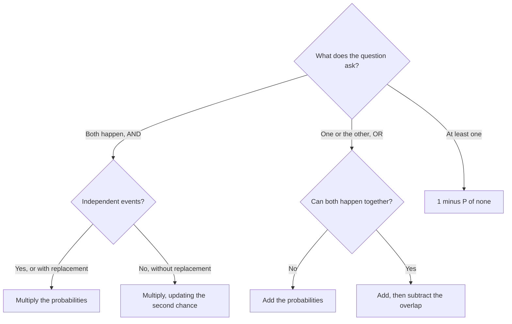

# Probability: Chances, Combinations and Complements

Probability usually shows up as one to three Problem Solving questions on the GMAT Focus Quantitative section. The good news is that it reuses the counting you already know, plus a few rules about AND, OR and "at least one". If you can count outcomes, you can do probability.

## The basic idea

Probability is a fraction between 0 and 1:

P(event) = number of favourable outcomes / total number of equally likely outcomes

A probability of 0 means impossible, 1 means certain. You can write answers as fractions, decimals or percentages, but the GMAT usually wants a fraction in lowest terms.

> [!REMEMBER]
> "Equally likely" is the hidden condition. A cricket match result is not 1/2 win and 1/2 lose just because there are two results. Build the sample space from outcomes that are truly equal in chance (each face of a fair die, each card in a deck).

A fair six-sided die: P(rolling a prime) = 3/6 = 1/2, because the primes are 2, 3 and 5.

## The complement rule

P(not A) = 1 − P(A).

This is the single most useful trick in the chapter. Whenever the question has the phrase "at least one" or "at least k", compute the opposite and subtract from 1.

> [!SHORTCUT]
> "At least one" = 1 − P(none). Don't enumerate cases when one subtraction does the job.

## AND means multiply, OR means add (carefully)

**AND (both happen):** multiply. P(A and B) = P(A) × P(B | A). If A and B are independent, P(B | A) is just P(B).

**OR (at least one happens):** add, then subtract the overlap so you don't count it twice.

P(A or B) = P(A) + P(B) − P(A and B)

This tree picks the right rule for most probability questions.

If A and B can't happen together (mutually exclusive, like rolling a 2 and rolling a 5 on one die), the overlap is zero and you simply add.

| Words in the question | Operation |
|---|---|
| "both", "and then", "all of", "every" | multiply |
| "either", "or" (exclusive cases) | add |
| "or" (overlapping cases) | add, subtract overlap |
| "at least one" | 1 − P(none) |
| "given that" | divide by the probability of the condition |

### Worked example 1 (Easy)
A bag has 5 red, 3 blue and 2 green marbles. One marble is drawn at random. What is the probability that it is red or blue?

Show solution

Red and blue can't both happen on one draw, so add: 5/10 + 3/10 = 8/10 = 4/5.

Faster way: "not green" is 1 − 2/10 = 8/10 = 4/5.

Trap: multiplying 5/10 × 3/10 answers "red AND blue", which can't happen on a single draw.

## Independent and dependent events

Two events are **independent** if one happening doesn't change the chance of the other: two coin tosses, two separate die rolls, draws made **with replacement**.

They are **dependent** if one outcome changes what's left: drawing cards, marbles or people **without replacement**. For dependent events, update the numbers after each step.

Draw two marbles from a bag of 4 red and 6 blue, without replacement. P(both red) = 4/10 × 3/9 = 12/90 = 2/15. If the first marble were replaced it would be 4/10 × 4/10 = 4/25.

> [!TRAP]
> If the problem says "one after the other" or "two are selected" and says nothing about putting back, assume no replacement. Using the original total twice is the most common arithmetic slip in this chapter.

### Worked example 2 (Medium)
A box holds 4 red and 6 blue marbles. Two are drawn without replacement. What is the probability that they are different colours?

Show solution

Two routes: red then blue, or blue then red. Add them.

Red then blue: 4/10 × 6/9 = 24/90. Blue then red: 6/10 × 4/9 = 24/90.

Total = 48/90 = 8/15.

Faster way (counting): 4 × 6 = 24 different-colour pairs out of 10C2 = 45 pairs: 24/45 = 8/15.

Trap: forgetting that the second route exists gives 4/15, half of the right answer.

## Probability with combinations

When you pick a group all at once (a committee, a hand), count favourable groups and total groups with combinations:

P = (favourable combinations) / (total combinations)

Use the same counting method top and bottom. If you choose 3 people from 5 men and 4 women, the chance of exactly 2 women is 4C2 × 5C1 / 9C3 = 6 × 5 / 84 = 30/84 = 5/14.

Sequential multiplying (like 5/9 × 4/8 × 3/7) works too, but combinations are cleaner when order doesn't matter and there are more than two draws.

> [!TIP]
> If you are unsure, do it both ways. Sequential multiplying and combination counting should match. This double check is worth 20 seconds on a hard question.

### Worked example 3 (Medium)
A committee of 3 is chosen at random from 6 men and 4 women. What is the probability that the committee has at least one woman?

Show solution

Complement: P(no woman) = 6C3 / 10C3 = 20/120 = 1/6.

P(at least one woman) = 1 − 1/6 = 5/6.

Faster way: sequential, P(no woman) = 6/10 × 5/9 × 4/8 = 120/720 = 1/6. Same.

Trap: 1/6 is the answer to a different question ("no women"). Read what the question finally asks.

## Repeated trials: "exactly k of n"

When the same independent trial repeats (coin tosses, guessing on a quiz), the probability of **one specific sequence** is the product of the individual chances. Then multiply by the number of sequences that give the result you want, which is a combination.

P(exactly k successes in n trials) = nCk × pk × (1 − p)n−k

Three guesses on a 5-option question, each right with chance 1/5. Exactly 2 right: 3C2 × (1/5)² × (4/5) = 3 × 1/25 × 4/5 = 12/125.

### Worked example 4 (Hard)
A student guesses at random on 3 multiple-choice questions, each with 5 options and exactly one correct. What is the probability that she gets at least 2 correct?

Show solution

"At least 2" means exactly 2 or exactly 3. These cases are exclusive, so add.

Exactly 2: 3C2 × (1/5)² × (4/5) = 3 × 4/125 = 12/125.

Exactly 3: (1/5)³ = 1/125.

Total = 13/125.

Faster way: none shorter here, but always check that you used the correct count of arrangements (3 ways to choose which question she misses).

Trap: 12/125 alone forgets the all-correct case; and 1/25 (just 1/5 × 1/5) forgets the third question and the arrangements.

## Conditional probability and probability trees

Conditional probability answers "what are the chances of A, given that B has already happened?"

P(A | B) = P(A and B) / P(B)

The easiest way to handle this on the GMAT is a **tree**. Each branch carries a probability, you multiply along a path, and you add the paths that end in the same result.

For problems where you are told the end result and asked about the beginning ("given that the item is defective, which machine made it?"), imagine a round number of items, like 1000, and count. This turns a Bayes-style question into plain arithmetic.

> [!TIP]
> When a conditional problem looks messy, pick a convenient total (100, 1000, or the product of the denominators) and count actual cases. You rarely need the formula.

### Worked example 5 (Hard)
Box X holds 2 gold coins and 1 silver coin. Box Y holds 1 gold coin and 3 silver coins. A box is chosen at random (each equally likely) and a coin is drawn from it. The coin is gold. What is the probability it came from Box X?

Show solution

Path through X to gold: 1/2 × 2/3 = 1/3. Path through Y to gold: 1/2 × 1/4 = 1/8.

P(gold) = 1/3 + 1/8 = 8/24 + 3/24 = 11/24.

P(X | gold) = (1/3)/(11/24) = (8/24)/(11/24) = 8/11.

Faster way: think of 24 trials. 12 pick X, of which 8 are gold. 12 pick Y, of which 3 are gold. Gold total: 11, from X: 8. So 8/11.

Trap: 1/2 (the prior chance of choosing X) or 2/3 (the proportion of gold in X alone). The word "given" forces you to use both boxes' gold chances in the denominator.

## Expected value basics

The expected value (average result over many repeats) is the sum of (each outcome × its probability).

A game pays ₹60 if a die shows 6, ₹30 if it shows 4 or 5, and nothing otherwise.

E = (1/6) × 60 + (2/6) × 30 + (3/6) × 0 = 10 + 10 + 0 = ₹20.

If a ticket costs ₹20, the game is "fair": on average you neither win nor lose. If it costs ₹25, you lose ₹5 per play on average.

> [!NOTE]
> Expected value doesn't have to be a possible outcome. The average of a fair die is 3.5, even though no roll shows 3.5.

## Sanity table: coins, dice, cards

Memorise these. They let you check any answer quickly and they come up in the setup of problems.

| Object | Facts to know |
|---|---|
| Coin | 2 outcomes. n tosses: 2n equally likely sequences. |
| One die | 6 outcomes; evens 2, 4, 6; primes 2, 3, 5. |
| Two dice | 36 ordered outcomes. Ways to get a sum s is 6 − |s − 7|. Sum 7 is most likely: 6/36 = 1/6. |
| Card deck | 52 cards: 4 suits of 13; 12 face cards; 4 aces. |
| People in a row | n people can stand in n! orders, all equally likely if the order is random. |

| Sum of two dice | 2 | 3 | 4 | 5 | 6 | 7 | 8 | 9 | 10 | 11 | 12 |
|---|---|---|---|---|---|---|---|---|---|---|---|
| Ways (out of 36) | 1 | 2 | 3 | 4 | 5 | 6 | 5 | 4 | 3 | 2 | 1 |

> [!TRAP]
> For two dice, treat (2, 5) and (5, 2) as different outcomes. If you count unordered pairs you get the wrong denominator (21 instead of 36) and the chances are no longer equal.

### Worked example 6 (Hard)
Two fair dice are rolled. What is the probability that the sum is a multiple of 4?

Show solution

Multiples of 4 that are possible: 4, 8 and 12.

Ways: sum 4 has 3 ways, sum 8 has 5 ways, sum 12 has 1 way. Total 9.

Probability = 9/36 = 1/4.

Faster way: read the three numbers straight off the table (3, 5 and 1) and add them. Sum-of-two-dice questions are an excellent reason to learn the table.

Trap: including 0 or 16 (not possible), or counting sum 8 as 4 ways (5 is correct).

## Probability and arrangements

When people (or objects) are placed in random order, use counting with the same total on top and bottom.

Five friends line up at random. What is the probability that Asha and Ben stand next to each other? Favourable: glue them, 4! × 2 = 48. Total: 5! = 120. So 48/120 = 2/5.

Fast version: fix Asha's seat. If she is at an end (2 of 5 seats) Ben has 1 adjacent seat out of 4 left; if she is in the middle (3 of 5 seats) he has 2 out of 4. That gives 2/5 × 1/4 + 3/5 × 2/4 = 8/20 = 2/5.

## Quick check

1. A fair die is rolled. What is P(number greater than 4)?

Answer

Outcomes 5 and 6: 2/6 = 1/3.

2. Two coins are tossed. What is P(at least one head)?

Answer

1 − P(no heads) = 1 − 1/4 = 3/4.

3. Two cards are dealt from a deck without replacement. What is P(both are aces)?

Answer

4/52 × 3/51 = 12/2652 = 1/221.

4. P(A) = 0.5, P(B) = 0.4 and they are independent. What is P(A or B)?

Answer

0.5 + 0.4 − 0.2 = 0.7. Check: 1 − 0.5 × 0.6 = 0.7.

5. A game costs ₹10. A fair coin is tossed; heads pays ₹16, tails pays ₹0. What is the expected net gain?

Answer

Expected payout = 1/2 × 16 = ₹8. Net = 8 − 10 = −₹2.

## Key takeaways
- Probability = favourable / total, where outcomes are equally likely.
- "At least one" = 1 − P(none). Look for this first.
- AND multiplies (independent events), OR adds then subtracts the overlap.
- Without replacement means the total (and the favourable count) shrinks after each draw.
- For group selections use combinations on top and bottom; for ordered draws multiply fractions; check by doing it both ways.
- "Given that" shrinks the sample space; divide by the probability of the condition, or imagine 1000 trials and count.
- Expected value = sum of outcome × probability; it does not have to be a possible outcome.
- Two dice: 36 ordered outcomes and the sum-of-7 peak. Know the table.

## Go deeper
- [Khan Academy: Statistics and probability](https://www.khanacademy.org/math/statistics-probability) — free lessons on basic and conditional probability.
- [GMAT Club forum](https://gmatclub.com/forum/) — search "probability" for explanations from other test takers.
- [Official GMAT exam site](https://www.mba.com/exams/gmat-exam) — details about what the Quantitative section covers.
