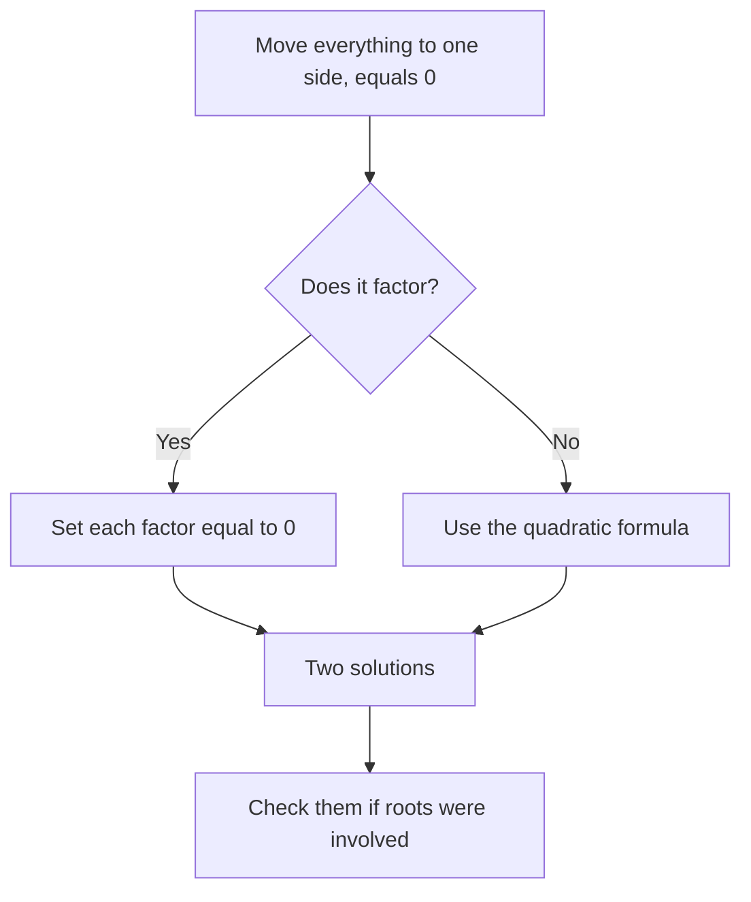

# Quadratics and Algebraic Identities

A quadratic is any equation with an x² in it. On the GMAT you almost never need the quadratic formula. Instead you need to recognise patterns fast: a hidden difference of squares, a trinomial that factors, or a "cancel the common factor" trap. These questions show up in the mid-to-hard range of Quant, and they reward pattern-spotting over grinding.

## FOIL: expanding two brackets

To multiply (x + 3)(x + 5), multiply every term in the first bracket by every term in the second: First, Outer, Inner, Last.

(x + 3)(x + 5) = x² + 5x + 3x + 15 = x² + 8x + 15.

Notice the pattern: the middle coefficient (8) is the sum of the two numbers, and the last term (15) is their product. That pattern is exactly what you run in reverse to factor.

## Factoring trinomials

To factor x² + bx + c, look for two numbers that **multiply to c** and **add to b**.

- x² + 7x + 12: numbers that multiply to 12 and add to 7 are 3 and 4. So (x + 3)(x + 4).
- x² − x − 12: multiply to −12, add to −1: 3 and −4. So (x + 3)(x − 4).
- x² − 9x + 20: multiply to 20, add to −9: −4 and −5. So (x − 4)(x − 5).

> [!TIP]
> Look at the sign of the last term first. If c is positive, both numbers have the same sign (the sign of b). If c is negative, they have opposite signs, and the bigger one takes the sign of b.

When the leading coefficient isn't 1, like 2x² + 7x + 3, try the "split the middle" method. Multiply 2 × 3 = 6, find two numbers that multiply to 6 and add to 7 (1 and 6), split the middle: 2x² + x + 6x + 3, then group: x(2x + 1) + 3(2x + 1) = (2x + 1)(x + 3).

## The three special products

These three show up constantly. Memorise them in both directions.

| Product | Expanded |
|---|---|
| (a + b)² | a² + 2ab + b² |
| (a − b)² | a² − 2ab + b² |
| (a + b)(a − b) | a² − b² |

> [!REMEMBER]
> (a + b)² is **not** a² + b². The middle term 2ab is the one everyone forgets. Test with a = 1, b = 1: (1 + 1)² = 4, but 1² + 1² = 2.

### How the GMAT disguises them

Rarely will you see "(a + b)(a − b)" written out. Instead you'll see:

- **Arithmetic shortcuts.** 101² − 99² = (101 + 99)(101 − 99) = 200 × 2 = 400. And 49 × 51 = (50 − 1)(50 + 1) = 2,500 − 1 = 2,499.
- **Expressions with roots.** (√7 + √3)(√7 − √3) = 7 − 3 = 4.
- **Missing pieces.** If x + y = 10 and xy = 21, then x² + y² = (x + y)² − 2xy = 100 − 42 = 58.
- **Hidden in the question.** If x² − y² = 40 and x + y = 8, then x − y = 5 without ever finding x or y.

> [!SHORTCUT]
> When you see x² − y² in a problem, immediately write (x + y)(x − y). When you see x² + y² together with x + y or x − y, think "complete the square": x² + y² = (x ± y)² ∓ 2xy.

### Worked example 1 (Medium)
If x + y = 8 and x² − y² = 40, what is the value of x − y?

(A) 3  (B) 4  (C) 5  (D) 6  (E) 8

Show solution

Factor: x² − y² = (x + y)(x − y). So 40 = 8 × (x − y), giving x − y = 5. The answer is **(C)**.

Check: x + y = 8 and x − y = 5 give x = 6.5 and y = 1.5. Then x² − y² = 42.25 − 2.25 = 40. 

Trap: (B) 4 comes from 40/10 or from guessing x = 6, y = 2. Plugging in whole numbers feels natural, but here the solution isn't whole.

## Solving quadratic equations by factoring

The method has one rule that must come first: **get zero on one side**. Then factor and use the zero product property.

> [!REMEMBER]
> **Zero product property.** If A × B = 0, then A = 0 or B = 0. This only works when the product equals zero. If (x − 2)(x − 3) = 6, you cannot say x − 2 = 6.

Here is the full route for solving a quadratic.

Solve x² − 5x + 6 = 0. Factor: (x − 2)(x − 3) = 0. So x = 2 or x = 3.

Solve x² = 5x. Don't divide by x. Move it: x² − 5x = 0, so x(x − 5) = 0 and x = 0 or x = 5.

### The "dividing by a variable" trap

This is one of the GMAT's favourite traps. When you divide both sides by a variable, you quietly throw away the case where that variable is zero.

Take (x − 3)(x + 2) = 4(x − 3). It's tempting to cancel (x − 3) from both sides and get x + 2 = 4, so x = 2. But x = 3 also works: both sides are 0. The safe way is to move everything to one side and factor: (x − 3)(x + 2) − 4(x − 3) = 0, so (x − 3)(x + 2 − 4) = 0, so (x − 3)(x − 2) = 0.

### Worked example 2 (Medium)
If (x − 3)(x + 2) = 4(x − 3), what is the sum of all possible values of x?

(A) 2  (B) 3  (C) 5  (D) 7  (E) −1

Show solution

Move everything to one side: (x − 3)(x + 2) − 4(x − 3) = 0. Factor out (x − 3): (x − 3)[(x + 2) − 4] = 0, so (x − 3)(x − 2) = 0. The solutions are x = 3 and x = 2, and their sum is 5. The answer is **(C)**.

Check: x = 3 gives 0 = 0. x = 2 gives (−1)(4) = −4 and 4(−1) = −4. Both work.

Trap: (A) 2 is what you get by dividing both sides by (x − 3) and losing x = 3. Never divide by an expression that could be zero; factor it out instead.

> [!TRAP]
> If you cancel a common factor that contains a variable, you must also check the case where that factor equals zero. When the question says "all possible values" or "how many solutions", this is almost always the trap.

## The quadratic formula (when factoring fails)

For ax² + bx + c = 0, the solutions are x = (−b ± √(b² − 4ac)) / 2a.

The part under the root, b² − 4ac, is the **discriminant**. If it's positive there are two real solutions, if zero there's one, and if negative there are none. The GMAT cares about this more than the full formula.

> [!NOTE]
> Quant questions are built so numbers are friendly. If a quadratic doesn't factor in 20 seconds, double-check your setup before reaching for the formula. A mis-copied sign is far more likely than an ugly quadratic.

Quick use: how many real solutions does x² + 4x + 7 = 0 have? Discriminant = 16 − 28 = −12, which is negative. None.

## Sum and product of the roots

If the roots of x² + bx + c = 0 are r and s, then (x − r)(x − s) = x² − (r + s)x + rs. Matching coefficients gives:

> [!REMEMBER]
> For x² + bx + c = 0: **sum of roots = −b** and **product of roots = c**. (If the leading coefficient is a, divide: sum = −b/a, product = c/a.)

This lets you answer many questions without finding the roots. For x² − 9x + 14 = 0, the sum is 9 and the product is 14 (the roots are 2 and 7). And if a question gives you information about the roots, like "one root is twice the other", you can set up equations quickly.

### Worked example 3 (Medium-Hard)
In the equation x² − 9x + k = 0, one root is twice the other. What is the value of k?

(A) 12  (B) 14  (C) 18  (D) 20  (E) 27

Show solution

Let the roots be r and 2r. Their sum is 9, so 3r = 9 and r = 3. The roots are 3 and 6. The product is k = 3 × 6 = 18. The answer is **(C)**.

Check: x² − 9x + 18 = (x − 3)(x − 6). Roots 3 and 6, and 6 is twice 3.

Trap: (E) 27 comes from using 9 × 3, mixing the sum of the roots with one root. (A) 12 comes from guessing roots 3 and 4 (sum 7) or 2 and 6 (sum 8). Always use the sum to pin down the roots.

## Simplifying algebraic fractions

Treat algebraic fractions like numeric ones: factor the top and bottom, then cancel common **factors** (never common terms).

(x² − x − 12)/(x² − 9). Factor the top: (x − 4)(x + 3). Factor the bottom: (x − 3)(x + 3). Cancel (x + 3): (x − 4)/(x − 3), valid for x ≠ ±3.

> [!TRAP]
> You can cancel factors but not terms. In (x + 3)/(x − 3) you cannot cancel the 3s. Test it: with x = 5, (5 + 3)/(5 − 3) = 4, not 1.

### Worked example 4 (Medium)
For all x ≠ 3 and x ≠ −3, (x² − x − 12)/(x² − 9) is equivalent to which of the following?

(A) (x − 4)/(x − 3)  (B) (x + 4)/(x + 3)  (C) (x − 4)/(x + 3)  (D) 4/3  (E) (x − 12)/(−9)

Show solution

Factor both: numerator (x − 4)(x + 3), denominator (x − 3)(x + 3). Cancel (x + 3): (x − 4)/(x − 3). The answer is **(A)**.

Check with x = 7: the original is (49 − 7 − 12)/(49 − 9) = 30/40 = 3/4. And (7 − 4)/(7 − 3) = 3/4. They match.

Faster way: just plug in x = 7 and test each choice. (B) gives 11/10, (C) gives 3/10, (D) is 4/3, (E) is −5/(−9) = 5/9. Only (A) gives 3/4.

Trap: (E) comes from "cancelling" the x² terms, which is illegal.

## Equations with radicals

To solve an equation with a square root, isolate the root, square both sides, solve, and then **check every answer** in the original equation. Squaring can create extra solutions that don't work.

Solve √(x + 7) = x − 5. Square both sides: x + 7 = x² − 10x + 25. Rearrange: x² − 11x + 18 = 0, so (x − 2)(x − 9) = 0. Test x = 2: √9 = 3 but x − 5 = −3. Fails. Test x = 9: √16 = 4 and 9 − 5 = 4. Works. So x = 9 only.

> [!REMEMBER]
> √ means the **non-negative** root. √25 = 5, not ±5. But the equation x² = 25 has two solutions, x = 5 and x = −5. This distinction is tested constantly.

### Worked example 5 (Hard)
What is the sum of all values of x that satisfy √(x + 7) = x − 5?

(A) 2  (B) 9  (C) 11  (D) 13  (E) 18

Show solution

Squaring gives x² − 11x + 18 = 0, so x = 2 or x = 9. Substituting back: for x = 2, √9 = 3 but x − 5 = −3, so x = 2 is extraneous. For x = 9, √16 = 4 = 9 − 5. The only solution is 9, so the sum is 9. The answer is **(B)**.

Faster way: the right side x − 5 must be ≥ 0 because it equals a square root. So x ≥ 5, which rules out x = 2 before you test it.

Trap: (C) 11 is the sum of both roots of the quadratic (from −b/a), which includes the extraneous one.

### Worked example 6 (Hard)
If x² + y² = 29 and xy = 10, what is the value of (x + y)² + (x − y)²?

(A) 18  (B) 39  (C) 49  (D) 58  (E) 78

Show solution

Expand each: (x + y)² = x² + 2xy + y² and (x − y)² = x² − 2xy + y². Adding, the 2xy terms cancel: 2x² + 2y² = 2(29) = 58. The answer is **(D)**.

Check: x² + y² = 29 and xy = 10 give x = 5, y = 2 (25 + 4 = 29, product 10). Then 7² + 3² = 49 + 9 = 58.

Trap: (C) 49 is just (x + y)² and (E) 78 adds 2xy × 2 instead of cancelling. Don't solve for x and y if the structure hands you the answer.

## Quick check

1. Factor x² − 3x − 40.

Answer

Numbers multiplying to −40 and adding to −3: 5 and −8. So (x + 5)(x − 8).

2. Compute 73² − 27² without a calculator.

Answer

(73 + 27)(73 − 27) = 100 × 46 = 4,600.

3. If x² = 9x, what values can x take?

Answer

x = 0 or x = 9. Dividing by x would lose x = 0.

4. What is the product of the roots of 2x² − 10x + 12 = 0?

Answer

c/a = 12/2 = 6. (The roots are 2 and 3.)

## Key takeaways
- To factor x² + bx + c, find two numbers that multiply to c and add to b.
- Know the three special products cold, and run them in reverse: a² − b² = (a + b)(a − b).
- The GMAT disguises special products as arithmetic (101² − 99²), as sums (x + y with xy given), and inside roots.
- Zero product property only works when the product is zero. Get zero on one side first.
- Never divide by a variable expression without considering the case where it equals zero.
- Sum of roots = −b/a, product of roots = c/a.
- Cancel factors, not terms, in algebraic fractions.
- Square both sides of a radical equation, then check every answer in the original.

## Go deeper
- [Khan Academy: Algebra 1](https://www.khanacademy.org/math/algebra) — practice factoring and quadratic equations.
- [Khan Academy: Algebra 2](https://www.khanacademy.org/math/algebra2) — more on the quadratic formula and radical equations.
- [GMAT Club forum](https://gmatclub.com/forum/) — search for "quadratic" and "difference of squares" discussions.
