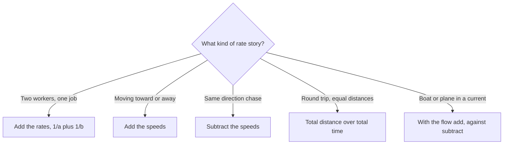

# Rates, Speed & Work

Rate problems are a GMAT favourite because the same one idea, rate × time = amount, powers speed questions, work questions, pipes and even price-per-unit stories. Learn the idea once and you can solve all of them.

## The one formula: Rate × Time = Distance (or Work)

> [!REMEMBER]
> **Distance = Rate × Time.** Rearranged: Rate = Distance ÷ Time and Time = Distance ÷ Rate.
>
> **Work = Rate × Time.** A worker who finishes a job in 5 hours has a rate of 1/5 of the job per hour.

Draw a small RTD table (Rate, Time, Distance) for each object or person in the problem, fill in what you know, and use D = R × T across each row. The only job left is to link the rows: usually the distances are equal (round trip) or add up (towards each other), or the times are equal (leaving together).

### Unit conversions

Make sure every row uses the same units. Convert early.

- km/h → m/s: multiply by 5/18. So 72 km/h = 20 m/s.
- m/s → km/h: multiply by 18/5.
- minutes → hours: divide by 60. 40 minutes = 2/3 hour.

> [!TRAP]
> A speed of 6 km in 40 minutes is 6 ÷ (2/3) = 9 km/h, not 6 ÷ 40 = 0.15. The time must be in hours before you divide.

### Worked example 1 (Easy)
A train travels 360 km in 4 hours at constant speed. How long will it take to travel 540 km at the same speed?

Show solution

Speed = 360/4 = 90 km/h. Time = 540/90 = 6 hours.

Faster way: the distance is 1.5 times as long, so the time is 1.5 × 4 = 6 hours.

Trap: treating the extra 180 km as extra hours and adding.

## Average speed: it's not the average of the speeds

> [!REMEMBER]
> **Average speed = total distance ÷ total time.** Never just (speed 1 + speed 2)/2.

Anita drives to work at 40 km/h and returns at 60 km/h. The simple average (50) is wrong because she spends more time at the slower speed. Choose a distance divisible by both speeds, say 120 km each way. The outward trip takes 3 hours, the return 2 hours. Total 240 km in 5 hours: 48 km/h.

> [!SHORTCUT]
> For two equal distances at speeds a and b, the average speed is the harmonic mean: 2ab/(a + b). For 40 and 60: 2 × 40 × 60/100 = 48. The harmonic mean is always lower than the ordinary average, which is a quick way to eliminate the tempting wrong choice.

If distances are not equal, use the totals. If AB is d at 60 km/h and BC is 2d at 40 km/h, the time is d/60 + 2d/40 = 4d/60, and the average speed is 3d ÷ (4d/60) = 45 km/h. The simple average (50), the harmonic mean for equal distances (48), and a distance-weighted average (46.7) are all wrong.

> [!TIP]
> Whenever a question has an unknown distance, pick a smart number for it (the LCM of the speeds usually works), compute the times, and then compute the average. The answer won't depend on your choice.

### Worked example 2 (Medium)
A cyclist rides the first half of a journey's distance at 20 km/h and the second half at v km/h. Her average speed over the whole journey is 24 km/h. What is v?

Show solution

Equal distances, so 24 = 2(20)(v)/(20 + v). Then 24(20 + v) = 40v, so 480 = 16v and v = 30.

Check with 60 km each half: 3 hours + 2 hours = 5 hours for 120 km, which is 24 km/h.

Trap: setting (20 + v)/2 = 24 to get 28.

## Relative speed

- **Towards each other** (or away from each other): add the speeds. Two cyclists 90 km apart riding towards each other at 12 and 18 km/h close the gap at 30 km/h and meet after 90/30 = 3 hours.
- **Same direction** (catching up): subtract the speeds. If Arun leaves at 9:00 at 40 km/h and Bala leaves the same place at 10:00 at 60 km/h, Arun has a 40 km head start by 10:00. Bala gains 20 km/h, so catches up in 2 hours, at noon.

> [!TRAP]
> For a delayed start, subtract the head start first, then use the relative speed, and start the clock when the second person starts. A common mistake is to measure the catching-up time from the first person's start.

Pick the rate rule that matches the story.

### Trains and circular tracks

When a train crosses a pole, it travels its own length. To cross a platform, it travels its own length plus the platform length. Two trains passing each other cover the sum of their lengths at the relative speed (add if opposite directions, subtract if same direction). Don't forget to convert km/h to m/s.

On a circular track of length L, two runners going the same way separate by one full lap after L/(difference in speeds) time. If they run opposite ways, they meet every L/(sum of speeds).

### Worked example 3 (Medium)
Cars leave towns X and Y, 240 km apart. The first car leaves X at 60 km/h. One hour later a second car leaves Y towards X at 90 km/h. How far from X do they meet?

Show solution

After 1 hour the first car has covered 60 km, leaving 180 km. They close at 60 + 90 = 150 km/h, so they meet 180/150 = 1.2 hours later. The first car has travelled 60 + 60(1.2) = 132 km.

Check from Y: 90 × 1.2 = 108 km, and 240 − 108 = 132.

Trap: 108 (the distance from Y) or 120 (ignoring the head start).

## Round trips and currents

On a round trip the distance there and the distance back are equal, but the speeds differ, so use the average-speed method. With a current (boat in a river, plane in wind, walking on an escalator), the speed with the current is the sum, and against it is the difference.

A boat at 12 km/h in a 3 km/h current: downstream 15 km/h, upstream 9 km/h. For a 45 km each way, the time is 3 + 5 = 8 hours. If you ignored the current you'd get 7.5 hours; the time spent going against the current always outweighs the help it gives.

## Combined work rates

If A finishes a job in a hours and B in b hours, their rates are 1/a and 1/b jobs per hour. Working together, rates add:

> [!REMEMBER]
> **Combined rate = 1/a + 1/b.** Combined time = ab/(a + b) for two workers.

Ravi paints a fence in 6 hours and Seema in 12. Together: 1/6 + 1/12 = 1/4 per hour, so 4 hours. Two sanity checks: the combined time must be shorter than the faster worker's time alone (4 < 6), and it must be more than half of it (if both were as fast as the quicker one, the time would be 3).

> [!SHORTCUT]
> Smart number: pick a job size equal to the LCM of the times. Ravi (6 hours) and Seema (12 hours): let the job be 12 units. Ravi does 2 units/hour and Seema 1 unit/hour. Together 3 units/hour, so 12/3 = 4 hours. No fractions.

> [!TRAP]
> Never average the times. (6 + 12)/2 = 9 hours is wrong because the workers are helping each other, not taking turns.

### Working together, then one leaves

Handle each phase on its own. Machine A (10 hours) and B (15 hours) work together for 3 hours: their rate is 1/10 + 1/15 = 1/6, so they finish 1/2 the job. The rest, 1/2, is done by A alone at 1/10 per hour: 5 more hours. Remember to ask what the question really wants: "how many more hours" (5) or "total time" (8).

### Pipes and drains

A pipe that fills is a positive rate; a drain is a negative rate. Pipe A fills in 8 hours, B in 12 hours, drain C empties in 24 hours. Net rate with a tank of 24 units: 3 + 2 − 1 = 4 units/hour, so 6 hours.

### Work with three or more workers

If pairs are given, add the pair rates to get twice the sum of all three. A + B takes 12 days, B + C 15 days, A + C 20 days. Then 2(A + B + C) = 1/12 + 1/15 + 1/20 = 1/5, so A + B + C = 1/10. A alone: 1/10 − (B + C) = 1/10 − 1/15 = 1/30, so 30 days.

### Worked example 4 (Hard)
Machine A completes an order in 12 hours and machine B in 24 hours. Both start together. After 4 hours A breaks down and B finishes alone. How many hours in total?

Show solution

Combined rate 1/12 + 1/24 = 1/8. In 4 hours: 1/2 of the order. B finishes the other half at 1/24 per hour: 12 hours. Total = 4 + 12 = 16 hours.

Check with a 24-unit job: A does 2/h, B does 1/h. After 4 hours 12 units are done. The remaining 12 units take B 12 hours.

Trap: giving 12 (the time after the breakdown) instead of 16 (the total).

## Speed ratios and races

If distance is fixed, speed and time are inversely proportional. If speeds are in the ratio 3 : 2, the times for the same distance are in the ratio 2 : 3.

"Beats by" races hide speed ratios. If A beats B by 20 m in a 100 m race, then when A runs 100 m, B runs 80 m, so B's speed is 0.8 of A's. If B beats C by 10 m in 100 m, C's speed is 0.9 of B's. So C's speed is 0.9 × 0.8 = 0.72 of A's, and A beats C by 28 m, not 30.

### Worked example 5 (Hard)
A traveller drives from P to Q. At 60 km/h she arrives 1 hour late; at 90 km/h she arrives 1 hour early. At what constant speed would she arrive exactly on time?

Show solution

Let the distance be d and the on-time journey time T. Then d/60 = T + 1 and d/90 = T − 1. Subtract: d/60 − d/90 = 2, so d/180 = 2 and d = 360. Then T = 6 − 1 = 5 hours and the speed is 360/5 = 72 km/h.

Trap: 75 km/h, the simple average of 60 and 90. The right speed (72) is the harmonic mean here because the distance is fixed.

## Variable answer choices

If the answer is an expression in letters (like "average speed in terms of r"), pick numbers for the letters. A car goes half the distance at r and half at 1.25r. Let r = 40: the speeds are 40 and 50; the harmonic mean is 2(40)(50)/90 = 44.4. The choice that gives 44.4 when r = 40 is 10r/9. The arithmetic mean 9r/8 gives 45 and is the tempting wrong answer.

## Quick check

1. A runner covers 6 km in 40 minutes. What is her speed in km/h?

Answer

6 ÷ (2/3) = 9 km/h.

2. Convert 90 km/h to m/s.

Answer

90 × 5/18 = 25 m/s.

3. A walks at 3 km/h and B at 5 km/h. They start 24 km apart and walk towards each other. How long until they meet?

Answer

24 ÷ 8 = 3 hours.

4. A takes 20 hours, B takes 30 hours. How long working together?

Answer

1/20 + 1/30 = 1/12, so 12 hours.

5. A car drives 100 km at 50 km/h, then 100 km at 100 km/h. What is its average speed?

Answer

Time = 2 + 1 = 3 hours for 200 km: 66⅔ km/h (not 75).

## Key takeaways
- Everything is rate × time = amount. Draw an RTD table and link rows by equal distance, equal time, or total distance.
- Average speed = total distance ÷ total time. For equal distances use the harmonic mean 2ab/(a + b).
- Towards or away: add speeds. Same direction: subtract. For a delayed start, subtract the head start first.
- Trains: crossing distance is the sum of lengths (or length plus platform). Convert km/h to m/s with ×5/18.
- Work rates add: 1/a + 1/b. Use a smart number equal to the LCM of times.
- Handle each phase of a changing team separately, then add the times.
- Pipes fill (positive) and drains empty (negative).
- Sanity checks: the combined time is less than the faster worker's time; the average speed lies between the two speeds, nearer the slower one.

## Go deeper
- [Khan Academy: Algebra word problems](https://www.khanacademy.org/math/algebra) — rate and work problems with step-by-step videos.
- [GMAT Club forum](https://gmatclub.com/forum/) — large bank of rate, work and speed problems.
- [mba.com GMAT exam page](https://www.mba.com/exams/gmat-exam) — official exam information.
