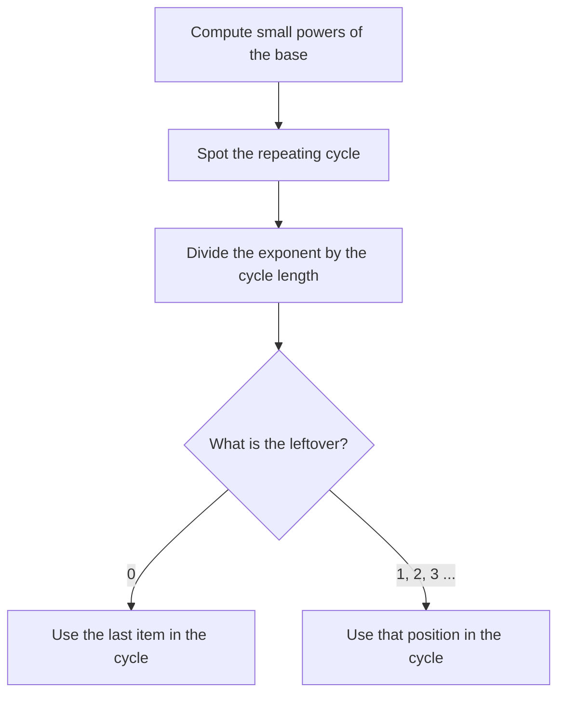

# Remainders & Cyclicity

Remainder questions look scary because the numbers are huge (think 7100), but the trick is always the same: the answer repeats in a short cycle, or you can swap the big number for a tiny stand-in. Expect one or two of these on test day, and they're usually in the harder half of the section.

## The one equation behind everything

When you divide a positive integer n by a positive integer d, you get a quotient q and a remainder r:

**n = d × q + r**, with 0 ≤ r < d.

Divide 47 by 6: 47 = 6 × 7 + 5. The quotient is 7 and the remainder is 5.

Two things to burn in. First, the remainder is always smaller than the divisor, so "remainder 9 when divided by 7" is impossible. Second, the remainder is never negative on the GMAT. If n is a multiple of d, the remainder is 0.

> [!REMEMBER]
> "n leaves remainder r when divided by d" means n = dq + r for some integer q ≥ 0, and 0 ≤ r < d. The list of such n is r, r + d, r + 2d, and so on.

A small oddity: if the dividend is smaller than the divisor, the quotient is 0 and the remainder is the dividend itself. So 3 divided by 8 has remainder 3. This catches people out.

## Remainder arithmetic

You can work with remainders instead of the full numbers.

- **Sums:** the remainder of (a + b) is the remainder of (rem(a) + rem(b)).
- **Products:** the remainder of (a × b) is the remainder of (rem(a) × rem(b)).
- **Powers:** same idea, repeated.

Because a result may overshoot the divisor, finish by reducing again.

Example: a leaves remainder 4 when divided by 9, and b leaves remainder 7 when divided by 9. For a + b the remainders add to 11, which is bigger than 9, so reduce: 11 = 9 + 2, remainder 2. For a × b: 4 × 7 = 28 = 3 × 9 + 1, remainder 1.

> [!TIP]
> Fastest method for almost any remainder question with a variable: **pick a number.** If n leaves remainder 4 when divided by 9, just use n = 4 (or 13). Compute whatever the question asks. Different valid picks always give the same remainder, so one pick is enough when the question has a single answer.

> [!TRAP]
> Don't invent remainder rules for division. If n leaves remainder 5 when divided by 12, the remainder of n ÷ 24 could be 5 or 17, so it isn't determined. Remainders only carry over cleanly when the new divisor is a factor of the old one (n ÷ 6 and n ÷ 4 are both pinned down; n ÷ 24 is not). When in doubt, pick numbers.

### Worked example 1 (Easy)
When n is divided by 9, the remainder is 4. What is the remainder when 5n is divided by 9?

Show solution

Pick n = 4 (4 ÷ 9 leaves remainder 4). Then 5n = 20, and 20 = 2 × 9 + 2. The remainder is **2**.

Check with a second pick, n = 13: 5n = 65 = 7 × 9 + 2. Same remainder.

Trap: multiplying 4 × 5 = 20 and answering 20. A remainder can never be bigger than the divisor; always reduce.

### Worked example 2 (Medium)
The positive integer n leaves a remainder of 3 when divided by 5 and a remainder of 4 when divided by 7. What is the smallest possible value of n?

Show solution

List numbers that leave remainder 4 when divided by 7: 4, 11, 18, 25, ... Test each against "remainder 3 when divided by 5":

- 4 ÷ 5 gives remainder 4. No.
- 11 ÷ 5 gives remainder 1. No.
- 18 ÷ 5 gives remainder 3. Yes.

So the smallest n is **18**. All valid values are 18 + 35k, because 35 = 5 × 7 is the point where both patterns repeat.

Faster way: list the numbers from the larger divisor (7), since that list is shorter.

Trap: assuming n = 3 + 4 = 7 or something built by adding the remainders. Always test against both conditions.

## Remainders with a decimal

If x ÷ y = 12.35, the decimal part tells you the remainder as a fraction of y.

x = y × 12 + r, so x/y = 12 + r/y. Therefore r/y = 0.35, so **r = 0.35 × y**.

Because r is a whole number, 0.35y must be an integer: 0.35 = 7/20, so y must be a multiple of 20. If y = 20, r = 7. If y = 40, r = 14. If y = 60, r = 21.

> [!REMEMBER]
> Decimal part of x/y = remainder ÷ y. Reduce the decimal to a fraction (0.35 = 7/20) to see which divisors y are possible.

### Worked example 3 (Medium)
If x and y are positive integers and x/y = 12.35, which of the following could be the remainder when x is divided by y?

(A) 5 (B) 6 (C) 7 (D) 8 (E) 9

Show solution

r/y = 0.35 = 7/20. So r = 7y/20, and y must be a multiple of 20: y = 20k, r = 7k. Possible remainders are 7, 14, 21, ... Only 7 is on the list: **(C)**.

Trap: answering 35 (the decimal digits) or 0.35. The remainder is a whole number and depends on y.

## Units digits and cyclicity

The units (last) digit of a power repeats in a cycle as the exponent grows. Learn these cycles.

| Base ending in | Cycle of units digits (exponent 1, 2, 3, ...) | Cycle length |
|---|---|---|
| 0, 1, 5, 6 | stays the same (0, 1, 5, 6) | 1 |
| 2 | 2, 4, 8, 6 | 4 |
| 3 | 3, 9, 7, 1 | 4 |
| 4 | 4, 6 | 2 |
| 7 | 7, 9, 3, 1 | 4 |
| 8 | 8, 4, 2, 6 | 4 |
| 9 | 9, 1 | 2 |

To find the units digit of an: take the exponent n, find its remainder when divided by the cycle length, and read off the matching spot. If the remainder is 0, use the **last** digit of the cycle (position 4 for a 4-cycle).

Units digit of 347: cycle length 4, and 47 = 4 × 11 + 3, so position 3, which is **7**.

> [!TRAP]
> A remainder of 0 means the end of the cycle, not "no digit". 240: 40 ÷ 4 leaves 0, so use position 4, units digit 6. Many people write 2 by mistake.

Units digit of a product or sum only needs the units digits of the parts. Units digit of 745 × 813? 745: 45 ÷ 4 leaves 1, units digit 7. 813: 13 ÷ 4 leaves 1, units digit 8. 7 × 8 = 56, units digit **6**.

### Worked example 4 (Medium)
What is the units digit of 347 + 431?

Show solution

347: cycle 3, 9, 7, 1; 47 leaves remainder 3 when divided by 4, so the units digit is 7.

431: cycle 4, 6 (length 2); 31 is odd (position 1), so units digit 4.

Sum of units digits: 7 + 4 = 11, so the units digit is **1**.

Trap: forgetting to reduce 11 to its last digit.

## Remainders of large powers

The units digit is the remainder when divided by 10. The same cycle idea works for any divisor: compute the remainders of small powers, spot the repeat, then jump.

Find the remainder when 7100 is divided by 5.

First swap the base: 7 leaves remainder 2 when divided by 5, so 7100 behaves like 2100. Powers of 2 divided by 5 have remainders 2, 4, 3, 1, then repeat (24 = 16 leaves 1). Cycle length 4, and 100 is a multiple of 4, so the remainder is the end of the cycle: **1**.

A powerful shortcut: if a number leaves remainder 1 at some power, you can chop the exponent into chunks of that size. Since 24 leaves 1 when divided by 5, (24)25 leaves 125 = 1.

Another pattern: when the base is one less than the divisor, the remainder is −1 in disguise. 9n divided by 10 has remainder 9 for odd n and 1 for even n. We avoid negatives when we write the final answer, but it's fine to think "9 is one short of 10" while working.

Large powers always collapse into a short cycle.

### Worked example 5 (Hard)
What is the remainder when 7100 + 350 is divided by 5?

Show solution

7100: as above, the remainder is 1.

350: powers of 3 divided by 5 give remainders 3, 4, 2, 1 (3, 9, 27, 81), repeating every 4. 50 = 4 × 12 + 2, so position 2, remainder 4.

Sum of remainders: 1 + 4 = 5, which is divisible by 5, so the remainder is **0**.

Trap: stopping at 5 as the answer. A remainder must be smaller than the divisor, so reduce 5 to 0.

## Calendar and clock problems

These are remainder questions in disguise. A week has 7 days, so days of the week repeat in a cycle of 7. A clock repeats every 12 hours (or 24).

If today is Thursday, what day will it be in 200 days? 200 = 7 × 28 + 4, so the remainder is 4. Move 4 days forward from Thursday: Fri, Sat, Sun, **Mon**.

Only the remainder matters. Every full block of 7 days returns to the same weekday.

> [!TIP]
> Number the days (Mon = 1, ..., Sun = 7, or any start you like) and add the remainder. Or just count on your fingers. Don't try to be clever; it's 4 steps.

### Worked example 6 (Hard)
Let n be a positive integer that leaves remainder 3 when divided by 8. What is the remainder when n² is divided by 8?

Show solution

Write n = 8k + 3. Then n² = 64k² + 48k + 9. The first two terms are multiples of 8, so the remainder comes from 9, and 9 = 8 + 1. The remainder is **1**.

Pick-numbers check: n = 3 gives 9, remainder 1. n = 11 gives 121 = 15 × 8 + 1, remainder 1. 

Trap: squaring the remainder (3² = 9) and writing 9. It must be reduced below 8.

## Quick check

1. What is the remainder when 83 is divided by 9?

Answer

83 = 9 × 9 + 2, so the remainder is 2.

2. What is the remainder when 5 is divided by 12?

Answer

5 = 12 × 0 + 5, so the remainder is 5.

3. What is the units digit of 822?

Answer

The cycle for 8 is 8, 4, 2, 6. 22 leaves remainder 2 when divided by 4, so the units digit is 4.

4. If x/y = 7.2 with x and y positive integers, what is the smallest possible remainder?

Answer

0.2 = 1/5, so y = 5k and the remainder = k. Smallest is k = 1: the remainder is 1 (x = 36, y = 5).

5. Today is Tuesday. What day will it be in 100 days?

Answer

100 = 7 × 14 + 2. Two days after Tuesday is Thursday.

## Key takeaways
- n = dq + r with 0 ≤ r < d. The remainder is always smaller than the divisor.
- Remainders of sums and products come from the remainders of the parts, reduced again at the end.
- With a variable remainder statement, the quickest approach is to pick a number that fits.
- Units digit cycles have length 1, 2 or 4. Reduce the exponent by the cycle length; a remainder of 0 means the last position.
- For the remainder of a big power, shrink the base first, then find the cycle of remainders.
- Decimal part of x/y equals r/y, so r = decimal × y. Convert the decimal to a fraction to find which y fit.
- Calendar questions only care about the remainder when you divide by 7.

## Go deeper
- [Khan Academy: Arithmetic](https://www.khanacademy.org/math/arithmetic) — free refreshers on division and remainders.
- [GMAT Club forum](https://gmatclub.com/forum/) — search "remainders" for community discussion of worked problems.
- [Official GMAT exam page](https://www.mba.com/exams/gmat-exam) — the official source for exam format and practice tools.
