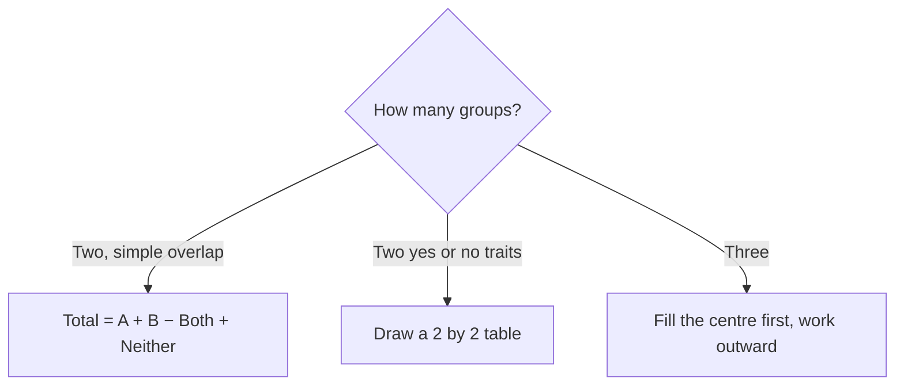

# Overlapping Sets

Some people belong to more than one group: students who study French and Spanish, customers who bought online and in-store, employees in two committees. The GMAT loves these because careless counting double-counts the overlap. Expect one set problem in a typical Quant section, often disguised as a percentage question.

The whole topic comes down to one principle: **don't count anyone twice**.

## Two overlapping sets

Picture two overlapping circles. The left circle is group A, the right is group B, and the lens-shaped overlap is "both". Anything outside both circles but inside the box is "neither".

If you add |A| + |B|, the people in the overlap are counted twice, so subtract them once.

Choose your overlap tool by how many sets you have.

> [!REMEMBER]
> **Total = A + B − Both + Neither**
>
> Where A and B are the full sizes of each group (including those in both), and "Neither" are the people in neither group.

Rearranged versions you'll use all the time:

- At least one group (A or B) = A + B − Both
- Exactly one group = A + B − 2 × Both
- Only A = A − Both

> [!TRAP]
> "Exactly one" subtracts the overlap TWICE, once for each circle it sits in. People often subtract it once and get an answer that is too big.

### Worked example 1 (Easy)
Of 60 students in a class, 35 study French, 28 study Spanish, and 12 study both. How many study neither?

Show solution

At least one language = 35 + 28 − 12 = 51. Neither = 60 − 51 = 9.

Using the formula: 60 = 35 + 28 − 12 + Neither, so Neither = 9. ✓

Trap: computing 60 − 35 − 28 = −3 (impossible), or forgetting that the 12 are already inside both 35 and 28.

## The double-set matrix

When the two groups are **yes/no attributes** (own a car or don't, male or female, in marketing or not), a 2 × 2 table is more reliable than a Venn diagram. The four inner cells are the four possible combinations, and the margins are the totals.

| | In marketing | Not in marketing | Total |
|---|---|---|---|
| Female | F ∩ M | F only | F total |
| Male | M only | Neither | M total |
| Total | Marketing total | Not marketing total | Grand total |

Fill in whatever you're told, then complete the grid using "row adds to row total, column adds to column total". It's a Sudoku with nothing but addition.

> [!TIP]
> Use the matrix when every item falls into exactly one of two options on each attribute (like male/female). Use a Venn diagram when you have "neither" as a vague bucket or three groups.

### Worked example 2 (Medium)
A company has 200 employees. 120 work in marketing, 80 are female, and 50 of the females work in marketing. How many male employees do NOT work in marketing?

Show solution

Fill the table. Female and marketing = 50. Female total = 80, so female not in marketing = 30. Marketing total = 120, so male in marketing = 120 − 50 = 70. Male total = 200 − 80 = 120, so male not in marketing = 120 − 70 = 50.

Check by the formula: Total = F + M − Both + Neither → 200 = 80 + 120 − 50 + Neither → Neither = 50. ✓

Trap: reading "male not in marketing" as "not marketing" (80), which includes the 30 females.

### Sets with percentages

If a problem is in percentages, pretend the total is 100 and the percentages become people. The formula and the matrix work the same way.

### Worked example 3 (Medium)
In a survey, 70% of respondents like tea, 60% like coffee, and 10% like neither. What percent like both?

Show solution

Total 100 = 70 + 60 − Both + 10, so Both = 140 − 100 = 40%.

Matrix check: Liking at least one = 90%. Tea only = 30, coffee only = 20, both = 40. 30 + 20 + 40 = 90. ✓

Trap: 70 + 60 = 130 and 130 − 100 = 30, forgetting the 10% who like neither (they aren't in either circle but are in the 100).

## Maximum and minimum overlap

A sneaky variation gives you two group sizes and asks for the *largest* or *smallest* possible overlap.

- **Largest possible "both"** = the smaller of the two groups (one group sits entirely inside the other).
- **Smallest possible "both"** = A + B − Total (if A + B is more than the total, they MUST overlap by that much; otherwise the minimum is 0).

Think of it as: the groups try to avoid each other, and once the box is full they are forced to overlap.

### Worked example 4 (Medium)
In a group of 100 people, 70 like tea and 60 like coffee. What are the greatest and least possible numbers who like both?

Show solution

Greatest: the coffee-lovers (60) could all be among the tea-lovers (70), so max = 60.

Least: 70 + 60 = 130 is 30 more than 100, so at least 30 must overlap. Min = 30.

Check with the formula (assuming everyone likes at least one when the overlap is minimal): 100 = 70 + 60 − 30 + 0. ✓

Trap: the minimum isn't 0 here. When the two groups together exceed the total, overlap is forced.

## Three overlapping sets

With three circles A, B, C there are seven regions inside plus "neither". The key is to be precise about "exactly" and "at least".

> [!REMEMBER]
> **Total = A + B + C − (sum of exactly two) − 2 × (all three) + Neither**
>
> Here "sum of exactly two" is the total of the three double-only regions (not including the center). If instead you're given the *pairwise overlaps* (A∩B, B∩C, A∩C including the center), the formula is:
> Total = A + B + C − (A∩B) − (B∩C) − (A∩C) + (A∩B∩C) + Neither.

Why the "−2 × all three"? Someone in all three circles was counted three times in A + B + C; we want them counted once. "Sum of exactly two" doesn't remove them at all, so we have to subtract them twice.

The three headcounts you'll need to keep apart:

| Phrase | Meaning |
|---|---|
| Exactly one | In one circle only |
| Exactly two | In precisely two circles (not the centre) |
| At least two | Exactly two + all three |
| Exactly three / all three | The centre region |

> [!TRAP]
> "At least two" includes the people in all three. "Exactly two" does not. When a problem gives you "20 belong to at least two clubs", the centre is already inside that 20.

### Worked example 5 (Hard)
In a town of 130 residents, 60 read the newspaper, 50 read magazines, and 40 read online news. 20 residents read exactly two of the three, 5 read all three, and 10 read none. Is the data consistent, and how many read exactly one?

Show solution

Use Total = A + B + C − (exactly two) − 2 × (all three) + Neither: 130 = 150 − 20 − 10 + 10 = 130. ✓ Consistent.

Exactly one = Total − Neither − exactly two − all three = 130 − 10 − 20 − 5 = 95.

Cross-check: A + B + C = 150 counts each exactly-one person once, each exactly-two person twice, and each all-three person three times: 95 + 2 × 20 + 3 × 5 = 95 + 40 + 15 = 150. ✓

Trap: subtracting only once for the all-three people (130 = 150 − 20 − 5 + 10 would give 135) because they feel like "one more overlap".

### Worked example 6 (Hard)
In a club of 50 members, 30 play chess, 25 play bridge, and 20 play carrom. Everyone plays at least one game, and 8 members play all three. How many play exactly two games?

Show solution

Total = A + B + C − (exactly two) − 2 × (all three) + Neither → 50 = 75 − X − 16 + 0 → X = 75 − 16 − 50 = 9.

Cross-check with the counting trick: exactly one = 50 − 9 − 8 = 33. Then 33 × 1 + 9 × 2 + 8 × 3 = 33 + 18 + 24 = 75 ✓.

Trap: using 75 − 50 = 25 and calling that the answer. That's the number of "extra counts", where all-three members contribute 2 each (16) and exactly-two members contribute 1 each (9). It isn't a head count.

## Quick check

1. In a group of 40, 25 like cricket and 22 like football. Everyone likes at least one. How many like both?

Answer

40 = 25 + 22 − Both, so Both = 7.

2. In the same group (40, cricket 25, football 22, 7 both), how many like exactly one sport?

Answer

25 + 22 − 2 × 7 = 33.

3. 60% of employees speak English and 45% speak Hindi, and every employee speaks at least one. What percent speak both?

Answer

100 = 60 + 45 − Both, so Both = 5%.

4. Among 80 people, 50 own a car and 40 own a bike. What is the smallest number who own both a car and a bike?

Answer

50 + 40 − 80 = 10.

## Key takeaways

- Two sets: Total = A + B − Both + Neither. Watch whether "A" means "A only" or "all of A".
- Use a 2 × 2 matrix for yes/no attributes; use a Venn diagram when you have a "neither" bucket or three sets.
- "Exactly one" = A + B − 2 × Both. The overlap comes out twice.
- Maximum overlap = the smaller set. Minimum overlap = A + B − Total (at least 0).
- Three sets: Total = A + B + C − (exactly two) − 2 × (all three) + Neither.
- "At least two" includes all three; "exactly two" does not.
- With percentages, imagine the total is 100 and the people-formulas work unchanged.

## Go deeper
- [Khan Academy: Algebra and word problems](https://www.khanacademy.org/math/algebra) — extra practice turning English into equations.
- [GMAT Club forum](https://gmatclub.com/forum/) — search "overlapping sets" for discussion threads.
- [Official GMAT exam page](https://www.mba.com/exams/gmat-exam) — format and section details for the GMAT Focus Edition.
