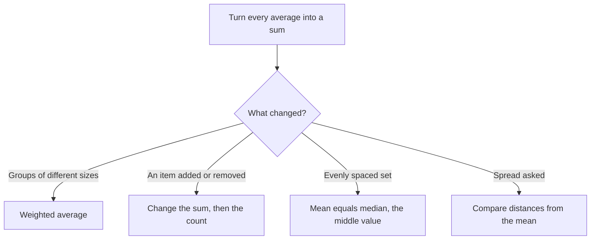

# Statistics: Mean, Median, Mode, Range & Standard Deviation

Statistics on the GMAT is not about formulas from a college textbook. It's about a handful of ideas (average, middle, spread) that you can reason about with common sense. Expect one or two questions on this in Quant, and the same ideas pop up again in Data Insights.

## The averages family

### Mean (the average)

> [!REMEMBER]
> Mean = (sum of values) ÷ (number of values). The flip side is the one that does the heavy lifting: **Sum = Mean × Count**.

Almost every hard average problem is solved by converting "average" into "sum", doing arithmetic with sums, and converting back. If the average of 5 numbers is 12, the sum is 60. Done. Never try to juggle averages directly when you can juggle totals.

### Median (the middle one)

Sort the list from smallest to largest. If there's an odd number of values, the median is the middle one. If there's an even number, it's the average of the two middle ones.

> [!TRAP]
> You must sort first. The median of 9, 2, 7, 4, 5 is NOT 7 (the middle of the list as written). Sorted: 2, 4, 5, 7, 9, so the median is 5.

For 6 values, say 3, 5, 8, 10, 12, 20, the median is the average of the 3rd and 4th: (8 + 10)/2 = 9. Note that 9 isn't in the list, which is perfectly fine.

### Mode (the most common)

The value that appears most often. A list can have no mode (all appear once), one mode, or several modes. The GMAT almost never asks for the mode unless it's testing whether you remember it's possible to have two.

### Range (the spread, crudely)

Range = largest − smallest. It looks only at the two extremes and ignores everything in between.

| Measure | What it tells you | Sensitive to a huge outlier? |
|---|---|---|
| Mean | The balance point | Yes, a lot |
| Median | The middle | Not at all |
| Mode | The most common | No |
| Range | Total spread | Yes (it IS the outlier) |

> [!NOTE]
> If a value in a list is changed but stays on the same side of the middle, the median does not change. Increasing the largest number from 50 to 5,000 changes the mean and range dramatically but leaves the median untouched.

### Worked example 1 (Easy)
The average of five numbers is 12. When a sixth number is added, the average becomes 14. What is the sixth number?

Show solution

Sum of five = 5 × 12 = 60. Sum of six = 6 × 14 = 84. The sixth number is 84 − 60 = 24.

Faster way: the new number raised the average of 6 numbers by 2, so it contributed 6 × 2 = 12 extra over the old average, plus it had to match the old average of 12 itself: 12 + 12 = 24.

Trap: guessing 14 or 26. Always go through the sums.

## Weighted averages

When groups have different sizes, you can't just average their averages. Each group's average counts in proportion to how many members it has.

> [!REMEMBER]
> Weighted average = (sum of group₁ + sum of group₂ + ...) ÷ (total count). Or use the seesaw: the combined average sits closer to the bigger group's average.

Most average questions start by turning averages into sums.

### Worked example 2 (Medium)
In a class, 20 students average 70 marks in a test and 30 students in another section average 80 marks. What is the average of all 50 students?

Show solution

Total marks = 20 × 70 + 30 × 80 = 1,400 + 2,400 = 3,800. Average = 3,800 ÷ 50 = 76.

Seesaw: the groups are in ratio 20 : 30 = 2 : 3, and the 80-average group is the bigger one, so the combined average sits closer to 80. It's 3/5 of the way from 70 up to 80: 70 + 10 × 3/5 = 76. ✓

Trap: (70 + 80)/2 = 75. That's the unweighted answer.

## Adding, removing and changing an element

The mean moves toward a new value that's added. A new value above the current average raises the mean; below it lowers it; equal to it leaves it unchanged.

A neat way to see this: each extra point above the old average gets shared among all the members. If you add a value that is D above the current average to a set of n values (making n + 1), the mean rises by D ÷ (n + 1).

> [!SHORTCUT]
> New mean = old mean + (new value − old mean) ÷ (new count). For the worked example above: 12 + (24 − 12)/6 = 14. ✓

### Max or min of one element

A classic hard type: "The average of 5 distinct positive integers is 20 and the median is 18. What's the greatest possible value of the largest integer?"

The trick is to make the sum fixed and then make everything else as small as the rules allow.

### Worked example 3 (Hard)
Five distinct positive integers have an average of 20 and a median of 18. What is the greatest possible value of the largest of these integers?

Show solution

Sum = 5 × 20 = 100. Arrange as a ≤ b ≤ c ≤ d ≤ e with distinct values, so c = 18 (the median).

To make e as large as possible, make a, b, and d as small as possible. The smallest positive distinct values: a = 1, b = 2. And d must be larger than the median 18, so the smallest it can be is 19.

Then e = 100 − (1 + 2 + 18 + 19) = 100 − 40 = 60.

Check: 1, 2, 18, 19, 60 are distinct, sorted, median 18, sum 100. ✓

Trap: setting d = 18 or forgetting that "distinct" forces d ≥ 19. That would give e = 61.

## Evenly spaced sets

An evenly spaced set (also called an arithmetic sequence) has the same gap between consecutive terms, e.g. 4, 7, 10, 13, 16 (gap 3), or the consecutive integers 11, 12, 13.

> [!REMEMBER]
> In an evenly spaced set, **mean = median = (first + last) ÷ 2**.

And therefore: Sum = Mean × Count = ((first + last) ÷ 2) × count.

Counting terms: number of terms = (last − first) ÷ gap + 1. (This "+1" is the fence-post trap: a fence with 10 sections has 11 posts.)

### Worked example 4 (Medium)
What is the sum of all multiples of 3 from 12 to 60, inclusive?

Show solution

Number of terms = (60 − 12) ÷ 3 + 1 = 16 + 1 = 17. Average = (12 + 60)/2 = 36. Sum = 17 × 36 = 612.

Trap: using 16 terms (forgetting the +1) gives 576.

## Standard deviation (conceptually)

Standard deviation (SD) measures how far values typically sit from their mean. Small SD: values are bunched near the mean. Large SD: values are spread out. The GMAT will almost never make you calculate an SD for anything but the tiniest data set. It tests whether you understand what makes it bigger or smaller.

The tiny-set recipe, in case you need it: find the mean, find each value's distance from the mean, square those distances, average them, take the square root. For {2, 4, 6}: mean 4, distances −2, 0, 2, squares 4, 0, 4, average 8/3, SD = √(8/3).

### What changes SD (and what doesn't)

| If you... | SD becomes |
|---|---|
| Add or subtract a constant to every value | Unchanged (everything shifts together) |
| Multiply every value by k | Multiplied by |k| |
| Add a value equal to the mean | Decreases (more points sit at zero distance) |
| Add a value far from the mean | Increases |
| Replace values with ones closer to the mean | Decreases |
| Make all values identical | SD = 0 |

The mean, median, and everything else shift with a constant added, but the *spread* doesn't.

> [!TRAP]
> "Same range" does not mean "same SD". The sets {1, 5, 5, 5, 9} and {1, 1, 5, 9, 9} both have range 8, but the second is more spread out, so it has the larger SD. To compare SDs, ask "which set is more bunched around its own mean?" Don't just look at the extremes.

### Worked example 5 (Medium)
Set A = {10, 20, 30, 40, 50}. Set B = {110, 120, 130, 140, 150}. Set C = {20, 40, 60, 80, 100}. Without calculating, rank the three sets by standard deviation.

Show solution

B is A shifted up by 100, so SD(B) = SD(A). C is A multiplied by 2, so SD(C) = 2 × SD(A). Ranking: SD(A) = SD(B) < SD(C).

Trap: thinking B has the biggest SD because its numbers are the biggest. SD measures spread around the mean, not size.

### Worked example 6 (Hard)
The list L has 10 values with mean 50 and standard deviation 8. Two values are added to L: both equal 50. Which is true of the new list?

(A) The mean and SD are both unchanged. (B) The mean is unchanged and the SD is smaller. (C) The mean is unchanged and the SD is larger. (D) The mean is smaller and the SD is smaller. (E) The mean is larger and the SD is larger.

Show solution

Adding values equal to the mean leaves the mean at 50. The sum of squared distances from the mean is unchanged (the new points add 0), but it's now divided over 12 values instead of 10, so the average squared distance, and thus the SD, gets smaller. Answer (B).

Trap: choosing (A) because "the new values are exactly the mean". They don't change the mean but they do reduce the spread.

## Quick check

1. The mean of four numbers is 15. Three of them are 10, 12, and 18. What is the fourth?

Answer

Sum = 60. Known sum = 40. Fourth = 20.

2. What is the median of 14, 3, 9, 21, 6, 9?

Answer

Sorted: 3, 6, 9, 9, 14, 21. Median = (9 + 9)/2 = 9.

3. If every value in a list is increased by 7, what happens to the mean, median, range and SD?

Answer

Mean and median go up by 7. Range and SD stay the same.

4. The first term of an evenly spaced set is 5 and the last is 41, with a gap of 4. How many terms are there and what is the average?

Answer

(41 − 5)/4 + 1 = 10 terms. Average = (5 + 41)/2 = 23.

## Key takeaways

- Convert averages to sums (Sum = Mean × Count), solve, and convert back.
- Always sort before finding the median; with an even count average the two middle values.
- Weighted averages lean toward the bigger group. Never average two averages unless the groups are equal in size.
- For max/min of one element, fix the total, then push every other value to its limit (watch "distinct" and "integer").
- In an evenly spaced set, mean = median = (first + last)/2, and the number of terms is (last − first)/gap + 1.
- Adding a constant leaves SD alone; multiplying by k multiplies SD by |k|; adding a value near the mean shrinks SD.
- Range uses only the two extremes; SD uses every value.

## Go deeper
- [Khan Academy: Statistics and probability](https://www.khanacademy.org/math/statistics-probability) — plain-language refreshers on mean, median, and spread.
- [GMAT Club forum](https://gmatclub.com/forum/) — search "standard deviation" or "evenly spaced sets" for discussion threads.
- [Official GMAT exam page](https://www.mba.com/exams/gmat-exam) — format and section details for the GMAT Focus Edition.
