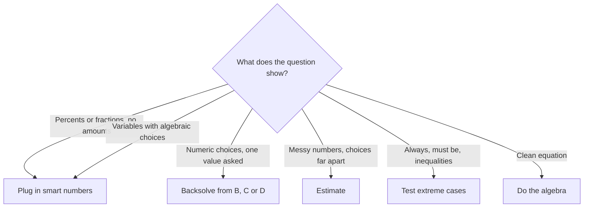

# Quant Section Strategy: Speed, Pacing and Power Methods

You will have 45 minutes for 21 Problem Solving questions, with no calculator. That's roughly 2 minutes and 8 seconds per question. Knowing the math is only half the battle; the other half is deciding how to spend those 45 minutes. This lesson gives you the pacing plan and four power methods that turn many "hard" questions into quick ones.

## The shape of the section

- 21 questions, all Problem Solving, arithmetic and algebra only. No geometry.
- 45 minutes. No calculator. You work on the on-screen whiteboard or the physical note-board and marker you're given at the test centre (online, an erasable board).
- The test is **question-level adaptive**. It picks each next question based on how you've done so far, so a string of right answers makes the questions harder. That is a good sign, not a punishment.
- Your section score runs from 60 to 90. Unanswered questions hurt you, so you always want an answer on every question.

> [!NOTE]
> You can't skip a question and return later in the way you can on a paper test. You can bookmark questions and, at the end, use Review & Edit (below). Treat each question as one chance, then move forward.

## Doing math without a calculator

The GMAT designs numbers so the arithmetic is gentle if you see the structure. These habits make a big difference.

- **Factor before you multiply.** For 48 × 25, think 12 × 4 × 25 = 12 × 100 = 1200.
- **Cancel before you compute.** In 18 × 35 / 21, write 18 × 5 × 7 / (3 × 7) = 18 × 5 / 3 = 30. Never multiply everything and then divide.
- **Round, then correct.** 99 × 47 = 100 × 47 − 47 = 4653.
- **Percent shortcuts.** 10% is a decimal move, 5% is half of that, 1% is two moves. 15% of 80 = 8 + 4 = 12.
- **Use friendly fractions.** 1/8 = 12.5%, 3/8 = 37.5%, 1/6 ≈ 16.7%, 1/7 ≈ 14.3%.
- **Know the squares to 25 and the cubes to 10.** They save a lot of grinding.

> [!TIP]
> If you are about to multiply two big numbers, stop. The question almost certainly has a trick that avoids it: a common factor, a nearby round number, or an answer choice list so spread out that an estimate works.

## The two-minute rule and pacing checkpoints

An average of 2 minutes 8 seconds per question means some questions deserve 60 seconds and some deserve 3 minutes. The danger is the question that eats 5 or 6 minutes. Those minutes cost you two or three easier questions later.

Use this plan:

| Checkpoint | Time elapsed (target) | What it means |
|---|---|---|
| End of Q7 | about 15 minutes | You are on pace. |
| End of Q14 | about 30 minutes | Same pace; if you are behind, speed up on easy ones. |
| End of Q21 | about 43 minutes | Leaves about 2 minutes for Review & Edit. |

Read your clock at Q7 and Q14. If you're 3 or more minutes behind, don't panic and don't rush the next question; instead, make a deliberate rule: no more than 2 minutes on anything unless you're clearly 30 seconds from the answer.

### The 2-minute rule

After about 2 minutes, ask yourself one question: "Do I know the next step?"

- **Yes, I can see the finish:** keep going, even to 3 minutes.
- **No, I'm stuck or just re-reading:** stop. Eliminate any choices you can, make your best guess, bookmark it, and move on.

> [!TRAP]
> The sunk-cost feeling ("I've already spent 4 minutes, I must be close") is the biggest score killer on the Quant section. Time already spent is gone either way. Ask only: "What's the quickest way to a good answer from here?"

## When to guess

A guess is not giving up; it is a strategy. Guess when:

1. You are past about 2 minutes and still have no plan.
2. The question is clearly well above your current level (the adaptive test will sometimes serve you a few of these).
3. You've eliminated at least one or two choices (even one elimination improves your odds from 20% to 25%).

**How to guess smartly:** strike answers that are too big or too small by estimation, wrong in sign, parity or units digit, or equal to a number sitting in the question stem (a number appearing in the question is often a trap). Choose from what's left, and move on.

> [!REMEMBER]
> Never leave a question blank. Unanswered questions at the end are penalised in the scoring. Even a rushed guess in the last 30 seconds beats nothing.

## Read the question twice

Most careless errors come from answering a nearly identical question. Do this: read once for the story, then re-read the final sentence and underline (on your board) what is being asked: "how many MORE", "what fraction REMAINS", "in years", "per hour", "NOT". Then circle the unit.

Before you pick an answer, one last 5-second check: "Does my answer have the right unit and the right sense (positive count, fraction below 1, speed that makes sense)?"

## Using the whiteboard cleanly

- Write big, in columns: one step per line, "=" signs aligned.
- Label every number the first time you write it ("rent = 4").
- Write the answer choices (A to E) in a column; cross out as you eliminate. This is also your record when you come back to a bookmarked question.
- For long problems, put the question's key facts in a small box at the top. You'll often need them again in the last step.
- If you change approach, draw a line and start fresh below. A messy board costs you errors.

## Review & Edit: bookmark and change up to 3 answers

At the end of a section, you can open Review & Edit to revisit questions. The rules:

- You may bookmark any question as you go, so it's marked for review.
- You can change up to **3** answers in the section.
- Only use it if you have time left. Aim to have 2 to 3 minutes spare, which the 43-minute checkpoint gives you.

Use the 3 changes on the bookmarked questions where you guessed but now see a quicker approach, or where you suspect a misread. Don't reopen questions you were confident about; second-guessing correct answers is a common error.

> [!TIP]
> Bookmark only questions where you guessed or where you have a specific reason for a second look. If you bookmark 12 questions, you can't possibly revisit them in the remaining time. A good rule is bookmarking 3 to 5 at most.

## The four power methods

Many GMAT Quant questions can be solved the "textbook" way (set up algebra) or the "power" way (use numbers and the answer choices). The textbook way is slower when the algebra is messy, but it is safer when the numbers are tidy. Choose in the first 15 seconds, and don't be afraid to switch.

### Method 1: Plugging in numbers (smart numbers)

Use it when the question has variables, or percentages and fractions with no actual amounts ("a certain price", "x dollars", "a number n"). Pick a value that makes the arithmetic easy, then compute.

Good picks:

- **Percent problems:** 100 (or 200 for half-percentages).
- **Fraction problems:** the least common multiple of the denominators (for 1/3 and 1/4, pick 12).
- **Ratio problems:** a multiple of the ratio's total (ratio 2 : 3, pick 5 or 10).
- **Variables:** small positive numbers like 2, 3 or 10, but never 0, 1 or a number that already appears in the problem; those can match several answers by accident.

Always check **all five choices** with your smart number; if two survive, pick another number to split them.

> [!TRAP]
> Don't use smart numbers when the question gives actual values or when the answer must be a single particular number. And never plug in 1 or 0 as your only test; many wrong choices agree with the right one at those values.

#### Worked example 1 (Medium): smart numbers with fractions
Ritu spends 1/3 of her monthly salary on rent. She then spends 1/4 of the money that remains on food. What fraction of her salary is left after rent and food?

(A) 1/4  (B) 1/3  (C) 5/12  (D) 1/2  (E) 7/12

Show solution

No amounts are given, so pick a smart number. The denominators are 3 and 4, so use a salary of 12.

Rent: 12 ÷ 3 = 4, leaving 8. Food: 8 ÷ 4 = 2, leaving 6.

Left over: 6 out of 12 = 1/2. Answer (D).

Faster way: this *is* the fast way; the algebraic version is (1 − 1/3) × (1 − 1/4) = 2/3 × 3/4 = 1/2, which agrees.

Trap: subtracting the fractions directly: 1 − 1/3 − 1/4 = 5/12, choice (C). The food fraction is 1/4 of the *remainder*, not of the whole salary.

#### Worked example 2 (Medium): smart numbers with a variable distance
A car drives a certain distance from town A to town B at 30 mph and returns along the same road at 60 mph. What is its average speed for the whole trip?

(A) 40 mph  (B) 42 mph  (C) 45 mph  (D) 48 mph  (E) 50 mph

Show solution

The distance isn't given, so choose a convenient one. A distance of 60 miles divides evenly by both speeds.

Going: 60 ÷ 30 = 2 hours. Returning: 60 ÷ 60 = 1 hour. Total distance 120 miles in 3 hours: 120 ÷ 3 = 40 mph. Answer (A).

Faster way: for equal distances, the average speed is the harmonic mean: 2 × 30 × 60 / (30 + 60) = 3600/90 = 40.

Trap: (30 + 60)/2 = 45, choice (C). Average speed is total distance divided by total time, and the car spends more time at the slower speed.

### Method 2: Backsolving from the answer choices

Use it when the choices are numbers, the question asks for a specific value ("how many...", "what is the value of x..."), and setting up the equation would be slow. Plug a choice into the story and see whether it works.

**Where to start:** the choices are almost always in increasing order, so start with **B or D** (or C, the middle one). If the middle one is too big, you only have the smaller two left; if it's too small, the larger two. That cuts your work to at most 2 or 3 tries.

> [!TIP]
> Backsolving is excellent for age problems, mixture and work problems with whole-number answers, and "which of the following could be x?" questions. It's a poor choice when the answer choices are algebraic expressions or when the numbers are messy.

#### Worked example 3 (Medium): backsolving
Maria buys 8 items in total from a stationery shop: pens at ₹12 each and notebooks at ₹30 each. She pays ₹168 in all. How many notebooks did she buy?

(A) 2  (B) 3  (C) 4  (D) 5  (E) 6

Show solution

Start with the middle choice, (C) 4 notebooks. That means 4 pens too (8 items in total).

Cost: 4 × 30 = 120 for notebooks, plus 4 × 12 = 48 for pens. Total 168, exactly what she paid. Answer (C), found in one try.

Algebra check: pens p, notebooks n. p + n = 8 and 12p + 30n = 168. Substituting p = 8 − n: 96 + 18n = 168, so n = 4. ✓

Trap: if choice (D) 5 had been tested first, you would compute 5 × 30 + 3 × 12 = 186, too high, and know to go down. A wrong test is not wasted: it tells you the direction.

### Method 3: Estimation and ballparking

Use it when the choices are far apart. Round the ugly numbers to friendly ones, estimate, and pick the closest choice. Notice the spread of the choices first: if they differ by a factor of 2 or more, rounding is safe. If they differ in the last digit, don't estimate; use the units digit or exact arithmetic.

#### Worked example 4 (Easy): ballparking
What is the approximate value of (4.98 × 20.1) / 0.0995?

(A) 10  (B) 100  (C) 500  (D) 1000  (E) 5000

Show solution

Round: 4.98 ≈ 5, 20.1 ≈ 20, 0.0995 ≈ 0.1.

(5 × 20) / 0.1 = 100 / 0.1 = 1000. Answer (D).

The exact value is about 1006, which confirms it.

Trap: dividing by 0.1 and getting 10 instead of 1000. Dividing by a tenth *multiplies* by 10.

#### Worked example 5 (Medium): near-round numbers, exact answer
What is the value of 19 × 21 × 23?

(A) 8,977  (B) 9,177  (C) 9,377  (D) 9,577  (E) 9,777

Show solution

19 × 21 = (20 − 1)(20 + 1) = 400 − 1 = 399, which is just under 400.

399 × 23 = 400 × 23 − 23 = 9,200 − 23 = 9,177. Answer (B).

Quick elimination: 400 × 23 = 9,200, and 399 × 23 is slightly less, so only (B) is just below 9,200. Choices (C), (D) and (E) are above 9,200 and (A) is more than 200 below.

Trap: multiplying 19 × 21 × 23 digit by digit. Whenever numbers sit just above and below a round number, think (a − b)(a + b).

### Method 4: Testing extreme and special cases

Use it for inequality, "which is always true", and "which must be greater" questions. Try a few categories of numbers: **negatives, zero, one, a fraction between 0 and 1, and a big number**. A single counterexample kills a choice.

#### Worked example 6 (Hard): test a fraction
If 0 < x < 1, which of the following is the greatest?

(A) x  (B) x²  (C) √x  (D) 1/x  (E) 1/x²

Show solution

Pick a friendly fraction between 0 and 1: x = 1/2.

x = 0.5, x² = 0.25, √x ≈ 0.71, 1/x = 2, 1/x² = 4.

The greatest is 1/x², choice (E).

Check with a second value, x = 1/10: x = 0.1, x² = 0.01, √x ≈ 0.32, 1/x = 10, 1/x² = 100. Again (E).

Trap: assuming "squaring makes numbers bigger". That's only true for numbers greater than 1; for fractions between 0 and 1, squaring makes them smaller, while 1/x² is the reciprocal of something small, which is large.

## Choosing the method

| You see... | Reach for... |
|---|---|
| Percent, fraction or ratio with no actual amounts | Smart numbers |
| Variables in the stem and algebraic choices | Smart numbers (plug in, check all choices) |
| Numerical choices, a specific value asked | Backsolve (start at B/C/D) |
| Messy decimals, choices far apart | Estimate |
| "Always", "must be", inequality comparisons | Extreme cases |
| A clean equation you can see through at once | Plain algebra; don't over-think it |

This flow turns the table above into a quick decision.

Combine the methods freely. For example, estimate first to eliminate three choices, then backsolve the last two.

## A 45-minute game plan

1. **Before you start:** decide to follow the checkpoints (15 minutes by Q7, 30 by Q14).
2. **Each question:** read twice, decide the method in 15 seconds, and write a clean first line.
3. **At 2 minutes:** continue only if you can see the finish; otherwise eliminate, guess, bookmark, move on.
4. **After Q21:** use leftover time for Review & Edit on your 3 to 5 bookmarks, changing at most 3 answers.
5. **After the section:** forget it. The next section is a fresh start.

## Quick check

1. You're at question 8 and the clock says 19 minutes. What do you do?

Answer

You're about 4 minutes behind (target about 15 minutes by Q7). Don't rush blindly; tighten the cap to about 2 minutes per question, guess faster on the stuck ones, and use methods like backsolving and estimation to recover time.

2. A question says "a price increases by 20%, then decreases by 20%". Which method is best?

Answer

Smart numbers. Use 100: 100 → 120 → 96, so the final price is 4% below the original.

3. Why start backsolving at (C) or (B)/(D) rather than (A)?

Answer

The choices are ordered, so a middle test tells you whether to go higher or lower, which removes about half the choices at once.

## Key takeaways
- 21 questions in 45 minutes is about 2 minutes 8 seconds per question. Be at about 15 minutes after Q7 and about 30 minutes after Q14.
- After about 2 minutes with no plan, eliminate, guess, bookmark and move on. Never fall for sunk cost.
- Use smart numbers for abstract percent, fraction and variable questions; backsolve for numerical choices; estimate when choices are far apart; test extreme cases for "always true" questions.
- Factor, cancel and round before multiplying. A hard multiplication is a hint that there's a shortcut.
- Read the question twice and underline exactly what is asked, with its unit.
- Leave nothing blank. Bookmark only a handful and use at most 3 changes in Review & Edit.

## Go deeper
- [Official GMAT exam site](https://www.mba.com/exams/gmat-exam) — current details on the exam structure, timing and Review & Edit.
- [GMAT Club forum](https://gmatclub.com/forum/) — strategy threads from other test takers on pacing and method choices.
- [Khan Academy: Algebra](https://www.khanacademy.org/math/algebra) — brush up the basics that make the shortcuts easier.
