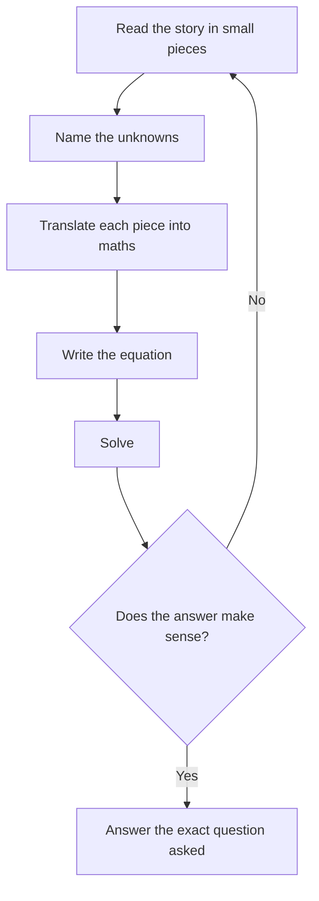

# Translating Word Problems

Almost every Quant question on the GMAT Focus is a word problem in disguise. The maths is usually easy; the hard part is turning English into equations without losing a "than" or a "per" along the way. Get this skill right and the other topics get easier too.

## The translation dictionary

Read the sentence in small pieces and translate each piece. Most phrases have a fixed meaning.

| English | Maths |
|---|---|
| is, was, equals, gives, results in | = |
| of (with a fraction or percent) | × |
| more than, increased by, sum of | + |
| less than, decreased by, difference of | − (watch the order) |
| per, each, for every | ÷ or × (a rate) |
| what percent of A is B | (B/A) × 100 |
| twice, three times | 2×, 3× |
| at least | ≥ |
| at most, no more than | ≤ |

> [!TRAP]
> "5 less than x" is x − 5, not 5 − x. "x is 5 less than y" is x = y − 5. The word "than" reverses the order of the pieces. Test it with a small number: "5 less than 8" is 3, which is 8 − 5.

> [!TRAP]
> "A is 20% more than B" means A = 1.2B, not B = 1.2A. The thing after "than" is the base.

Percent phrases are covered in detail in the percents lesson. For now, remember that "of" means multiply, and "what percent of 40 is 10?" is 10/40 = 25%.

## Define variables smartly

1. **Name the unknown the question asks for**, or the quantity that makes everything else simple. If Tom is 4 years older than twice Sam's age, let Sam's age be s and write Tom as 2s + 4. Then solve, and re-read what was asked: Tom's age, not Sam's.
2. **Use as few variables as possible.** If there are two kinds of coins and 40 coins in total, call the first type x and the other 40 − x. One variable instead of two.
3. **Write units next to variables** (x = number of coins, not x = coins).
4. **Re-read at the end.** Many wrong answers on the GMAT are right numbers for the wrong quantity.

Every word problem follows this same path from English to answer.

### Worked example 1 (Easy)
Tom is 4 years older than twice Sam's age. The sum of their ages is 31. How old is Tom?

Show solution

Sam = s, Tom = 2s + 4. So s + 2s + 4 = 31, 3s = 27, s = 9. Tom = 2(9) + 4 = 22.

Backsolving: Tom = 22 means Sam is (22 − 4)/2 = 9, and 9 + 22 = 31. It fits.

Trap: giving 9 (Sam's age) because you stopped at the first answer.

## Age problems

Ages change by the same amount for everyone. If Anita is three times as old as Bina now, then in 6 years both are 6 years older. Make a small table:

| | Now | In 6 years |
|---|---|---|
| Bina | b | b + 6 |
| Anita | 3b | 3b + 6 |

"In 6 years, Anita will be twice as old as Bina": 3b + 6 = 2(b + 6), so b = 6 and Anita is 18.

> [!TIP]
> Age problems: the difference between two people's ages never changes. If Anita is 12 years older than Bina now, she's 12 years older in any year.

## Money, coins and tickets

These problems have two kinds of item, a count and a value per item. Two equations: one for the total count, one for the total value.

Example: 40 coins of ₹5 and ₹2 total ₹146. Let x be the number of ₹5 coins: 5x + 2(40 − x) = 146, so x = 22.

> [!SHORTCUT]
> The "all-cheap" method: assume every coin is ₹2, giving ₹80. You need ₹66 more. Swapping one ₹2 coin for a ₹5 coin adds ₹3, so you need 66/3 = 22 swaps. No algebra and almost no way to slip.

## "Per" and unit conversions

"Per" always signals a rate: pages per minute, rupees per kilometre, kilometres per litre. Rate × quantity = total. The mistake to avoid is mixing units. A printer at 40 pages per minute needs 12,000/40 = 300 **minutes** to print 12,000 pages. The question asked for hours, so divide by 60: 5 hours.

Convert early. Write units next to every number and check that the same unit cancels top and bottom.

> [!REMEMBER]
> 1 hour = 60 minutes = 3,600 seconds. 1 km = 1,000 m. 1 day = 24 hours. 1 km/h = 5/18 m/s.

### Worked example 2 (Medium)
A school fund needs at least ₹10,000. The 6 teachers contribute ₹350 each, and each student contributes ₹120. What is the minimum number of students needed?

Show solution

Teachers give 6 × 350 = ₹2,100. Students must give at least ₹7,900. So 120s ≥ 7,900, s ≥ 65.83. Round up: 66.

Check: 65 students give 7,800 + 2,100 = 9,900 (short). 66 give 10,020 (enough).

Trap: 65 comes from rounding 65.83 down, or dropping the fractional part. For "at least" you always round up, even if the decimal is small.

## Consecutive integers

Consecutive integers: n, n + 1, n + 2, ... Consecutive even or odd integers: n, n + 2, n + 4, ...

For a sum, use the average. The sum of an odd number of evenly spaced numbers is (count) × (middle). Three consecutive odd integers with sum 87 have middle 29, so they are 27, 29, 31.

> [!TIP]
> Five consecutive integers with sum S: the next five each shift up by 5, so their sum is S + 5 × 5 = S + 25. Shifting k numbers up by m adds k × m.

> [!NOTE]
> "Consecutive" alone means consecutive integers. If the problem says "consecutive even integers" the step is 2. If it says "consecutive multiples of 5", the step is 5.

## Maximum and minimum, "at least" and "at most"

These questions give you rules and ask for the biggest or smallest possible value. The method is always the same:

1. Write down every condition as an equation or inequality.
2. To make one quantity as large as possible, make the others as small as possible (and vice versa), without breaking any condition.
3. Watch for words like "distinct" (no repeats), "positive" (at least 1), and "integer" (whole numbers only).
4. Round in the direction that keeps the condition true: "at least" rounds up, "at most" rounds down.

Example: seven distinct positive integers with mean 12 and median 6. The total is 84. To make the largest as big as possible, make the others as small as possible: 1, 2, 3 below the median, then 6, then 7 and 8 above it. That sums to 27, so the largest is 84 − 27 = 57.

> [!TRAP]
> Ignoring "distinct" and using 6, 6, 6 for the middle values gives a larger answer (60) that is not allowed. Ignoring the median gives 63. Each condition removes a tempting wrong answer.

### Worked example 3 (Hard)
A theatre has 400 seats, all sold. Premium seats cost $50 and standard seats cost $30. Revenue is at least $15,000 and premium seats are at most 40% of all seats. How many different numbers of premium seats are possible?

Show solution

Revenue = 50p + 30(400 − p) = 12,000 + 20p ≥ 15,000, so p ≥ 150. The 40% limit gives p ≤ 160. The values 150 to 160 inclusive are 160 − 150 + 1 = 11.

Trap: 10, from subtracting 160 − 150 and forgetting that both ends count.

## Smart numbers and backsolving

**Smart numbers.** When a problem has fractions or percentages of an unknown amount, pick a convenient value for the unknown and follow it through. Aman spends 1/3 of his salary on rent, 1/4 of the remainder on food, then saves half of what's left. Choose salary = 12 units: rent 4, left 8, food 2, left 6, saves 3. If 3 units = ₹6,000 then the salary (12 units) is ₹24,000.

**Backsolving.** When the answer choices are plain numbers, plug them into the story instead of building equations. Start with choice C (the middle value). If it's too big or too small, you know which direction to go. This works especially well with ages, quadratics hidden in word problems, and "price per item" stories.

Example: with ₹1,200 Rohan could buy 4 more notebooks if each were ₹10 cheaper. Try ₹60: 1,200/60 = 20 notebooks; at ₹50, 1,200/50 = 24 notebooks, which is exactly 4 more. Done in one test.

> [!TIP]
> Smart numbers work when the answer is a *ratio, fraction or percent*, or when the problem never gives an actual amount. Backsolving works when the choices are actual numbers. If neither fits, write the algebra.

> [!SHORTCUT]
> Variable answer choices (such as ds/(m − s))? Choose simple values for the variables (m = 10, d = 100, s = 2), compute the answer yourself, and see which choice matches. Check one or two others to be sure, because two choices can coincide for a particular set of numbers.

### Worked example 4 (Hard)
A club has m members, and each pays d dollars in dues. If s of the members do not pay, by how many dollars must each of the remaining members pay extra for the club to still collect the same total?

Show solution

The total is md. The remaining m − s members must each pay md/(m − s). The extra is md/(m − s) − d = ds/(m − s).

Check with m = 10, d = 100, s = 2: the total of 1,000 split among 8 gives 125, which is 25 extra. The formula gives 100 × 2/8 = 25.

Trap: md/(m − s), which is the new payment per person, not the extra.

### Worked example 5 (Medium)
Three pens and two notebooks cost ₹49. Two pens and three notebooks cost ₹46. What is the cost of one pen plus one notebook?

Show solution

Add the two equations: 5 pens + 5 notebooks = ₹95, so 1 pen + 1 notebook = ₹19.

Check: subtracting gives pen − notebook = ₹3, so pen = ₹11 and notebook = ₹8. Then 33 + 16 = 49 and 22 + 24 = 46.

Trap: dividing 95 by 10 to get ₹9.50, as if there were 10 items.

## Work backwards

When a story applies several steps to an unknown starting amount and tells you the end result, undo the steps in reverse order. Priya spends 1/3 on books, then 1/4 of the remainder on lunch, then gives her brother half of what's left plus ₹100, and ends with ₹200. Reverse: before the brother, 200 + 100 = 300 was half, so ₹600. Before lunch, 600 ÷ 3/4 = ₹800. Before books, 800 ÷ 2/3 = ₹1,200.

## Quick check

1. A taxi charges ₹50 plus ₹12 per km. What is the fare for 15 km?

Answer

50 + 12 × 15 = ₹230.

2. "x is 8 less than y" translates to which equation?

Answer

x = y − 8.

3. Rita is 6 years older than Sumit. In 4 years she will be twice as old as he will be then. How old is Sumit now?

Answer

Sumit = s, Rita = s + 6. In 4 years: s + 10 = 2(s + 4), so s = 2. Check: now 2 and 8; in 4 years 6 and 12.

4. The sum of four consecutive integers is 62. What is the largest?

Answer

The average is 15.5, so the integers are 14, 15, 16, 17 and the largest is 17.

## Key takeaways
- Translate in small pieces: "of" is multiply, "is" is equals, and "than" reverses the order of the two pieces.
- Define the fewest variables, write the quantity you are solving for, and re-read the question at the end.
- Age problems: the same number of years is added to everyone, and the age difference never changes.
- Two-item money problems: all-cheap method, or one equation for count and one for value.
- "At least" rounds up, "at most" rounds down; inclusive counts need a +1.
- For max/min problems, push all other quantities to their limits while obeying every condition (distinct, positive, integer).
- Smart numbers for fractions and percentages of an unknown; backsolving for numeric answer choices.
- Variable choices: plug in simple numbers for the variables.

## Go deeper
- [Khan Academy: Algebra word problems](https://www.khanacademy.org/math/algebra) — practice turning stories into equations.
- [GMAT Club forum](https://gmatclub.com/forum/) — search by topic for hundreds of word problems at every difficulty.
- [mba.com GMAT Focus exam page](https://www.mba.com/exams/gmat-exam) — official overview of the exam format.
