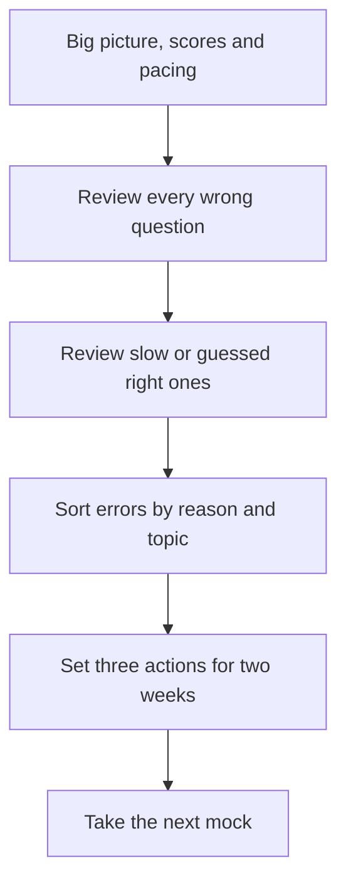

# Mock Exams: Your Dress Rehearsals

A mock exam is a full-length practice test taken under real conditions. It's the closest thing to the real GMAT you can get, and it does three jobs: it measures where you are, it builds your stamina and pacing, and it shows you what to fix next. Used well, mocks are the most valuable hours in your whole preparation. Used badly, they just give you a number that ruins your mood.

## The mocks you'll use

There are two families of mocks in your plan.

### Official GMAT Practice Exams

GMAC makes official practice exams. They use the same scoring approach and timing as the real exam, so they're the best predictor you can buy.

- **Practice Exams 1 and 2** are free. They come with the GMAT Official Starter Kit on mba.com, which also has a sampler of real questions (a third-party source says 70) and guided study material.
- **Practice Exams 3 to 6** are paid. Prices change, so check mba.com. As a rough guide, third-party sources have reported about US$110 for all four, and some reported cheaper bundles of two. Those figures were dated, so treat them as approximate. GMAC suggests buying them together if you plan to use more than one, to save money.

All six are full-length, adaptive and in the real format.

### The app's own mocks

GMAT Buddy has its own full-length mocks, built from questions held back from the practice pool, so you won't have seen them. They follow the real structure: 21 Quant, 23 Verbal and 20 Data Insights questions, 45 minutes per section, optional break and Review & Edit.

They're excellent for pacing practice, stamina and detailed analysis. But they're not GMAC's own algorithm, so their score is an estimate. Use them to practise and to find weaknesses, and rely on the official exams for score predictions.

> [!NOTE]
> Never use mocks from third-party sources before you've done the official ones, and don't treat third-party scores as gospel. Different companies calibrate difficulty differently, and a bad score on a harsh mock can shake your confidence for no good reason.

## When to take each one

Here's the default schedule for your plan. Move dates if work gets in the way, but keep the order and the gaps.

| When | Mock | Purpose |
|---|---|---|
| Early Nov 2026 (Foundations) | Official Practice Exam 1 (free) | Baseline. Expect a low score. That's useful information. |
| Late Jan to Feb 2027 (Core) | App mock 1 | Check progress, practise a full 2 h 15 min |
| Late Mar 2027 (end of Core) | Official Practice Exam 2 (free) | Measure real progress. Choose your first section-order guess. |
| Apr to May 2027 (Advanced) | App mock 2, plus one more if you're on track | Test a different section order, practise timing |
| Early June 2027 | Official Practice Exam 3 (paid) | First mock of the mock season |
| Late June 2027 | Official Practice Exam 4 | Check trend. Rehearse the break. |
| Mid July 2027 | Official Practice Exam 5 | Pre-final check. Lock in your section order. |
| Early Aug 2027 | Official Practice Exam 6 | Full dress rehearsal, at the same time of day as your real slot |
| 28 Aug 2027 | The real exam | |

Leave at least seven days between your last mock and the real exam. Taking a mock three days before is risky: a bad score lands right when you can't fix it.

If you decide to retake in October 2027, we'll replan the mocks. There may be some later official exams you can save for that.

> [!TIP]
> You only get a limited number of official exams. Don't take Exam 3 on a day when you're exhausted or distracted. A clean score is worth more than a convenient date.

## How to simulate real test conditions

A mock only predicts the real thing if it feels like the real thing. Set up as follows.

1. **Same time of day as your booked exam slot.** If your real exam is at 9 a.m., take mocks around 9 a.m. Your brain's rhythm matters.
2. **A proper, quiet space.** Phone out of the room, no family walking in, no music.
3. **A computer, not your phone.** The real exam is on a computer with a mouse and keyboard. Official practice exams are meant for a computer.
4. **Full 2 h 15 min plus the break.** No pausing. If the doorbell rings, let it ring.
5. **Only allowed materials.** Test centre style: no paper, only the allowed note-taking supplies. For online prep, use a whiteboard of the permitted size. Don't use a calculator, except the on-screen one in Data Insights.
6. **Eat and drink as planned.** Practise the same breakfast and break snack you'll have on exam day.
7. **Take the break at 10 minutes exactly.** Practise the whole routine: stand, stretch, snack, return.
8. **Follow your section order and Review & Edit plan.** Don't improvise.

> [!TRAP]
> Don't do a "half-mock" and pretend it's a real one. Stopping after Verbal because you're tired doesn't give you a score or a stamina test. If you can't set aside the full time, wait until you can.

## The full mock review process

A mock without a thorough review is mostly wasted. Plan about 3 to 5 hours for the review. That's as long as the mock itself, and it's where the improvement comes from. Do it within a day or two, while you remember your thinking.

Here's the process.

The five steps of a full mock review.

### Step 1: Look at the big picture (20 to 30 minutes)

- Total and section scores.
- Which section was your weakest, and by how much compared with your last mock?
- Pacing: how many questions did you finish in each section, and how many did you guess at the end? Did you leave any blank?
- How did you feel? Where did you lose focus?

### Step 2: Review every wrong question (the longest part)

For each one, use the 4-question review from the study-system lesson, and log it in your error log with its reason: concept, careless, timing, misread or trap.

### Step 3: Review the slow-but-right questions

Any question you got right but spent over 3 minutes on, or guessed, deserves a look. Those are the unstable wins.

### Step 4: Find patterns

Sort the errors by reason and by topic. Ask:

- Which topic or question type appears most often?
- Did most errors come early (carelessness, nerves) or late (fatigue, timing)?
- Did your timing break down in one section?
- Did Review & Edit help?

### Step 5: Set three actions

Don't write a list of 20 things. Pick three concrete actions for the next two weeks, for example:

1. "Two sets of 8 ratio questions, untimed, then timed."
2. "Re-learn Table Analysis method, with 10 questions."
3. "Practise the 2.5-minute bail-out in Quant."

Put them in your plan and tick them off.

> [!REMEMBER]
> The mock isn't the learning. The review is. A mock plus a 30-minute glance at the score gets you almost nothing.

## Reading your score honestly

A mock score is a measurement with noise. You learned in the scoring lesson that the real exam has a standard error of roughly 30 to 40 points (a secondary-source figure). Mocks have their own error on top. So:

- **Think in ranges.** If your mock says 635, think "somewhere between about 610 and 660".
- **Watch the trend, not the single score.** Three mocks rising from 565 to 595 to 625 is a clearer signal than any individual score.
- **Look at section scores.** A flat total can hide a section that's improving while another has dipped.
- **Ignore tiny moves.** A change of 10 points between two mocks means almost nothing.
- **Compare apples to apples.** Official exams with official exams. App mocks with app mocks.

## Mock score versus real score

How close will your mock be to the real thing? Nobody can promise a number. GMAC designs its official practice exams to behave like the real exam, and many people find their official mock scores land in the same neighbourhood as their real result. But plenty of people score a little higher or lower on test day. Third-party mocks vary even more: some run harsh, some generous.

A few honest factors:

- **Test-day nerves** can pull your score down. Mocks at home are less stressful.
- **Test-day adrenaline** can sharpen you. Some people do better in the real thing.
- **Fatigue, sleep and the day's luck** all shift results.
- **Your final mocks matter more.** A mock from five months ago says little about your current level.

So use your last two official mocks, taken close to the exam, as the main guide. A reasonable approach is to expect your real score to fall within about 30 to 40 points of your recent official mocks, either side. That's a rough rule of thumb, not an official figure.

## What to do after a bad mock

Everyone has one. It doesn't mean the plan is failing. We'll talk about the emotional side in the mindset lesson. Practically:

1. Wait a few hours before opening the results if you're upset.
2. Do the full review anyway. Bad mocks often contain your most useful errors.
3. Check whether it was a one-off: did you sleep badly, skip food, get interrupted?
4. Look at the pattern, not the number.
5. Keep your next mock on schedule, unless you have a clear skill gap to fix first.

## Using the app's mocks well

- Treat each app mock exactly like a real exam: full time, proper setup, no pausing.
- After the mock, the app breaks results down by topic, question type and timing. Read that breakdown before looking at individual questions.
- Every missed question goes to your error log, with the reason.
- The app builds your next two weeks of practice partly from what the mock showed. Trust that plan.

## Quick check

1. Which official practice exams are free?

Answer

Practice Exams 1 and 2, included in the GMAT Official Starter Kit on mba.com. Exams 3 to 6 are paid.

2. About how long should a proper mock review take?

Answer

Roughly 3 to 5 hours, similar to the length of the mock itself, because the review is where the learning happens.

3. Your mock score drops 10 points compared with last time. How worried should you be?

Answer

Not very. A 10-point change is within normal noise. Look at the trend over three or four mocks, and at the section scores, instead.

## Key takeaways

- Mocks measure, build stamina and show what to fix. The review is where learning happens.
- Use the free Official Practice Exams 1 and 2, then the paid 3 to 6 in the mock season, plus the app's own mocks for practice and analysis.
- Take mocks under real conditions: same time of day as your exam, full length, planned break, no pausing.
- Allow 3 to 5 hours for a full review: big picture, wrong questions, slow-right questions, patterns, three actions.
- Read scores as ranges and trends, not single numbers.
- Expect your real score to land near your recent official mocks, but with natural variation of a few dozen points.
- Leave at least a week between your last mock and exam day.
- Prices and availability of official exams can change, so check mba.com before buying.

## Go deeper
- [GMAT exam on mba.com](https://www.mba.com/exams/gmat-exam): the official Starter Kit, free Practice Exams 1 and 2, and the paid exams.
- [GMAC](https://www.gmac.com/): official exam information and announcements.
- [GMAT Club forum](https://gmatclub.com/forum/): mock score reports and review tips from other test-takers.
