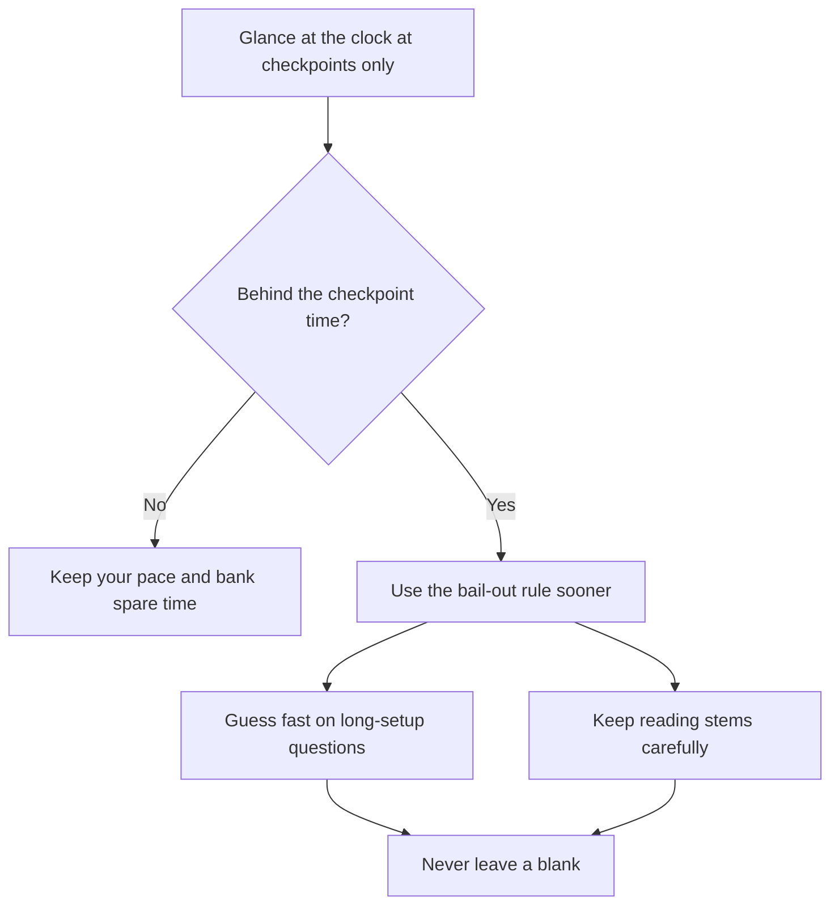

# Pacing and Time Management

Most GMAT scores are lost to the clock, not to hard questions. You'll meet questions you can't solve. That's by design. The skill is deciding quickly what's worth your time, and keeping a steady rhythm for 45 minutes.

## The maths of time

Each section gives you 45 minutes. Divide by the number of questions and you get these averages.

| Section | Questions | Average per question |
|---|---|---|
| Quantitative Reasoning | 21 | about 2 min 9 s |
| Verbal Reasoning | 23 | about 1 min 57 s |
| Data Insights | 20 | about 2 min 15 s |

These are averages, not targets for every question. Some will take 40 seconds. Others will deserve 3 minutes. The average works because fast questions pay for slow ones. That means every minute you save on an easy question is a minute you can spend on a hard one.

> [!REMEMBER]
> Don't aim to spend the same time on every question. Aim to finish with all questions answered, and a minute or two spare.

## Checkpoints for each section

Checkpoints tell you whether you're on pace without constantly doing sums. Glance at the clock only at these moments. Looking after every question wastes attention.

These are guidelines I've built from the averages above, with about two minutes left over at the end. The exact numbers aren't magic.

### Quant (45 minutes, 21 questions)

| By question | Time elapsed should be about |
|---|---|
| 5 | 11 minutes |
| 10 | 22 minutes |
| 15 | 32 minutes |
| 21 | 43 minutes |

### Verbal (45 minutes, 23 questions)

| By question | Time elapsed should be about |
|---|---|
| 6 | 11 minutes |
| 12 | 23 minutes |
| 18 | 34 minutes |
| 23 | 43 minutes |

Reading Comprehension passages cost more up front. Prep companies suggest roughly 6 minutes in total for a short passage with three questions (about 60 to 90 seconds reading) and around 8 minutes for a long one with four questions (about 2 to 2.5 minutes reading). So your Verbal timing will bounce: Critical Reasoning questions often take 1.5 to 2 minutes, RC questions can be faster once you've read the passage.

### Data Insights (45 minutes, 20 questions)

| By question | Time elapsed should be about |
|---|---|
| 5 | 11 minutes |
| 10 | 22 minutes |
| 15 | 33 minutes |
| 20 | 43 minutes |

Data Insights questions can come in sets, such as Multi-Source Reasoning with several questions on one set of tabs. Your first question in a set takes longer because you read the material, and the later ones go faster.

> [!TIP]
> If you're ahead by a minute or two, don't spend it. Bank it. Late-section questions are where the extra time saves you.

## The 2.5-minute bail-out rule

Here's the rule I want you to practise until it's automatic: **if you're not clearly closer to an answer after about two and a half minutes, make your best guess and move on.**

Prep companies use slightly different trigger times by type (roughly 2.5 minutes in Quant, 2 minutes in Critical Reasoning, 2 to 2.25 minutes in Reading Comprehension and Data Insights), but 2.5 minutes is a good general ceiling. It isn't a cut-off to reach on every question. It's your emergency exit.

Why it works: a question that's still unsolved after 2.5 minutes is either one you'd get wrong anyway, or one that needs a lot more time than the expected return. The next question might take 90 seconds and be worth just as much.

A simple routine for a hard question:

1. **First 30 seconds:** read it carefully and choose a method. Most questions should show you a way in by now.
2. **30 to 60 seconds:** if you're not sure, start eliminating answers or try plugging in numbers.
3. **60 to 90 seconds:** commit to an approach. If it's working, continue.
4. **90 to 150 seconds:** you should be close. If not, guess, bookmark if you want to revisit it, and go on.

> [!TRAP]
> The sunk-cost trap. "I've already spent two minutes, so I should finish." No. Time already spent is gone. The only question is whether the next minute is better spent here or on the next problem.

## Strategic guessing

A blind guess has a 1-in-5 chance. But you can usually do better.

- **Eliminate first.** Every wrong answer you cross out improves your odds: about 25 percent after removing one, about 33 percent after two, and 50 percent after three.
- **Use the structure.** In Quant, answers that are far too big or too small can be thrown out by quick estimation. In Critical Reasoning, answers that are out of scope or too extreme (always, never, all) are often wrong.
- **In Data Sufficiency,** if you've found that statement 1 alone works, and statement 2 is uncertain, you've already narrowed to A or D.
- **Bookmark your guesses.** If time remains, Review & Edit may let you revisit them.

> [!NOTE]
> Treat a guess as a decision, not a failure. A quick, educated guess on a bad question is a good use of your time, not giving up.

## Never leave a blank

In the previous lesson you learned that unanswered questions are penalised. Prep companies estimate the penalty as noticeable: one blank in a 23-question section could cost over a point on the 60 to 90 scale. GMAC doesn't publish an exact formula, so take that as an estimate. What isn't in doubt is the advice: **every question gets an answer.**

Build a safety net into your pacing:

- With about **2 minutes left**, check how many questions remain.
- With about **60 seconds left**, if you're not done, stop working properly and fill the rest with quick guesses. Pick one letter and use it consistently if you're truly out of time.
- Practise this in mocks so it doesn't feel like panic on the day.

## Common pacing mistakes

**Spending too long early.** Everyone wants to get the first questions right. That's sensible, and the first handful matter. But a 4-minute struggle on question 2 leaves you chasing the clock for the next 40 minutes.

If a checkpoint shows you are behind, follow this flow instead of rushing.

**Rushing the reading.** In Verbal and Data Insights, misreading costs more than slow reading. If you rush a stimulus and have to read it twice, you've lost time anyway.

**Over-checking.** On easy questions, a quick sanity check is smart. Re-solving everything a second time isn't, unless you have spare time at the end.

**Letting one hard question steal the next.** After a tough one, you may still be thinking about it when the next one starts. Take one slow breath, clear it, and read the next question fresh.

**Looking at the clock too often.** Use your checkpoints. If you're checking after every question, you're burning attention.

## Handling a hard streak calmly

It happens to everyone: three tough questions in a row, and a voice in your head says "I'm failing." Here's what's actually going on.

Because the exam adapts, a stretch of hard questions usually means you've been answering correctly, so the software is testing you at a higher level. It's often a good sign. It doesn't mean you're doing badly.

What to do:

1. **Breathe out slowly.** A long exhale calms your body faster than telling yourself to relax. Do it once, for about 5 seconds.
2. **Tell yourself the fact.** "A hard streak can mean I'm scoring well." Say it in your head.
3. **Use the bail-out rule.** Don't try to win every hard question. Guess quickly on the ugliest ones and protect your time for the ones you can solve.
4. **Reset on each question.** The last one is gone. This is a new question, with a new chance.
5. **Write down your method.** On the scratch board, start with the first step. Moving the pen often unlocks the problem.

> [!TIP]
> Build a tiny reset ritual and practise it in every mock: eyes off the screen, one slow breath, shoulders down, then read the next question. It takes five seconds.

## How to train pacing

Pacing is a skill, and you build it in stages, just like the untimed to timed progression in the study-system lesson.

- **Phase 1 and 2:** don't worry about the clock. Learn methods.
- **Phase 3:** use a timer on sets of 7 to 10 questions. Note your time per question in the app.
- **Phase 4:** practise full 45-minute sections with checkpoints, then full mocks.
- **Always:** after each timed set, look at the time per question in your review. Which question types are slow? Which questions did you bail on, and was that right?

Keep a "time sink" list in your error log: question types that regularly take more than 3 minutes. They're your training targets.

## A quick pacing plan for exam day

1. At the start of each section, note the checkpoints on your scratch space: for example, "Q5 at 11, Q10 at 22, Q15 at 32".
2. Work each question at a steady pace. Use the first 30 seconds to choose a method.
3. Bail out at about 2.5 minutes. Guess smartly, bookmark if you'd like to return.
4. Glance at the clock at checkpoints only.
5. Keep about 2 minutes at the end for Review & Edit and to confirm every question is answered.

## Quick check

1. In a 21-question Quant section, about how far into the section should you be by question 10?

Answer

About 22 minutes. That leaves you roughly 23 minutes for the last 11 questions, with spare time at the end.

2. You've spent 2 minutes 30 seconds on a Quant question and you aren't sure how to finish. What do you do?

Answer

Eliminate what you can, make your best guess, bookmark it if you want to revisit it, and move on. Time already spent is gone, so don't let it push you to spend more.

3. Why might three hard questions in a row be good news?

Answer

Because the exam adapts to your answers, a run of harder questions often means you've been getting questions right. It isn't proof, but it's a reason not to panic.

## Key takeaways

- Average time is about 2:09 in Quant, 1:57 in Verbal and 2:15 in Data Insights, but time per question varies a lot.
- Use checkpoints, not constant clock-watching. Aim to finish each section with about 2 minutes spare.
- The bail-out rule: if you're not clearly closer to an answer by about 2.5 minutes, guess and move on.
- Guess strategically: eliminate first, then pick. Bookmark guesses for Review & Edit.
- Never leave a blank. Unanswered questions are penalised, and wrong answers aren't directly penalised.
- Don't fall for the sunk-cost trap. Spent time is gone.
- A hard streak can mean you're doing well. Breathe, reset and keep going.
- Train pacing in stages, from untimed to timed sets to full sections and mocks.

## Go deeper
- [GMAT exam on mba.com](https://www.mba.com/exams/gmat-exam): official information and free prep to practise timing.
- [GMAT Club forum](https://gmatclub.com/forum/): pacing strategies and score stories from other test-takers.
- [GMAC](https://www.gmac.com/): official news and exam information.
