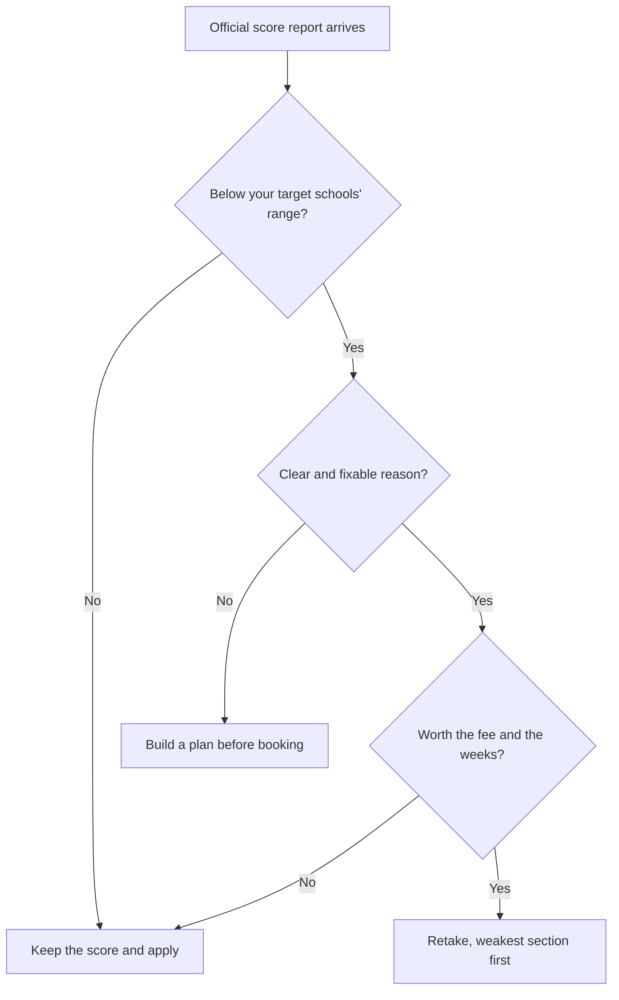

# Score Reports, Superscore and Retakes

Your exam isn't over when you click "finish". There are decisions about sending scores, cancelling, and whether to take it again. Knowing the rules now means you can plan calmly, and you can treat a second attempt as part of the strategy rather than an emergency. A reminder first: some rules below come from prep-company sites because mba.com's own pages didn't load for my research. I'll flag them. Please confirm on mba.com.

## Your score report

A few days after the exam (prep sources say roughly 3 to 5 business days), your **Official Score Report** appears in your mba.com account. It shows your total score (205 to 805), your three section scores (60 to 90) and percentiles. GMAC says the report includes detailed performance insights for free. That means you can see how you did by question type, which is gold for planning a retake.

A paid product called the **Enhanced Score Report** has been offered in the past. One site lists it at US$30, but I couldn't confirm whether it's still sold now that the official report already includes detailed insights. Check mba.com before paying for anything.

## Sending your scores

After you've seen your score, and not before, you can send it to **five programmes for free**. Prep sources and mba.com snippets say this must be done within a limited window (reported as 48 hours after your official score becomes available). Please check the exact window on mba.com so you don't lose the free sends.

After that, extra score reports cost money. A prep site reports roughly US$35 each online (and more by phone), but confirm the current price.

Two things to plan:

- **Choose the five carefully.** Think about which programmes you're most likely to apply to this year, and which will want the score first. If your applications are at different dates, ask whether it's worth keeping free sends for later. Check the rules on whether unused free sends expire.
- **Application timing.** GMAC suggests allowing at least 20 days before an application deadline for scores to be processed, according to one prep source. For ISB Round 1 and Round 2 and European deadlines, the admissions section lists dates.

> [!TIP]
> Don't send scores to a programme you haven't decided on. Use the free sends for schools you're sure about, and pay for extras if your list changes.

## The GMAT Superscore

In August 2026 GMAC launched the **Superscore**. It automatically looks at all your valid attempts on the current exam (test centre or online) and picks your **highest section score from each section**, combining them into a best total.

For example, imagine two attempts:

| | Quant | Verbal | Data Insights | Total (illustrative) |
|---|---|---|---|---|
| Attempt 1 | 83 | 80 | 78 | about 610 |
| Attempt 2 | 80 | 84 | 80 | about 630 |
| **Superscore** | **83** | **84** | **80** | **about 650** |

The Superscore takes 83 from Attempt 1, 84 from Attempt 2 and 80 from Attempt 2. It's higher than either single attempt. (The totals here are only illustrative, since GMAC's exact formula isn't published.)

What GMAC says: it's free, it appears in your mba.com account, and it shows as an additional data point on official score reports sent to programmes. One prep company says GMAC's own analysis suggests a Superscore might run 20 to 50 points above a single attempt, though the method isn't published, so don't count on a specific uplift. The same source says you can't opt out of sending your Superscore, and that only valid attempts on the current exam count. Confirm the details on mba.com.

Another important unknown: **how each school treats it.** Some schools may focus on your Superscore, others on your best single sitting, and policies may differ. Check each programme's admissions page, or email them, and make a note in your admissions plan.

> [!NOTE]
> The Superscore is new, so schools are still deciding how to use it. Never assume. Ask.

## Cancelling and reinstating

If you feel the exam went badly, you may be able to cancel your score.

- At a test centre, you can cancel **immediately after the exam** at no charge, according to GMAC snippets.
- For the online exam, you can cancel **within 72 hours.** One prep site lists a US$25 fee for online cancellation, which I couldn't verify.
- A cancelled score doesn't appear on your reports to schools.
- You can usually **reinstate** a cancelled score within a period of up to about four years and eleven months, for a fee. Prep sources quote US$50 to US$100, so the figure is uncertain.

Since schools may now see a Superscore, think carefully about whether cancelling is ever worth it. If the score is lower than your target but still a real attempt, keeping it protects your best section scores. Also check on mba.com whether a cancelled attempt counts towards the Superscore.

## Validity

Scores are generally valid for **five years** from the test date. That covers your 2027 application round and future ones.

## The retake policy

This is where the rules got friendlier recently. As reported by GMAC through search results and several prep sources:

- **16 calendar days** must pass between attempts.
- **Up to 5 attempts** in any rolling 12 months.
- The old **lifetime cap was removed in October 2024.** Previously there was a limit of 8 attempts in a lifetime.
- Online and test-centre attempts count together.
- Each retake costs the **full exam fee** again (and GST in India).

Confirm all of this on mba.com, as policies change.

For you, the practical effect is that a second attempt in mid-October 2027 is fully allowed, and the 16-day rule won't be an issue.

## When does a retake make sense?

A retake isn't a sign of failure. For many applicants, it's a normal step. Think about it using three questions.

1. **Is your score below the range your target schools publish?** For ISB, the class-of-2026 mean was about 683 (ISB doesn't say which scale). If you're well below your target programmes' ranges, a retake can matter.
2. **Do you have a clear, fixable reason?** Maybe one section was far below your mocks, or you ran out of time, or you had a bad day. A specific fixable issue is a good reason. "I'd just like a higher number" with no plan is a weaker one.
3. **Is the cost worth it?** Compare the extra fee and weeks of study against the improvement you can reasonably expect.

On improvement size, the evidence is limited. A coaching site reports that GMAC's FAQ cites an average gain of about 20 to 30 points for repeat test-takers, but I couldn't verify it. Treat it as a ballpark, and remember that people who retake are a self-selected group.

> [!TRAP]
> Don't retake straight away out of disappointment. Wait for your detailed score report, find the cause, and give yourself at least a few weeks of targeted practice. Two weeks of re-doing questions you've already seen won't move your score much.

Use this tree to decide whether to retake.

## A plan between attempts

Here's how I'd use the weeks between 28 August and mid-October 2027, if you decide to retake.

**Week 1: Rest and read.** Take a few days off. Then study your Official Score Report: which sections and question types were weakest?

**Weeks 2 to 3: Fix the biggest gap.** Use deliberate practice on your weakest section. Take your error log, sort it by reason, and fix the top pattern.

**Weeks 4 to 5: Refresh the rest.** Short sets across all sections so strong areas don't fade.

**Weeks 6 to 7: Mocks.** Two official or app mocks, with full reviews. Choose your section order again, based on the last result.

**Final week: Taper.** Light flashcards, sleep, logistics.

The Superscore changes your strategy. Because your best section scores combine, your retake should aim at your **weakest section first.** If Verbal was your lowest and Quant your highest, spend most of your time raising Verbal. A strong section you've already banked can't get worse on paper, though you should still stay sharp in case it matters for a school that looks at single sittings.

> [!REMEMBER]
> With the Superscore, a retake can only help your best-of-sections. But it costs time and money, and some schools may still look at each individual attempt. Always check how your target schools treat multiple attempts.

## Key dates for your plan

| Date | What happens |
|---|---|
| 28 Aug 2027 | First attempt |
| About a week later | Official score report arrives (3 to 5 business days is typical) |
| Within the free-send window | Choose up to 5 programmes to receive your score |
| Early Sep 2027 | Decide: keep score, plan retake, or both |
| Mid-Oct 2027 | Backup attempt, if needed |
| Application rounds | ISB R1/R2 and European deadlines, see the admissions section |

## Quick check

1. How many free score sends do you get, and when do you use them?

Answer

Five programmes, after you've seen your score and within the window GMAC allows (reported as 48 hours, so confirm on mba.com). Extra sends cost money.

2. How does the Superscore work?

Answer

It takes your highest score in each section from across your valid attempts on the current exam and combines them into a best total. It's free and shown in your mba.com account and as an extra data point on official score reports.

3. What are the current retake limits?

Answer

16 calendar days between attempts, and up to 5 attempts in a rolling 12 months. The old lifetime cap was removed in October 2024. Each retake costs the full fee.

## Key takeaways

- Your Official Score Report arrives a few days after the exam and includes detailed performance insights, which are valuable for any retake.
- You can send your score to five programmes for free after seeing it, within a limited window. Confirm the window on mba.com.
- The Superscore combines your best section scores across valid attempts on the current exam. Check how each school uses it.
- You can cancel at a centre immediately after the exam, or online within 72 hours, and reinstate later for a fee.
- Scores are valid for five years.
- Retake rules: 16 days apart, up to 5 attempts per rolling 12 months, no lifetime cap, full fee each time.
- Retake for a specific, fixable reason, not just disappointment.
- Between attempts, rest first, then target your weakest section, then take two mocks and taper.

## Go deeper
- [GMAT exam on mba.com](https://www.mba.com/exams/gmat-exam): official score, retake and cancellation policies.
- [GMAC](https://www.gmac.com/): announcements, including the Superscore.
- [GMAT Club forum](https://gmatclub.com/forum/): retake stories and school-by-school discussions.
