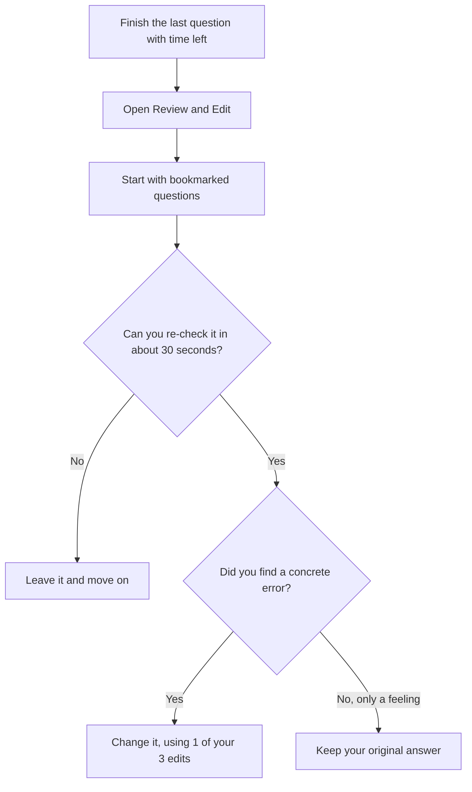

# Section Order, Breaks and Review & Edit

Three small choices on exam day can quietly change how you feel and perform: which section you start with, whether and when you take the break, and how you use the Review & Edit screen. None of them is a magic trick. But together they're free advantages, so let's decide them calmly now, not in the testing room.

## Choosing your section order

You can take the sections in any order. That gives six possible orders:

1. Quant, Verbal, Data Insights
2. Quant, Data Insights, Verbal
3. Verbal, Quant, Data Insights
4. Verbal, Data Insights, Quant
5. Data Insights, Quant, Verbal
6. Data Insights, Verbal, Quant

You pick the order on screen at the start of the exam. It's worth knowing in advance because you want to have practised it.

### Does order change your score?

Honestly, nobody can tell you with certainty. One prep company claims that a GMAC study found no significant score differences between orders, but I couldn't verify that source, so don't rely on it. What's more certain is that order affects your energy, your confidence and your nerves, and those do matter.

### A simple way to decide

Think about three things: your strongest section, your weakest section and your warm-up time.

- **Start with your strongest section** if you're a nervous starter. A good first section builds confidence and momentum for the rest.
- **Start with your most demanding section** if you're sharp early and fade later. Your best brain goes where the most points are at risk.
- **Put your weakest section in the middle** if your sections are fairly close in strength. You'll be warmed up and not yet drained.
- **Use the break** to reset before the section you're most afraid of, or after the one that drained you most.

### Recommendations based on your strengths

Because I don't know your scores yet, use this as a starting menu. Check it against your first two mocks.

| If this is you | Try this order | Why |
|---|---|---|
| Strongest in Data Insights, weakest in Quant | Data Insights, Verbal, Quant | You start with confidence, but Quant is last when you're tired, which can hurt. So test it in a mock. |
| Strongest in Verbal, weakest in Quant | Verbal, Quant, Data Insights | A confident start, then Quant while you're still fresh, then Data Insights, which uses the calculator and softer maths. |
| Strongest in Quant, weakest in Verbal | Quant, Verbal, Data Insights | Start by scoring well, and take on Verbal with your confidence up. Add the break after Verbal if you're flagging. |
| Fairly even across sections | Quant, Data Insights, Verbal or Verbal, Quant, Data Insights | Pick the one that feels best across two or three mocks. |
| Quant is your clear weak spot and you panic early | Verbal, Data Insights, Quant with the break before Quant | Quant comes last, after a break, once your nerves have settled. |

For you specifically, Maria, I'd expect Verbal and Data Insights to feel friendlier than Quant, given your background and job. Many people in your position find that starting with Verbal or Data Insights builds momentum, but Quant at the end can feel brutal if you're tired. That's exactly why we'll test two orders in the mock season rather than guess.

> [!TIP]
> Test at least two different orders across your mocks, and note your section scores and how you felt. Choose your order by about the third mock and then stop changing it. Switching order on exam day is a gamble.

> [!TRAP]
> Don't choose your order because a forum says "everyone does Quant first". The best order is the one that works for your energy and nerves, proven in your own mocks.

## The optional 10-minute break

You get one optional break of 10 minutes. Prep companies report it can be taken after the first or second section, but not both. Please confirm the exact rule on mba.com, since I couldn't read the official page. The break doesn't come out of your 2 h 15 min testing time.

### Should you take it?

Most coaches say yes. Taking no break means 90 minutes or more of focused work with no pause. The break is useful even if you feel fine, because your focus fades before you notice.

### How to use it

1. **Decide where in advance.** Many people take it after Section 2 (so Section 3 starts fresh), others after Section 1 so they have a mental reset earlier. Practise whichever you choose in your mocks.
2. **Leave your seat.** Walk, stretch, drink water, use the loo.
3. **Eat something small.** A banana, nuts or a sandwich. Skip heavy or sugary food that makes you crash. (We'll give a full food plan in the test-day lesson.)
4. **Breathe.** Five slow breaths. Drop your shoulders.
5. **Don't revisit the last section.** It's done, and replaying it only hurts. You can't change it.
6. **Be back on time.** At a test centre, there will also be a check-in process after the break. Online, you'll follow the proctor's break rules. Don't cut it close.

> [!NOTE]
> The break timer keeps running even if you take your time returning, so a long bathroom queue eats into your 10 minutes. Plan your break routine and rehearse it in a mock using exactly 10 minutes.

## Review & Edit: the end-of-section safety net

After you answer the last question in a section, if you have time left, you'll see the Review & Edit screen. It shows all the questions in a numbered list, with the ones you bookmarked marked. You can jump to any question and change your answer.

The rules, as published by GMAC:

- You can **bookmark** as many questions as you want during the section.
- You can **change up to three answers** per section.
- It's three **changes**, not three questions. Prep companies note that changing an answer and then changing it back would use two of your three.
- You can only review in the time that remains. When the timer ends, the section ends.
- Unused edits don't carry over to the next section.

Now the strategy.

### The bookmark strategy

Bookmarks are free, but your time isn't. If you bookmark half the section, you've bookmarked nothing useful.

Use bookmarks for a few specific cases:

- A question where you've narrowed to **two options** and chose one on a hunch.
- A question you **guessed on** at the bail-out point.
- A question where you **suspect a misread** or an arithmetic slip.

A sensible budget is about 3 to 6 bookmarks per section. Prep companies suggest roughly 4 to 6 in Quant, 3 to 5 in Verbal and 3 to 4 in Data Insights.

Bookmark with a quick click, then keep moving. Don't reflect on why.

### Leave time for it

To see the Review & Edit screen, you must answer every question first. You can't skip ahead and still reach the screen. So pacing comes first: your goal is to finish the last question with about 2 minutes left. If you finish with 10 seconds spare, Review & Edit is irrelevant.

### Using your three changes well

You have two minutes, three changes. Which ones should you spend them on?

1. **Start with bookmarked questions where you can work out an answer quickly.** A re-read often reveals an obvious misread.
2. **Prefer arithmetic or logic you can re-check fast** over long problems you can't redo in the time.
3. **Change an answer only for a concrete reason.** "I now see that I read 'less than' as 'more than'" is a reason. "I have a bad feeling" is not.
4. **If you can't improve it in about 30 seconds, leave it.** Don't burn your last two minutes on one question.

Use your three edits with this flow.

### When changing an answer helps and when it hurts

Research on test-taking is mixed, but the general pattern is that changes backed by a clear reason help, and changes made from anxiety tend to hurt. So when you decide whether to switch:

- **Change it if** you found a specific error, a misread or a calculation slip, or realised you used the wrong formula.
- **Change it if** you originally guessed blindly and you now have real information that rules out your choice.
- **Don't change it if** the only reason is "I'm not sure" or "I'd feel better with a different one".
- **Don't change it if** your original answer was reached by solid reasoning and the new one just "feels right".

> [!TRAP]
> Nervous edit syndrome: switching answers because of vague doubt, then changing it back, which spends two of your three edits for nothing.

Also remember that Review & Edit doesn't re-run the adaptive difficulty. Prep companies say that early wrong answers have already shaped the path of questions you saw, and changing an answer later doesn't reset that. So the best defence is accuracy on the first pass. Review & Edit is a safety net for slips, not a second attempt.

## Practise it before test day

Don't meet this screen for the first time on the real exam. The official practice exams are designed to mirror the real exam, and our own app mocks include Review & Edit too. In every mock:

- Bookmark sparingly (3 to 6 per section).
- Finish with at least 90 seconds left.
- Use your edits, and afterwards compare: did your changes help? Over a few mocks, you'll learn whether your edits tend to improve answers or not. Some students find their changes usually help, others find they usually don't. Your own data beats any rule.

## A decision checklist for exam day

1. Order chosen and practised (decided by the third mock).
2. Break planned: after which section, what you'll eat, how long you'll take.
3. Bookmark budget: about 3 to 6 per section.
4. Two minutes left at the end of each section, if possible.
5. Edit rule: only with a concrete reason.

## Quick check

1. How many answers can you change in Review & Edit, and do unused changes carry over?

Answer

Up to three per section. Unused changes don't carry over to another section.

2. Give two good reasons to bookmark a question and one bad one.

Answer

Good: you narrowed to two options and chose by hunch; you guessed at the bail-out point; you suspect a misread or slip. Bad: it felt hard, with no specific doubt. Over-bookmarking leaves you nothing useful to review.

3. You have 90 seconds left on the Review screen and a bookmarked question you could re-check in 30 seconds. What's your approach?

Answer

Re-check it. If you find a concrete error, such as a misread or arithmetic slip, change the answer. If you find none, leave your original choice.

## Key takeaways

- You can take the sections in any order. Pick based on your strengths and nerves, test it in two or three mocks, and settle by the third.
- Nobody has proved one order wins. What matters is that the order suits your energy and confidence.
- You get one optional 10-minute break. Plan where you'll take it, what you'll eat, and rehearse it.
- Use bookmarks sparingly, around 3 to 6 per section.
- Review & Edit allows up to three changes per section, and only if time remains.
- Change an answer only for a concrete reason, never from vague doubt.
- Finish each section with about two minutes to spare so you can use the screen.
- Confirm the current rules on mba.com, as they can change.

## Go deeper
- [GMAT exam on mba.com](https://www.mba.com/exams/gmat-exam): official exam structure, including section order and Review & Edit.
- [GMAC](https://www.gmac.com/): official exam overview and announcements.
- [GMAT Club forum](https://gmatclub.com/forum/): test-takers compare section orders and break strategies.
