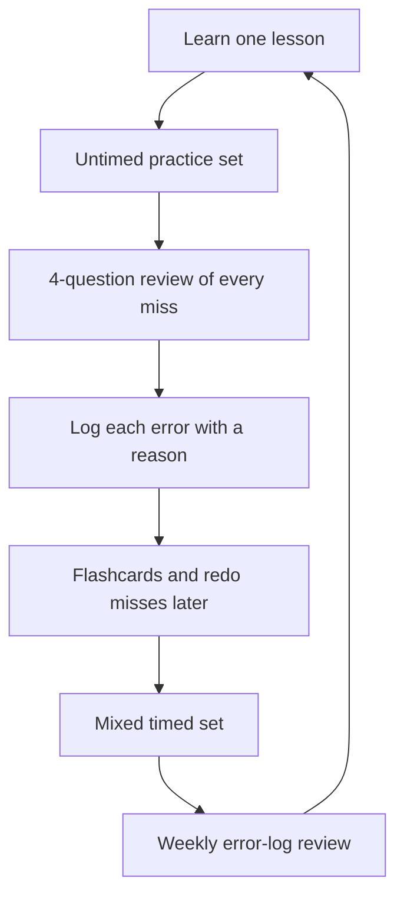

# How to Study: The System

Most people prepare for the GMAT by reading, watching and re-reading. It feels productive and it works badly. This lesson gives you the study methods that research and good coaching both support, and the habits the app is built around.

## Why re-reading doesn't work

Imagine you read a lesson on percents three times in one evening. The next day it feels familiar, and you think you know it. Then a question appears with the numbers changed, and you stall. Familiarity isn't the same as being able to do it.

Psychologists call this the illusion of knowing. You recognise the material, so you feel confident, but you haven't practised pulling it out of your own head. And pulling it out is exactly what the exam asks you to do.

So the principle behind this entire app is simple: **spend less time taking information in and more time getting it out.**

## Retrieval practice: test yourself

In a well-known 2006 study, Roediger and Karpicke had students study a passage and then either re-read it or take a recall test on it. After five minutes, the re-readers did better. But a week later the pattern flipped: the students who had practised recalling remembered about 61 percent, against about 40 percent for those who had re-read it several more times. The re-readers also felt more confident while remembering less.

The study used prose passages with university students, not GMAT problems, so applying it to maths is my inference, not the authors' claim. But decades of related work point the same way, and every serious coach agrees.

What it means for you:

- After a lesson, close it and try to write down the key ideas from memory.
- Do practice questions soon after learning, not after a week of reading.
- Use flashcards by trying to answer before flipping.
- Struggling a bit is a good sign. Easy recall teaches you less than effortful recall.

> [!REMEMBER]
> If it feels easy, you're probably not learning much. If it feels like effort, you probably are.

## Spacing: come back later

The second big finding is about timing. Cepeda and colleagues (2006) reviewed 839 assessments of distributed practice from 317 experiments. Their headline finding: spreading study over time beats cramming, and the best gap between sessions gets longer the longer you need to remember something.

In plain terms, studying a topic for one hour on Saturday and 20 minutes on each of the next three weekends will beat four hours in one go. The research again used verbal recall tasks, so the application to GMAT skills is an inference. But it's one that matches every study plan that works.

How the app uses it:

- Topics come back in later sessions, mixed with new ones.
- Flashcards reappear at growing intervals.
- Your error log gets reviewed weekly, not just once.

## The error log

If I could give you only one habit, this would be it. Your mistakes are the most personal and valuable study material you have. A log turns random mistakes into patterns you can fix.

Every time you get a question wrong, or right by luck or after a struggle, record four things in the app's error log:

1. **Topic.** For example: percent change, assumption questions, Table Analysis.
2. **Why you got it wrong.** Pick one honest reason from five.
3. **What the right approach was.** In your own words, one or two lines.
4. **The fix.** What you'll do differently next time, and what you'll practise.

The five reasons:

| Reason | What it looks like | Typical fix |
|---|---|---|
| **Concept** | You didn't know the rule or method | Re-learn the lesson, add flashcards, do easier practice on it |
| **Careless** | You knew it but slipped (sign error, arithmetic) | Slow your writing, check units and signs, add a final check step |
| **Timing** | You ran out of time or rushed | Practise pacing and the bail-out rule |
| **Misread** | You answered a different question than the one asked | Underline what's asked, restate it before solving |
| **Trap** | You fell for a tempting wrong answer | Name the trap in the log, learn its pattern |

Be honest. "Careless" is the most overused label because it's the most comfortable. If you've mislabelled three "careless" errors on the same topic, they're probably concept errors.

> [!TIP]
> Once a week, sort your log by reason. The biggest category is your priority for the coming week. If concept errors dominate, go back to the lessons. If careless errors dominate, change your workings.

## The 4-question review

Doing a practice question isn't the learning. The review is. For every question you miss, and for every correct one you guessed or found slow, ask four things:

1. **What was the question really asking?** Rewrite it in one line. This catches misreads.
2. **What's the cleanest path to the answer?** Read the explanation, and note both the fast method and the safe method.
3. **Why was my answer wrong, and why was it tempting?** This is the trap, and it will come back.
4. **What will I do next time when I see this pattern?** Turn it into a rule you can use.

Then, 24 to 48 hours later, redo the question without looking. If you can't, it goes back on your list.

> [!NOTE]
> Reviewing correct answers matters too. If you got it right but it took four minutes, or you guessed, that's a gap hiding behind a good result.

## Deliberate practice

Deliberate practice means working on the exact things you're bad at, at the edge of your ability, with feedback. It's different from doing 50 questions you already find easy.

How to do it:

- **Pick one weakness.** For example, "ratios with three parts" or "weaken questions".
- **Do a small set, around 5 to 8 questions,** at slightly above your comfort level.
- **Review each one properly** with the 4-question method.
- **Repeat** until accuracy improves, then move on.

Comfortable practice feels good. Deliberate practice feels annoying. The annoying kind is what raises scores.

## Interleaving: mix it up

When you learn a new topic, you'll practise it in a block: ten percent questions in a row. That's right for first learning. But in the real exam, the next question could be anything. If you only ever practise in blocks, you never practise the skill of recognising which method to use.

So as you progress, mix topics. A set might have a percent question, then a rate question, then an inequality. It feels harder and your accuracy will drop at first. That's normal, and it's the point.

The app handles this for you: early sessions are topic-based, and later ones get steadily more mixed.

## From untimed to timed

A common mistake is to start timing yourself on day one. Pressure before understanding just trains you to panic. Another mistake is to stay untimed forever, then discover on a mock that you can't finish. The app uses a progression.

| Stage | When | How you practise |
|---|---|---|
| 1. Learn | Foundations and early Core | Untimed. Focus on getting the method right. |
| 2. Fluent | Late Core | Loose timing. Aim for roughly the average time per question. |
| 3. Timed sets | Advanced | Strict timing in mixed sets of 7 to 10 questions. |
| 4. Full sections | Late Advanced and mocks | Complete 45-minute sections, then full mocks. |

Move from one stage to the next when you're getting about 70 to 75 percent right at the current stage. If you move too early, drop back a stage without guilt.

> [!TRAP]
> Don't "speed up" by skipping steps in your working. Speed on the GMAT comes from knowing the method, not from rushing. Rushing creates careless errors, and then you'll waste more time reviewing them.

## How flashcards work in the app

Flashcards are for facts that you need to know instantly, because looking them up in your head mid-question wastes time. Good flashcard material includes:

- Formulas and rules (percent change, divisibility tests, exponent laws, rate and work formulas).
- Squares, cubes and fraction-percent conversions.
- Question-type routines (the steps you take for an assumption question, or the DS method).
- Traps you've been caught by.

How the app runs them:

1. A card shows a prompt. You try to answer in your head, or on a scrap of paper, before you flip it.
2. You rate yourself honestly: knew it, hard, or didn't know it.
3. Cards you missed come back soon. Cards you knew come back after longer and longer gaps.
4. Your error log can create new cards. If a trap caught you twice, it becomes a card.

A good session is 10 to 15 minutes. That's an ideal Metro ride. Don't skip flashcards on busy days. They're the cheapest way to keep the habit alive.

> [!TIP]
> Keep cards short. One idea per card, in your own words. A card that needs a paragraph isn't a card; it's a lesson, and it belongs in your notes.

## A sample study week using the system

- **Monday:** new lesson, 10 untimed questions, errors logged with reasons.
- **Tuesday:** 15 minutes of flashcards, plus a redo of Monday's misses.
- **Wednesday:** next lesson, a small set, 4-question review.
- **Thursday:** mixed set from earlier topics (interleaving), error log.
- **Friday:** flashcards, light practice, early night.
- **Saturday:** long session. A timed set, then a thorough review, then weak-topic practice.
- **Sunday:** weekly error-log review, plan the week.

Here is your study loop as a cycle. Every lesson you learn goes round it.

## Quick check

1. Name the five reasons for a mistake in your error log.

Answer

Concept, careless, timing, misread, and trap.

2. You get a question right, but it took four minutes and you guessed between two options. Should you review it?

Answer

Yes. A lucky or slow correct answer is a hidden gap. Review it with the same four questions as a wrong one.

3. Why mix topics once you've learned them?

Answer

The real exam doesn't announce the topic. Mixing practises the skill of recognising which method a question needs, which block practice never trains. It feels harder, and accuracy dips at first, which is normal.

## Key takeaways

- Re-reading feels productive but doesn't build lasting memory. Retrieval, testing yourself, does.
- Spread study over time. Several short sessions beat one long cram. The research behind this used verbal tasks, so applying it to maths is a sensible inference.
- Keep an error log with four fields: topic, reason (concept, careless, timing, misread, trap), the right approach, and the fix.
- Review every miss with the 4-question method, and redo the question 24 to 48 hours later.
- Practise your weaknesses deliberately, in small sets just above your comfort level.
- Move from untimed to loosely timed to strictly timed, then full sections and mocks.
- Mix topics as you progress. It feels worse and works better.
- Flashcards hold formulas, routines and traps. Answer before you flip, and keep them short.

## Go deeper
- [Roediger and Karpicke (2006) on PubMed](https://pubmed.ncbi.nlm.nih.gov/16507066/): the original test-enhanced learning study.
- [Cepeda et al. (2006) on PubMed](https://pubmed.ncbi.nlm.nih.gov/16719566/): the review of distributed practice research.
- [GMAT Club forum](https://gmatclub.com/forum/): study plans and error-log templates shared by other test-takers.
