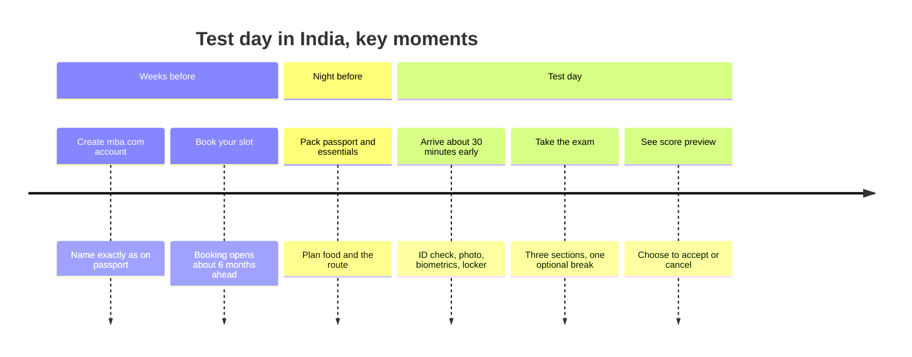

# Test Day in India: Booking to Result

This lesson walks you through the whole practical side: creating your account, choosing between a test centre and the online exam, paying, picking a Delhi NCR centre, getting your ID right, and what happens on the day. I've marked everything I couldn't verify on the official site, so please check those points on mba.com before you act. Fees and rules change, and the official page always wins.

> [!NOTE]
> GMAC's official fee and policy pages didn't load for me, so some figures below come from reputable prep-company sites. I'll tell you when that's the case. Treat those figures as "very likely, but confirm".

## Step 1: Your mba.com account

Everything starts with a free account on mba.com. You'll use it to book, reschedule, see your scores and send them to schools.

The most important rule: **your name must match your ID exactly.** The name in your mba.com profile has to match the name on the passport you'll show on the day, in spelling and in order. If your passport has a middle name, a surname or initials arranged a particular way, copy it exactly. A mismatch can mean you're turned away, and you may lose your fee.

Create the account now, even though your exam is ten months away. It's also where you'll get the free Starter Kit.

## Step 2: Test centre or online?

You can take the GMAT at a test centre (run through Pearson VUE) or online from home. Both are the same exam, with the same sections, scoring and Review & Edit. Both count the same for your Superscore.

| | Test centre | Online |
|---|---|---|
| Fee (before tax) | about US$275 | about US$300 |
| Where | Pearson VUE centre | A private room at home |
| Scratch work | Note-taking booklet or noteboard and marker | Your own erasable whiteboard and markers, shown to camera |
| Calculator (Data Insights) | On-screen | On-screen |
| Tech risk | Low, the centre handles it | Your internet, laptop and room all matter |
| Scheduling | Depends on centre availability | Offered very flexibly, often at many hours |

### Which should you choose?

I recommend the **test centre** for you, for four reasons.

1. **Fewer things can go wrong.** No internet drops, no camera glitches, no noisy neighbours, no power cuts.
2. **It's cheaper** by about US$25, before tax.
3. **Some schools prefer or require it.** ISB's FAQ says online or home-based scores aren't accepted from the April 2025 intake, according to our admissions research. Since ISB is one of your target schools, that settles it. Confirm on ISB's site before you book.
4. **Your own dedicated quiet environment.** Living at home with family or housemates, a private room for 2 h 15 min with no interruptions can be hard to guarantee.

Online makes sense if no centre is convenient, or if you've done a lot of research and have a perfect setup. Even then, check each target school's policy first.

## Step 3: Fees and GST

The listed fee is about **US$275 for a test centre exam and US$300 for online**. Several prep sites report that Indian candidates also pay **18 percent GST**, added at checkout, on top. That brings the total to roughly US$324.50 for a centre and about US$354 for online, and the charge is in US dollars. In rupees, it depends on the exchange rate and your card's charges, but expect something in the region of Rs 27,000 to Rs 31,000 for a centre exam, depending on the rate. Different sites quote different rupee numbers, so look at the checkout page for the real figure.

Always confirm the current fee, and whether GST applies, on mba.com.

> [!TIP]
> Budget for a retake in your plan, even if you never need it. A second attempt costs the full fee again, so setting aside the money keeps the decision about your score, not your wallet.

## Step 4: When to book

GMAT appointments can be booked from about six months ahead to 24 hours before. The exam is available year-round, with no fixed national test dates. Centre seats vary by location.

Our default plan: **first attempt on Saturday 28 August 2027.** Weekend slots at centres in major cities fill faster than weekdays. Prep sites suggest booking six to twelve weeks ahead in busy months. So aim to look for your 28 August slot around the end of February 2027, as soon as the six-month window opens, and choose a morning time. Early July 2027 is the latest sensible date, since that is about seven weeks ahead.

Also book your **backup attempt** (mid-October 2027) once you have a result, or at least check availability early. Keep in mind the rule: 16 calendar days between attempts.

> [!REMEMBER]
> Book as soon as your slot becomes available, then work backwards from the date. A booked date is the best motivator you can buy. Rescheduling is possible, but costs money.

## Rescheduling and cancelling

Plans change. Here's the tiered policy as reported by prep-company sites (consistent across several, but I couldn't confirm it on mba.com). The amounts are in US dollars.

| Notice before your appointment | Reschedule fee (centre / online) | Refund if you cancel (centre / online) |
|---|---|---|
| More than 60 days | $55 / $60 | $110 / $120 |
| 15 to 60 days | $110 / $120 | $80 / $90 |
| 1 to 14 days | $165 / $180 | $55 / $60 |
| Less than 24 hours | Not allowed | $0 |

GMAC's policy says appointments can't be changed within 24 hours of the start time. If you don't turn up, you lose the full fee. Changing your appointment by phone may add a charge. For genuine emergencies, such as illness, you can ask for a free reschedule or refund with documentation.

The practical rule is simple: **if you might need to move the date, decide more than 60 days ahead.**

## Delhi NCR test centres

Test centres in Delhi NCR run through Pearson VUE. Locations I found in sources, which I couldn't verify directly (please confirm on mba.com and pearsonvue.com):

- **New Delhi:** around Barakhamba Road, in the Ashoka Estate building.
- **Gurugram:** around MG Road, in Times Tower.
- **Noida:** in the Sector 16A area (one source dates this listing to 2024, so check it's still active).

When you book, you'll see the actual list. Choose by these criteria:

1. **Travel time.** Pick the one you can reach in under 45 minutes without stress.
2. **Metro access.** Delhi traffic is unpredictable. The Metro is more reliable on a Saturday morning.
3. **Parking or drop-off,** if you're coming by car.
4. **Do a trial run** a few weeks before, at the same time of day, to check the route and timing.
5. **Check what's nearby** for a quiet breakfast, and for water or snacks after.

## ID and passport rules

For Indian citizens taking the test at a centre, **the passport is the ID**. GMAC's press release in 2021 said that for the centre version, the passport remains the only acceptable ID. Other IDs, such as PAN, a driving licence, a voter ID or Aadhaar, aren't accepted at a centre, according to prep-company sources. I couldn't confirm whether this has changed, so check the current ID rules on mba.com before the exam.

Checklist:

- The passport is **original, valid and not expired.** Check the expiry date now, not in August 2027.
- The **name matches** your mba.com account exactly.
- The photo is clear and the document is in good condition. A damaged or heavily worn passport can cause trouble.
- If your name has changed since the passport was issued (marriage, for example), sort out the paperwork well in advance.

If you take the **online** exam, GMAC has previously allowed Aadhaar or a passport for ID in India. That was announced in 2021, and I couldn't confirm the current rule, so verify it on mba.com if you ever consider online.

> [!TRAP]
> Don't wait until your booking date to check your passport. Passport renewals can take weeks, and an expired one means you can't test and may lose your fee.

## If you take the online exam

I recommend a test centre, but you should know the online rules.

- **Room:** private, indoor, quiet and well lit, with a clear desk. You'll scan the room with your camera.
- **Whiteboard:** one erasable whiteboard no larger than 12 x 20 inches, with markers and an eraser. Show the blank board to the camera at the start, before the break and at the end. An on-screen whiteboard also exists.
- **Tech:** a reliable internet connection, a laptop with a working camera and microphone, and no phone hotspots or tethering. Run GMAC's system check well before the exam.
- **Check-in:** log in early. GMAC's guidance (via search results) says to be ready about 30 minutes before; one prep site says 15. Plan for 30.
- **Rules:** no phone in reach, no notes, no other people in the room, and no leaving your seat except on the break.
- **Backup plan:** if the power or internet fails, contact support straight away. Have a second connection ready if you can.

## What to bring to a test centre

Pack the night before.

| Bring | Why |
|---|---|
| Original passport | Your only ID at the centre |
| Booking confirmation (printed or on your phone) | In case of check-in questions |
| Prescription glasses, if you wear them | They'll be inspected |
| A light jacket or sweater | Centres are often cold |
| A small snack and water, for the break | You may need to leave them in a locker and fetch them during the break; confirm the rules |
| Cash or a card | For after the exam |

What not to bring: phones, smartwatches, bags, notes, headphones and food into the testing room. You'll leave these in a locker. Prep sites report that centres use fingerprint or palm-vein scans before the exam and after the break. Don't be alarmed. It's routine.

## Check-in timing

Arrive about **30 minutes early.** Check-in includes ID checks, a photo, a scan of your biometrics, a locker for your things and a short briefing. Late arrivals can be refused entry, and your fee may be forfeited. In Delhi, add a traffic buffer: leave earlier than you think you need to. If you arrive 20 minutes early, you can sit and breathe. If you arrive 5 minutes late, you may lose the exam.

Here is how test day unfolds, from booking to your score.

## Food and break plan

You can't snack during the test, so plan around it.

- **Breakfast, 2 to 3 hours before:** something you've eaten before and digests well, with protein and slow carbohydrates. Poha with peanuts, eggs and toast, or oats with fruit. Avoid anything heavy, oily or new.
- **Caffeine:** if you usually have a chai or coffee, have your usual amount. Don't have extra, and don't skip it if you rely on it.
- **Water:** sip, don't gulp. You don't want to be queuing for the loo mid-section.
- **Break snack:** a banana, a handful of nuts, a small energy bar or a dates-and-nuts snack. Quick energy without a crash.
- **Break routine:** use the toilet, drink water, stretch your neck and wrists, breathe, and return on time.

Practise exactly this plan in at least two mocks.

## After the test: your score and the big decision

When you finish, you'll see how things go next. As I understand it, test-takers see an **unofficial score preview** at the end, then decide whether to accept or cancel the score. Please confirm exactly how this works on mba.com.

Prep sources and mba.com snippets say:

- At a test centre, you can **cancel immediately** after the exam, at no charge.
- For the online exam, cancellation is possible **within 72 hours.**
- A cancelled score doesn't appear on your score reports, and it can be reinstated later for a fee (we'll cover it in the scores and retakes lesson).

Don't decide in a panic. Most people feel the exam went worse than it did, because adaptive tests are designed to feel hard. Take a breath. If the preview score meets your floor, accepting is usually right. If it's well below, think carefully about cancel versus keep, remembering the Superscore, which reduces the cost of a weaker attempt.

Your official score typically arrives in a few business days, per prep sources. After you see it, you can send it free to up to five programmes, within a limited window.

## Quick check

1. Which ID do you need at a Delhi test centre?

Answer

Your original, valid passport, with the name exactly matching your mba.com account.

2. You need to move your exam date. Which timing is cheapest?

Answer

More than 60 days before the exam. The reported reschedule fee is about US$55 for a centre exam. Closer to the date the fee climbs, and within 24 hours you can't change it at all.

3. When should you arrive at the test centre?

Answer

About 30 minutes early, with an extra buffer for Delhi traffic.

## Key takeaways

- Create your mba.com account now, with your name exactly as on your passport.
- A test centre is the safer choice for you, and ISB's policy reportedly doesn't accept online scores from April 2025 (confirm on ISB's site).
- Fees are about US$275 (centre) or US$300 (online), plus 18 percent GST for India according to prep sources. Confirm on mba.com.
- Book early, as soon as your date is bookable, and decide any rescheduling more than 60 days ahead.
- Delhi NCR centres run through Pearson VUE, so verify locations and do a trial run.
- Your passport is your ID at a centre. Check its expiry date now.
- Arrive about 30 minutes early, eat a familiar breakfast, and rehearse your break.
- After the exam, check the accept-or-cancel rules, and don't decide in a panic.

## Go deeper
- [GMAT exam on mba.com](https://www.mba.com/exams/gmat-exam): official booking, fees and policies.
- [GMAC](https://www.gmac.com/): official announcements.
- [Pearson VUE](https://www.pearsonvue.com/): test centre information and locations.
- [GMAT Club forum](https://gmatclub.com/forum/): recent test-day reports from India.
