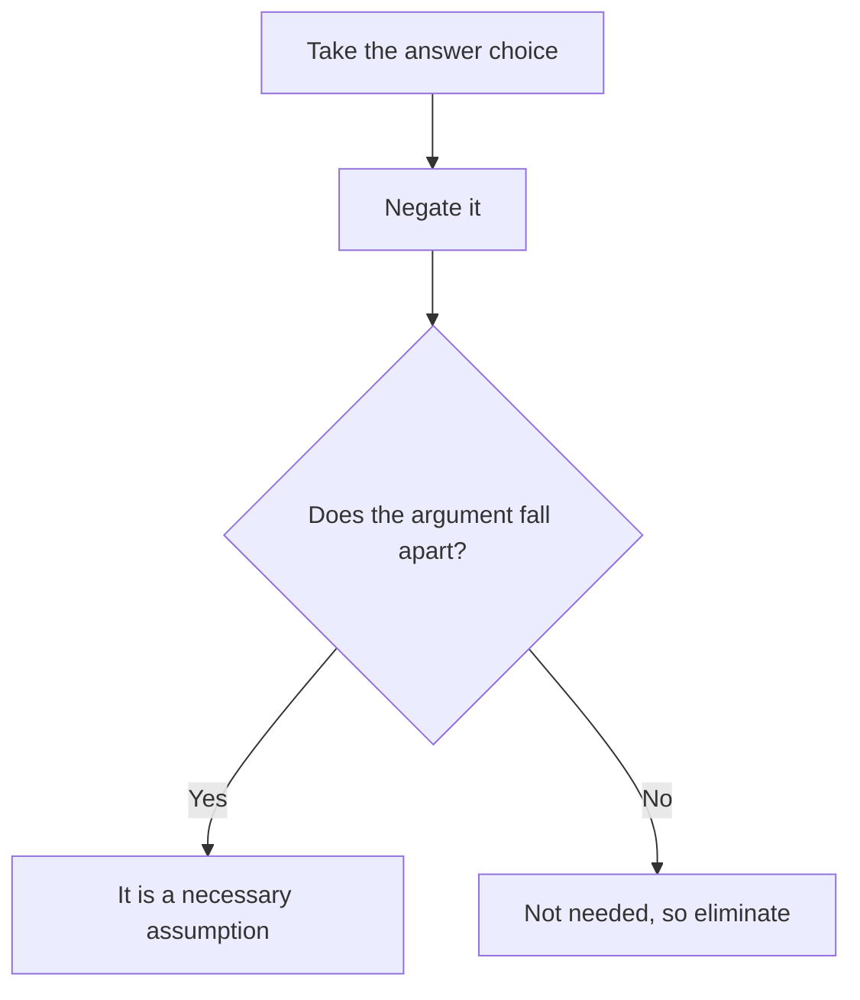

# Assumption Questions

Assumption questions are the backbone of Critical Reasoning. They show up often on their own, and the skill behind them (spotting the unstated bridge) is the same one you use for strengthen, weaken, flaw and evaluate questions. Master this lesson and you've learned a third of CR.

## What an assumption is

An assumption is an unstated premise the argument **needs** in order to work. The author doesn't say it, but if it were false, the argument would fall apart.

Picture a rope bridge between two cliffs. The evidence stands on the left cliff, the conclusion on the right. The assumption is the plank in the middle that the author forgot to mention. Your job is to find the plank.

Typical stems:

- "The argument above depends on which of the following assumptions?"
- "Which of the following is an assumption on which the argument relies?"
- "The conclusion above is properly drawn if which of the following is assumed?" (careful: this one can be a *sufficient* assumption, see below)

## Necessary vs. sufficient assumptions

Two different animals, and the GMAT overwhelmingly asks for the first.

- A **necessary** assumption is something the argument *must* have. Without it, the argument collapses. It might be weak or modest ("at least some of the customers are repeat buyers").
- A **sufficient** assumption is something that, if added, *guarantees* the conclusion. It can be strong, even extreme.

For "depends on", "relies on", "requires", "assumes", pick the **necessary** one. If the stem says "if which of the following is assumed, the conclusion follows logically", a strong answer that closes the gap fully is what you want, but this phrasing is rare on the GMAT Focus.

> [!REMEMBER]
> Necessary assumptions are usually modest and hedged ("not", "at least some", "is likely", "most"). Extreme words ("all", "only", "never", "always") are usually wrong on a necessary assumption question.

## The Negation Test

This is your safety net, and you should use it on every close call.

**Negate the answer choice. If the argument then falls apart, the original choice is a necessary assumption.** If the argument still works after negation, the choice isn't necessary.

Use the Negation Test like this on any close call.

How to negate cleanly:

| Original | Negation |
|---|---|
| "Every customer received the survey." | "Not every customer received the survey." (some didn't) |
| "The new road will not increase pollution." | "The new road will increase pollution." |
| "Most employees prefer remote work." | "Half or fewer of the employees prefer remote work." (not most) |
| "Competitors will not cut prices." | "Competitors will cut prices." |
| "The 2024 results were not caused by weather." | "The 2024 results were caused (at least partly) by weather." |
| "Some of the recruits are experienced." | "None of the recruits are experienced." |

> [!TRAP]
> Don't negate by simply flipping to the opposite extreme. The negation of "all" is "not all" (some don't), not "none". The negation of "most" is "half or fewer", not "none".

### Worked example 1 (Easy)

"Surveys show that people who eat breakfast every day score higher on concentration tests than people who skip breakfast. A school principal concludes that making breakfast available at school will improve students' concentration.

The principal's argument assumes which of the following?"

(A) Students who skip breakfast do so because they cannot afford it.
(B) Eating breakfast is part of what improves concentration, rather than concentration and breakfast habits both coming from some other trait.
(C) Concentration tests are the best measure of academic performance.
(D) Most students currently skip breakfast.
(E) Breakfast eaten at school is healthier than breakfast eaten at home.

Show solution

Prephrase: this is correlation to cause to plan. The author needs "breakfast actually causes better concentration".

(B) says exactly that. Negation test: "Eating breakfast is NOT part of what improves concentration; some other trait explains both." Then providing breakfast does nothing, and the argument falls apart. Necessary, so correct.

(A) is a reason people skip, but the argument works whatever the reason. (C) widens to "academic performance", which is out of scope. (D) isn't required (even if few skip breakfast, the plan could still help them). (E) is a comparison the argument never makes.

Trap: (A) feels relevant because the plan is about providing food, but the argument doesn't need to know *why* students skip.

## Common assumption patterns

Most necessary assumptions fall into a handful of buckets. Learn to expect them.

**1. No alternative cause (causal arguments).** If the author says A caused B, the author assumes nothing else caused B, and that B didn't cause A.

**2. Representative sample.** If the author generalises from a sample, the sample is assumed to be representative of the whole group.

**3. The plan will work.** If the author recommends a plan, the author assumes the plan can be carried out, has no major side effects, and that the goal isn't achievable more simply (or is not already achieved).

**4. The comparison is valid.** If the author compares X and Y, the author assumes they're similar in the ways that matter.

**5. Terms match.** If premise and conclusion use different words ("popular" vs "profitable"), the author assumes a link between them.

**6. Elimination of the alternatives.** If the author says "there are only two options, and A is bad, so choose B", the author assumes no third option exists.

### Worked example 2 (Medium)

"Bhavna's Bakery plans to replace its plastic packaging with compostable packaging. The owner argues that this will raise customer loyalty, because a recent survey of the bakery's current customers found that 78 percent said they care about environmental sustainability.

Which of the following is an assumption on which the owner's argument depends?"

(A) Compostable packaging costs no more than plastic packaging.
(B) Customers who say they care about sustainability would, in practice, respond to the change by being more loyal.
(C) Every bakery customer was included in the survey.
(D) Few other bakeries have switched to compostable packaging.
(E) Customers who do not care about sustainability will be annoyed by the change.

Show solution

Conclusion: the packaging switch will raise loyalty. Evidence: customers *say* they care about sustainability. Gap: saying versus acting. (B) bridges it.

Negation of (B): customers who say they care would NOT become more loyal. Then the whole argument is empty. Correct.

(A) concerns cost, a different issue from loyalty. Negating it ("it costs more") doesn't stop loyalty from rising. (C) is too strong ("every") and a survey need not cover everyone. (D) is irrelevant to whether the switch helps. (E) is about a different group; negating it ("they won't be annoyed") leaves the argument untouched.

Trap: (C) because "representative sample" is a familiar assumption. But the argument needs the sample to be representative, not exhaustive. "Every" overshoots.

## Answer-choice traps

Wrong choices on assumption questions tend to follow predictable patterns:

- **Out of scope:** introduces a new idea the argument never touched.
- **Too extreme:** "all", "never", "only", "completely".
- **Restates a premise:** it's already in the stimulus, so it isn't *un*stated.
- **Wrong direction:** reverses the needed link.
- **Strengthener, not assumption:** it would *help* the argument but isn't *needed* for it. Use the negation test: if the argument survives negation, it's a mere helper.
- **Irrelevant comparison:** compares two things the argument never compared.

> [!TIP]
> A correct assumption often sounds boring and slightly obvious, such as "the survey respondents are not unusual in ways that matter". The wrong answers are the exciting ones.

### Worked example 3 (Medium-Hard)

"Tarun Motors is launching an electric scooter and plans to sell it only through its existing 300 dealerships. The company argues that this is the quickest way to reach 50,000 annual sales, since its dealerships already sell 40,000 petrol scooters a year to customers within easy reach of the showrooms.

The company's plan assumes which of the following?"

(A) At least some of the customers who buy petrol scooters from Tarun Motors would be willing to buy an electric model.
(B) No other manufacturer sells electric scooters through dealerships.
(C) Online sales would lower the average price of the electric scooter.
(D) The dealerships' staff are currently enthusiastic about electric vehicles.
(E) All of the 50,000 buyers will be existing Tarun Motors customers.

Show solution

The argument: dealers sell 40,000 petrol scooters, so selling through dealers is the quickest way to reach 50,000 electric ones. The author needs the dealer base to be a source of electric buyers.

(A) is the bridge: the dealer's existing customer pool must produce electric buyers. Negation: "None of the existing customers would buy an electric model." Then the dealer base doesn't help reach 50,000, and the plan collapses.

(B) is extreme and unnecessary. (C) brings in online channels, not mentioned. (D) is helpful to success but not necessary (the plan could still work with indifferent staff). (E) is too extreme ("all"); new customers could also walk into dealerships.

Trap: (E), because it sounds like a rephrasing of "existing dealerships reach existing customers". The word "All" is the giveaway.

### Worked example 4 (Hard)

"A city's transport department wants to reduce road deaths. Analysis of the last five years shows that 60 percent of fatal accidents occurred on stretches of road where the speed limit was at least 80 km/h. The department therefore proposes to lower the limit to 60 km/h on all such stretches, concluding that the number of fatal accidents will fall.

Which of the following is an assumption required by the department's argument?"

(A) Drivers will, on the whole, comply with the lower limit.
(B) The 80 km/h stretches carry more traffic than the other stretches.
(C) Lowering the speed limit has reduced fatalities in every city that has tried it.
(D) A majority of fatal accidents are caused by speeding.
(E) No fatal accidents occur at speeds below 60 km/h.

Show solution

Plan to outcome argument. Plans need: they're actually carried out, they work as intended, and no offsetting side effects.

(A) is necessary. Negation: "Drivers will, on the whole, NOT comply with the lower limit." Then lowering the posted limit changes nothing and fatalities won't fall. Correct.

(B) would explain *why* 60 percent of fatalities happen there, but the argument doesn't need it (a stretch could be dangerous because of design, not traffic). Negation leaves the plan intact. (C) is "every city", far too strong. (D) is tempting, but the plan can work even if speeding causes only a minority of the deaths (lower speed also reduces the severity of crashes). Negate: "A majority are not caused by speeding" and the plan can still help. (E) is extreme and absurd.

Trap: (D). It feels like the central link, but the argument needs only that the lowered limit reduces fatalities, not that speeding is the main cause.

## Quick check

1. Negate: "None of the survey respondents had previously used the product."

Answer

"At least one respondent had previously used the product." Not "all had used it".

2. An author says "Sales rose after we hired a new head of marketing, so she deserves the credit." Name two assumptions.

Answer

(1) Nothing else (a new product, a seasonal effect, a competitor's problems) caused the rise. (2) The sales did not rise anyway, and she had the relevant influence on sales.

3. Why is "Customers will like the new design" unlikely to be the correct choice if the argument is "Because the design is cheaper to make, profits will rise"?

Answer

Because it is out of scope: the argument is about cost and profit, not taste. A better assumption is that cheaper manufacturing won't cause a drop in sales that outweighs the savings.

## Key takeaways
- An assumption is an unstated premise the argument needs; it sits in the gap between evidence and conclusion.
- On "depends on / relies on" stems, you want a necessary assumption, which is usually modest in tone.
- The Negation Test: negate the choice; if the argument collapses, the choice is necessary.
- Negate carefully: "all" becomes "not all", "most" becomes "half or fewer".
- Expect patterns: no alternative cause, representative sample, plan will work, comparison valid, terms match.
- Beware extreme words, out-of-scope ideas, restated premises and mere "helpers" that aren't required.
- Prephrase the gap before reading the choices.

## Go deeper
- [GMAT official site](https://www.mba.com/exams/gmat-exam) - official overview of the Verbal Reasoning section.
- [GMAT Club forums](https://gmatclub.com/forum/) - peer explanations of assumption questions (search for "CR assumption" after you've tried ours).
