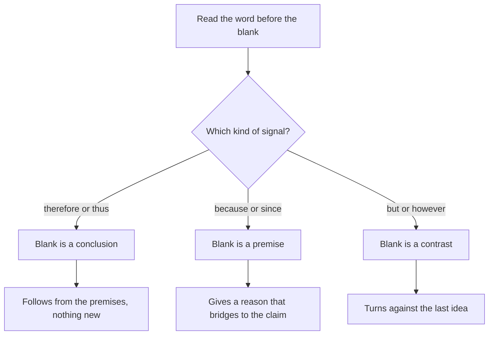

# Complete the Argument

In a complete-the-argument question, the last sentence of the stimulus is unfinished, and you pick the choice that fills the blank. They're less common than other CR types, but they're a gift: the blank tells you exactly what job the missing words must do.

## What the question looks like

The stimulus ends with something like "Therefore, __________." or "...because __________." The stem asks: "Which of the following most logically completes the argument?" or "Which of the following most logically completes the passage?"

There's no new skill to learn here, only a smart use of skills you already have. A blank is simply a missing piece of an argument, and the piece is either a **conclusion** or a **premise**. Your first task is to decide which.

## Step 1: Read the signal word just before the blank

The words right before "__________" tell you what the blank must be:

| Signal before the blank | The blank is a... | What it must do |
|---|---|---|
| therefore, thus, so, hence, consequently, it follows that | **Conclusion** | Follow from everything stated before |
| because, since, for, given that, after all | **Premise** | Supply a reason that supports the preceding claim |
| but, however, yet | **Counter-point or turn** | Introduce a contrast to the previous idea |
| for example, for instance | **Example** | Illustrate the previous claim |
| (no signal, "Thus the managers should ___") | Usually a **recommendation** | Follow from the data |

The signal word before the blank tells you what to write.

> [!REMEMBER]
> "Therefore ___" means the blank is a conclusion. "Because ___" means the blank is a supporting premise. Decide which one it is before you read any choice.

## Step 2: Predict, then match

### When the blank is a conclusion

Summarise what the argument has established, and ask: "What is the natural next step?" The right answer is usually a claim that:

- follows from the premises, with no new information added;
- may say the same thing in different words, or draw the obvious implication;
- is neither stronger nor broader than the premises allow.

Wrong choices for conclusion blanks are often too strong ("will always", "never"), go beyond the scope (talk about a group the premises don't mention), or contradict a premise.

### When the blank is a premise ("because ___")

Look at the claim before the blank and ask: "What fact, if true, would make this claim believable?" The answer is a supporting reason. Typically it either:

- supplies the missing link between two ideas the argument has already introduced, or
- answers an obvious objection raised earlier.

Wrong choices often restate the claim itself (circular), support the opposite claim, or are true-sounding facts that don't connect to the argument.

> [!TIP]
> In "because ___" blanks, the correct choice often contains a term from the claim and a term from the evidence earlier in the paragraph. It acts as a bridge. If a choice has only one side, it can't bridge.

## Step 3: The final check

Slot your chosen answer into the blank and read the last two sentences together. Ask: "Does this sound like what a careful writer would say next?" If the choice makes the argument sound strange, bring in new topics, or just repeat what's been said, it's wrong.

## The common traps

- **Too strong.** The premises say "most", the choice says "all".
- **Scope shift.** The argument is about city A; the choice makes a claim about all cities.
- **Reverse relationship.** The premises say A rises with B; the choice says A falls with B.
- **Merely true.** The choice is a fact that would be fine in the passage but has nothing to do with the logical hole the blank must fill.
- **Repeats a premise.** A conclusion needs to go somewhere new, so a choice that only repeats the premises doesn't complete anything (unless the blank is a premise restated in other words, which is rare).

> [!TRAP]
> If the argument ends with "Therefore, the company's best option is to ___", the blank is a recommendation and must be consistent with all the evidence. A choice that sounds sensible in the real world but isn't supported by what's in the stimulus is wrong. Use only what the passage gives you.

### Worked example 1 (Easy)

Most commuters in the city now travel by metro rather than by bus. Last year the municipal bus company's ridership fell by 12 percent, while metro ridership rose by 20 percent. The bus company's income depends entirely on fares. Therefore, __________.

Which of the following most logically completes the argument?

A. the bus company's fare income probably fell last year
B. metro fares are too high
C. buses will soon be withdrawn entirely
D. the metro has more stations than there are bus stops
E. fewer people are commuting than before

Show solution

"Therefore" means the blank is the conclusion. The premises: bus ridership fell, and the company's income comes entirely from fares. The natural conclusion: its income probably fell. **A**.

B: the premises say nothing about metro fares. C: far too strong; falling 12 percent is not the end. D: about station counts, which are irrelevant. E: ridership moved from one mode to another, and total commuting isn't stated.

Trap: E. It reads like a summary of "ridership fell", but half the movement went to the metro.

### Worked example 2 (Medium)

A grocery chain notices that its new self-checkout counters are used by far fewer customers during evening hours than at midday, even though total customer numbers are about the same in both periods. The chain's managers believe the counters are poorly understood by customers. However, during the evening, the number of staff-run counters open is much higher than at midday. It is therefore likely that customers use self-checkout less in the evening because __________.

A. the evening is the busiest part of the day
B. self-checkout machines are harder to operate after dark
C. when staffed counters are readily available, customers prefer them
D. the chain has more customers who are over sixty in the evening
E. managers disagree on the cause

Show solution

The blank follows "because", so it's a premise that explains the evening drop. The passage hands us the contrast: more staffed counters open in the evening. The bridge: when staffed counters are available, people choose them. **C**.

A: the passage says total customers are about equal, so evening isn't busier. B: invents a factor not in the passage and not tied to the staffed counters. D: age is not mentioned. E: managers' disagreement isn't a reason customers behave differently.

Trap: B. It "explains" the drop but with a made-up factor. Use the fact the stimulus gave: the number of staffed counters.

### Worked example 3 (Hard)

Researchers compared two methods of teaching vocabulary to adult learners. In the first, learners saw each new word with its definition and example sentences. In the second, learners saw only an example sentence and had to infer the meaning. After a week, learners in the second group recalled significantly more words. The researchers note that the second method required learners to spend more time on each word and to make a guess that could be wrong. They conclude that what mattered was not the amount of exposure to the words but __________.

Which of the following most logically completes the passage?

A. how much effort learners put into working out each word's meaning
B. how many example sentences were shown
C. the age of the learners
D. whether the definitions were accurate
E. whether the learners enjoyed the lesson

Show solution

The passage sets up a contrast: "not the amount of exposure but ___". Exposure is the thing ruled out. The second method differed by requiring inference: more effort, with a risk of being wrong. The blank must name that factor. **A**.

B: example sentences are exposure, the very thing being set aside. C: age isn't compared. D: accuracy of definitions applies only to the first method, and the study doesn't discuss definition errors. E: enjoyment isn't mentioned.

Faster way: the structure "not X but ___" tells you the blank is the alternative to X, and the passage's last sentences tell you what that is.

Trap: B. It sounds like a "design detail" of the second method, but it falls on the exposure side.

### Worked example 4 (Hard)

A city plans to charge drivers a fee to enter its centre, expecting that the charge will cut traffic. Supporters point to another city where traffic fell 20 percent after a similar charge. Opponents reply that the other city had an unusually good public transport system already in place, whereas this city's system is patchy and slow. Without a reliable alternative, drivers will pay the fee rather than leave their cars. Therefore, the fee is likely to raise revenue without reducing traffic as much as in the other city, unless __________.

Which of the following most logically completes the argument?

A. the city's government first improves public transport
B. the other city had a higher fee
C. the fee is paid mostly by tourists
D. traffic in the other city began to rise again
E. the fee exceeds drivers' fuel costs

Show solution

The blank follows "unless", so it must name the condition that would remove the opponents' concern. Their concern is the lack of a reliable alternative. The fix: provide one. **A**.

B: a higher fee in the other city might explain the other city's result but doesn't give this city a path to reduce traffic. C: tourists paying doesn't remove the lack of alternatives for locals. D: later rises in the other city don't change this city's outlook. E: a fee that exceeds fuel costs doesn't address the lack of alternatives; drivers might still pay it.

Trap: E. Making driving costlier sounds like it would cut traffic, but the argument explicitly says drivers will pay when there's no alternative.

## Quick check

1. "The company's new software doubled the speed of order processing. Order volume stayed the same. Therefore, __________." Give a good completion.

Answer

Something like "the time staff spend processing orders has likely fallen" or "staff have spare capacity". It needs to follow from both premises without adding new facts.

2. You see "...because __________." What kind of sentence are you looking for?

Answer

A premise: a reason that supports the claim just before the blank.

3. Why is "all", "always", or "never" a warning sign in a conclusion blank?

Answer

Premises on the GMAT are typically limited ("most", "some", "in this study"). A conclusion stronger than its premises goes beyond what they allow.

## Key takeaways

- A blank is either a conclusion or a premise. Decide which by reading the signal word before it.
- "Therefore ___" asks what follows; "because ___" asks what supports.
- Predict the content in your own words before reading the choices.
- Conclusions should follow from the premises with no extra assumptions and no extra strength.
- Premise blanks should bridge the claim and the evidence in the passage.
- Beware choices that are true in real life but not supported in the passage.
- "Not X but ___" and "unless ___" give you structure: find what the passage contrasts with X, or what would remove the stated problem.
- Slot your answer in and re-read. If it sounds odd, it probably is wrong.

## Go deeper
- [GMAT Club forums](https://gmatclub.com/forum/) — Critical Reasoning section for practice with fill-in-the-blank style questions.
- [Official GMAT exam site](https://www.mba.com/exams/gmat-exam) — official overview of Verbal question types.
