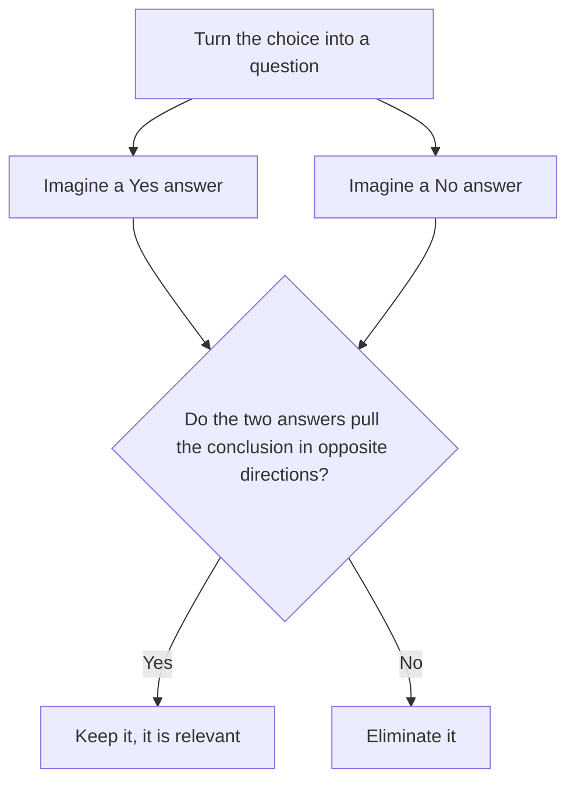

# Evaluate the Argument

Evaluate questions ask you to pick the question whose answer would tell you the most about whether an argument holds up. They look strange the first time, because the choices are questions, not statements. Once you know the one trick behind them, they become some of the most mechanical Critical Reasoning questions on the GMAT Focus.

## What the question is really asking

A typical stem reads: "Which of the following would be most useful to know in order to evaluate the argument above?" The choices are all questions: "Did the other stores also raise prices?" or "How many customers returned within a month?"

Here's the idea. Every argument rests on an assumption, a hidden bridge between the evidence and the conclusion. An evaluate question asks: which question, once answered, would tell us whether that bridge is sturdy or broken?

Think of it as a fact-check. A journalist reads a claim and asks, "What single thing would I want to check?" The right answer is the thing that, depending on what you find, would make the conclusion more believable or less believable.

## The Variance Test (two-answer test)

This is the whole method. Take the question in the answer choice and imagine two possible answers: yes and no (or high and low, or "most" and "few").

- If "yes" would **strengthen** the argument and "no" would **weaken** it (or the other way round), the choice is correct. The answer moves the conclusion in opposite directions.
- If both answers leave the argument where it was, the choice is wrong, however interesting it sounds.
- If only one answer matters and the other does nothing, the choice is weak. Keep looking.

The Variance Test runs on every answer choice like this.

> [!REMEMBER]
> Correct evaluate answer = the two possible answers push the conclusion in **opposite directions**. If both answers lead to the same conclusion, or to no change, it's wrong.

Let's run it on a quick example. A café chain argues: "Since we added oat milk, our sales rose 12%, so oat milk made us more popular."

Choice: "Did sales rise at café chains that didn't add oat milk?" If yes (they rose too), then oat milk probably isn't the cause, and the argument weakens. If no (they stayed flat), the argument gets stronger. The two answers pull in opposite directions, so this choice passes the test.

Choice: "Is oat milk more expensive than dairy milk?" Whether yes or no, you still don't know why sales rose. Both answers leave the argument where it was. Fail.

## Step by step

1. **Find the conclusion** and the evidence. Mark the gap between them.
2. **Name the gap** in your own words before reading the choices: "The author assumes nothing else caused the change," or "The author assumes the survey group represents everyone."
3. **Read each choice as a question** and run the variance test. Say the two answers out loud (in your head) and ask what each does to the conclusion.
4. **Pick the choice where the answers diverge**, and where the divergence is about the gap you named.

> [!TIP]
> You don't have to predict the exact answer. Predicting the *gap* is enough. The right choice will be a question about that gap.

## Common evaluate patterns

Most evaluate questions are one of these four, wearing different clothes.

| Pattern | The author concludes... | The useful question is about... |
|---|---|---|
| Causal | A caused B | Did B happen without A? Did A happen without B? Could something else (C) explain both? |
| Sample / survey | Everyone is like our sample | Is the sample representative? How were people chosen? Did non-responders differ? |
| Comparison / analogy | X will work here because it worked there | Are the two situations alike in the way that matters? |
| Plan / prediction | This plan will achieve the goal | Does the plan work in practice? Are there obstacles or side effects? Is the goal measured fairly? |

### Causal arguments

For "A caused B," the best questions check three things: is there a **control group** (B without A), is there a **reverse** possibility (B caused A), and is there a **third factor** (C caused both). A choice such as "Did the regions that did not adopt the policy see similar changes?" is a classic.

### Sampling arguments

A survey of 400 customers who answered an online poll tells you about people who answer online polls. The useful questions ask about **how** the sample was drawn and whether it differs from the wider group: "Were the respondents chosen at random?" or "Did customers who didn't reply have the same views?"

### Analogy arguments

"The scheme cut crime in Brazil, so it will cut crime in Poland." The useful question is whether the two places are alike in the factors that made the scheme work. Notice that you want a question about similarity or difference, not about the scheme in a vacuum.

## The big trap: interesting but irrelevant

The wrong choices in evaluate questions are rarely silly. They are *interesting*. They ask about something related to the topic, something a curious person would want to know. But "I'd like to know that" is not the same as "knowing that would change my mind about this argument."

> [!TRAP]
> A choice can be perfectly sensible and still fail the variance test. Before you pick it, ask: "If the answer were yes, what would I conclude? If no, what would I conclude?" If the answer is "the same thing both times," it's out.

The usual flavours of irrelevant choices:

- **Wrong scope.** It asks about a group, time or place the argument isn't about.
- **Asks about the evidence, not the link.** It questions a fact the author already told you (taking the premise as given is part of the game).
- **One-sided.** Only one answer would matter. For example, "Did the company spend more than ₹10 lakh on advertising?" might matter if yes but say nothing if no. Prefer the choice where both answers do real work.
- **Wrong comparison.** It compares two things that are not what the argument compares.

## Strengthen and weaken in one question

Because evaluate questions test both directions at once, they're built on the same logic as strengthen and weaken questions. If you're comfortable with those, you already own this skill. The only twist is that you must hold two scenarios in mind rather than one.

> [!NOTE]
> Some evaluate stems say "to evaluate the plan" or "to decide whether the claim is true." Same method. Ask which question's answer would tell you whether the plan is likely to work.

### Worked example 1 (Easy)

A regional newspaper reports: "Last year the town of Ranigarh introduced a ban on plastic bags. This year the amount of litter collected from its streets fell by 20%. The ban evidently reduced litter."

Which of the following would be most useful to know in order to evaluate the argument?

(A) Whether the ban also covers paper bags
(B) Whether litter collected from streets fell in comparable towns that had no ban
(C) Whether residents approve of the ban
(D) Whether plastic bags are cheaper to make than paper bags
(E) Whether Ranigarh has more streets than the neighbouring town

Show solution

The conclusion is causal: the ban reduced litter. The gap is "something else may have reduced litter." The most useful question checks whether litter fell without the ban.

(B): if litter also fell by about 20% in comparable towns without a ban, the ban is probably not the cause (weakens). If it didn't fall elsewhere, the ban looks effective (strengthens). Opposite directions, so B is correct.

(A), (C), (D) and (E) are about the ban's design, popularity, cost or the town's size. None of the answers, yes or no, tells us whether the ban caused the drop.

Faster way: for any causal argument, look for the choice that asks about a comparison group.

Trap: (C) is tempting because popularity sounds relevant, but people can like a ban that does nothing.

### Worked example 2 (Medium)

A software firm's manager says: "We surveyed our 200 most active users, and 85% said they would pay for a premium version. So a premium version will bring in strong revenue from our whole user base."

Which would be most useful to know in evaluating the manager's reasoning?

(A) Whether the premium version would include features the active users asked for
(B) Whether the firm's less active users are as willing to pay as its most active users
(C) Whether competitors offer premium versions
(D) How long the survey took to complete
(E) Whether the firm's active users are mostly in one country

Show solution

The conclusion extends from the *most active* users to the *whole* user base. The gap is representativeness. The useful question compares the other users to the surveyed ones.

(B): if less active users are equally willing, the conclusion is supported; if far less willing, it is weakened. Opposite directions.

(A) would be useful for designing the product, but it doesn't test the leap to the whole user base. (C) is about the market, not the survey's reach. (D) is irrelevant. (E) is partly relevant, but only if you know where the other users live, and the choice doesn't compare the two groups. It fails the two-answer test as stated.

Trap: (A) feels like a smart business question. It is smart, but it doesn't evaluate the argument as written.

### Worked example 3 (Hard)

A city's transport department argues: "Cycle lanes on Marine Road were painted red last year. In the following twelve months, cyclist injuries on Marine Road fell from 40 to 28. Therefore, painting the lanes red made the road safer for cyclists."

Which of the following would be most useful to know in evaluating the argument?

(A) Whether the number of cyclists using Marine Road changed substantially over the twelve months
(B) Whether red paint is more expensive than other colours
(C) Whether cyclists prefer red lanes to green ones
(D) Whether motorists on Marine Road approve of the red lanes
(E) Whether the department painted lanes on any other road

Show solution

The department compares injury *counts*, but safety depends on injuries per cyclist. The gap is the hidden change in the number of cyclists, besides the colour itself.

(A): if cyclist numbers fell sharply, fewer injuries may just reflect fewer riders (weakens). If numbers held steady or rose, the drop is more impressive (strengthens). Opposite directions.

(B) and (C) concern cost and preference, not safety outcomes. (D) is about motorists' opinions, which says nothing about cyclist injuries. (E) asks about painting elsewhere, which doesn't tell us what happened on Marine Road.

Trap: (E) sounds like a comparison-group question, but it only asks whether painting happened elsewhere, not what happened to injuries there or here.

### Worked example 4 (Hard)

An investor claims: "Companies that publish an annual sustainability report outperform those that don't. Of the 50 companies in our fund, the 20 that publish a sustainability report grew profits 9% on average, while the other 30 grew profits 4%. If we invest only in companies that publish such reports, we will earn higher returns."

Which would be most useful to know to evaluate the investor's plan?

(A) Whether companies began publishing sustainability reports before or after their profits began to rise
(B) Whether the 20 reporting companies are larger than the 30 others
(C) Whether sustainability reports are audited
(D) Whether investors in other funds follow the same strategy
(E) Whether the 9% average is skewed by one very successful company

Show solution

The plan assumes publishing reports leads to (or at least signals) higher future profit. The sharpest gap is direction of cause: perhaps already-profitable companies can afford to publish reports.

(A): if reports came first, the plan gains support. If profits rose first, publishing is a result of success and the plan is weakened, because choosing reporters now would not buy you future growth. Opposite directions on the plan's core assumption.

(B) is partly attractive (size could explain both reporting and growth), but the choice doesn't state which direction size would push, and a yes or no on its own does not clearly decide. (C) and (D) are off the point. (E) asks about skew in the data, which is a fair check, but it concerns the past average rather than whether reporting will predict future returns.

Trap: (E) sounds statistically sharp. A skewed average would weaken the evidence, but a non-skewed one wouldn't establish the causal direction, so it's the weaker, one-sided choice.

## Quick check

1. In an evaluate question, what do you do with each answer choice?

Answer

Imagine the two possible answers (yes/no) and check whether they push the conclusion in opposite directions. If they do, and the question is about the argument's key gap, it is correct.

2. An argument concludes that a new training programme raised sales, because sales rose after it began. Which question is better: "Did sales also rise in teams that did not take the programme?" or "Do employees enjoy the programme?"

Answer

The first. A yes would weaken the causal claim and a no would strengthen it. Enjoyment does not decide whether sales rose because of the programme.

3. Why is "How much did the survey cost?" almost never the right choice?

Answer

Cost doesn't change what the results say or how far they can be generalised. Both answers leave the argument unchanged.

## Key takeaways

- An evaluate question asks which question's answer would tell you whether the argument holds.
- The Variance Test: the two possible answers should push the conclusion in opposite directions.
- Name the gap (cause, sample, analogy, plan) before you read the choices.
- Correct choices usually ask about a comparison group, a representative sample, a similarity, or an obstacle.
- Interesting but irrelevant choices fail the test because both answers leave the conclusion alone.
- Don't evaluate the premises. The facts you're given are accepted; test the link to the conclusion.
- One-sided questions (only one answer matters) lose to two-sided ones.

## Go deeper

- [GMAT Focus Edition overview](https://www.mba.com/exams/gmat-exam) — official description of the Verbal section and question types.
- [GMAT Club forum](https://gmatclub.com/forum/) — community discussions of Critical Reasoning strategies.
