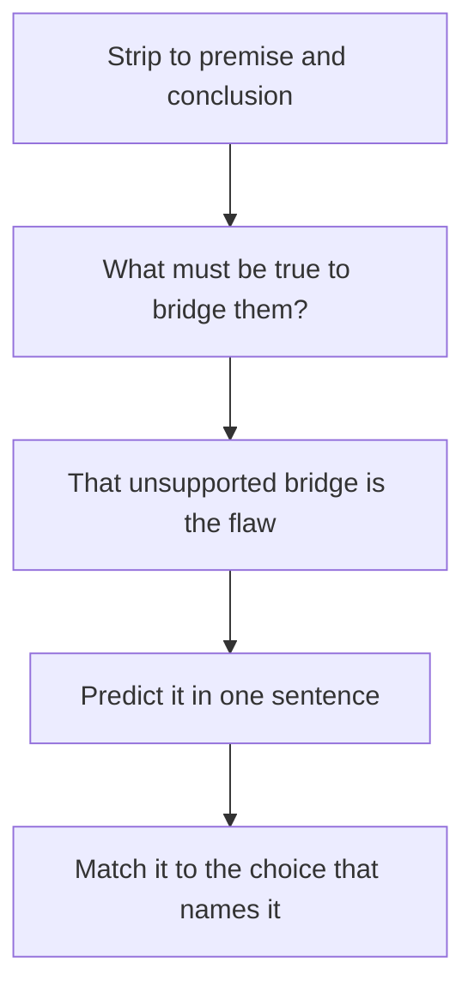

# Flaw Questions

A flaw question asks, in effect, "where does this argument go wrong?" It's one of the most common Critical Reasoning types on the GMAT Focus, and the good news is that the exam keeps returning to the same dozen or so errors, dressed up in different stories.

## What you're being asked

The stem usually reads: "The reasoning in the argument is most vulnerable to criticism on the grounds that it..." or "Which of the following describes a flaw in the argument?" Every flaw answer starts with a verb that describes what the author did wrong. The most common are:

- "**fails to consider** the possibility that..."
- "**takes for granted** that..."
- "**overlooks** the fact that..."
- "**confuses** X with Y"
- "**treats** a necessary condition as if it were sufficient"
- "**draws a conclusion about** the whole from evidence about a part"

Maria, if you only memorise one thing from this lesson, memorise this: the flaw is almost always **a gap between the evidence and the conclusion**. The author jumps across the gap without noticing it. Your job is to see the gap and to find the choice that names it.

## The method

1. **Find the conclusion and the premises.** Strip the argument to "Premise, therefore Conclusion."
2. **Ask: what has to be true for the premise to guarantee the conclusion?** That's the assumption. The flaw is that the author assumes it without support.
3. **Predict the flaw in a sentence** in your own words: "The author assumes that A is the only possible cause."
4. **Match the prediction to the choices.** The correct choice describes the flaw in abstract language; the wrong choices describe errors the author did *not* make.

How to find the flaw in four moves.

> [!TIP]
> A flaw choice that mentions something the author never did ("relies on the testimony of an interested party", "uses an ambiguous term") is wrong unless you can point to the exact words. Always check the choice against the text.

## The flaw catalogue

### 1. Correlation versus causation

Two things happen together, and the author concludes that one causes the other. Alternatives: the arrow runs the other way (reverse causation), a third factor causes both, or it's coincidence.

"Employees who take the company's optional wellness workshops have lower absenteeism. Therefore, the workshops reduce absenteeism." Perhaps healthier, more motivated employees are the ones who sign up.

The flaw choice: "fails to consider that employees who were already less likely to be absent may have been the ones to enrol."

### 2. Unrepresentative sample

The conclusion is about a whole group, but the evidence comes from a group that differs from it in a relevant way. A survey of people at a gym about exercise habits, a poll of existing customers about why people don't buy, and a study of volunteers are all classic.

The flaw choice: "relies on a sample that may not be representative of the population about which the conclusion is drawn."

### 3. Percentage versus number

A percentage rose, so the author concludes that the number rose, or the reverse. "The share of Delhi commuters using the Metro rose from 20 percent to 25 percent, so more people than before are taking the Metro." But if the total number of commuters fell sharply, the actual number could be lower.

The flaw choice: "treats an increase in a proportion as if it were an increase in an absolute quantity."

### 4. False dichotomy (either/or)

The author presents two options as if they were the only ones. "Either we raise prices or we shut the plant. We can't shut the plant. So we must raise prices." There may be a third option, such as cutting costs.

The flaw choice: "fails to consider other alternatives besides the two that it presents."

### 5. Circular reasoning

The conclusion is just the premise restated. "The manager is the best choice for the job because no one is better suited for it." Nothing new is offered.

The flaw choice: "takes for granted the very claim that it sets out to establish."

### 6. Ad hominem (attacking the person)

The argument is rejected because of who made it, not what it says. "Her proposal for a new tax is wrong because she has never run a business." The proposal might still be sound.

The flaw choice: "rejects a position on the basis of a characteristic of the person who holds it, not on the merits."

### 7. Equivocation

A key word shifts meaning between premise and conclusion. "Laws are made by legislatures. Gravity is a law. So gravity was made by a legislature." On the exam it's subtler: "safe" in one sentence means "free of injury", in the next, "unlikely to fail".

The flaw choice: "uses a key term in two different senses."

### 8. Part-to-whole and whole-to-part (composition and division)

What's true of the parts is assumed true of the whole, or vice versa. "Every player on the team is excellent, so the team is excellent." (Maybe they can't play together.) Or: "The hospital is large, so each of its departments must be large."

The flaw choice: "assumes that a property of the parts must be a property of the whole."

### 9. Overgeneralisation from a small or special case

One or two examples support a broad rule. "Two of my friends who studied abroad got great jobs, so studying abroad guarantees a great job."

The flaw choice: "draws a general conclusion from too few cases."

### 10. Ignoring alternative explanations

The author picks one explanation for an event without ruling out others. This overlaps with correlation versus causation but also appears in single events: "Sales fell after the new packaging was introduced, so the packaging was to blame." Perhaps the competitor cut prices in the same month.

### 11. Necessary versus sufficient

The author treats a requirement as a guarantee. "A candidate needs a degree to qualify. She has a degree. So she qualifies." The degree is necessary, not sufficient.

### 12. Confusing "no evidence of" with "evidence of no"

"Studies have not shown that the supplement is harmful, so it is safe." Absence of proof of harm isn't proof of safety.

> [!REMEMBER]
> Flaw answer choices are written in abstract language, and each of the twelve flaws above has a standard phrasing. Before test day, say each one aloud in its abstract form until the language feels natural.

### Worked example 1 (Easy)

A restaurant owner argues: "Since we introduced the new menu, our monthly revenue has gone up by 15 percent. So the new menu is what brought in more customers."

The reasoning in the argument is flawed because it

A. assumes that the new menu is the only possible reason for the rise in revenue
B. relies on the opinion of an interested party rather than on facts
C. confuses an increase in revenue with an increase in profit
D. treats a sufficient condition as necessary
E. draws a conclusion about all restaurants from one restaurant

Show solution

The premise: revenue rose after the menu change. The conclusion: the menu caused more customers. This is "after, therefore because". The gap: other causes, like a festival season, higher prices, or a nearby office opening. Choice **A** says the author takes the menu to be the only reason.

B: the owner reports revenue figures, not an opinion on a disputed point. C: the argument never mentions profit. D: no sufficient/necessary talk. E: the conclusion is about this restaurant only.

Trap: B. The speaker is the owner, which sounds like "interested party", but the flaw is in the logic, not in who is talking.

### Worked example 2 (Medium)

"Last year, 8 percent of the students at Greenfield College who took the optional exam-skills course failed their final exams, compared to 14 percent of students who didn't take it. The course clearly helps students avoid failing."

The reasoning in the argument is most vulnerable to which of the following criticisms?

A. The argument fails to consider that students who choose to take an optional course may be more motivated than those who don't.
B. The argument ignores the possibility that some students who took the course also took other courses.
C. The argument treats the failure rate as if it were the number of failures.
D. The argument relies on information from before last year.
E. The argument assumes that exams are the only way to measure learning.

Show solution

This is correlation versus causation. The gap is self-selection: motivated students both volunteer for the course and study harder. **A** names it directly.

B: other courses are a minor variation and not the main gap, and the choice doesn't say what harm they cause. C: the argument uses percentages only for comparison and doesn't claim anything about numbers. D: the data is from last year; no earlier information is used. E: the conclusion is about failing exams, not about measuring learning in general.

Trap: E sounds philosophical and "deep", but it attacks something the argument never claims.

### Worked example 3 (Hard)

"Our company's average employee salary has risen every year for five years. Therefore, every employee of the company is better paid than five years ago."

The flaw is most similar to which of these?

A. "The average score of the class on its tests has risen each term, so every student in the class scored higher this term than last."
B. "This singer's albums have always sold well; therefore her next album will also sell well."
C. "Most people who wear glasses read a lot; therefore reading causes poor eyesight."
D. "The newspaper says the mayor is honest; the mayor owns the newspaper; so the mayor is honest."
E. "This recipe has worked every time I made it, so it will work for you."

Show solution

The flaw: an increase in an average does not mean each item rose. New high earners could have been hired, low earners could have left, or a few salaries could have risen steeply. Choice **A** repeats the same error: the class average rose, so every student (an individual part) must have changed in the same direction.

B: a prediction from past sales, a different mistake (assumes the past predicts the future). C: reverse causation. D: circular reasoning plus an interested source. E: assumes your situation is like the speaker's.

Trap: B. It seems close because both concern "past trend implies future/all". But the heart of the original is average to individual.

## How flaw choices are built

Wrong choices on flaw questions come in predictable flavours. Learn them and you'll rule most out fast:

- **Didn't happen.** Describes a flaw not present in the argument ("relies on the testimony of an expert").
- **Opposite.** Describes the reverse error (for example, a choice that says "confuses cause with effect" when the argument actually mixes up a part with the whole; read the direction carefully).
- **Too strong or too specific.** Includes extra words like "all", "only", "always" that the argument doesn't need.
- **Real but irrelevant.** Describes a real weakness that does not bear on the conclusion.

> [!TRAP]
> "Real but irrelevant" is the hardest decoy. A choice may describe something the author truly did not do or did not consider, but if filling it in would not change whether the premise supports the conclusion, it isn't the flaw. Ask: if this were fixed, would the argument be stronger?

## Hard flaw questions: the level-five patterns

At the 705+ level, flaws are subtler:

1. **The shifted scope.** The premise is about "most" or "some", the conclusion about "all". Or the premise is about past behaviour, the conclusion about intention.
2. **The conditional trap.** "If A then B. B happened. So A." (Affirming the consequent.) Or "If A then B. Not A. So not B." (Denying the antecedent.)
3. **The comparison trap.** "Products from firm X fail less often than those from firm Y. So products from X are reliable." Fewer failures does not mean few failures.
4. **The causal chain with a missing link.** "Policy P reduced crime, and lower crime raises property values, so P raised property values." Probably, but the chain could break if P also shifted people elsewhere.
5. **The survivorship pattern.** The author studies only those who made it through a filter, and so misses everyone filtered out.

### Worked example 4 (Hard)

"Among the 30 companies that grew fastest in the region last decade, 24 were led by founders who dropped out of college. Clearly, dropping out of college improves a founder's chances of building a fast-growing company."

The reasoning is vulnerable to criticism because it

A. confuses a necessary condition for fast growth with a sufficient one
B. fails to consider how many founders who dropped out built companies that did not grow fast
C. assumes that the 30 companies are the only ones in the region
D. overlooks the possibility that the founders who dropped out were older than the others
E. uses the word "growth" in two senses

Show solution

This is survivorship bias. The author looks only at the winners (fast growers), finds many dropouts, and concludes dropping out helps. What is missing is the denominator: how many dropouts founded companies that didn't grow? If dropouts are also the vast majority of all founders, 24 of 30 would be unremarkable. **B** names the missing group.

A: the argument never says dropping out is necessary or sufficient. C: the region is not claimed to have only 30 companies. D: age is a different possible factor, but the answer doesn't connect it to the conclusion. E: no word is used in two senses.

Faster way: whenever evidence is "among the successful, many had X", ask "what about the unsuccessful?"

## Quick check

1. "Everyone on the committee supports the plan, so the committee will approve it." What are the two possible flaws? Name one.

Answer

Composition: members' support may not translate into a committee decision (voting rules, absence), or the premise may concern the individuals and the conclusion the group. Either way, a property of parts is assumed for the whole.

2. "The percentage of defective units fell from 5 to 4 percent, so fewer defective units were produced." What is missing?

Answer

Total production. If output rose a lot, 4 percent of a bigger number can exceed 5 percent of a smaller one. This is the percentage versus number flaw.

3. Which phrase marks a flaw answer that is almost certainly correct: "fails to consider the possibility that" or "relies on an authority"? Why?

Answer

Neither is automatically correct. "Fails to consider" is common in right answers, but you must check that what it names is an actual gap in the argument. "Relies on an authority" is right only if the stimulus actually cites one.

## Key takeaways

- A flaw is a gap between evidence and conclusion that the author does not notice. Find the gap first, then the choice that names it.
- Predict the flaw in your own words before reading the options.
- Memorise the common catalogue: correlation versus causation, sampling, percent versus number, false dichotomy, circularity, ad hominem, equivocation, part-whole, overgeneralisation, alternatives, necessary versus sufficient, and absence of evidence.
- Flaw answers use "fails to consider", "takes for granted", "overlooks", "confuses".
- Check every choice against the text. If the author did not do it, it's not the flaw.
- On hard questions, look for scope shifts, survivorship, comparison traps, and conditional errors.
- When evidence only covers the winners, ask about the losers.

## Go deeper
- [GMAT Club forums](https://gmatclub.com/forum/) — Critical Reasoning discussions with many flaw questions explained.
- [Official GMAT exam site](https://www.mba.com/exams/gmat-exam) — official practice and question formats.
