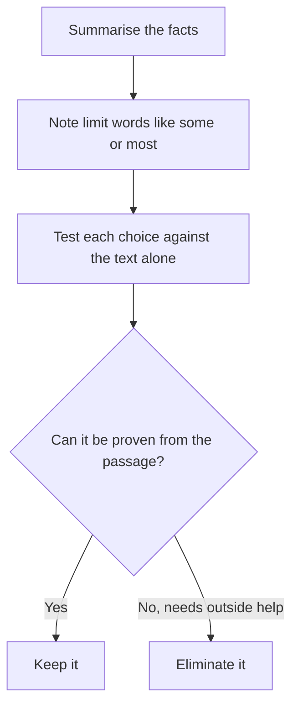

# Inference: Must Be True

Inference questions ask what has to be true, or is most strongly supported, given the passage. Nothing is being argued and there is no gap to fill. You are a detective who may only say what the evidence forces. These questions show up regularly in GMAT Focus Verbal, and they punish one habit above all: reading in more than the author wrote.

## A different mindset

In assumption, strengthen and weaken questions, you work *outside* the passage. You add something the author left out. Inference is the opposite. You stay *inside* the passage. The correct answer adds nothing new. It is already there, folded into the facts, waiting to be unpacked.

Typical stems:

- "Which of the following must be true on the basis of the statements above?"
- "Which of the following can be properly concluded from the information above?"
- "The statements above, if true, most strongly support which of the following?"

The first two ask for a *must be true* answer. The third allows slightly more room: the best-supported choice, even if it's not a logical certainty. In both cases, the passage is treated as **true**. Don't argue with it.

> [!REMEMBER]
> Inference = no gap to fill. The right answer is the one you can defend using only the passage. If you need an outside fact to justify it, it's wrong.

## Why the wrong answers look so good

The wrong answers are written to feel "reasonable." They are things that *might* be true, or are true in real life, or follow if you assume something extra. The GMAT does not care about what might be true. It asks what **must** be true.

A useful test: argue against the choice. If you can imagine a world where the passage is entirely true and the choice is false, the choice is wrong. The right answer cannot be falsified without contradicting the passage.

## Safe words and dangerous words

Look at the strength of the words in each choice.

| Dangerous (extreme) | Safe (modest) |
|---|---|
| all, every, always, never, none | some, at least one, may, can, could |
| the most, the best, only | at least, sometimes, often |
| completely, entirely | partly, to some degree |
| will | is likely to, tends to |

A safe word makes a claim that's hard to break. "Some customers prefer the new design" needs just one customer. "All customers prefer it" needs every customer, and a single exception breaks it.

> [!TRAP]
> An extreme word is not automatically wrong, and a modest word is not automatically right. Always check against the passage. If the passage says "all," then "all" in the answer is perfectly safe. But when the passage speaks in modest terms ("many," "most," "some"), an answer in extreme terms usually overreaches.

## Combining two statements

A common high-level pattern: the passage gives two facts that, taken together, yield a third. This is the logic of chains.

- If every A is B, and every B is C, then every A is C.
- If most A are B, and most B are C, you **cannot** conclude that most A are C.
- If **some** A are B, and some B are C, you can't conclude any A are C.
- "Most" plus "most" can overlap, but only when the shares add up to more than 100%. If 70% of employees work in sales and 60% of employees are under 30, at least 30% are *both* (70 + 60 − 100). That's a legitimate inference.

> [!TIP]
> When two groups are described with "most" or percentages, add the percentages. If the sum exceeds 100%, the groups must overlap by at least the excess. That's the classic hidden-inference move.

## Numbers and percentages

Number-based inferences are among the hardest because the tempting answer mixes up *percent* with *number*.

- If the **percentage** of something rose, the number might still have fallen (if the total shrank).
- If the **number** rose, the percentage might have fallen (if the total grew faster).
- "A larger share of X than Y" says nothing about which group is larger in absolute terms.

Work with a quick made-up number to test an answer. If sales rose from 100 to 120 while the total market went from 500 to 800, the share fell from 20% to 15% even though the number grew. If a choice needs the share to have risen, you can break it with this example, so it is not a "must."

## What "most strongly supported" means

When the stem says "most strongly supported," you're picking the best of five, not a perfect one. Several choices may be tempting; one will be a closer match to the passage's wording and scope, and the others will go further or sideways. The winner usually:

- restates or combines information in the passage with little added,
- uses modest language, and
- stays on topic (same group, same time, same measure).

## Step by step

1. Read the passage and **summarise the facts** in your own words. Don't hunt for a conclusion; there may not be one.
2. Note any limits: *some, most, at least, only, if, unless, before, after.*
3. Test each choice: "Can I prove this from the passage alone?" If you must assume something, it's out.
4. Eliminate choices that bring in new groups, new comparisons or new causes.
5. Pick the choice that survives the "try to break it" test.

The inference routine in one picture.

### Worked example 1 (Easy)

All the cafés in the Old Quarter close by 9 p.m. Some of the cafés in the Old Quarter serve breakfast.

Which of the following must be true?

(A) All cafés that serve breakfast close by 9 p.m.
(B) Some cafés that close by 9 p.m. serve breakfast.
(C) Some cafés in the Old Quarter serve dinner.
(D) Every café in the Old Quarter serves breakfast.
(E) Most cafés in the Old Quarter serve breakfast.

Show solution

Every Old Quarter café closes by 9 p.m. Some Old Quarter cafés serve breakfast. Those breakfast-serving cafés are Old Quarter cafés, so they close by 9 p.m. That makes (B) true.

(A) covers all breakfast cafés anywhere, not just in the Old Quarter. (C) says nothing about dinner. (D) turns "some" into "every". (E) turns "some" into "most."

Trap: (A) feels close, but "cafés that serve breakfast" includes ones outside the Old Quarter.

### Worked example 2 (Medium)

Over the past decade, the share of Ministry of Finance staff aged under 35 rose from 30% to 40%. During the same period, the ministry's total staff fell from 5,000 to 4,000.

Which of the following can be properly concluded?

(A) The number of staff aged 35 or older fell by more than 1,000.
(B) The number of staff aged under 35 fell.
(C) The number of staff aged under 35 stayed the same.
(D) The ministry hired more people under 35 than it lost.
(E) The number of staff aged under 35 rose by more than 200.

Show solution

Compute. Ten years ago, under-35s were 30% of 5,000 = 1,500, so those 35 or older were 3,500. Now under-35s are 40% of 4,000 = 1,600, so those 35 or older are 2,400.

Under-35s rose by 100. Older staff fell by 1,100. So (A) is correct.

(B) and (C) are false because under-35s rose from 1,500 to 1,600. (D) is about hiring and losing, which we can't know: people age out of the "under 35" group without leaving the ministry. (E) overstates the rise (it was 100).

Trap: (D). A rising count looks like net hiring, but the group's membership also changes as people turn 35.

### Worked example 3 (Hard)

A survey of 1,000 mobile-app users found that 70% use a food-delivery app and 60% use a ride-hailing app. Every user in the survey uses at least one of the two types of app.

Which of the following must be true?

(A) Exactly 300 users use both types of app.
(B) More than 400 users use only a food-delivery app.
(C) Fewer than 300 users use only a ride-hailing app.
(D) Fewer users use both types than use only a ride-hailing app.
(E) Most ride-hailing users also use a food-delivery app.

Show solution

Food = 700, ride = 600, total = 1,000, and nobody uses neither. Both = 700 + 600 − 1,000 = 300 exactly. So (A) is correct.

Then only food = 700 − 300 = 400 and only ride = 600 − 300 = 300.

(B) says more than 400, but it's exactly 400. (C) says fewer than 300, but it's exactly 300. (D) compares 300 with 300; they're equal, so "fewer" is false. (E) says most ride-hailing users also use food delivery, but 300 of 600 is exactly half, not most.

Faster way: sum the percentages (130%) and subtract 100%. The excess is the overlap, 30%.

Trap: (B) and (C) are each one step off. Several wrong answers are "almost" right with a single word changed (more than, fewer than, most). Check each against the exact numbers.

### Worked example 4 (Hard)

Researchers tracked two groups of employees for a year. Employees who took part in the company's mentoring scheme were promoted at twice the rate of employees who did not. However, employees were allowed to join the scheme only if their line manager nominated them, and managers nominated only employees whom they considered high performers.

The statements above most strongly support which of the following?

(A) The mentoring scheme causes employees to be promoted faster.
(B) Without the scheme, the promotion rate of nominated employees would have been the same as that of non-nominated employees.
(C) The higher promotion rate among scheme participants cannot be attributed solely to the scheme.
(D) Employees who are not considered high performers by their managers would benefit most from the scheme.
(E) Managers who nominate more employees are promoted faster themselves.

Show solution

The passage hands us a competing explanation: participants were pre-selected as high performers, so they might have been promoted faster anyway. What we can say safely is that the scheme can't be given *all* the credit. That's (C), which uses a modest, protective wording ("cannot be attributed solely").

(A) is the causal claim the passage undermines. (B) goes too far in the other direction; it asserts the scheme had no effect, which the passage does not say. (D) and (E) bring in groups and effects that the passage never mentions.

Trap: (B). When a passage casts doubt on a cause, the tempting answer swings to "the cause did nothing." Inference answers stay modest: it may have helped, but the selection effect means we can't credit it entirely.

## Quick check

1. "Some analysts at the bank are CFA holders. All CFA holders at the bank passed the exam." What must be true?

Answer

Some analysts at the bank passed the exam. (The CFA-holding analysts are CFA holders, and all CFA holders passed.)

2. 55% of a team are women and 50% of the team are over 40. What is the least possible share of women over 40?

Answer

5%. Add the shares (105%) and subtract 100%.

3. A passage says "most students in the course passed." Is "nearly all students passed" an acceptable inference?

Answer

No. "Most" only means more than half, so "nearly all" overstates it.

## Key takeaways

- Inference = stay inside the passage. No gap to fill, no outside facts.
- Treat the passage as true, and check each choice by trying to break it.
- Modest words (some, may, can, at least) are safe; extreme words (all, never, only, most) need the passage to back them.
- "Some" plus "some" proves nothing; two percentages that add to more than 100% force an overlap.
- A rising percentage does not mean a rising number, and the reverse.
- On "most strongly supported" questions, pick the choice closest in scope and strength to the passage.
- When a passage undermines a cause, the right answer says the cause isn't the whole story, not that it's irrelevant.

## Go deeper

- [GMAT Focus Edition overview](https://www.mba.com/exams/gmat-exam) — official description of the Verbal section.
- [GMAT Club forum](https://gmatclub.com/forum/) — discussions of inference question strategy.
