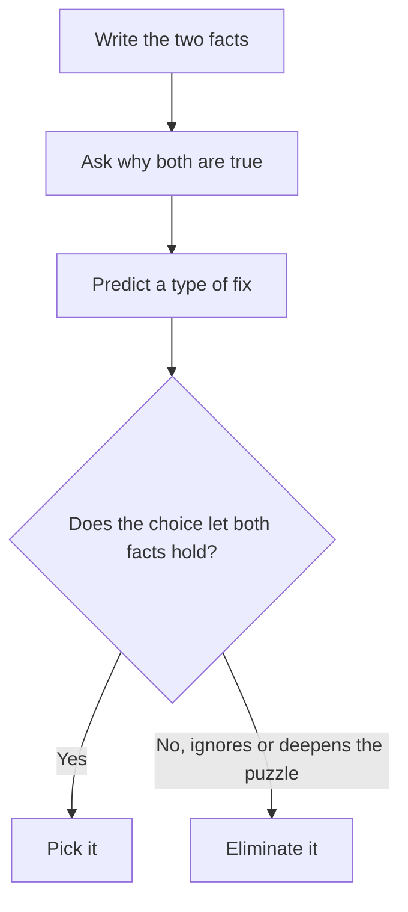

# Explain the Discrepancy

Paradox questions hand you two facts that seem to clash and ask for the choice that lets both be true. They're a gentle category once you see the pattern: you aren't judging an argument, you're solving a small puzzle. On the GMAT Focus they appear in several difficulty levels, and the hard ones hide the key distinction in a single word.

## What you're being asked

Typical stems:

- "Which of the following, if true, most helps to explain the apparent discrepancy?"
- "Which of the following, if true, most helps to resolve the paradox described above?"
- "Each of the following, if true, helps to explain... EXCEPT:"

There's no conclusion to attack. There are two facts, and they look incompatible, like a shop that raises prices and sells more, or a city that builds more roads and gets worse traffic. Your job is to find the extra piece of information that makes the situation make sense.

> [!REMEMBER]
> Don't try to decide which fact is wrong. Both are true. The correct answer adds a new fact that lets both be true together.

## The method

1. **Write down the two facts** in short form. Example: "Fact 1: Ticket prices rose 20%. Fact 2: Attendance also rose."
2. **State the puzzle in plain words:** "Why would attendance rise when prices rose?"
3. **Predict a type of fix** before reading the choices (see the patterns below).
4. **Test each choice:** "If this is true, do I now understand why both facts hold?"
5. **Reject choices that deepen the mystery or ignore it.**

How to attack an Explain the Discrepancy question.

> [!TIP]
> Say the puzzle as a "why" question. The right answer is the one that answers it. If the choice would also have been true in a world without the puzzle, it probably doesn't explain anything.

## Common resolution patterns

Most paradox answers fall into one of a handful of families. Learn these and you can often predict the answer.

### 1. Different groups

The two facts are about *different* groups, even though the wording makes them sound like the same one. "Average salaries at the firm fell, yet every department's average salary rose." Resolution: many new low-paid staff joined one department, or the mix of staff shifted toward cheaper departments.

### 2. Different time periods

The facts are measured at different times. "Sales fell after the discount ended, yet the discount lost money." Resolution: the discount pulled forward purchases that would have happened anyway.

### 3. Percent versus number

One fact is about a percentage and the other about a count. "The share of accidents involving drunk drivers fell, but the number rose." Resolution: the total number of accidents rose a lot.

### 4. A hidden factor

A third thing, mentioned in none of the facts, changes both. "The bakery raised prices and sold more." Resolution: a nearby bakery closed, so customers had nowhere else to go.

### 5. Different measures

The facts use different definitions. "Reported crime rose while people felt safer." Resolution: more victims now report crimes because trust in the police improved.

| Puzzle shape | Fix to look for |
|---|---|
| X rose, but Y (which X should affect) fell | A side effect or a third factor |
| Group average up, but every subgroup down (or vice versa) | A change in the mix of the group |
| Number up, percentage down | The total changed |
| Measured A, then not-A | A difference in what was measured, or when |
| Plan should have worked but didn't | A complication that blocked the plan |

## What wrong answers look like

> [!TRAP]
> The most common wrong choice *restates* the puzzle or explains **only one** of the facts. If an answer helps explain why Fact 1 is true but says nothing about Fact 2, the puzzle remains.

The usual wrong-answer types:

- **Makes the paradox worse.** It strengthens the reason to expect the opposite result.
- **Irrelevant.** True and interesting, but it neither helps nor hurts.
- **Explains only half.** It accounts for one fact but not the clash.
- **Out of scope.** It's about a different product, place or period.
- **Too weak.** It *could* help, but only if you add an assumption. Resolutions should work as stated.
- **Contradicts a given fact.** It resolves the puzzle by denying one of the facts. Not allowed.

## The EXCEPT variant

"Each of the following, if true, helps to explain the discrepancy EXCEPT" turns the question inside out. Four choices resolve the puzzle; one doesn't. The odd one out is usually irrelevant or makes the puzzle worse.

> [!TIP]
> On EXCEPT questions, check the choices in turn and mark each "helps" or "doesn't help." The one that *doesn't help* wins. Don't be thrown if the correct answer actually deepens the puzzle. It still counts, because it fails to help.

### Worked example 1 (Easy)

A public library extended its opening hours by two hours every weekday. Yet the total number of books borrowed per week did not rise.

Which of the following, if true, most helps to explain this?

(A) The library added new books at the same time.
(B) During the extra two hours, most visitors came only to use the free reading room and the internet, not to borrow books.
(C) The library is located close to a large office district.
(D) Other libraries in the city also lengthened their hours.
(E) Book borrowing in the city had been rising for several years.

Show solution

Puzzle: why didn't extra hours lead to more borrowing? (B) says the extra hours attracted people who don't borrow. The additional visits did not turn into more loans, so both facts hold.

(A) would, if anything, raise borrowing. (C) is irrelevant. (D) is vague, since it doesn't say how it changes the library's borrowing. (E) suggests borrowing should have risen, which deepens the puzzle.

Trap: (D). Competition might lower borrowing, but it's a guess; it doesn't explain the extra hours' effect.

### Worked example 2 (Medium)

Over the last five years, the average price of a flat in the city of Dunmore rose by 18%. Over the same period, the average price per square metre of flats sold in Dunmore fell by 5%.

Which of the following, if true, most helps to reconcile these two facts?

(A) Dunmore's population grew over the five years.
(B) The flats sold in Dunmore were, on average, considerably larger at the end of the period than at the start.
(C) Mortgage interest rates fell over the five years.
(D) Prices in neighbouring cities rose more slowly.
(E) Many buyers in Dunmore are investors rather than residents.

Show solution

Average price = price per square metre × average size. Price per m² fell, yet average price rose, so average size must have risen. (B) says exactly that. This is the "different measure / mix" pattern.

(A), (C) and (E) would push prices up, but they don't explain why price per square metre fell. (D) doesn't help, because it concerns other cities.

Trap: (A) or (C). Both explain a rise in the average price but leave the falling price per square metre unexplained: the half-answer trap.

### Worked example 3 (Hard)

After a chain of electronics stores began offering a two-year extended warranty at no extra charge on all laptops, the chain's laptop sales rose, but the chain's profit from laptop sales fell, even though the manufacturer's wholesale prices and the stores' selling prices did not change.

Which of the following, if true, most helps to explain the drop in profit?

(A) Laptop sales at competing chains also rose during the period.
(B) The chain pays for repairs and replacements covered by the extended warranty.
(C) Customers who bought laptops were more likely to buy accessories as well.
(D) The chain's advertising spending on laptops remained constant.
(E) Customers say the warranty was an important reason for buying.

Show solution

More sales at the same margin should raise profit. What lowers profit? A new cost. (B) shows that the free warranty creates repair costs that the chain now bears, so it explains why profit fell despite higher sales.

(A) is irrelevant to profit. (C) would raise profit overall and, if anything, deepens the puzzle. (D) rules out one possible cause without giving a cause. (E) explains the rise in sales, which isn't the puzzle.

Trap: (E). It explains the *sales* fact and leaves the *profit* fact unexplained. Always ask which fact needs the explanation.

### Worked example 4 (Hard, EXCEPT)

A national railway cut its fares by 10% in January. By December, the railway's total fare revenue had risen, even though the number of rail journeys taken that year was slightly lower than in the previous year.

Each of the following, if true, helps to explain how fare revenue could rise EXCEPT:

(A) Many passengers switched from cheap off-peak tickets to more expensive peak-time and first-class tickets during the year.
(B) The railway introduced a new, premium express service in February that carried many passengers at high fares.
(C) In March, the railway raised fares on its busiest routes by 15%.
(D) Passengers took fewer short journeys but more long journeys, which cost more per trip.
(E) The railway's operating costs rose during the year.

Show solution

Puzzle: fares were cut, journeys fell, yet revenue rose. Anything that raises the *average* revenue per journey explains it.

(A): a mix shift to pricier tickets raises average revenue per journey. Helps. (B): premium service raises revenue. Helps. (C): a later rise on the busiest routes lifts the average fare per journey. Helps. (D): longer trips pay more per journey. Helps.

(E): operating costs concern spending, not fare revenue. It does nothing to explain how revenue rose, so (E) is the exception.

Trap: picking a choice that merely seems odd. The question wants the one that is *irrelevant to revenue*, not the one that sounds least plausible.

## Quick check

1. The share of a company's staff who work remotely rose, yet the number of remote staff fell. What is one resolution?

Answer

The company's total staff fell by even more than its remote staff did (percent versus number).

2. An answer explains why Fact 1 happened but is silent on Fact 2. Is it a good answer?

Answer

No. It explains only half, and the clash between the two facts remains.

3. On an EXCEPT paradox question, what should you look for?

Answer

The one choice that does not help resolve the puzzle (irrelevant, or one that makes the puzzle worse).

## Key takeaways

- Both facts are true. The answer adds information that lets them coexist.
- State the puzzle as a "why" question before you read the choices.
- Common fixes: different groups, different time periods, percent versus number, a hidden factor, different measures.
- Wrong answers explain only half the puzzle, deepen it, or are irrelevant.
- Never choose an answer that denies one of the facts.
- For EXCEPT questions, mark each choice "helps" or "doesn't help," and pick the one that doesn't.
- When averages seem to conflict, think about the change in the mix of what's being averaged.

## Go deeper

- [GMAT Focus Edition overview](https://www.mba.com/exams/gmat-exam) — official description of the exam and Verbal section.
- [GMAT Club forum](https://gmatclub.com/forum/) — community threads on resolving-the-paradox questions.
