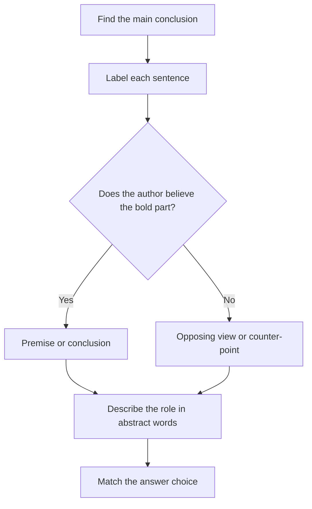

# Boldface and Method of Reasoning

Boldface questions look strange at first: two phrases in the argument are bolded, and you're asked what job each one does. They show up only occasionally on the GMAT Focus, but they're very learnable, because you're never asked whether the argument is good. You're only asked how it's built.

## What the question is really asking

A boldface question is a labelling exercise. Every sentence in an argument does a job, and the question wants you to name the job of the two bolded pieces. Think of a cricket team: one person opens, one anchors, one finishes. Same match, different roles. Sentences work the same way.

The question stems usually look like one of these:

- "In the argument above, the two portions in **boldface** play which of the following roles?"
- "The statement in boldface plays which of the following roles in the argument?"
- "Which of the following best describes the way the argument proceeds?" (a method-of-reasoning question with no boldface at all)

Notice that none of them asks you to strengthen, weaken, or find a flaw. You're describing, not judging. That's why these are the most mechanical of all CR types, and why Maria can get them right reliably with a routine.

## The seven jobs a sentence can do

Before you can pick the answer, you need the vocabulary. Almost every bolded sentence is one of these:

| Role | What it is | Typical clue words |
|---|---|---|
| **Conclusion (main point)** | The claim the author is trying to get you to accept | therefore, thus, so, hence, clearly, "should", "must" |
| **Premise (evidence)** | A fact offered to support a claim | because, since, for, given that, after all |
| **Intermediate conclusion** | A claim that is supported by one sentence and then itself supports the main conclusion | "thus" followed by another "so" or "therefore" |
| **Opposing view / position to be rejected** | A claim the author mentions only to argue against it | some argue, many believe, it is often said, critics claim |
| **Counter-evidence / objection** | A fact that seems to cut against the author's claim | however, but, although, admittedly |
| **Background information** | Context that sets the scene and supports nothing directly | usually the first sentence; plain facts about the situation |
| **Example / illustration** | A specific case used to make a general claim vivid or to support it | for instance, consider, take the case of |

> [!REMEMBER]
> A sentence's role depends on what it does inside the argument, never on whether it is true or sounds important. The same sentence can be the conclusion in one argument and a premise in another.

## Step 1: Find the main conclusion first

Always start here. Everything else is defined in relation to the conclusion. To find it, use the "because test": try attaching "because" to the end of a candidate sentence, and the other claim should answer the "why". For example, "The city should expand the metro **because** traffic in the centre has doubled." The expanding is the conclusion; the traffic is the premise. If you flip them ("Traffic has doubled because the city should expand the metro") it sounds absurd.

Conclusions are very often opinions, predictions, recommendations, or evaluations. Premises tend to be facts, studies, and statistics. That's a tendency, not a law, but it gets you to the right sentence quickly.

## Step 2: Label every sentence in the margin

On the screen you can't scribble on the question, but you do have a noteboard. Use short symbols: **C** for conclusion, **P** for premise, **IC** for intermediate conclusion, **OV** for opposing view, **CP** for counter-point or objection, **B** for background. A typical argument of five sentences might read: B, OV, CP, P, C. Once you've labelled, the bolded pieces already have names, and the question becomes a matching game.

## Step 3: Ask "who believes it?"

This is the single most useful test in boldface questions. For each bolded statement, ask: does the author believe this? Or is it a position the author is bringing up in order to knock it down?

Take this skeleton: "Some analysts claim that the company's profits will fall. But the company has just signed three large contracts, so profits will rise."

- "Some analysts claim profits will fall": believed by the analysts, not the author. It's an opposing view.
- "The company signed three contracts": the author believes it, and uses it as evidence.
- "Profits will rise": the author believes it, and it's what everything else supports. Conclusion.

The "who believes it?" test separates the author's own claims from claims being reported. Watch for reporting verbs ("some say", "it has been argued", "a common assumption is") because they almost always mark a view the author does not hold.

> [!TIP]
> If a bolded sentence begins with a phrase like "Critics contend" or "It is widely held", that sentence is almost never the main conclusion. It is either the opposing view or a claim the author will accept only partly.

## Step 4: Describe the argument abstractly, then match

The answer choices are written in abstract language: "a claim that the argument as a whole opposes", "evidence offered in support of the main conclusion", "an intermediate conclusion that is used to support the main conclusion". Your job is to turn the concrete sentences into this abstract language in your head before you look at the choices.

A useful sentence frame is: "The first bolded portion is a ______, which the author ______; the second bolded portion is a ______, which ______."

Fill the blanks with the roles from the table. For example: "The first is an opposing view, which the author rejects; the second is the author's main conclusion, which is supported by the evidence that follows." Now scan the choices for that exact pair of roles. Most wrong choices will get one of the two roles wrong, so you can eliminate them even without finishing the others.

The boldface routine, step by step.

> [!NOTE]
> The GMAT Focus Edition presents boldface in the stimulus with the key parts in bold text, just as you'll see in this app. In the real exam the bold portions may be whole sentences or just clauses. Treat a bold clause the same way: ask what job that clause does in the argument.

## Method of reasoning questions (no boldface)

Some questions ask "the argument proceeds by..." or "the author responds to the objection by...". These are the same skill with no bold to guide you. Label the whole argument, then describe its path in one sentence: "It presents a general principle, applies it to a specific case, and concludes." The answer choices will describe common argument shapes:

- **Reasoning from a particular case to a general rule** (example, then generalisation).
- **Reasoning from a general principle to a particular case.**
- **Offering a counterexample** to a general claim ("Not all X are Y, because here is an X that is not Y").
- **Arguing by analogy** ("Situation B is just like situation A, so what is true of A is true of B").
- **Pointing out an inconsistency** in an opponent's position.
- **Rejecting an alternative explanation** and so supporting the author's own.

> [!TRAP]
> Wrong answers love to describe a plausible-sounding method that the argument doesn't actually use. "Appeals to authority", "attacks the character of the opponent", or "draws an analogy" are common decoys. If you can't point to the exact sentence where the method happens, the choice is wrong.

## Common role pairs on the exam

Boldface questions repeat a small set of patterns. Recognising them saves time:

1. **Opposing view, then conclusion.** The first bold is a claim the author rejects; the second is the author's main point. ("Some say X. **X is mistaken**, because...")
2. **Premise, then conclusion.** The first bold is evidence; the second is what the evidence supports.
3. **Intermediate conclusion, then main conclusion.** The first is a claim that is itself supported, and which in turn supports the second.
4. **Counter-point, then reply.** The first bold is an objection the author concedes; the second is the author's answer to it, which keeps the conclusion standing.
5. **Observation, then explanation.** The first bold is a surprising fact; the second is the hypothesis offered to explain it (and sometimes a third sentence knocks that hypothesis down).

### Worked example 1 (Easy)

Bookshops in the city report a surge in sales of printed novels. **Some commentators claim that this proves e-readers are losing their appeal.** But e-reader sales figures for the same period are actually higher than last year's. **So the rise in printed-novel sales reflects growth in overall reading, not a retreat from e-readers.**

In the argument given, the two portions in boldface play which of the following roles?

A. The first is a premise; the second is the conclusion drawn from it.
B. The first is a position the argument opposes; the second is the argument's main conclusion.
C. The first is the main conclusion; the second is evidence in support.
D. The first is background; the second is a counter-point.
E. Both are premises supporting an unstated conclusion.

Show solution

Label first. Sentence 1 is background. Sentence 2 (bold) starts with "Some commentators claim": reporting verb, so it is someone else's view. Sentence 3 begins with "But" and offers a fact that undercuts that view, so it's a premise. Sentence 4 (bold) starts with "So" and states what the author wants us to accept: the main conclusion.

Abstractly: first bold = opposing view that the author argues against; second bold = main conclusion. That is choice **B**.

Why the others fail: A treats the commentators' claim as support, but the author rejects it. C reverses the order. D gets the first role wrong (it is not mere background) and the second wrong (the second is the conclusion, not an objection). E calls both premises, and the second is plainly the point of the whole passage.

Trap: choice A. The first bold sentence comes with a number-like claim ("sales surge") and looks like evidence. The "who believes it?" test shows the author doesn't buy the commentators' reading.

### Worked example 2 (Medium)

A regional airline plans to cut its cheapest fares in order to attract more passengers. **However, the airline's most recent survey found that 70 percent of its passengers say they chose it because of its schedule and not its price.** Since the survey was conducted among passengers who were already on board, **it provides no information about the people who chose a different airline for reasons of price.** Therefore, the survey gives the airline little reason to think that cutting fares would fail to attract new customers.

In the argument, the two boldface portions play which of the following roles?

A. The first is evidence that supports the airline's plan; the second is the main conclusion.
B. The first is a claim that the argument takes to be misleading; the second is the main conclusion.
C. The first is a claim that the argument goes on to criticise; the second is a reason for that criticism.
D. The first is the main conclusion; the second is an objection to it.
E. The first is an assumption of the airline's plan; the second is a counter-example to it.

Show solution

Sentence 1 states the airline's plan (background). Bold 1 is the survey result, which could be read as a reason to doubt the plan. Bold 2 says the survey has nothing to say about people who chose another airline: a reason to discount the survey. The final sentence ("Therefore...") is the main conclusion: the survey gives little reason to think the plan would fail.

So bold 1 is a piece of evidence that the argument goes on to criticise (it undermines its force), and bold 2 is the reason offered for that criticism. That's **C**.

Why not B: the second bold is not the main conclusion; the "Therefore" sentence is. Why not A: bold 1 doesn't support the plan; it seems to oppose it. D: neither bold is the conclusion. E: bold 1 is a survey result, not an assumption.

Faster way: spot the "Therefore" sentence. Neither bold is it, so every choice that says "main conclusion" for either bold is out. That removes A, B and D in one move.

Trap: B. The second bold sounds like the point of the passage, but it's one step short: it supports the real conclusion.

### Worked example 3 (Hard)

A city council member argues: "Free public transport would reduce traffic congestion. **Critics respond that people who already use buses and trains will not change their habits, so congestion won't fall.** That is true as far as it goes, but **it overlooks the large number of people who currently drive only because the fare plus the inconvenience of ticketing outweighs the cost of parking.** For these people, free transport would remove the main reason to drive, and so congestion would fall."

The portions in boldface play which of the following roles?

A. The first is a claim that the argument grants but treats as incomplete; the second is a consideration the argument offers to show it incomplete.
B. The first is the main conclusion; the second is evidence for it.
C. The first is an opposing view that is flatly rejected; the second is the argument's main conclusion.
D. The first is evidence offered in support of the council member's position; the second is a counter-point to that evidence.
E. The first is a hypothesis; the second is a prediction that tests it.

Show solution

Here's where "who believes it?" earns its keep. The first bold is the critics' claim, so it isn't the author's. But the author says "That is true as far as it goes", so the author partly accepts it. It isn't flatly rejected. The second bold begins "it overlooks", which points to something left out, so it's a consideration that shows the critics' claim is incomplete. The main conclusion is the final clause: "congestion would fall".

So: bold 1 = claim granted but treated as incomplete; bold 2 = the consideration that shows it is incomplete. **A**.

C is the tempting one: the first bold is the critics' view, true, but "flatly rejected" is wrong because the author concedes it, and the second bold isn't the conclusion. B reverses the author's stance. D says the first is evidence in support of the author, but it's the critics' point. E uses scientific language that doesn't map to anything in the passage.

Trap: C. Many people see "critics" and assume "rejected". Read the exact attitude the author takes: "true as far as it goes" is a partial concession.

### Worked example 4 (Method of reasoning, Hard)

Journalist: "Wealthy countries often claim that their spending on foreign aid is generous. But the claim rests on counting total pounds or dollars. A tiny country that gives a small sum may be far more generous relative to its income than a large country that gives a large sum. Therefore, absolute totals are a poor measure of generosity."

The argument proceeds by

A. citing an authority and then deferring to it
B. showing that a measure can give a misleading ranking by considering a case in which it would rank two parties in the opposite order from a more appropriate measure
C. generalising from a single example to a universal rule
D. proposing a cause for an observed fact and then ruling out alternative causes
E. attacking the motives of those who use a particular measure

Show solution

The structure: (1) a claim about generosity based on totals; (2) a hypothetical comparison, a small country giving a small sum but generously relative to income vs a large country giving a large sum; (3) the conclusion that totals are a poor measure. The hypothetical shows totals rank the two countries one way while a better measure (share of income) ranks them the other way. That is **B**.

A: no authority is cited. C: the example is hypothetical and the conclusion is about a measure, not a universal rule about countries. D: no cause is proposed. E: the journalist criticises the measure, not anyone's motives.

Tip: for method questions, write one sentence describing what the argument does (here: "shows a measure can mislead through a contrasting case"), then find the choice that says the same thing in abstract language.

## Quick check

1. In the sentence "Many parents assume that homework improves results, yet studies show no link between the two," which part is the opposing view?

Answer

"Many parents assume that homework improves results." It's a reported assumption, and the "yet" signals that the author is about to oppose it.

2. An argument has the structure: Background, Premise, Intermediate conclusion, Main conclusion. Which statement depends on the intermediate conclusion for its support?

Answer

The main conclusion. The intermediate conclusion is a stepping stone: it's supported by the premise and in turn supports the final claim.

3. True or false: if a bolded sentence is a statistic, it must be a premise.

Answer

False. A statistic can be a premise, but it can also be an opposing claim being reported, or a piece of evidence the author is criticising. Role depends on what the author does with it.

## Key takeaways

- Boldface questions ask for jobs, not for truth. Your task is to label, not to judge the argument.
- Find the main conclusion first; everything else is defined by its relation to it.
- Use the "who believes it?" test on every bolded statement. Reporting verbs ("some argue", "critics claim") signal a view the author may not share.
- Check the author's exact attitude: rejects, partly concedes, or accepts. "True as far as it goes" is a partial concession, not a rejection.
- Translate the bolded parts into abstract role language first, then scan the choices. Eliminate any choice that gets even one of the two roles wrong.
- For method-of-reasoning questions, summarise the argument's path in one plain sentence before you read the options.
- A choice that mentions a method you can't point to in the text (authority, motives, analogy) is a decoy.

## Go deeper
- [GMAT Club forums](https://gmatclub.com/forum/) — search the Critical Reasoning section for "boldface" threads to see how others label real-style questions.
- [Official GMAT exam site](https://www.mba.com/exams/gmat-exam) — free official practice materials to see the exam's wording.
