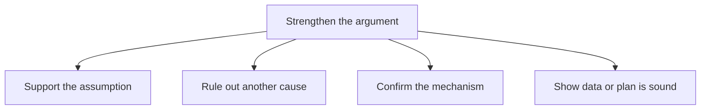
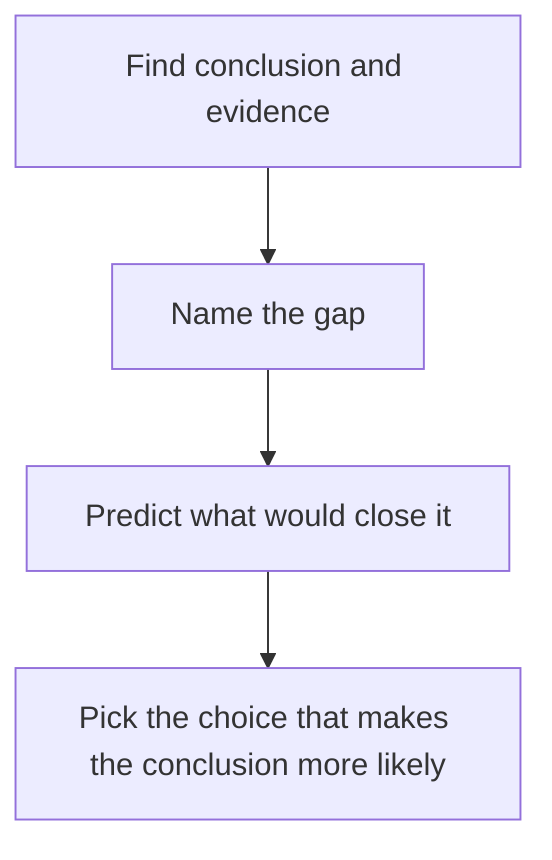

# Strengthen Questions

Strengthen questions ask you to make an argument more believable. They are the friendly cousin of assumption questions: instead of finding the missing plank in the bridge, you pick the answer that nails a plank into place. Expect a few of these in every Verbal section.

## What "strengthen" means

The stem usually reads: "Which of the following, if true, most strengthens the argument?" or "...provides the most support for the conclusion?"

Two rules to keep in your head:

1. You are not proving the conclusion. You only need to make it **more likely** than before.
2. The correct answer is **new information**. It adds something the stimulus didn't say.

> [!REMEMBER]
> Treat every answer choice as true. Don't argue with it ("but that seems unlikely"). Just ask: does it make the conclusion more likely?

## The four ways to strengthen

Think of the gap again. Evidence on one side, conclusion on the other, assumption in between. A strengthener does one of four jobs.

**1. Supports the assumption directly.** Says the missing plank is in place. "The survey respondents were chosen at random from all customers."

**2. Eliminates an alternative explanation (causal arguments).** Rules out another cause. "Rainfall was identical in both years."

**3. Confirms the mechanism or adds supporting evidence.** Shows how A leads to B, or adds a parallel case. "Lab studies show the compound directly slows the bacteria's growth."

**4. Shows the data are representative or the plan is workable.** "The pilot city was typical of the other regions." "The new software integrates with the existing systems."

A fifth quiet one, for causal arguments: **the effect appears when the cause is added and disappears when it is removed** (a before and after, or a control group).

Every strengthener does one of these jobs on the gap.

> [!TIP]
> In a causal argument, the strongest strengtheners are usually (a) no other cause, (b) the cause came before the effect, and (c) a clear mechanism. Scan the choices for those three.

### Worked example 1 (Easy)

"A software company noticed that teams using its new project-planning tool finished projects an average of two weeks sooner than teams not using it. The company's marketing director concludes that the tool speeds up project completion.

Which of the following, if true, most strengthens the director's conclusion?"

(A) The tool was priced competitively with other planning tools.
(B) Teams were randomly assigned to use the tool or not.
(C) Most teams that used the tool said they liked it.
(D) The tool has a larger feature set than any competing product.
(E) Teams that adopted the tool had volunteered to try new software.

Show solution

Correlation to cause. The best strengthener removes the possibility that already-better teams chose the tool. Random assignment (B) does exactly that.

(A) and (D) are about the product's market position, not its effect on speed. (C) is about opinion, not results. (E) is a trap: volunteer teams may be more motivated and faster anyway, so it opens a rival explanation and weakens the argument.

Trap: (C). Satisfaction sounds supportive, but liking a tool is not evidence that it speeds work.

## Close the gap: study the stimulus before the choices

The skill is **prephrasing the gap**. Ask three questions of the stimulus:

- What is the evidence about? (subject and measure)
- What is the conclusion about? (subject and measure)
- What has changed between them?

Whatever has changed is what the right answer will bridge.

A quick way to attack any strengthen question.

| If the stimulus is... | The correct answer will likely... |
|---|---|
| Causal | Rule out another cause, rule out reverse causation, or show the mechanism |
| Survey / sample | Show the sample is representative, or the stated view matches behaviour |
| Plan / prediction | Show the plan can be carried out, or that obstacles don't exist, or similar plans worked |
| Analogy | Show the two cases are alike in the relevant respect |
| Numbers vs. percents | Provide the missing base figure that makes the inference valid |

### Worked example 2 (Medium)

"Over the past decade, the share of Kerala households that hold health insurance has risen from 20 percent to 55 percent. During the same decade the average amount a household spends out of pocket on hospital stays has fallen by a third. A health economist argues that wider insurance coverage is the reason out-of-pocket spending has fallen.

Which of the following, if true, most strengthens the economist's argument?"

(A) The cost of private hospital stays in Kerala rose faster than inflation over the decade.
(B) In districts where insurance coverage rose most, out-of-pocket spending fell most.
(C) Insurance premiums in Kerala are lower than in most other states.
(D) Households that hold insurance tend to be wealthier than those that do not.
(E) The government built several new public hospitals in Kerala over the decade.

Show solution

The gap is that two trends coincided; the economist claims one caused the other. (B) gives a dose-response pattern: where the supposed cause grew more, the effect grew more. That is classic supporting evidence for causation.

(A) tells us hospital costs rose, which makes falling spending more puzzling, but it doesn't link the fall to insurance. (C) is a comparison with other states, out of scope. (D) suggests insured households differ from others, which does nothing for the claim. (E) offers a rival explanation (cheaper public care), which weakens.

Trap: (A). It looks supportive ("costs rose, yet spending fell, so something must have absorbed them"), but it doesn't identify insurance as that something.

## "Strengthens" vs. "supports" vs. "justifies"

Read the stem closely, because slightly different words ask for slightly different tasks.

- **"Most strengthens" / "most supports the argument":** the choice makes the conclusion more likely. Pick the best of five helpers.
- **"Most strongly supports the statement":** if the stimulus has an argument with a conclusion, it's strengthen. If there is no argument and you must find what follows from facts, it's inference.
- **"Justifies / the principle that justifies":** a rarer type that asks for a general rule that, if accepted, would make the author's reasoning valid. That's a sufficient assumption in the form of a principle, so a broad, strong answer is fine here.

> [!NOTE]
> On the GMAT Focus, plain "strengthens" is by far the most common. Treat "justify" or "principle" stems as a signal to pick the broader, more complete bridge.

## Traps in strengthen questions

> [!TRAP]
> **Wrong direction.** The answer weakens the argument, or is neutral. Always ask "Does this make the conclusion MORE likely?" and not "Is this related?".

Other common traps:

- **Restating the evidence.** An answer that repeats what the stimulus already says adds nothing. The right answer must be new.
- **Out of scope.** Concerns a different group, product or time period. It sounds related but doesn't touch the gap.
- **Irrelevant detail.** Something nice but not tied to the gap ("The CEO supports the plan").
- **Strengthens a different conclusion.** It supports a sub-point, not the final conclusion. Always check you are strengthening the *main* claim.
- **Partial help vs. best help.** If two choices both help, choose the one that closes more of the gap (e.g. rules out the most plausible alternative cause).

### Worked example 3 (Medium-Hard)

"A chain of coaching centres in Delhi wants to open a branch in Pune. It points out that in the three cities where it already operates, student enrolment grew steadily for four years after opening, and in each city a large share of its students come from outside the city. The chain's director concludes that a Pune branch will also see strong enrolment growth over its first four years.

Which of the following, if true, most strengthens the director's conclusion?"

(A) Pune has a larger population than any of the three cities where the chain currently operates.
(B) Like the three existing cities, Pune hosts several major universities and attracts large numbers of students from other states.
(C) Competing coaching centres in Pune have recently increased their fees.
(D) The chain's existing branches are profitable.
(E) The chain's director has experience opening branches in other industries.

Show solution

This is an analogy. The author assumes Pune resembles the three cities in the way that matters (a large inflow of outside students). (B) states that similarity. Correct.

(A) population size isn't the driver; the evidence says many students come from *outside*, so what matters is the inflow of outside students. (C) is a mild help but about competitors' fees and doesn't establish demand. (D) profit isn't enrolment growth. (E) is irrelevant.

Trap: (A). Bigger sounds better, but the relevant similarity in the argument is where students come from, not the headcount.

### Worked example 4 (Hard)

"A pharmaceutical firm reports that, in a trial involving 600 patients with mild hypertension, those who took its new drug, Calmex, for a year had an average drop of 12 points in systolic blood pressure, compared with 4 points for those who took a placebo. Patients were free to withdraw from the trial at any time, and the 520 who completed it are the ones included in the results. The firm concludes that Calmex lowers blood pressure more effectively than a placebo in patients with mild hypertension.

Which of the following, if true, most strengthens the firm's conclusion?"

(A) The number of patients who withdrew was roughly the same in the Calmex group as in the placebo group, and their pre-trial blood pressure readings were similar to those of patients who completed the trial.
(B) The drug's side effects are comparable to those of other hypertension drugs.
(C) Patients who completed the trial were, on average, younger than patients with hypertension generally.
(D) The 12-point drop is larger than the drop produced by several older drugs in earlier trials.
(E) The placebo group's pressure dropped by 4 points because of regular check-ups and increased attention.

Show solution

The gap: the analysis includes only completers. If many patients on Calmex dropped out because it didn't work (or the dropouts in the two groups differed), the completers could be a biased group. (A) closes that gap: dropout was balanced and the dropouts weren't systematically different.

(B) concerns side effects, not effectiveness. (C) would weaken generalisation to all patients with mild hypertension. (D) compares across different trials, which are not comparable. (E) explains the placebo drop but says nothing about whether the completers are a fair sample.

Trap: (D) because "bigger than older drugs" feels like strong evidence. But different trials, different patients, and the dropout issue remain.

## Quick check

1. The argument: "Since we added a loyalty scheme, repeat purchases have risen 15 percent, so the scheme works." Which one choice would strengthen it most: (a) Repeat purchases rose 15 percent at a competitor with no scheme; (b) Repeat purchases rose only among scheme members; (c) The scheme cost less than expected.

Answer

(b). It ties the rise to participation in the scheme. (a) weakens by suggesting a market-wide trend. (c) is about cost, not effect.

2. What one question should you ask of every choice in a strengthen question?

Answer

"Taking it as true, does it make the conclusion more likely?" If the answer is no or maybe, move on.

3. Why is an answer that simply repeats a premise never correct?

Answer

It adds no new information, so the argument is exactly as strong as before.

## Key takeaways
- Strengthening means making the conclusion more likely, not proving it.
- The correct answer adds new information that closes or supports the gap.
- Four main moves: support the assumption, eliminate alternatives, confirm the mechanism, show representativeness or workability.
- Name the argument's pattern first; the pattern predicts the strengthener.
- Dose-response, random assignment and a clear mechanism are classic strong evidence for causal claims.
- Beware wrong-direction, out-of-scope and restated-premise choices.
- "Justify" stems are rare; they want a broad principle that makes the reasoning valid.

## Go deeper
- [GMAT official site](https://www.mba.com/exams/gmat-exam) - the official source for question formats and section structure.
- [GMAT Club forums](https://gmatclub.com/forum/) - community discussions of strengthen questions.
