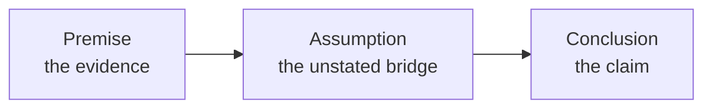
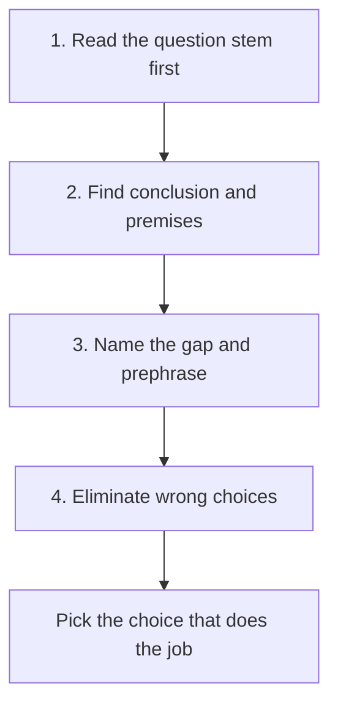

# How GMAT Arguments Work

Roughly 9 to 11 of the 23 Verbal questions are Critical Reasoning (CR); GMAC publishes no fixed split. Each one is a short paragraph of business, science or policy talk, followed by one question about the logic. Every CR question, whatever its type, is really testing whether you can see how an argument is built. Learn the anatomy once and the whole family of questions gets easier.

## What an argument is

An argument is a conclusion supported by evidence. That's it. Someone claims something, and gives reasons for it. The GMAT doesn't care whether the claim is true in the real world. It cares about the link between the reasons and the claim.

Think of it like a Delhi Metro journey. The evidence is the stations you've already passed, the conclusion is where you say you'll end up. The question is whether the line really goes there.

Here are the parts you'll meet:

| Part | What it is | Example |
|---|---|---|
| **Conclusion** | The main claim the author wants you to accept | "The company should raise prices." |
| **Premise** | A fact or reason offered in support | "Rivals have raised prices without losing customers." |
| **Intermediate conclusion** | A claim that is supported by premises AND used to support the final conclusion | "Customers are not price sensitive" (supported by the rival data, then used to support "raise prices") |
| **Background** | Context that sets the scene but doesn't argue anything | "The company sells budget headphones." |
| **Counter-premise** | Evidence the author mentions only to argue against it or explain it away | "Some analysts claim demand will fall, but..." |

> [!REMEMBER]
> Every argument has exactly one **final conclusion**. If you can't say it in one sentence, you haven't found it yet.

## Indicator words

The author usually leaves signposts. Learn them.

**Conclusion indicators:** therefore, thus, hence, so, consequently, as a result, it follows that, clearly, this shows that, the evidence suggests, accordingly, should, must, will.

**Premise indicators:** because, since, for, given that, after all, as shown by, in view of the fact that, the reason is.

**Contrast indicators:** however, but, yet, although, despite, nevertheless, while. These often flip direction. What comes after "however" is very often the author's real conclusion, and what comes before it is often a view the author is about to reject.

> [!TIP]
> A claim about the future ("will", "should", "is likely to") or a recommendation is almost always a conclusion. Facts about the past and present data are almost always premises.

> [!TRAP]
> "Since" can mean "because" (premise follows) or "ever since" (time). And a sentence that begins with "Some argue that..." is usually a counter-premise, not the author's view. Always ask: whose claim is this?

## Finding the conclusion

Use this quick routine on any stimulus:

1. Look for indicator words.
2. Ask "What is the author trying to convince me of?"
3. Apply the "because" test. Put the suspected conclusion first and a suspected premise after, joined by "because". If it sounds right ("The city should expand the bus network because ridership has doubled"), you've got the direction right. If it sounds backwards, swap them.

### Worked example 1 (Easy)

Read the stimulus and name the conclusion.

"Revenue at Larkspur Cafes has fallen for three straight quarters. During the same period the chain has cut its marketing budget by 40 percent. Clearly, the marketing cuts are responsible for the revenue decline."

Show solution

"Clearly" is the signal. The conclusion is that the marketing cuts caused the revenue decline. The two premises are the revenue drop and the budget cut.

Notice what the author is doing: noticing that two things happened together and claiming one caused the other. That is a causal argument, and we'll see below what it assumes.

Trap: choosing "Revenue has fallen for three straight quarters" as the conclusion. It's just a fact being explained.

## The gap

Here is the single most important idea in CR. **Premises never fully prove the conclusion on the GMAT.** There is always a gap between them, and the unstated bridge across that gap is the **assumption**.

Here is the shape of every argument: evidence, a hidden bridge, then the claim.

In the Larkspur example, the evidence is about timing (revenue fell, budget cut). The conclusion is about cause. The gap is: "nothing else explains the revenue decline" and "the correlation isn't a coincidence". Each of the main question families works on that gap:

- **Assumption**: name the bridge the author needs.
- **Strengthen**: give evidence that makes the bridge more solid.
- **Weaken**: give evidence that makes the bridge shakier.
- **Flaw**: describe the error the author made in crossing the gap.
- **Evaluate**: name the question whose answer tells you whether the bridge holds.

Inference and Paradox questions work differently (we'll cover them in their own lessons), but even there, reading the structure helps.

> [!NOTE]
> Arguments on the real GMAT very often hinge on a **change in vocabulary** between the premise and the conclusion. If the evidence talks about "sales" and the conclusion talks about "profit", or the evidence talks about "tested users" and the conclusion about "all customers", you've found the gap.

## The universal 4-step CR method

1. **Identify the question type.** Read the question stem FIRST (the sentence at the bottom), then read the stimulus with that task in mind.
2. **Read the stimulus and find the conclusion.** Mark premises and conclusion mentally. Spot the gap.
3. **Prephrase.** Before you look at the choices, predict what a correct answer would do. For an assumption question: "The author needs to assume nothing else caused it." For weaken: "Something that gives another cause."
4. **Eliminate.** Go through the choices and kill the ones that are out of scope, too extreme, the wrong direction, or irrelevant. Pick the one that does the job your prephrase described.

The four steps as a single flow you can run on every CR question.

> [!TIP]
> You don't need a perfect prephrase. A rough one ("this is about whether the sample represents everybody") is enough to make the wrong answers look wrong. Spend about 20 to 30 seconds on the stimulus, 60 seconds on choices, and don't re-read the stimulus more than once.

## Classic argument patterns

Most GMAT arguments are one of five shapes. Recognise the shape and you immediately know the likely gap.

| Pattern | What the author does | The usual gap |
|---|---|---|
| **Causal** | "A and B go together, so A causes B" | Reverse cause, a third factor, coincidence |
| **Plan / prediction** | "This plan will achieve this goal" | Plan can't be carried out, side effects, goal reached some other way |
| **Analogy** | "X worked in City A, so it will work in City B" | A and B differ in a relevant way |
| **Survey / sample** | "These respondents think X, so everyone does" | Sample is biased or too small; people say one thing and do another |
| **Numbers vs. percents** | "The percent rose, so the number rose" (or the reverse) | The base may have changed |

### Worked example 2 (Medium)

"A regional bank found that customers who use its mobile app hold, on average, three times as many products with the bank as customers who do not use it. The bank therefore concludes that encouraging more customers to download the app will increase the number of products each customer holds."

Which pattern is this, and what is the gap?

Show solution

This is a causal argument in disguise. The evidence is a correlation (app users hold more products). The conclusion is a prediction that pushing the app will cause customers to hold more products.

The gap: maybe customers who already love the bank, and already hold many products, are the ones who download the app. In that case the causation runs the other way, or a third factor (loyalty) drives both. If so, nudging a lukewarm customer to download the app wouldn't change anything.

Trap: treating "three times as many" as proof. A correlation, however large, is never proof of cause.

### Worked example 3 (Medium-Hard)

"Last year, 70 percent of the complaints received by Fenwick Telecom concerned billing. This year, only 55 percent do. Fenwick's customer service director says that this proves the new billing system has reduced billing problems."

What is wrong, in one sentence?

Show solution

The evidence is about a **percentage of complaints**, while the conclusion is about the **number (or rate) of billing problems**. If total complaints jumped (say, from 1,000 to 1,800 because of a network outage), billing complaints could have risen from 700 to 990 even as their share fell from 70 to 55 percent.

The author also assumes that complaints are a good measure of problems, which is another vocabulary shift.

Faster way: any time you see a percent in the premise and an absolute in the conclusion (or the other way round), ask "what happened to the base?"

## Reading the question stem: the type cheat table

The stem tells you what job to do. Learn to classify it in two seconds.

| Stem sounds like... | Type | Your job |
|---|---|---|
| "The argument depends on which of the following assumptions?" / "relies on assuming" / "requires which assumption" | **Assumption** | Find the unstated bridge (necessary) |
| "Which of the following, if true, most strengthens / supports the argument?" | **Strengthen** | Make the conclusion more likely |
| "Which of the following, if true, most seriously weakens / undermines / calls into question?" | **Weaken** | Make the conclusion less likely |
| "Which of the following would be most useful to know in evaluating the argument?" | **Evaluate** | Pick the question whose answer could swing either way |
| "Which of the following can be properly inferred / must be true / is most strongly supported by the statements?" | **Inference** | Find what MUST follow from the facts, no more |
| "Which of the following, if true, most helps to explain / resolve the apparent discrepancy?" | **Paradox** | Reconcile two facts that seem to clash |
| "In the argument above, the two portions in boldface play which of the following roles?" | **Boldface / role** | Name the function of each bold part in the structure |
| "The reasoning in the argument is most vulnerable to criticism because it..." / "flawed because" | **Flaw** | Name the logical error |
| "Which of the following most logically completes the argument?" | **Complete the argument** | Fill the blank so it follows from the rest |

> [!TIP]
> Two stems that students mix up: "most strongly supports" in an **inference** stem asks what follows from the stimulus (no argument to help), whereas "strengthens the argument" in a **strengthen** stem asks what supports the author's conclusion. If the stem says "supported by the statements above", it's inference.

> [!REMEMBER]
> Assumption, strengthen, weaken, evaluate and flaw all attack the **same gap**. If you can find the gap, you can answer any of the five.

### Worked example 4 (Hard)

"A national furniture retailer reports that its stores in cities with a metro rail system sell 30 percent more modular shelving per customer than its stores in cities without one. The retailer's analysts conclude that residents without cars buy more modular shelving because it can be carried home on public transit, and they recommend promoting the product heavily in the remaining cities with metro systems."

Which of the following is the gap the recommendation relies on crossing?

Show solution

There are two layers. First, an intermediate conclusion: "Metro availability (via not needing a car) causes higher shelving sales". Second, the final conclusion: promoting heavily in the *remaining* metro cities will work.

The gaps are:

1. Other differences between metro cities and others (smaller apartments, younger renters, higher density) might explain the sales.
2. The metro cities that haven't been promoted may differ from the ones studied (for example, they may be less affluent).

Notice how the conclusion speaks about a plan (promotion) while the evidence only speaks about sales patterns. The author needs to assume that the metro-linked factor is the real driver and that it applies to the remaining cities.

Trap: spending time on whether modular shelving can really be carried on a train. That detail is a side explanation, not the claim being tested.

## Quick check

1. In "Because the new highway cut commuting times, property values along it rose; the city should therefore build a second highway," what is the conclusion?

Answer

"The city should build a second highway." "Therefore" and "should" both signal it. "Property values rose" is a premise (supported by the intermediate idea that commuting times fell).

2. A stem reads: "Which of the following, if true, most helps to explain why the number of accidents rose even though cars are safer?" What type is it?

Answer

Paradox (resolve the apparent discrepancy). There's no conclusion to strengthen or weaken; you're reconciling two facts.

3. A poll of 400 subscribers to a premium cricket channel shows that 80 percent would pay more. The channel concludes that most Indian cricket fans would pay more. Name the pattern and the gap.

Answer

Survey/sample. The 400 subscribers are already paying for premium content, so they aren't representative of all cricket fans. Also, "would pay" in a poll is not the same as actually paying.

## Key takeaways
- An argument is a conclusion plus evidence; the GMAT tests the link, not the truth.
- Find the conclusion with indicator words, recommendations and predictions, and the "because" test.
- Premises never fully prove the conclusion; the unstated bridge is the assumption.
- Five common shapes: causal, plan/prediction, analogy, survey/sample, numbers vs. percents.
- Read the question stem first, classify it, then read the stimulus with that job in mind.
- Prephrase before you look at the answer choices, even if the prephrase is rough.
- Assumption, strengthen, weaken, evaluate and flaw all work on the same gap.
- Watch for shifts in vocabulary between premise and conclusion; that shift is where the gap lives.

## Go deeper
- [GMAT official site: exam structure](https://www.mba.com/exams/gmat-exam) - confirm the current Verbal format and question counts.
- [GMAT Club forums](https://gmatclub.com/forum/) - discussion of CR question types and student reasoning, useful once you've done the practice sets here.
