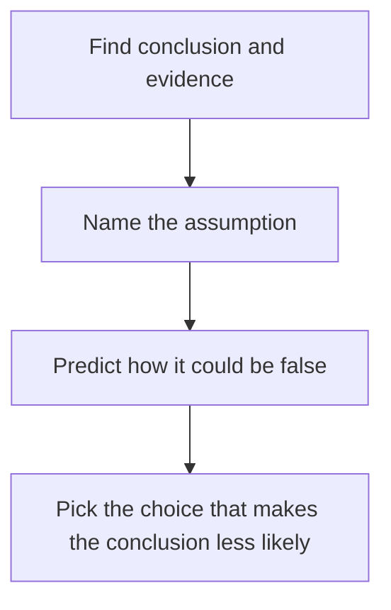
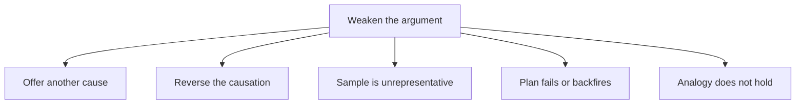

# Weaken Questions

Weaken questions are the mirror image of strengthen questions, and they are among the most common CR types on the GMAT Focus. You get an argument, and you must find the fact that most damages it. The skill is attacking the gap, not the author.

## What "weaken" means

Typical stems: "Which of the following, if true, most seriously weakens the argument?", "...calls into question...", "...undermines...", "...casts the most doubt on...".

Here is the mindset that wins: **you do not have to destroy the argument. You only have to make the conclusion less likely.** A weakener can be modest. It might raise just one doubt, as long as it attacks the gap and does so more than the other four choices.

Your attack path for a weaken question.

> [!REMEMBER]
> Weaken = attack the **assumption**, not the evidence. The premises are taken as true. A choice that merely says "the data is wrong" is almost never the answer. The one that says "the data is right, but it doesn't prove what the author thinks" usually is.

## The five main ways to weaken

**1. Offer an alternative cause (causal arguments).** Another factor could explain the result. "The same month, a rival's factory closed."

**2. Reverse the causation.** The effect might actually have caused the supposed cause. "Companies that were already growing hired more consultants."

**3. Show the sample or data is unrepresentative.** "Respondents were all volunteers who already used the service."

**4. Show the plan won't work or will backfire.** It can't be carried out, there are costly side effects, or it solves a problem that isn't there. "The new policy will drive some of the best staff to leave."

**5. Show the analogy fails.** The two cases differ in a relevant way. "City B has no public transport, unlike City A."

Also: **the correlation is coincidence**, or **the measure doesn't capture the claim** ("complaints fell" doesn't mean "satisfaction rose": maybe customers gave up complaining).

Most weakeners fall into one of these families.

> [!TIP]
> Weakeners often begin with phrases like "In fact...", "Many of the...", "Most of the..." and name something *concrete*. The wrong answers tend to be vague ("some experts disagree") or unrelated ("the product comes in many colours").

### Worked example 1 (Easy)

"A town council noticed that the number of street-lamp repairs fell by half after it installed LED lamps. The council concludes that LED lamps are more reliable than the older lamps.

Which of the following, if true, most seriously weakens the council's conclusion?"

(A) LED lamps use less electricity than the older lamps.
(B) The council cut its repair budget in the same year, so many reported faults went unrepaired.
(C) Residents say LED lamps give a whiter light.
(D) The older lamps were installed more than ten years ago.
(E) The council plans to install LED lamps in more areas.

Show solution

The conclusion is about reliability; the evidence is about the number of *repairs*. The gap is whether repairs measure faults. (B) says repairs fell because fewer faults were fixed, not because there were fewer faults. That breaks the link.

(A) and (C) are about other features. (D) is background that could even help the council. (E) is a plan, irrelevant to past data.

Trap: (D). Old lamps being replaced could look like a rival explanation, but it doesn't explain why repairs fell, and if anything it supports the idea that the new lamps are more dependable. It doesn't make the conclusion less likely.

## Causal arguments: the weakener toolkit

Whenever you see "A led to B" or "because of A, B happened", prepare these:

| Attack | What the choice looks like |
|---|---|
| Alternative cause | "Meanwhile, C also changed and could explain B." |
| Reverse causation | "B tends to come first and lead people to A." |
| Coincidence | "A and B rose together in unrelated cities too" (or "the link vanished in other years") |
| Mechanism fails | "A cannot physically produce B." |
| Effect without cause | "B also occurred where A did not happen." |
| Cause without effect | "A occurred in many places and B did not follow." |

> [!TRAP]
> **Strengthening answers masquerading as weakeners.** After reading a long choice, ask: "In which direction does this push the conclusion?" Under time pressure it is easy to pick the choice that supports the argument. Mark each choice with a quick +, - or 0.

### Worked example 2 (Medium)

"After a chain of gyms introduced a mandatory 20-minute orientation for new members, the proportion of members who were still active after six months rose from 40 percent to 52 percent. The chain's management concludes that the orientation sessions improved member retention.

Which of the following, if true, most seriously weakens management's conclusion?"

(A) The orientation sessions are free for members.
(B) During the same period, the chain stopped signing up members who joined through a discount offer, who had historically dropped out at much higher rates.
(C) Members who attended orientation reported high satisfaction with the trainers.
(D) The chain's competitors have not introduced orientation sessions.
(E) The orientation is conducted by trainers who have worked at the gym for several years.

Show solution

Prephrase: an alternative cause. (B) provides one: the mix of members changed. Removing high-dropout discount members would raise retention even if orientation did nothing.

(A) and (E) describe the sessions without touching their effect. (C) shows satisfaction, which if anything supports the idea that the sessions matter. (D) says competitors haven't followed, which is neutral.

Trap: (C). It's about the orientation, so it feels connected, but it pushes in the author's direction.

## Plans, predictions and side effects

When the argument is "we should do X so that Y happens", the choices that work usually say one of:

- X can't be implemented.
- X will happen but not cause Y.
- X causes Y, but also causes a cost that outweighs it.
- Y will happen anyway without X.
- X will make Y worse in some group.

### Worked example 3 (Medium-Hard)

"To reduce lunchtime queues, a large Gurugram office park plans to cut the number of food counters in its central food court from twelve to eight and replace the four removed counters with automated vending machines. Management argues that queues will shorten because vending machines serve customers faster than staffed counters."

Which of the following, if true, most seriously weakens the management's argument?

(A) The vending machines will accept both cash and card payments.
(B) At present, the longest queues form at the four counters that will be removed, and their customers will have to move to the remaining eight counters.
(C) The vending machines will be stocked each morning by a contractor.
(D) Food-court revenues rose last year.
(E) Some customers prefer food from staffed counters to food from vending machines.

Show solution

The plan: remove four counters, add vending machines, queues shorten. The assumption is that the people displaced end up served faster. (B) says the busiest counters' customers would crowd into fewer counters, which could lengthen queues there, and the vending machines may not absorb them. It attacks the plan's effect directly.

(A) is a payment detail that says nothing about how queues move. (C) is logistics, irrelevant to queues. (D) is irrelevant. (E) is a preference, possibly a mild point, but it doesn't say those customers would stay in queues; it could be handled by the eight remaining counters.

Trap: (E). Preference-based answers sound reasonable but don't establish an effect on queue length.

## EXCEPT variants

You'll sometimes see: "Each of the following, if true, weakens the argument EXCEPT:". Now four choices weaken, and the one that doesn't (it strengthens or is irrelevant) is correct.

How to handle:

1. Write a W (weakens) or N (does not weaken) beside each choice as you read.
2. Don't hunt for one clean answer. Eliminate the four that clearly hurt the argument.
3. The odd one out is either neutral or supportive. Both are fine as the correct answer.

> [!TIP]
> EXCEPT questions are slower. Do not agonise on a choice you can't classify. Mark it "?", move on, and return after you have the four weakeners nailed.

## Subtle traps in harder weaken questions

- **Weakens a premise, not the link.** The author's evidence is taken as given. If the choice only changes a number in a premise, the conclusion may not move.
- **Weakens only part of the conclusion.** Check the full scope of the conclusion before picking.
- **Raises a possibility instead of a fact.** "It is possible that..." is not enough. But "Some of ..." can be.
- **Irrelevant group.** Facts about a different population than the one in the conclusion.
- **Out-of-scope comparison.** "Competitors do worse" doesn't weaken a claim about absolute improvement.

### Worked example 4 (Hard)

"A national tax authority reports that, since it introduced an automated system for flagging suspicious income-tax returns, the amount of additional tax recovered per audit has risen by 35 percent. The authority concludes that the automated system has improved its ability to detect underpaid tax.

Which of the following, if true, most seriously weakens the authority's conclusion?"

(A) The number of audits conducted has declined since the system was introduced.
(B) Since the system was introduced, the authority has focused audits almost exclusively on the highest-income taxpayers, who owe much larger sums.
(C) The automated system flags returns using the same criteria the authority's staff previously used manually.
(D) Taxpayers have become more aware that returns are being screened by software.
(E) The authority recovered more tax in total last year than in any previous year.

Show solution

The evidence is "recovery per audit" and the conclusion is "better detection". Recovery per audit also depends on *whom* you audit. (B) offers an alternative explanation: the rise could come from auditing richer taxpayers, whatever the software does. It weakens clearly.

(A) fewer audits doesn't tell us anything about per-audit recovery (if anything, fewer but more selective audits might hint at better targeting, which supports the author). (C) says the criteria are the same as before; it might suggest the system adds no detection ability, but the new system could still be faster and more consistent. It raises a mild doubt but is less direct than (B). (D) deterrence would, if anything, shrink the underpayments left to recover, so it doesn't explain the rise away. (E) total recovery is a different measure, so it doesn't bear on per-audit performance.

Trap: (C). It is attractive because it seems to say the system is "nothing new", but sameness of criteria doesn't show that detection didn't improve (accuracy, coverage and consistency could differ). It is half-right, so (B), which supplies a concrete rival cause, is stronger.

## Quick check

1. The argument: "Visitors to our website doubled after we redesigned it, so the redesign worked." Give one weakener.

Answer

For example: "The company ran a large advertising campaign at the same time", or "A viral news story linked to the site." Any alternative cause for the doubling works.

2. An answer says "Some experts have criticised the plan." Why is it rarely correct?

Answer

It's vague and doesn't say why the plan would fail; opinions aren't evidence about outcomes.

3. In a weaken question, an answer repeats that the author's data came from a reliable source. Does it weaken?

Answer

No. It supports the premise, if anything. Weakeners go after the link between premise and conclusion.

## Key takeaways
- To weaken, make the conclusion less likely; you don't need to destroy it.
- Attack the assumption (the gap), not the premises.
- Main moves: alternative cause, reverse causation, unrepresentative sample, plan fails or backfires, analogy breaks.
- For causal arguments, keep the toolkit ready: alternative cause, reverse cause, coincidence, cause without effect.
- Mark each choice +, - or 0; wrong-direction answers are a favourite trap.
- For EXCEPT questions, label each choice W or N and find the odd one out.
- When two answers both weaken, choose the one with the more concrete, more direct hit on the gap.

## Go deeper
- [GMAT official site](https://www.mba.com/exams/gmat-exam) - the official exam overview.
- [GMAT Club forums](https://gmatclub.com/forum/) - discussions of weaken questions and alternative approaches.
