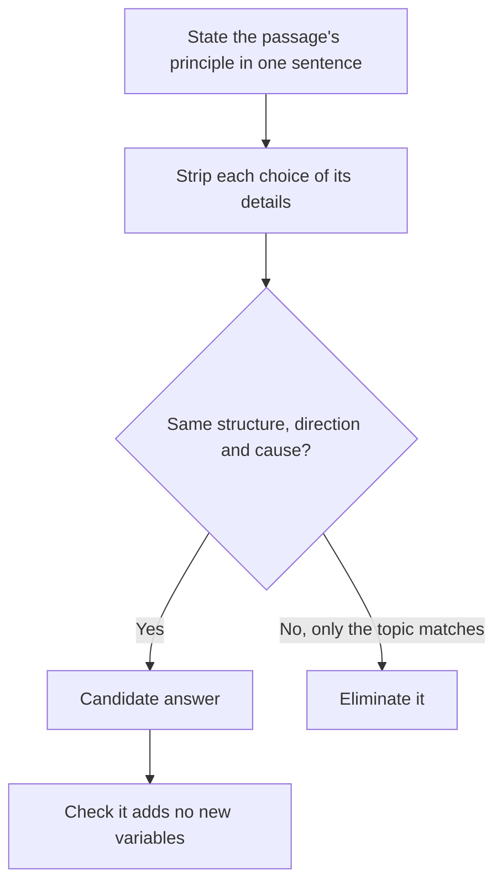

# Application, Analogy, and Author Tone Questions

Some RC questions ask you to take an idea from the passage and **apply it somewhere new**: to a fresh example, to a parallel situation, or to a new piece of evidence. Others ask about the author's **attitude**. These are the questions that feel most like a test of thinking, and they're more common at the higher difficulty levels.

## Application questions

> [!NOTE]
> GMAC doesn't publish a separate "application" question type for Focus Verbal. Prep companies use the label for questions that ask you to apply the passage's idea to a new case, and they are worth practising because the skill (abstracting a principle) also helps with inference and function questions.

An application question gives you a new scenario and asks which one "is most analogous to", "would be an example of", "would most likely be cited by the author as", or "would the author consider to be...". The passage's **principle** is the key.

> [!REMEMBER]
> Don't match the surface topic. Match the **structure** or **principle**. An analogy about bakeries and one about steel mills can be the same analogy.

### The method

1. **Extract the principle** from the passage in a sentence: "X works because Y, but only when Z."
2. **Strip the new scenarios of their details** until you see the underlying pattern.
3. **Pick the choice whose pattern matches**. The topic may be wildly different.
4. **Check the relationships**: who does what to whom, and what's the cause and what's the effect?

### Worked example 1 (Medium)

> In many professions, apprenticeship once passed knowledge from master to learner through years of shared work. Modern formal training, the author argues, delivers the explicit rules of a trade efficiently, but loses the tacit knowledge, the instincts about when to break a rule, that apprentices absorb simply by watching. A surgeon can learn the steps of an operation from a textbook; judging when a patient's tissue "looks wrong" comes only from watching many operations.

The author's argument about tacit knowledge would be best illustrated by which of the following?

(A) A pilot who memorises every emergency procedure but cannot decide which one applies when two alarms sound at once
(B) A chef who follows a recipe exactly and produces a perfect dish
(C) A teacher who is paid more for a degree
(D) A driver who passes a test on the first attempt
(E) A scientist who publishes results in a journal

Show solution

The answer is **(A)**. The principle: explicit rules can be learned from a book; judgment about when and how to apply them comes from experience. The pilot knows the procedures (explicit) but lacks judgment about which applies (tacit).

(B) shows rule-following succeeding. That's the opposite pattern.
(C), (D), (E) have nothing to do with rules versus judgment.

**Trap:** (B). A kitchen is a trade like the surgeon's, so it sounds relevant, but the pattern is wrong: the author claims that rules are *not enough*.

## Analogy questions

An analogy question says: "Which of the following is most similar to the situation the author describes?" Treat it exactly like application, but be more literal about the relationships. Write the relationship in abstract terms:

- "A group initially dismissed a rival, then lost market share to it."
- "A tool designed for one purpose proved more valuable for another."
- "A measure intended to reduce a problem made it worse."

Then test each choice against that abstract sentence. The right choice has the same shape and the same direction.

> [!TRAP]
> Watch for choices that match the **topic** (another company, another medical drug) but flip the relationship. A choice with a "rival that was ignored and then lost" is not the same as a "rival that was ignored and then went bankrupt itself".

## Strengthen and weaken within RC

Some RC stems ask: "Which of the following, if true, would most strengthen/weaken the author's argument?" This is a mini Critical Reasoning question inside a passage. The approach:

1. **Find the author's claim** and the evidence for it. (Use the map.)
2. **Find the gap**: what has to be true for the evidence to support the claim?
3. **Strengthen** by supporting that assumption or ruling out an alternative explanation. **Weaken** by offering an alternative explanation, or by attacking the assumption.
4. **Stay in the passage's world.** The choice should speak directly to the claim under discussion.

### Worked example 2 (Medium-Hard)

> A city introduced a congestion charge on vehicles entering its centre. In the following year, traffic fell by 15 per cent, and the city's transport office credited the charge. Critics note that the same year saw a major road closure at the city's main bridge, which made driving into the centre more difficult for reasons unrelated to the charge.

Which of the following, if true, would most weaken the transport office's claim?

(A) The charge is higher for large vehicles than for ordinary cars.
(B) A neighbouring city with no charge saw traffic fall by 14 per cent over the same year, after a similar bridge closure.
(C) The charge raised more revenue than expected.
(D) A survey found that most drivers disliked the charge.
(E) Public transport use rose by 10 per cent.

Show solution

The answer is **(B)**. It gives a comparison: a city with the closure but without the charge saw almost the same fall. That suggests the closure, not the charge, explains the drop. It's an alternative explanation.

(A) is about how the charge is structured, not about what caused the fall.
(C) is about revenue, not traffic.
(D) is about attitudes, not causes.
(E) would be consistent with the charge working (people switching to buses).

**Trap:** (E). It sounds like a traffic story, but if anything it supports the idea that the charge changed behaviour.

## Author tone and attitude

Tone questions ask "The author's attitude toward X is best described as...". The answer is a short phrase or word pair: *cautiously optimistic, qualified support, skeptical, critical, neutral, ambivalent.*

You find tone through **opinion markers**: adjectives, adverbs and verbs that carry judgment.

- Positive: *compelling, elegant, promising, convincing, valuable, impressive.*
- Negative: *flawed, naive, misleading, unconvincing, overstated, problematic.*
- Hedging: *may, appears, suggests, to some extent, arguably.*
- Neutral reporting: *states, notes, describes, observes.*

### The tone ladder

Think of a ladder from most positive to most negative:

| Rung | Sounds like | Typical wording |
|---|---|---|
| **Enthusiastic / strongly supportive** | The author is clearly on board | "a remarkable achievement", "convincingly shows" |
| **Qualified support** | Mostly agrees, but with a caveat | "a valuable approach, though not without limits" |
| **Cautiously optimistic** | Hopeful about something unproven | "promising, though early evidence is limited" |
| **Neutral / objective** | Reports without judgment | "researchers have proposed...", "the study found..." |
| **Skeptical / doubtful** | Not convinced | "it remains unclear whether...", "the evidence is thin" |
| **Critical** | Actively finds fault | "this reading is mistaken", "a flawed premise" |
| **Dismissive / scornful** | Finds it worthless (very rare on GMAT) | "absurd", "worthless" |

> [!TIP]
> GMAT authors are almost always **measured**. Correct tone answers sit in the middle rungs: *qualified support, cautiously optimistic, skeptical, critical of one aspect*. Answers like "enthusiastic", "scornful", "outraged" or "indifferent" are rarely right.

The tone of the author toward a *particular* subject can differ from the tone of the passage overall. An author may be skeptical of a theory but supportive of its inventor. Always read the question for **toward what**.

### Worked example 3 (Medium-Hard): tone

> Proponents of four-day working weeks point to trials in which productivity held steady while employees reported being happier. These results are encouraging, and it would be churlish to dismiss them. Yet the trials were voluntary, and firms that chose to take part were, almost by definition, those already most confident that the change would suit them. Until the experiment is repeated with a more representative sample of employers, it is premature to conclude that the four-day week would work across the economy.

The author's attitude toward the four-day week trials is best described as

(A) enthusiastic endorsement
(B) qualified appreciation combined with doubt about how far the results generalise
(C) neutral reporting with no evaluation
(D) scornful dismissal
(E) complete indifference

Show solution

The answer is **(B)**. "Encouraging" and "churlish to dismiss" are warm and show appreciation. "Yet" and "premature to conclude" show a limit on how far to trust them.

(A) is too strong: the author refuses to conclude.
(C) ignores the evaluative words (encouraging, churlish, premature).
(D) is the opposite of "it would be churlish to dismiss".
(E) The author clearly cares enough to evaluate.

**Trap:** (A). The first three sentences sound positive. But tone is set by the whole passage, and the closing sentence sets the final rung of the ladder.

### Worked example 4 (Hard): application of a principle

> Biologists use the term "keystone species" for an organism whose effect on its ecosystem is far larger than its numbers would suggest. When sea otters were hunted almost to extinction along the Pacific coast, the sea urchins on which they feed multiplied, and the urchins devoured the kelp forests that had sheltered hundreds of other species. The otters were few, but their removal changed the whole community.

Which of the following is the best example of a keystone species as the author uses the term?

(A) A tree that makes up 60 per cent of the biomass of a forest and provides the bulk of its shade
(B) A rare fungus whose disappearance from a woodland would lead to the decline of several tree species that depend on it, even though the fungus makes up less than 1 per cent of the woodland's living matter
(C) A common grass that provides food for a large number of grazing animals
(D) An invasive insect whose arrival has no effect on the species around it
(E) A bird that migrates thousands of kilometres each year

Show solution

The principle is: *small numbers, large effect when removed.* The otters were few, but removing them reshaped the ecosystem.

The answer is **(B)**: a rare fungus (few) whose disappearance causes major decline elsewhere (large effect).

(A) is a **dominant** species, big in numbers, so the effect matches its numbers.
(C) is also numerous and its importance comes from abundance.
(D) has no effect at all.
(E) is about migration, which is unrelated to the principle.

**Trap:** (A). It's an important species, so it feels like a keystone. But the author's definition requires an effect *disproportionate* to numbers.

## Putting it together: a checklist for application questions

Before choosing an answer, run this quick check:

1. **What is the principle or relationship?** (One sentence.)
2. **Does the choice have the same structure, direction and cause?**
3. **Does the choice stay inside what the passage's logic allows?** (No new variables.)
4. **For tone questions: which rung of the ladder?** (Check the last paragraph.)

Application questions match structure, not topic.

> [!NOTE]
> For strengthen/weaken in RC, the correct answer usually engages with the author's *evidence or assumption*, not with a side issue. If a choice talks about something the author never discusses (cost, public opinion, feelings), be suspicious.

## Quick check

1. A passage argues that "a policy that rewards short-term results will encourage employees to neglect long-term projects." Which scenario fits best: (a) A sales team given a quarterly bonus stops cultivating new clients who will only buy next year; (b) A company hires more staff to meet demand?

Answer

(a). It matches the principle: a short-term reward leads to neglect of long-term work.

2. Where on the tone ladder is "the findings are promising, but only a small sample has been tested"?

Answer

Cautiously optimistic, or qualified support.

3. You're asked to weaken the author's claim that "the new medicine reduced symptoms." Which kind of choice is most useful: a statement about the medicine's cost, or evidence that symptoms improved just as much in a group that took a sugar pill?

Answer

The sugar-pill evidence. It offers an alternative explanation (placebo effect) for the improvement. Cost doesn't affect whether symptoms were reduced.

4. A tone question asks about the author's attitude toward "critics of the theory". The author is supportive of the theory itself. Is the author's tone toward the critics likely to be positive?

Answer

Not necessarily. It's more likely mildly dismissive or at least unconvinced. Always check "toward what?".

## Key takeaways

- Application and analogy questions test **principles**, not topics. Strip the details and match the structure.
- Write the passage's principle or relationship in one abstract sentence before looking at choices.
- Wrong analogies match the topic but reverse the direction, scale or cause.
- Strengthen/weaken inside RC: find the claim, find the gap, and use alternative explanations.
- Tone ladder: enthusiastic, qualified support, cautiously optimistic, neutral, skeptical, critical, dismissive. GMAT answers live mostly in the middle.
- Tone is set by the whole passage, especially the final lines, not just the first sentences.
- Always ask "tone toward what?"

## Go deeper

- [GMAT Club forum](https://gmatclub.com/forum/): browse the RC section for application and tone discussions.
- [Official GMAT exam page](https://www.mba.com/exams/gmat-exam): official description of the Verbal Reasoning section.
