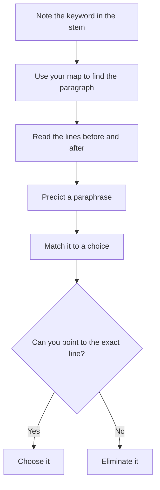

# Detail Questions: "According to the Passage"

Detail questions are the most "answerable" questions in Reading Comprehension: the proof is sitting in the passage. They show up in nearly every passage set. And yet they still catch people, because the wrong choices are designed to look like the text.

## What a detail question is

A detail question asks about something the passage **states directly**. The stems sound like this:

- "According to the passage, which of the following is true of...?"
- "The passage states that X occurred because..."
- "Which of the following does the author cite as a cause of...?"
- "The passage mentions all of the following EXCEPT..."

The right answer is **a paraphrase** of a specific sentence (or two) in the passage. No inference needed. If you find yourself thinking "well, it would make sense that...", you're in the wrong question type.

> [!REMEMBER]
> For a detail question, you must be able to point to the sentence that proves your answer. If you can't point, don't pick.

## The method: go back, find, match

1. **Read the stem and note the keyword** (a name, a concept, a number, a cause).
2. **Use your map** to locate the paragraph. Then scan for the keyword in that paragraph.
3. **Read the lines around it**, at least one sentence before and one after. The answer often hides in a qualification just next door.
4. **Predict** the paraphrase in your own words.
5. **Match** against the choices. The correct answer is a rewording, not a copy.

Detail questions are a go back, find, match job.

> [!TIP]
> The correct answer rarely repeats the passage word for word. If a choice is a near-copy of a sentence in the passage, check carefully that it's attached to the right idea. Test writers love "right words, wrong claim".

## Paraphrase matching

GMAT writers swap words to make the right answer less obvious. Train yourself to see these swaps:

| Passage says | Correct paraphrase might say |
|---|---|
| "a significant decline in output" | "a substantial drop in production" |
| "few investors anticipated the shift" | "most investors failed to predict the change" |
| "the practice persisted despite criticism" | "criticism did not end the practice" |
| "researchers were unable to replicate the result" | "the finding could not be reproduced" |

And these swaps are **wrong paraphrases**, even though they use passage vocabulary:

| Passage says | Distorted version |
|---|---|
| "may have contributed to" | "caused" |
| "some of the participants" | "all of the participants" |
| "the decline began in the 1990s" | "the decline ended in the 1990s" |
| "A was associated with B" | "A caused B" |

## The four traps

1. **Wrong paragraph.** The choice is true, and uses passage words, but concerns a different idea from the one in the question. Always confirm it answers *this* stem.
2. **Distorted wording.** One word is changed (some to all, may to does, increase to decrease) so the sentence no longer matches.
3. **Outside knowledge.** The statement is true in real life, but the passage never says it. On the GMAT, if it's not in the text, it's not an answer.
4. **Reversed relationship.** Cause and effect swapped, or the two views swapped between the groups that hold them.

> [!TRAP]
> "EXCEPT" and "NOT" questions. Four of the choices are *in* the passage, one is not. People often forget the twist halfway through and pick the first true statement. Write "4 true, 1 false" on your note board when you see EXCEPT.

## A model passage

> The cheetah's reputation as the fastest land animal is well deserved, but the speed comes at a price. Running at over 100 kilometres per hour generates so much body heat that a cheetah must stop after roughly 20 to 30 seconds, or risk collapse. Researchers once believed that the animal's chief limitation was its lungs. Measurements of oxygen use, however, have shown that cheetahs breathe no harder than many slower predators during a chase; the true constraint appears to be thermal.
>
> The consequences for hunting are significant. Cheetahs succeed in roughly half of their chases, a higher rate than lions, but they often lose their kills to larger predators before they have had time to eat. After a sprint, a cheetah may need up to half an hour to cool down. During that time, hyenas and lions frequently arrive and take the carcass. Biologists have therefore suggested that cheetah populations are limited less by their ability to catch prey than by their ability to keep it.

### Worked example 1 (Easy)

According to the passage, researchers who once believed the cheetah's lungs were its chief limitation have since been shown to be

(A) correct, since cheetahs cannot sustain a chase longer than 30 seconds
(B) mistaken, because cheetahs' oxygen use during a chase is similar to that of many slower predators
(C) mistaken, because cheetahs have unusually large lungs
(D) correct, because cheetahs must cool down after a sprint
(E) mistaken, because cheetahs rarely overheat

Show solution

The answer is **(B)**. Paragraph 1: "Measurements of oxygen use, however, have shown that cheetahs breathe no harder than many slower predators... the true constraint appears to be thermal." (B) paraphrases it.

(A) and (D) say the researchers were *correct*, but the "however" shows they were not. The 30-second limit is real, but it is caused by heat.
(C) invents a lung-size claim.
(E) is the opposite: overheating is the constraint.

**Trap:** (A) and (D). They contain true facts from the passage but attach them to the wrong conclusion.

### Worked example 2 (Medium)

According to the passage, why do cheetahs frequently fail to benefit from successful hunts?

(A) They succeed in too few of their chases.
(B) They are slower than lions and hyenas.
(C) Larger predators often take the kill while the cheetah is cooling down.
(D) They stop hunting after 20 to 30 seconds.
(E) They cannot digest large carcasses quickly.

Show solution

The answer is **(C)**. Paragraph 2: "After a sprint, a cheetah may need up to half an hour to cool down. During that time, hyenas and lions frequently arrive and take the carcass."

(A) contradicts the text: roughly half of the chases succeed, a higher rate than lions.
(B) The passage says cheetahs are the fastest land animal, and doesn't compare speed with hyenas.
(D) confuses the length of a sprint with the failure to eat.
(E) is outside the passage.

**Trap:** (D). It uses the "20 to 30 seconds" number and sounds like a limitation, but it explains why the chase ends, not why the kill is lost.

### Worked example 3 (Medium-Hard)

Which of the following is NOT mentioned in the passage as a factor affecting a cheetah's hunting success?

(A) The time the animal needs to cool down after a sprint
(B) The arrival of hyenas and lions
(C) The animal's body heat during a high-speed chase
(D) The density of vegetation in the cheetah's habitat
(E) The proportion of chases that end in a catch

Show solution

The answer is **(D)**. Vegetation appears nowhere in the passage. (A) is in paragraph 2, (B) is in paragraph 2, (C) is in paragraph 1 and (E) is in paragraph 2 ("roughly half of their chases").

**Trap:** Choosing a choice that is "obviously true" in real life. For EXCEPT questions, check each choice against the text, not against what you know.

### Worked example 4 (Hard)

> A growing number of retailers now offer "subscribe and save" plans, in which customers receive regular deliveries of everyday items at a discount. Industry analysts initially predicted that the discount would be the plans' main attraction, and indeed early surveys showed that price was the most common reason customers gave for signing up. But retailers' own data tell a subtler story. Customers who stay on a plan for more than a year are, on average, just as price-sensitive as those who leave; what separates them is that they rarely reorder from competitors, even when a rival's product is cheaper.
>
> One interpretation is that the plans create a habit: once a household has stopped thinking about running out of an item, the effort of switching brands is not worth the saving. Retailers, however, caution that the sample comes only from customers who did not cancel in the first month, and so may not represent subscribers generally.

According to the passage, which of the following distinguishes subscribers who stay for more than a year from those who leave?

(A) They are less sensitive to price than those who leave.
(B) They joined because of the discount.
(C) They seldom buy the product from competing retailers.
(D) They received larger discounts.
(E) They cancelled in the first month and later returned.

Show solution

The answer is **(C)**. Paragraph 1: "what separates them is that they rarely reorder from competitors, even when a rival's product is cheaper."

(A) is contradicted: long-term subscribers are "on average, just as price-sensitive" as those who leave.
(B) is true of many subscribers (price was the most common reason for signing up), but it doesn't *distinguish* long-stayers from leavers.
(D) The passage says nothing about different discount sizes.
(E) distorts the retailers' caution: the sample excludes people who cancelled in the first month.

**Trap:** (B). Early surveys are mentioned right next to the key sentence, so people grab the nearby claim. The stem asks about what *separates* the two groups, and (B) applies to both.

## Dealing with numbers and lists

When the passage gives numbers, lists or sequences, detail questions often test them:

- **Numbers:** check units and direction (growth *rate* versus growth *amount*; "fell from 12 to 8" versus "fell by 12").
- **Lists:** if the passage lists three causes, the question may ask for "a" cause. Any one of them can be correct. If the question says "the primary cause", only the one the author calls primary counts.
- **Sequences:** "before", "after", "as a result" are testable. Re-read the order.

> [!SHORTCUT]
> Underline (mentally) the qualifier in the question: "some", "most", "primarily", "only", "at least". The right answer will respect that exact qualifier, and wrong answers often shift it.

## Quick check

1. The passage says "the policy may have contributed to a rise in unemployment." Which paraphrase is acceptable: "The policy caused unemployment" or "The policy possibly played a role in higher unemployment"?

Answer

The second. "Caused" removes the uncertainty in "may have contributed".

2. The passage says "Some critics of the film praised its photography." Which paraphrase is acceptable: "The critics praised the photography" or "At least a few critics praised the photography"?

Answer

The second. "The critics" implies all of them.

3. You see "All of the following are mentioned in the passage EXCEPT". You've found four choices in the text. What does that tell you?

Answer

You can stop. The fifth choice, which you haven't found, is the answer. Still skim it once to be sure it's not secretly present in the passage.

4. A choice is true in real life but never mentioned in the passage. Do you pick it for a detail question?

Answer

No. Detail questions test what the passage says, not what you know.

## Key takeaways

- A detail answer is a **paraphrase of a specific line**. You must be able to point to the line.
- Use your map to locate the paragraph, then read the lines on **both sides** of the keyword.
- Predict the answer in your own words before reading the choices.
- Wrong choices: wrong paragraph, distorted wording, outside knowledge, reversed relationships.
- Guard the qualifiers: some versus all, may versus does, associated with versus caused.
- On EXCEPT questions, verify four choices in the text; the fifth is the answer.
- Never answer from memory.

## Go deeper

- [GMAT Club forum](https://gmatclub.com/forum/): browse the Reading Comprehension section for worked detail questions and paraphrase discussions.
- [Official GMAT exam page](https://www.mba.com/exams/gmat-exam): official Verbal section description.
