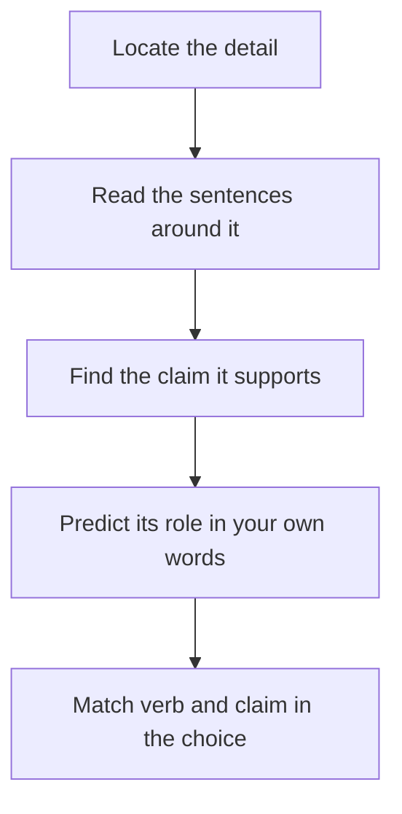

# Function and Structure Questions

"Why does the author mention the example of the Roman aqueduct?" These questions ask not **what** the passage says, but **why** it says it. They are quietly one of the most frequent question types in Reading Comprehension, and they reward anyone who has built a good passage map.

## What function questions ask

A function question gives you a detail (a word, an example, a quotation, a whole paragraph) and asks for its **role** in the passage. Typical stems:

- "The author mentions the 2008 crisis primarily in order to..."
- "The second paragraph serves primarily to..."
- "Which of the following best describes the function of the sentence beginning 'Yet...'?"
- "Which of the following best describes the organisation of the passage?"
- "The author's reference to X is intended to..."

The answer choices start with verbs: *illustrate, support, contrast, qualify, introduce, rebut, concede, provide background, anticipate an objection.*

> [!REMEMBER]
> A function answer is about **purpose in the argument**, not about the content of the detail. Two different passages can mention the same fact for opposite reasons.

## The roles a detail can play

| Role | What it looks like | Signal words |
|---|---|---|
| **Illustrate / exemplify** | A specific case for a general claim | for example, consider, such as |
| **Support / provide evidence** | Data, a study, an expert | studies show, according to |
| **Contrast / counter** | A case that goes against a view | however, by contrast, yet |
| **Concede / qualify** | The author admits a limit | admittedly, to be sure, though |
| **Give background** | Sets the scene for the debate | historically, traditionally |
| **Introduce a term or concept** | Defines something needed later | called, known as, termed |
| **Raise an objection and rebut it** | A critic's view, then the author's reply | some might argue... but |
| **Propose a solution** | Offers an answer to a stated problem | a more promising approach |

## The method

1. **Locate the detail** in the passage (use the line or the reference in the stem).
2. **Read the sentence before it and the sentence after it.** The function lives in the **context**.
3. **Ask "what claim is this serving?"** Find the claim nearby: the point the author wants you to accept.
4. **Predict the role** in your own words: "to show that X isn't enough", "to give an example of Y".
5. **Match** to the choice that has the correct verb **and** the correct claim.

Function questions ask why, so follow the claim being served.

> [!TIP]
> A trick for example questions: find the **general claim** the example supports and see if the answer choice mentions it. The right answer for "Why does the author mention the aqueduct?" is nearly always "to illustrate [the general point made just before]".

## Paragraph role and structure questions

For "the second paragraph serves to...", your map is your best friend. A paragraph's job is usually one of:

- **Introduce** the topic or debate.
- **Develop** the main point with evidence or examples.
- **Present a counterview** or complication.
- **Resolve** or conclude.

For "how is the passage organised?", describe the passage in order, using a verb for each part. A good structure answer might read: "A traditional view is presented, evidence against it is offered, and an alternative is proposed". Compare each choice with your map in order. A wrong answer often scrambles the order, or describes parts the passage does not contain (such as "a historical timeline" when there isn't one).

> [!TRAP]
> Wrong function answers often describe **what the detail says** rather than **what it does**. "To show that the aqueduct was 50 km long" is a content statement. "To illustrate how ancient engineers managed water over long distances" is a function statement. Always choose the function.

## Other traps

1. **Right verb, wrong target.** "To criticise the theory" when the example actually supports the theory.
2. **Zoomed-in function.** The answer describes the function of the sentence in isolation and ignores the larger claim.
3. **Reversed role.** The detail is a concession (it helps the *other side* a little), but the answer says it supports the author's view.
4. **Scope inflation.** "To prove that..." when the detail merely suggests.

## A model passage

> Debates about remote work often assume that physical proximity is essential for creativity. The assumption is deeply rooted: anyone who has worked in a busy office can recall a hallway conversation that produced a good idea. A recent study of 1,200 research scientists, however, complicates this picture. The study found that scientists who collaborated mainly through video calls and shared documents produced as many patents as colleagues who shared a building, though their patents were somewhat less likely to combine ideas from different fields.
>
> The authors suggest an explanation. In-person settings, they argue, create chance encounters between people from different disciplines. Remote tools, by contrast, tend to connect people who already know what they are looking for. This does not mean that remote work damages innovation; it means that the *kind* of innovation may shift. Companies that want cross-disciplinary breakthroughs, then, might deliberately engineer encounters for their remote staff, for instance through short rotating "virtual lunches" in which people from different teams are paired at random.

### Worked example 1 (Easy)

The author mentions "a hallway conversation that produced a good idea" in order to

(A) prove that remote work harms creativity
(B) show why the assumption about proximity feels natural
(C) describe the main finding of the study of scientists
(D) argue that offices should be redesigned
(E) criticise people who prefer working in offices

Show solution

The answer is **(B)**. The sentence is in support of "The assumption is deeply rooted": it shows why the idea about proximity seems intuitively right, before the author complicates it with "however".

(A) is too strong, and opposite to the passage's overall view that remote work does not damage innovation.
(C) is a content mix-up: the study is introduced later.
(D) There's no recommendation about redesigning offices.
(E) The tone toward the assumption is respectful ("deeply rooted"), not critical of office workers.

**Trap:** (A). The anecdote supports the pro-proximity view, which the author then challenges. It is a concession, not the author's claim.

### Worked example 2 (Medium)

The "virtual lunches" in the last sentence are mentioned primarily to

(A) illustrate a way companies could recreate the chance encounters that remote work lacks
(B) provide evidence that remote scientists produce fewer patents
(C) show that in-person meetings are unnecessary
(D) suggest that scientists prefer informal conversations
(E) describe how the study was conducted

Show solution

The answer is **(A)**. The general claim just before is that companies might "deliberately engineer encounters", and the introduced phrase "for instance" marks the virtual lunches as an example of that.

(B) The study's result was that patent numbers were similar, not fewer.
(C) is stronger than the author's claim, which concerns cross-disciplinary ideas only.
(D) The preference of scientists isn't discussed.
(E) The lunches are a suggestion, not part of the study.

**Trap:** (C). It captures a mood ("remote can work") but loses the actual job of the example.

### Worked example 3 (Medium-Hard): paragraph role

In the passage above, the second paragraph serves primarily to

(A) restate the finding of the study in different words
(B) offer an interpretation of the study's finding and draw a practical implication
(C) cast doubt on the study's methods
(D) give a historical account of remote working
(E) present an objection to the authors' explanation and rebut it

Show solution

The answer is **(B)**. Paragraph 2 begins "The authors suggest an explanation" (interpretation) and ends with what companies "might deliberately" do (implication).

(A) The paragraph adds an explanation, it doesn't restate.
(C) No methodological criticism appears.
(D) There's no history.
(E) The paragraph includes no objection. "This does not mean that remote work damages innovation" is a clarification, not a rebuttal of an objection raised by someone else.

**Trap:** (E). The sentence "This does not mean that..." looks like a rebuttal, but it's the author heading off a misreading, not answering a stated critic.

### Worked example 4 (Hard): structure

> Most accounts of the 1991 liberalisation of the Indian economy emphasise the foreign-exchange crisis that preceded it. The crisis was real: reserves had fallen to the equivalent of about three weeks of imports. But to treat it as the sole cause is to ignore the longer intellectual shift that made reform thinkable. Through the 1980s, a small group of economists inside the government had been questioning the licensing system, and several had quietly drafted proposals that were ready when the crisis arrived.
>
> Critics of this view point out that the draft proposals had been circulating for years without effect. This is fair, but it misses the point. The crisis supplied the political opportunity; the earlier work supplied the content. Reform needed both, and neither alone would have produced the policies actually adopted.

Which of the following best describes the organisation of the passage?

(A) A widely accepted explanation is described, qualified, supplemented with an additional factor, and defended against an objection.
(B) A historical event is narrated in chronological order, and its consequences are then evaluated.
(C) Two explanations are compared and the less convincing one is rejected.
(D) A theory is proposed, tested against evidence and then abandoned.
(E) An economic policy is described, criticised and then replaced by a better alternative.

Show solution

The answer is **(A)**. Walk through the map: P1 states the common view (crisis), concedes it's real ("The crisis was real"), then adds the intellectual shift ("But..."). P2 raises an objection ("Critics...") and defends the author's view ("This is fair, but it misses the point").

(B) The passage isn't chronological narration, and consequences of reform aren't evaluated.
(C) The author doesn't reject the crisis explanation. The author keeps it and supplements it.
(D) The author doesn't abandon anything.
(E) The passage isn't about replacing a policy.

**Trap:** (C). Many people read "to treat it as the sole cause is to ignore..." as rejecting the crisis view. In fact the author keeps it as one of two necessary factors.

## Function of a word or phrase

Occasionally you'll be asked why the author uses quotation marks, italics or a particular phrase. Quotation marks around a term usually mean one of three things: the term is **someone else's label** ("the so-called 'miracle'"), it's **used in an unusual sense**, or the author is **distancing** from it. Read the context to decide which.

> [!NOTE]
> Don't over-read. A phrase like "of course" usually signals a concession. A phrase like "it is often said" usually signals a view the author is about to qualify.

## Quick check

1. The author writes "Consider the case of Lagos" and spends five lines on Lagos's traffic. What is the likely function?

Answer

To illustrate a general claim made just before (probably about urban congestion). Check the sentence before "Consider".

2. A paragraph begins "Admittedly, the evidence is not conclusive." What role does the sentence play?

Answer

A concession or qualification. The author admits a limit, which is often followed by a "but" that returns to the main argument.

3. Which is a better answer to "Why does the author mention the 2008 crisis?": "to describe the year banks failed" or "to show that earlier warnings were ignored"?

Answer

The second, if the passage's surrounding claim is about ignored warnings. The first describes content, the second describes function.

4. How do you test a structure choice that has five parts when your map has three?

Answer

Be suspicious. Choices that include parts the passage doesn't contain (such as a "historical timeline" or "recommendation") are almost always wrong.

## Key takeaways

- Function questions ask **why**, not **what**. Choose the answer that describes the role.
- The function is found in the **context**: read the sentences before and after.
- Find the general claim the detail supports. The right answer links the two.
- Know the common roles: illustrate, support, contrast, concede, give background, introduce, rebut, propose.
- For paragraph and structure questions, compare each choice against your map in order.
- Avoid answers that merely restate the content of the detail.
- Be careful with concessions: they help the other side a little but the author still holds the main view.

## Go deeper

- [GMAT Club forum](https://gmatclub.com/forum/): look for Reading Comprehension threads on "function" and "structure" questions.
- [Official GMAT exam page](https://www.mba.com/exams/gmat-exam): official information on the Verbal section.
