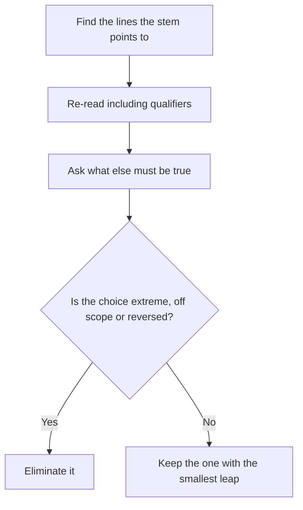

# Inference Questions in Reading Comprehension

Inference questions ask you to go **one small step** beyond what the passage says. They're among the most common RC question types on the GMAT Focus, and the ones that feel the most "slippery". The trick is learning exactly how small the step is.

## What an inference question is

An inference is something that **must be true, or is very strongly supported**, given the passage. It is not something that would be nice to be true, or that is probably true in real life.

Typical stems:

- "The passage suggests that..."
- "It can be inferred from the passage that..."
- "The author would most likely agree with which of the following?"
- "Which of the following is most strongly supported by the passage?"
- "The passage implies that..."

> [!REMEMBER]
> A correct inference is **a short, safe step** from the text. Think "this has to follow", not "this could be so".

## How inferences differ from details

A detail answer restates the passage. An inference answer **combines or extends** what's said, but only by a hair. For example, if the passage says "Every one of the plant's suppliers is located within 50 km of the factory", then a valid inference is "The plant has no supplier more than 50 km away", or "Transport costs for supplies are probably low" (a mild step), but **not** "the plant is more profitable than its competitors".

| If the passage says... | A good inference | A bad inference |
|---|---|---|
| "Only trained auditors may sign off the accounts." | "An untrained person cannot sign off the accounts." | "All auditors are trained to the same standard." |
| "Sales rose in every quarter except the third." | "Sales in the third quarter did not rise." | "Sales fell in the third quarter." (it might have stayed flat) |
| "Before the merger, the company had never turned a profit." | "The company turned its first profit after the merger or not at all." | "The merger caused the profit." |

Notice the second row: "did not rise" is safe, but "fell" is a step too far, because the text allows a flat quarter.

## The method

1. **Identify the question as an inference** and note the paragraph or idea referred to.
2. **Re-read the relevant lines**, including qualifiers and contrasts.
3. **Ask**: "If this is true, what else must be true?" Predict loosely.
4. **Eliminate** choices that are: too extreme, outside the scope, reversed, or merely plausible.
5. **Choose the choice with the smallest leap.**

Inference questions reward the smallest step from the text.

> [!TIP]
> When two choices both seem plausible, choose the **weaker, more qualified** one. GMAT inference answers tend to say "some", "may", "at least", "likely". They are hard to argue with. Wrong ones say "all", "never", "always", "the most" and "proves".

## "Suggests", "implies", "most likely agree"

Slight differences in the wording of the stem:

- **"The passage suggests/implies..."** The author doesn't say it outright, but the text points to it.
- **"The author would most likely agree..."** Your answer must fit the author's stated attitude and logic. You're predicting an opinion, so look at tone.
- **"Most strongly supported by the passage"** The strongest evidence wins. More than one choice may be partly supported, so rank them.
- **"Which of the following can be inferred about [group]?"** Read how the passage describes that group, line by line.

## The traps

1. **Extreme answer.** Words like "always", "never", "all", "only", "completely", "the most" push a reasonable idea beyond what the text supports.
2. **Outside knowledge.** A sensible statement that the passage does not touch.
3. **Reversed logic.** The passage says A leads to B; the choice says B leads to A.
4. **Plausible but unsupported.** It might be true, but nothing in the passage says so. If the evidence isn't there, the answer isn't there.
5. **Mixing the two views.** The choice gives the second view's conclusion to the first group, or vice versa.

> [!TRAP]
> The most dangerous wrong answer is the one that is **reasonable**. You'll think "yes, that makes sense". Ask instead: "Where in the passage does it say so?" If you can only reach it by adding an assumption of your own, it's wrong.

## A model passage

> When the Tamil Nadu coastal village of Pazhaverkadu introduced shared fishing quotas in 2011, most outside observers expected conflict. Fishing communities elsewhere in South Asia had seen quotas breed resentment, with families accusing neighbours of exceeding their limits. In Pazhaverkadu, however, a decade of data show that catches stayed within the agreed total in every season but one, and the exception was a cyclone year.
>
> Researchers credit a feature of the scheme that is easy to overlook: the quotas were allocated not to individuals but to boat crews, and each crew was responsible for reporting its own catch to a village council that included crew members from every boat. Because every crew had a representative on the council, members could see how any rule-breaking would affect the shared total. The researchers do not claim that this design would work everywhere. Pazhaverkadu is small, and its families have fished together for generations.

### Worked example 1 (Easy)

The passage suggests that the quota scheme at Pazhaverkadu

(A) was imposed on the village by outside observers
(B) worked in part because those affected by rule-breaking could see its effect
(C) will certainly work in larger fishing communities
(D) was less effective than quotas in other South Asian villages
(E) reduced the number of fishing boats in the village

Show solution

The answer is **(B)**. Paragraph 2: "Because every crew had a representative on the council, members could see how any rule-breaking would affect the shared total." Researchers "credit" the design, so "worked in part" is safe.

(A) Outside observers *expected* conflict; nothing says they imposed the scheme.
(C) "Certainly" is an extreme word, and the researchers say it may not work everywhere.
(D) The passage says conflicts occurred elsewhere, not that other schemes were more effective.
(E) Boats are mentioned, but a reduction in their number is not.

**Trap:** (C). It's the optimistic, general conclusion, but the author warns against it.

### Worked example 2 (Medium)

It can be inferred from the passage that the cyclone year was

(A) a season in which catches exceeded the agreed total
(B) the only season in which the council met
(C) a year in which the quotas were suspended
(D) a year in which crews did not report their catches
(E) the first year of the scheme

Show solution

The answer is **(A)**. The passage says catches stayed within the total "in every season but one, and the exception was a cyclone year". So in the cyclone season, catches did *not* stay within the total, which means they exceeded it.

(B), (C), (D) and (E) are unsupported by the text. They are plausible stories (a cyclone might disrupt reporting), but the passage doesn't mention any.

**Trap:** (D) or (C). A good story you've invented is not an inference.

### Worked example 3 (Medium-Hard): "the author would most likely agree"

Which of the following would the author most likely agree with?

(A) Shared quotas are preferable to individual quotas in all fishing communities.
(B) The success of a quota scheme may depend on features of the community that uses it.
(C) Outside observers are generally poor judges of fishing policy.
(D) Cyclones are the main threat to sustainable fishing in South Asia.
(E) Village councils are more effective than national governments at managing resources.

Show solution

The answer is **(B)**. The final sentences say the researchers don't claim the design would work everywhere, because the village is small and its families have long fished together. That is exactly "success may depend on community features".

(A) "In all" is extreme.
(C) The observers' prediction proved wrong in one case, which doesn't establish that they are "generally poor judges".
(D) The cyclone is mentioned once, and no claim is made about threats in the region.
(E) Compares councils to national governments, which the passage never does.

**Trap:** (A). It extends the success story to every community, the very leap the author refuses to make.

### Worked example 4 (Hard)

> Economists have long observed that wages for the same job vary widely between firms, even after adjusting for workers' education and experience. The standard explanation is that more productive firms pay more. But a recent study of Portuguese manufacturers suggests that this accounts for only part of the gap. When workers moved from low-paying to high-paying firms, their wages rose, but by about half the difference between the two firms' average pay. The researchers interpret this to mean that roughly half of the apparent pay premium at high-paying firms reflects the kind of worker those firms already employ, rather than anything the firm does.
>
> The finding is important, but it should be treated with caution. The study covers only workers who changed jobs, and people who move may differ from people who stay. If movers are, for instance, more willing to accept pay cuts for better prospects, the estimate of the firm's effect could be biased in either direction.

The passage suggests which of the following about the study's estimate that roughly half of the pay premium reflects worker characteristics?

(A) It is likely to be too high.
(B) It is likely to be too low.
(C) It may be inaccurate, though the direction of any error is uncertain.
(D) It has been confirmed by a second study of workers who stayed in their jobs.
(E) It applies to every industry.

Show solution

The answer is **(C)**. The last sentence says the bias could go "in either direction", so the estimate may be off in an unknown direction.

(A) and (B) each pick a direction that the author specifically refuses to pick.
(D) invents a second study.
(E) The study covers Portuguese manufacturers, and nothing is said about all industries.

**Trap:** (A) or (B). People are drawn to a decisive "likely" answer. But the author's caution ("either direction") is the only thing the passage supports.

## Calibrating the size of the step

Here's a good habit: for each inference choice, ask two questions.

1. **Does the passage give me at least one sentence that supports this?**
2. **Could the passage be true while this is false?** If yes, the choice is not an inference. It's a guess.

A true inference passes both tests. A choice that passes the first but fails the second is a *plausible extension*, and is wrong.

> [!NOTE]
> On "most strongly supported" questions the wording allows for "very likely" rather than "must be true". In those, the correct choice is the one the passage supports most, even if a sceptic could poke a hole. Pick the best of five, not a perfect one.

## Quick check

1. A passage says "None of the committee's members had served on a board before". Is "All of the committee's members were inexperienced in business" a valid inference?

Answer

No. Not having served on a board is narrower than "inexperienced in business". They might have run companies.

2. A passage says "Prices rose in most regions." Is "Prices fell in some regions" a valid inference?

Answer

No. In the remaining regions prices could simply have stayed flat. The safe inference is weaker: prices did not rise in some regions, or at least cannot be said to have risen everywhere.

3. Which is more likely to be a correct inference: "This may suggest that..." or "This proves that..."?

Answer

"May suggest". The qualified version is much safer.

4. For "the author would most likely agree", what part of the passage should you reread besides the relevant paragraph?

Answer

The author's tone and evaluative words (and the last paragraph), because you are predicting an opinion.

## Key takeaways

- A correct inference is **one small step** from the text; it must follow, not merely seem plausible.
- Qualified answers ("may", "some", "at least") beat absolute ones ("all", "never", "only").
- Check every choice against the text: can you point to the supporting sentence?
- Ask "could the passage be true and the choice false?" If yes, eliminate.
- Watch for reversed logic, outside knowledge and reasonable-sounding unsupported ideas.
- For "author would agree", use tone and the final paragraph as well as the details.
- The passage owns the truth. What you know about the world doesn't count.

## Go deeper

- [GMAT Club forum](https://gmatclub.com/forum/): search "RC inference" for discussions about how big the step should be.
- [Official GMAT exam page](https://www.mba.com/exams/gmat-exam): official information about the Verbal Reasoning section.
